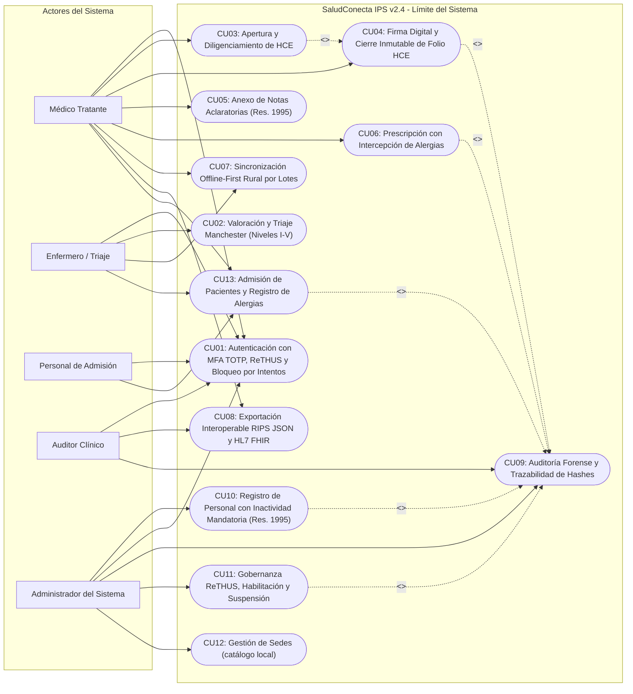
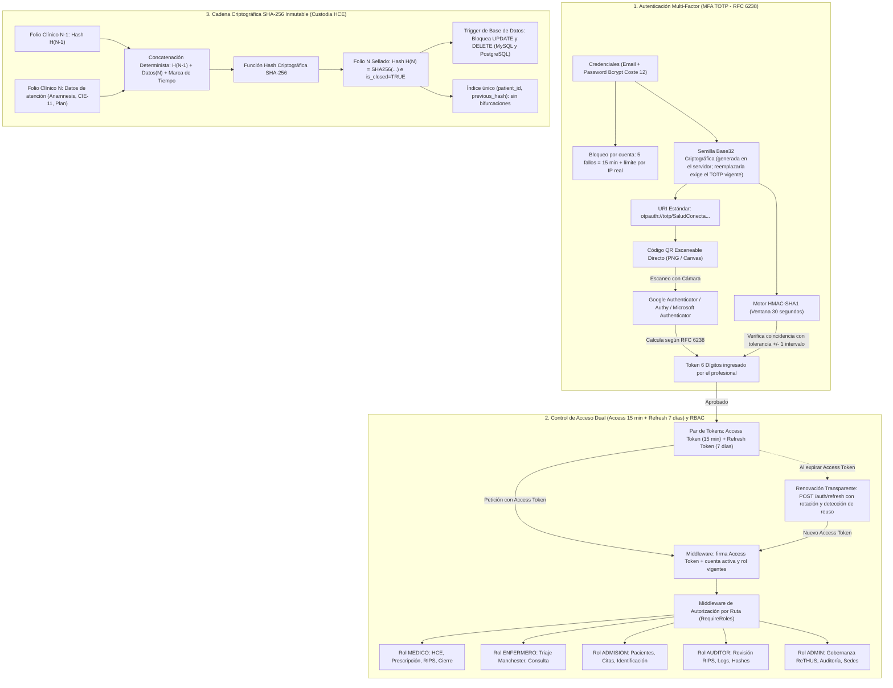
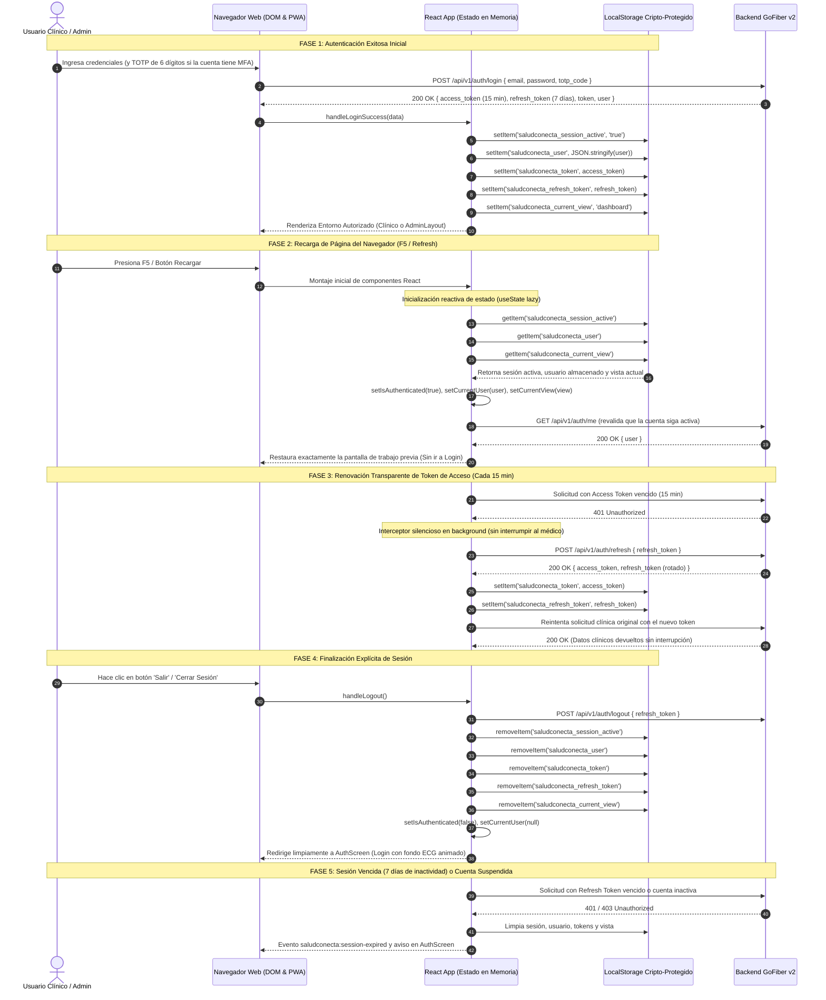

# Corporación de Estudios Tecnológicos del Norte del Valle (COTECNOVA)

## Ingeniería de Sistemas - Ingeniería de Software II

### Periodo Académico: 2026-2 | Docente: Felipe Gutiérrez Isaza

### Proyecto Final: Sistema Clínico Hospitalario «SaludConecta IPS v2.4»

---

## 1. Descripción del Proyecto y Arquitectura Técnica

«SaludConecta IPS v2.4» es una plataforma de software hospitalario de misión crítica diseñada para gestionar procesos asistenciales y de gobernanza médica bajo los más altos estándares de fiabilidad, seguridad y rendimiento: admisión de pacientes y registro de alergias, triaje estructurado bajo el protocolo internacional de Manchester, Historia Clínica Electrónica (HCE) con sellado criptográfico inmutable (Resolución 1995 de 1999 de MinSalud), prescripción médica con intercepción de alergias farmacológicas en tiempo real (< 150 ms, con cruce por familia farmacológica: una alergia a penicilina bloquea amoxicilina), interoperabilidad normativa mediante RIPS JSON (Resolución 2275 de 2023) y HL7 FHIR Release 4, y un módulo integral de **Gobernanza de Personal Asistencial ReTHUS y Panel Administrativo Desacoplado** (Ley 1581 de 2012 e ISO/IEC 25010).

### Stack Tecnológico

- **Backend:** Go 1.22+ estructurado bajo **Arquitectura Hexagonal Estricta (Puertos y Adaptadores)** utilizando el framework web de alto desempeño **GoFiber (v2.52.16)**. Incluye migración automática e idempotente de esquema (`adapters/storage/mysql/seeder.go` y `adapters/storage/postgres/schema.sql`), configuración que falla de forma explícita ante valores inseguros (`pkg/config`) y creación del administrador inicial únicamente con credenciales definidas por el operador (sin cuentas ni claves por defecto).
- **Frontend:** React 18 (Vite 5, Tailwind CSS 3, Lucide Icons, arquitectura modular de componentes accesibles y soporte PWA para atención offline en brigadas rurales). Diseñado bajo el sistema de diseño asistencial oficial de Stitch (Proyecto ID: `3409750822053339349`), con separación estricta entre la interfaz clínica asistencial y el entorno administrativo de gobernanza (`AdminLayout`).
- **Persistencia de Datos:** MySQL 8.0+ relacional con motor InnoDB, integridad referencial estricta, disparadores SQL de inmutabilidad (folios cerrados y notas aclaratorias), índice único que impide bifurcar la cadena SHA-256, adaptador PostgreSQL con esquema y disparadores equivalentes, y un adaptador en memoria no persistente solo para pruebas, que se activa únicamente con `DB_DRIVER=memory`.
- **Estándar de Calidad:** Evaluado, asegurado y documentado bajo el estándar internacional **ISO/IEC 25010** y lineamientos de seguridad **OWASP ASVS Nivel 2**.

---

## 2. Integrantes y Asignación de Roles del Equipo

| Nombre del Integrante                                  | Rol Asignado                           | Responsabilidades Principales                                                                                                   |
| :----------------------------------------------------- | :------------------------------------- | :------------------------------------------------------------------------------------------------------------------------------ |
| **Santiago Vélez**                                     | Líder Técnico / Arquitecto de Software | Diseño de arquitectura hexagonal, definición de puertos y adaptadores, gobernanza ReTHUS, coordinación Go/Fiber y persistencia. |
| **Santiago Arcos**                                     | Responsable de Pruebas (QA / Testing)  | Diseño de casos de prueba aplicando partición de equivalencia y valores límite, automatización de suites en Go y React.         |
| **Juan José Sánchez**                                  | Responsable de Calidad (ISO/IEC 25010) | Evaluación de características de calidad ISO 25010, bitácora de defectos (DEF-01 a DEF-04) y verificación de seguridad.         |
| **Santiago Vélez, Santiago Arcos y Juan José Sánchez** | Responsables de Documentación          | Elaboración de especificaciones formales de requisitos, marco normativo (Res. 1995 / 2275), criterios BDD y manuales técnicos.  |

### Persona de Pruebas Clínicas

Los casos de prueba clínicos se modelan con el **Dr. Santiago Vélez** (Medicina de Urgencias, Cartago - Hospital Central, Tarjeta Profesional ReTHUS de ejemplo `RM-94821-VALLE`). Por seguridad el sistema **no siembra cuentas con credenciales conocidas**: el Administrador inicial se define con `ADMIN_INITIAL_EMAIL` y `ADMIN_INITIAL_PASSWORD` y es quien registra al facultativo desde el panel administrativo (la cuenta nace inactiva hasta la verificación ReTHUS).

---

## 3. Gestión del Proyecto en Trello

El flujo de trabajo, la priorización de requisitos y el ciclo de vida del desarrollo se gestionaron mediante el tablero oficial de Trello:

- [Tablero de Trello del Equipo](https://trello.com/b/HUUP8uyu/proyecto-de-felipe)

### Organización de las Listas Operativas:

1. **Por hacer (Backlog):** Requisitos funcionales (RF01 a RF12) priorizados mediante técnica MoSCoW, diseño de modelos de dominio y contratos de interfaces.
2. **En curso (In Progress):** Módulos y adaptadores en desarrollo activo (handlers HTTP, repositorios MySQL/Postgres y componentes de interfaz de usuario).
3. **En revisión (In Review / Code Review):** Inspección de código estricta, análisis estático con `go vet` y verificación de desacoplamiento de capas según la Arquitectura Hexagonal.
4. **Hecho (Done):** Incrementos de software con pruebas automatizadas aprobadas (100% pass), sin defectos críticos abiertos y con trazabilidad documental completa.

---

## 4. Requisitos del Sistema

### 4.1. Requisitos Funcionales (Priorización MoSCoW)

| Código   | Nombre del Requisito                                   | Descripción Detallada                                                                                                                                                                                                                                                                                       | Prioridad MoSCoW |
| :------- | :----------------------------------------------------- | :---------------------------------------------------------------------------------------------------------------------------------------------------------------------------------------------------------------------------------------------------------------------------------------------------------- | :--------------- |
| **RF01** | Autenticación, MFA y Esquema Dual de Tokens | Control de acceso por roles (MEDICO, ENFERMERO, ADMISION, AUDITOR, ADMIN) mediante esquema dual de tokens JWT (HS256) con Access Token de 15 minutos y Refresh Token de 7 días con rotación automática y detección de reuso conforme a OWASP ASVS v4. Firma con `JWT_SECRET` obligatorio de al menos 32 caracteres y MFA TOTP (RFC 6238) con QR escaneable. El código TOTP se valida siempre en el servidor. Reemplazar o retirar un segundo factor activo exige el código vigente. Tras 5 intentos fallidos la cuenta se bloquea 15 minutos y las rutas de verificación tienen además un límite por IP real del cliente. En cada solicitud se revalida que la cuenta siga activa: suspender a un usuario revoca sus tokens de inmediato y el rol efectivo es el almacenado, no el declarado en el token. Renovación transparente en segundo plano vía `POST /auth/refresh` sin interrumpir la atención médica. | **Must Have** |
| **RF02** | Triaje Manchester y Guardia Fisiológica | Semaforización automática en 5 niveles calculada **siempre en el servidor** a partir de Glasgow, SpO2, FC, FR, PAS/PAD y temperatura (incluidas hipotermia e hipertermia: 30 °C es NIVEL_II, nunca NIVEL_V). Rangos plausibles: Glasgow 3-15, SpO2 0-100, FC 1-300, FR 1-80, PAS 1-300, PAD 1-200 y temperatura 20-45 °C (HTTP 422 fuera de rango). El cliente solo puede escalar a un nivel más urgente; un nivel fuera del catálogo o menos urgente que el clínico se rechaza. | **Must Have** |
| **RF03** | HCE e Inmutabilidad Absoluta | Registro de atención clínica con bloqueo de modificación post-cierre: un folio firmado no se reabre ni se reemplaza (tampoco al reenviar un lote de sincronización) y cualquier mutación se rechaza y está protegida por triggers a nivel de base de datos (MySQL y PostgreSQL), incluidas las notas aclaratorias, que son solo de anexo. Solo el médico autor del folio puede firmarlo o anexar notas (HTTP 403 en otro caso) (Resolución 1995 de 1999). | **Must Have** |
| **RF04** | Cadena Criptográfica SHA-256 | Hash SHA-256 encadenado que incorpora el hash del folio previo del paciente. La cabeza de la cadena es el último eslabón no referenciado; un índice único (paciente, hash previo) y un bloqueo por paciente con reintento impiden bifurcaciones cuando se cierran folios simultáneamente. La hora de cierre se sella con precisión de segundos para que lo firmado coincida con lo persistido y la verificación de integridad no falle. | **Must Have** |
| **RF05** | Intercepción Farmacológica de Alergias | Cruce en tiempo real entre los principios activos del medicamento (activo y genérico) y los antecedentes alérgicos del paciente **del folio** (nunca el paciente declarado por el cliente), sin distinguir mayúsculas ni tildes y por familia farmacológica: penicilina bloquea amoxicilina; también betalactámicos, cefalosporinas, AINE, quinolonas, macrólidos y sulfonamidas. Respuesta < 150 ms. Solo el autor del folio puede prescribir sobre él. | **Must Have** |
| **RF06** | Sincronización Offline-First Rural | Consolidación por lotes idempotentes con UUID v4 de folios capturados en brigadas rurales. El autor de cada folio es el médico autenticado; el hash previo y el hash los calcula el servidor y los encadena al historial del paciente; reenviar un lote nunca modifica un folio cerrado. El lote es atómico y se reintenta ante conflicto de cadena. | **Should Have** |
| **RF07** | Gobernanza de Personal y Habilitación ReTHUS           | Registro de personal exclusivo del Administrador, donde toda cuenta ingresa obligatoriamente inactiva (`is_active = FALSE`). Validación mandatoria de Tarjeta Profesional ReTHUS para roles médicos y de enfermería (Res. 1995/1999). Activación y suspensión controlada mediante auditoría forense inmutable.                 | **Must Have**    |
| **RF08** | Panel de Control Administrativo Desacoplado            | Entorno exclusivo para rol `ADMIN` (`AdminLayout`) aislado absolutamente de historias clínicas y consultas (Ley 1581 de 2012). Módulos de gobernanza de personal, bitácora forense de solo lectura alimentada por la API (inicios de sesión, mutaciones y lecturas de datos clínicos con usuario, rol, IP y Correlation-ID) y catálogo local de sedes. Los usuarios, estados y la bitácora provienen exclusivamente del servidor: si el backend falla o rechaza una operación se muestra el error real y nunca un éxito simulado.                                     | **Must Have**    |
| **RF09** | Perfil Asistencial y Administrativo con Alto Contraste | Perfil estilo red social con colección de 5 banners temáticos (Pediatría, Farmacia, Urgencias, Cirugía, Cardiología), carga reactiva de foto de perfil y encapsulación de identidad en un óvalo protector de alta luminosidad (`bg-white/95`) que garantiza contraste WCAG AAA sobre cualquier fondo.       | **Must Have**    |
| **RF10** | Menú Lateral Colapsable y Persistencia de Sesión F5    | Sidebar asistencial con modo colapsable (`w-20`) centrado exclusivamente en íconos con tooltips y margen reactivo (`ml-20`/`ml-64`). Persistencia local del estado de autenticación y vista activa que previene el cierre de sesión ante eventos de recarga del navegador (F5).                             | **Must Have**    |
| **RF11** | Admisión de Pacientes y Antecedentes Alérgicos | API de admisión (`POST /patients`, listado y búsqueda por documento) y registro de alergias (`POST /patients/:id/allergies`) para los roles ADMISION, ENFERMERO y MEDICO, con validación de catálogos (tipo de documento, sexo, grupo sanguíneo, afiliación y severidad) y rechazo de documentos duplicados (HTTP 409). | **Must Have** |
| **RF12** | Catálogo Farmacológico y Prescripción | Consulta del catálogo CUM institucional con stock (`GET /medications?q=`). El catálogo inicial de demostración usa códigos `CUM-DEMO-xxx` y debe sustituirse por la carga oficial del INVIMA. La prescripción descuenta inventario y rechaza stock insuficiente (HTTP 409). | **Should Have** |

### 4.2. Requisitos No Funcionales (RNF)

| Código    | Criterio de Calidad                            | Descripción y Métrica de Aceptación                                                                                                                                                                                              |
| :-------- | :--------------------------------------------- | :------------------------------------------------------------------------------------------------------------------------------------------------------------------------------------------------------------------------------- |
| **RNF01** | Latencia de Respuesta (Eficiencia)             | El percentil 95 (p95) de la latencia en operaciones de lectura y emisión de prescripciones debe ser inferior a 400 ms bajo concurrencia asistencial estándar.                                                                    |
| **RNF02** | Trazabilidad y Auditoría Forense               | Cada petición debe portar y propagar un encabezado `X-Correlation-ID` único (UUID v4). Las operaciones de mutación quedan persistidas en bitácora inalterable con IP, marca de tiempo UTC y actor institucional (ISO/IEC 27001). |
| **RNF03** | Seguridad en Aplicaciones (OWASP ASVS Nivel 2) | Esquema dual de tokens (Access Token 15 min / Refresh Token 7 días) con rotación automática (Refresh Token Rotation) y detección de reuso fraudulento, protección contra inyección SQL mediante sentencias preparadas, hashing de contraseñas con Bcrypt (coste 12), revocación inmediata de sesiones de cuentas suspendidas, bloqueo por cuenta tras 5 intentos fallidos, limitación de tasa por IP real del cliente (cabecera `X-Real-IP` solo desde proxies de confianza) y sanitización de cabeceras CORS. |
| **RNF04** | Inmutabilidad Criptográfica de Datos           | Toda modificación física a folios cerrados debe ser prevenida tanto en la capa de aplicación como en el motor de base de datos relacional mediante disparadores `BEFORE UPDATE` y `BEFORE DELETE`.                               |
| **RNF05** | Resiliencia y Disponibilidad en Zonas Rurales  | Operación asistencial autónoma en ausencia de conexión a internet mediante almacenamiento local PWA y resolución determinista de duplicados al sincronizar con la sede central.                                                  |
| **RNF06** | Configuración y Persistencia a Prueba de Fallos | El servicio no arranca sin `JWT_SECRET` seguro (mínimo 32 caracteres, distinto de cualquier valor publicado) y, si el motor de base de datos configurado no responde, termina con error: nunca conmuta en silencio a memoria, porque los registros clínicos se perderían al reiniciar. |
| **RNF07** | Gestión de Secretos | Ningún secreto ni cuenta por defecto en el código, el `docker-compose.yml` o la documentación. Las credenciales se definen en un `.env` privado y `docker compose` se detiene si faltan. Las plantillas `.env.example` solo contienen marcadores genéricos. |
| **RNF08** | Consistencia bajo Concurrencia | Los repositorios devuelven copias y protegen su estado con candados (verificable con `go test -race`); los cierres simultáneos del mismo paciente forman una cadena lineal; los lotes de sincronización son atómicos. |

---

## 5. Arquitectura del Sistema y Diagramas UML

Los diagramas técnicos del sistema han sido modelados en sintaxis Mermaid y pre-compilados en alta resolución (`.png` a escala 2x con fondo sólido blanco y `.svg` vectoriales) en el directorio `docs/diagrams/`:

### 5.1. Diagrama de Casos de Uso del Sistema (UML)

Representa los límites del sistema «SaludConecta IPS v2.4», los actores involucrados (Médico Tratante, Enfermero, Personal de Admisión, Auditor y Administrador) y los 13 casos de uso esenciales:




- Archivo fuente: [`docs/diagrams/01_casos_de_uso.mmd`](docs/diagrams/01_casos_de_uso.mmd)
- Imagen de alta resolución: [`docs/diagrams/01_casos_de_uso.png`](docs/diagrams/01_casos_de_uso.png) | Vectorial: [`docs/diagrams/01_casos_de_uso.svg`](docs/diagrams/01_casos_de_uso.svg)

---

### 5.2. Diagrama de Arquitectura Hexagonal y Flujo Integral (Go + React)

Ilustra la separación estricta entre la capa de presentación web (React 18 PWA y AdminLayout), los adaptadores primarios HTTP (GoFiber con AuthHandler, AdminHandler, PatientHandler y demás controladores), los puertos de entrada, los servicios puros de dominio (AuthService, AdminService, PatientService, ClinicalRecordService, TriageService, PrescriptionService, SyncService), los puertos de salida y los adaptadores secundarios (MySQL con migración idempotente, PostgreSQL, Memoria solo para pruebas, RIPS y FHIR):




- Archivo fuente: [`docs/diagrams/07_seguridad_mfa_sha256.mmd`](docs/diagrams/07_seguridad_mfa_sha256.mmd)
- Imagen de alta resolución: [`docs/diagrams/07_seguridad_mfa_sha256.png`](docs/diagrams/07_seguridad_mfa_sha256.png) | Vectorial: [`docs/diagrams/07_seguridad_mfa_sha256.svg`](docs/diagrams/07_seguridad_mfa_sha256.svg)

---

### 5.6. Diagrama de Sincronización Offline-First para Brigadas Rurales

Describe la recolección desconectada en dispositivos asistenciales PWA, la generación de claves idempotentes UUID v4 y la consolidación por lotes en el backend central GoFiber. El servidor ignora la autoría y los hashes que declare el cliente: el autor es el médico autenticado, el hash previo y el hash se calculan y encadenan en el servidor, y los folios ya cerrados nunca se modifican al reenviar un lote:


- Archivo fuente: [`docs/diagrams/08_flujo_sync_rural_offline.mmd`](docs/diagrams/08_flujo_sync_rural_offline.mmd)
- Imagen de alta resolución: [`docs/diagrams/08_flujo_sync_rural_offline.png`](docs/diagrams/08_flujo_sync_rural_offline.png) | Vectorial: [`docs/diagrams/08_flujo_sync_rural_offline.svg`](docs/diagrams/08_flujo_sync_rural_offline.svg)

---

### 5.7. Diagrama de Secuencia: Registro y Gobernanza ReTHUS de Personal Asistencial

Detalla el ciclo completo de registro de personal (exclusivo del Administrador), imposición de inactividad obligatoria (`is_active = FALSE`), bloqueo preventivo de sesión, inspección y cotejo de habilitación ReTHUS por el Administrador TI en el `AdminLayout`, activación formal con traza de auditoría forense y suspensión con revocación inmediata de los tokens vigentes (Resolución 1995 de 1999 y Ley 1581 de 2012):




- Archivo fuente: [`docs/diagrams/12_persistencia_sesion_f5.mmd`](docs/diagrams/12_persistencia_sesion_f5.mmd)
- Imagen de alta resolución: [`docs/diagrams/12_persistencia_sesion_f5.png`](docs/diagrams/12_persistencia_sesion_f5.png) | Vectorial: [`docs/diagrams/12_persistencia_sesion_f5.svg`](docs/diagrams/12_persistencia_sesion_f5.svg)

---

## 6. Estructura Exacta del Repositorio

```text
proyecto-final/
├── README.md                      # Presentación institucional, requisitos, arquitectura y diagramas
├── docker-compose.yml             # Orquestación Multi-Contenedor (MySQL 8, Go API, React + Nginx)
├── .dockerignore                  # Reglas de exclusión para contextos de construcción Docker
├── .gitignore                     # Exclusión estricta de credenciales, binarios y artefactos temporales
├── .env.example                   # Plantilla de variables para docker compose (marcadores genéricos; copiar como .env)
├── go.work                        # Workspace de Go para coordinación multi-módulo
├── docs/
│   ├── especificacion.md          # Alcance formal, RF (MoSCoW), RNF y Criterios BDD (Gherkin)
│   ├── plan-de-pruebas.md         # Partición de equivalencia, valores límite y matriz RTM
│   ├── informe-calidad.md         # ISO/IEC 25010, bitácora de defectos técnicos y refactorización
│   ├── diagrams/                  # Diagramas técnicos compilados (Mermaid, PNG 2x y SVG)
│   │   ├── 01_casos_de_uso.png (.svg / .mmd)
│   │   ├── 02_arquitectura_hexagonal.png (.svg / .mmd)
│   │   ├── 03_modelo_entidad_relacion.png (.svg / .mmd)
│   │   ├── 04_secuencia_triaje.png (.svg / .mmd)
│   │   ├── 05_secuencia_hce_inmutabilidad.png (.svg / .mmd)
│   │   ├── 06_secuencia_prescripcion_alergias.png (.svg / .mmd)
│   │   ├── 07_seguridad_mfa_sha256.png (.svg / .mmd)
│   │   ├── 08_flujo_sync_rural_offline.png (.svg / .mmd)
│   │   ├── 09_secuencia_gobernanza_rethus.png (.svg / .mmd)
│   │   ├── 10_arquitectura_rbac_aislamiento_admin.png (.svg / .mmd)
│   │   ├── 11_arquitectura_contenedores_docker.png (.svg / .mmd)
│   │   └── 12_persistencia_sesion_f5.png (.svg / .mmd)
│   ├── multimedia/                # Recursos audiovisuales institucionales
│   │   └── medicina.mp4           # Video institucional de referencia (no se usa en la aplicación)
│   └── stitch_designs/            # Maquetas visuales y capturas oficiales de Stitch
│       ├── 01_auth_mfa.html (.png)
│       ├── 02_dashboard_espera.html (.png)
│       ├── 03_historia_clinica_hce.html (.png)
│       ├── 04_triaje_manchester.html (.png)
│       └── 05_prescripcion_alergia.html (.png)
├── src/
│   ├── backend/                   # Código fuente Go + Fiber (Arquitectura Hexagonal)
│   │   ├── Dockerfile             # Multi-stage build Go 1.22+ y Alpine Linux de producción
│   │   ├── .dockerignore          # Exclusiones de contexto para build del backend
│   │   ├── cmd/api/main.go        # Punto de entrada e inyección de dependencias
│   │   ├── core/                  # Dominio puro, puertos y lógica de casos de uso
│   │   │   ├── domain/            # Entidades de negocio (User, Patient, Triage, Record, Prescription, Audit)
│   │   │   ├── ports/             # Contratos de interfaces (Driving y Driven)
│   │   │   └── services/          # Casos de uso: Auth, Admin, Patient, ClinicalRecord, Triage, Prescription, Sync, bootstrap del administrador y bloqueo por intentos
│   │   ├── adapters/              # Adaptadores de entrada y salida
│   │   │   ├── http/              # Handlers Fiber, DTOs y middlewares (JWT, RBAC)
│   │   │   │   ├── handlers/      # Auth, Admin, Patient, Triage, ClinicalRecord, Prescription y Sync
│   │   │   │   ├── middlewares/   # Auth (JWT + sesión vigente), RBAC, RateLimit (global y de autenticación), Audit
│   │   │   │   └── router.go      # Registro de rutas y control de acceso
│   │   │   ├── storage/           # Implementaciones MySQL, PostgreSQL y memoria
│   │   │   │   ├── mysql/         # Adaptador MySQL y migración idempotente (seeder.go)
│   │   │   │   ├── catalog/       # Catálogo farmacológico de demostración (CUM-DEMO)
│   │   │   │   ├── memory/        # Adaptador en memoria (solo pruebas y desarrollo, sin cuentas precargadas)
│   │   │   │   └── postgres/      # Adaptador PostgreSQL, schema.sql con triggers y migrate.go
│   │   │   └── interoperability/  # Generador RIPS JSON y mapeador HL7 FHIR
│   │   ├── database/schema.sql    # DDL relacional, índices y triggers SQL de inmutabilidad
│   │   ├── pkg/                   # Utilidades transversales (config validada, crypto, logger estructurado)
│   │   ├── go.mod                 # Módulo de Go del backend
│   │   └── go.sum                 # Sumas criptográficas de dependencias Go
│   └── frontend/                  # Código fuente de React 18 (Vite 5 + Tailwind CSS 3)
│       ├── Dockerfile             # Multi-stage build Node 20 + Nginx Alpine
│       ├── nginx.conf             # Servidor Nginx con proxy inverso `/api/` y SPA routing
│       ├── .dockerignore          # Exclusiones de contexto para build del frontend
│       ├── index.html             # Plantilla HTML5 accesible
│       ├── package.json           # Dependencias y scripts de ejecución/pruebas
│       ├── postcss.config.js      # Configuración de PostCSS
│       ├── tailwind.config.js     # Tokens clínicos y extensiones de diseño
│       ├── vite.config.js         # Configuración de Vite y enrutamiento de tests
│       ├── README.md              # Documentación detallada del cliente web
│       └── src/
│           ├── main.jsx           # Montaje raíz en el DOM
│           ├── App.jsx            # Enrutador asistencial/administrativo, persistencia F5 y sidebar
│           ├── index.css          # Estilos globales y capas de Tailwind
│           ├── setupTests.js      # Extensiones jest-dom para pruebas Vitest
│           ├── components/        # Componentes reutilizables
│           │   ├── Header.jsx     # Barra superior, búsqueda de pacientes, toggle menú y perfil
│           │   ├── Sidebar.jsx    # Menú asistencial colapsable (`w-20` / `w-64`) y widget SHA-256
│           │   ├── AllergyAlertModal.jsx # Modal crítico ante contraindicaciones (datos del servidor)
│           │   ├── PatientPicker.jsx # Selector de paciente por documento o listado
│           │   ├── PatientRegisterModal.jsx # Admisión de pacientes y registro de alergias
│           │   ├── PatientBanner.jsx / AllergyBanner.jsx # Cabecera del paciente y alergias reales
│           │   ├── SignFolioModal.jsx # Confirmación de firma y cierre de folio
│           │   ├── MfaQrModal.jsx # Modal con QR escaneable en Google Authenticator/Authy
│           │   ├── AdminRegisterModal.jsx # Registro de Administradores de Centros de Salud (Rol ADMIN, activación y QR exclusivo)
│           │   └── StaffRegisterModal.jsx # Modal de registro de personal (perfil admin) con validación ReTHUS
│           ├── screens/           # Pantallas asistenciales (Stitch Design System)
│           │   ├── AuthScreen.jsx # Acceso, sede, fondo animado con pulso ECG y QR directo
│           │   ├── DashboardScreen.jsx # Indicadores KPI y sala de espera Manchester
│           │   ├── TriageScreen.jsx    # Captura de constantes y escala Glasgow
│           │   ├── HceScreen.jsx  # Historia clínica, pestañas y sellado inmutable
│           │   ├── PrescriptionScreen.jsx # Prescripción e intercepción farmacológica
│           │   ├── ProfileScreen.jsx   # Perfil asistencial, 5 banners y óvalo de alto contraste
│           │   ├── SecurityMfaScreen.jsx  # Configuración MFA contra la API (setup con código vigente y enable)
│           │   └── admin/         # Entorno administrativo desacoplado
│           │       ├── AdminLayout.jsx # Layout exclusivo de administración y aislamiento RBAC
│           │       └── AdminDashboardScreen.jsx # Gobernanza ReTHUS, bitácora real y sedes
│           ├── services/
│           │   └── api.js         # Cliente API estricto: los errores del servidor llegan a la interfaz, sin simulaciones
│           └── utils/
│               ├── totp.js        # TOTP RFC 6238 (Web Crypto o HMAC-SHA1 puro) y generador QR
│               └── clinical.js    # Mapeo de errores HTTP, fechas y utilidades clínicas de interfaz
└── tests/
    ├── backend/                   # Pruebas automatizadas en Go
    │   ├── triage_test.go / triage_security_test.go # Partición de equivalencia, límites, hipotermia y nivel del cliente
    │   ├── clinical_record_test.go # Verificación de inmutabilidad y bloqueo de edición
    │   ├── clinical_chain_test.go # Autor del folio, cadena lineal concurrente, sincronización segura
    │   ├── prescription_test.go / prescription_security_test.go # Alergias por familia, tildes, paciente del folio y carreras de stock
    │   ├── sync_test.go           # Sincronización offline por lotes e idempotencia
    │   ├── admin_governance_test.go # Registro, inactividad y habilitación ReTHUS
    │   ├── staff_register_routes_test.go # Rutas de administración y RBAC
    │   ├── auth_security_test.go  # Revocación de sesión, MFA, bloqueo, bootstrap, JWT_SECRET e IP tras proxy
    │   ├── patient_api_test.go    # API de admisión de pacientes y alergias
    │   ├── mysql_integration_test.go # Contra MySQL real (etiqueta `integration`)
    │   ├── fixtures_test.go       # Generadores de datos de prueba institucionales
    │   ├── go.mod                 # Módulo de pruebas de Go
    │   └── go.sum                 # Sumas criptográficas del módulo de pruebas
    └── frontend/                  # Pruebas automatizadas en React (Vitest + Testing Library)
        ├── AllergyAlertModal.test.jsx # Modal ante alergias
        ├── totp.test.js           # TOTP RFC 6238 (vectores oficiales, con y sin Web Crypto)
        ├── AdminGovernance.test.jsx # Panel de gobernanza con errores reales del servidor
        ├── AuthMfa.test.jsx       # Login con MFA, bloqueo, sesión expirada y configuración MFA
        ├── ClinicalScreens.test.jsx # HCE, prescripción y triaje contra la API
        ├── PatientFlow.test.jsx   # Selección y registro de pacientes
        ├── DoctorLayout.test.jsx  # Sidebar colapsable, header y perfil
        └── helpers/mockApi.js     # Enrutador de fetch simulado para las pruebas
```

---

## 7. Guía de Instalación y Despliegue

### 7.1. Despliegue Rápido con Docker Compose (Recomendado para el Equipo)

Para que cualquier miembro del equipo de desarrollo o evaluación pueda ejecutar la plataforma completa en su máquina sin necesidad de configurar Go, Node ni MySQL de forma manual:

1. **Requisitos:**
   - Tener instalado [Docker Desktop](https://www.docker.com/products/docker-desktop/) en ejecución.

2. **Definir las variables privadas:**
   Copia `.env.example` como `.env` en la raíz y completa `DB_ROOT_PASSWORD`, `DB_PASSWORD`, `JWT_SECRET` (mínimo 32 caracteres aleatorios), `ADMIN_INITIAL_EMAIL` y `ADMIN_INITIAL_PASSWORD`. Sin estas variables `docker compose` se detiene a propósito y el repositorio no incluye credenciales por defecto.

3. **Iniciar la Plataforma Completa:**
   Desde la raíz del repositorio, ejecuta:

   ```bash
   docker compose up --build
   ```

   _Docker construirá y orquestará automáticamente tres contenedores interconectados:_
   - `saludconecta-mysql`: Base de datos MySQL 8.0 con migración DDL automática (`schema.sql`) y volumen persistente.
   - `saludconecta-backend`: API en Go 1.22+ (GoFiber v2) compilada en binario estático sobre Alpine Linux con migración idempotente.
   - `saludconecta-frontend`: React PWA + Vite servido a través de Nginx Alpine con proxy inverso integrado hacia `/api/`.

4. **Acceso al Sistema:**
   - Abre tu navegador web en: **[http://localhost:5173](http://localhost:5173)** (o alternativamente en `http://localhost`).
   - Inicia sesión con el Administrador definido en `ADMIN_INITIAL_EMAIL` / `ADMIN_INITIAL_PASSWORD` y registra desde el panel al resto del personal.
   - La API del backend queda disponible solo en el equipo local: `http://localhost:8080/api/v1/health`.

5. **Detener el Entorno:**
   ```bash
   docker compose down
   ```

---

### 7.2. Puesta en Marcha Local Tradicional (Sin Docker)

Si prefieres ejecutar los componentes de forma nativa en tu entorno de desarrollo local:

#### 7.2.1. Configuración de la Base de Datos (MySQL)

1. Conéctate a tu motor local de MySQL e importa el esquema DDL y los disparadores de auditoría:

   ```sql
   CREATE DATABASE IF NOT EXISTS saludconecta_db CHARACTER SET utf8mb4 COLLATE utf8mb4_unicode_ci;
   USE saludconecta_db;
   SOURCE src/backend/database/schema.sql;
   ```

2. Configura las variables de entorno para el backend creando el archivo `.env` en `src/backend/` tomando como base `.env.example`.

#### 7.2.2. Migración Idempotente y Administrador Inicial (`adapters/storage/mysql/seeder.go`)

Al iniciar el servidor en Go, el sistema ejecuta automáticamente la función `Migrate(db *sql.DB)`:

- Comprueba y crea dinámicamente las columnas de habilitación profesional en la tabla `users` (`document_type`, `document_number`, `phone`, `specialty`, `branch`).
- Crea el índice único `uq_cr_patient_chain (patient_id, previous_hash)` que impide bifurcar la cadena SHA-256 de un paciente cuando se cierran dos folios en simultáneo.
- Instala, si faltan, los disparadores de inmutabilidad de folios cerrados y de notas aclaratorias (en PostgreSQL el esquema equivalente se aplica desde `adapters/storage/postgres/schema.sql`).
- Carga el catálogo farmacológico inicial de demostración (códigos `CUM-DEMO-xxx`, que deben sustituirse por la carga oficial del INVIMA).

**No se siembran cuentas con credenciales conocidas.** El Administrador inicial se crea solo si no existe ninguno y únicamente cuando el operador define `ADMIN_INITIAL_EMAIL` y `ADMIN_INITIAL_PASSWORD` (mínimo 12 caracteres) en su `.env`. El resto del personal lo registra ese Administrador desde el panel (la cuenta nace inactiva hasta la verificación ReTHUS).

**`JWT_SECRET` es obligatorio** (mínimo 32 caracteres aleatorios, sin valores publicados): sin él el servicio no arranca. Si el motor de base de datos configurado no responde, el servicio termina con error y **no** conmuta a memoria, para no perder registros clínicos.

#### 7.2.3. Puesta en Marcha del Backend (Go)

Desde la terminal en la raíz del proyecto:

```powershell
cd src/backend
go run cmd/api/main.go
```

_El servicio HTTP de GoFiber iniciará escuchando en el puerto configurado (por defecto `http://localhost:8080`)._

> **Nota para pruebas en memoria:** Para ejecutar el backend sin MySQL, defina `DB_DRIVER=memory` de forma explícita (por ejemplo `$env:DB_DRIVER="memory"; go run cmd/api/main.go`). Es un modo no persistente exclusivo de desarrollo: no precarga cuentas, por lo que debe definir `ADMIN_INITIAL_EMAIL` y `ADMIN_INITIAL_PASSWORD` para crear el Administrador.

#### 7.2.4. Puesta en Marcha del Frontend (React)

```powershell
cd src/frontend
npm install
npm run dev
```

_El servidor de desarrollo Vite servirá la aplicación en `http://localhost:5173` con proxy inverso automático `/api` hacia el backend GoFiber._

---

## 8. Variables de Entorno de Muestra (`.env.example`)

Siguiendo la política de protección de infraestructura sensible (Regla 27), todas las credenciales y puertos reales se mantienen confidenciales mediante máscaras genéricas:

| Variable                 | Descripción                                               | Valor de Muestra                              |
| :----------------------- | :-------------------------------------------------------- | :-------------------------------------------- |
| `PORT`                   | Puerto de escucha del servicio HTTP GoFiber               | `8080`                                        |
| `DB_DRIVER`              | Adaptador de persistencia (`mysql`, `postgres`, `memory`) | `mysql`                                       |
| `DB_HOST`                | Host del motor de base de datos relacional                | `localhost`                                   |
| `DB_PORT`                | Puerto del motor de base de datos                         | `3306`                                        |
| `DB_USER`                | Usuario de conexión con permisos DDL/DML                  | `root`                                        |
| `DB_PASSWORD`            | Clave de acceso a la base de datos                        | `secret_password`                             |
| `DB_NAME`                | Nombre de la base de datos clínica                        | `saludconecta_db`                             |
| `JWT_SECRET`             | Obligatoria: firma de tokens HS256 (mínimo 32 caracteres aleatorios; el servicio no arranca sin ella) | `defina_un_secreto_aleatorio_de_32_o_mas` |
| `JWT_ACCESS_TTL_MINUTES` | Vigencia del Access Token de corta duración (por defecto 15 minutos) | `15` |
| `JWT_REFRESH_TTL_HOURS`  | Vigencia del Refresh Token rotado de larga duración (por defecto 7 días) | `168` |
| `CORS_ALLOWED_ORIGINS`   | Orígenes web autorizados para consumo de la API           | `http://localhost:5173,http://localhost:5174` |
| `ADMIN_INITIAL_EMAIL`    | Correo del administrador inicial (se crea solo si no hay ninguno) | `admin@su-institucion.example`        |
| `ADMIN_INITIAL_PASSWORD` | Clave inicial para inicialización automática              | `defina_una_clave_privada_larga`              |
| `IPS_NIT`                | NIT de la institución prestadora de salud                 | `900123456`                                   |
| `TRUSTED_PROXIES`        | IPs/CIDR del proxy inverso cuya cabecera `X-Real-IP` se acepta como IP del cliente | `127.0.0.1,::1,10.0.0.0/8,172.16.0.0/12,192.168.0.0/16` |
| `DB_ROOT_PASSWORD`       | Solo `docker compose`: clave root de MySQL                | `defina_una_clave_privada`                    |
| `COD_PRESTADOR`          | Código de habilitación MinSalud (12 dígitos)              | `110010999901`                                |

---

## 9. Documentación Técnica Complementaria

Para consultar el detalle extendido de la ingeniería del proyecto, accede a los documentos técnicos en el directorio `docs/`:

1. [Especificación de Requisitos de Software (`docs/especificacion.md`)](docs/especificacion.md):
   - Marco regulatorio: Resolución 1995 de 1999 (HCE), Resolución 2275 de 2023 (RIPS) y Ley 1581 de 2012 (Habeas Data).
   - Requisitos Funcionales (RF01 a RF12) y No Funcionales (RNF01 a RNF08); el detalle vigente de cada uno está en la sección 4 de este README.
   - Escenarios de aceptación formales en formato BDD (Dado-Cuando-Entonces / Gherkin).

2. [Plan de Pruebas y Técnicas de Diseño (`docs/plan-de-pruebas.md`)](docs/plan-de-pruebas.md):
   - Partición de Equivalencia y Análisis de Valores Límite (Escala de Glasgow [3, 15], Frecuencia Cardíaca, Presión Arterial y Dosificación Pediátrica).
   - Matriz de Trazabilidad de Requisitos (RTM).

3. [Informe de Calidad ISO/IEC 25010 (`docs/informe-calidad.md`)](docs/informe-calidad.md):
   - Evaluación de las características esenciales de calidad de software y seguridad OWASP.
   - Bitácora de defectos técnicos registrados durante el ciclo de vida (DEF-01 a DEF-04) y, en la sección 12 de este README, el registro de la auditoría de seguridad (25 defectos corregidos).
   - Medidas de mantenimiento preventivo y refactorizaciones implementadas.

4. [Guía del Cliente Web y Arquitectura Frontend (`src/frontend/README.md`)](src/frontend/README.md):
   - Arquitectura React 18, Vite 5, Tailwind CSS y Lucide Icons.
   - Catálogo de pantallas basado en el diseño Stitch y soporte de operación offline.

---

## 10. Referencia de la API REST

Base: `/api/v1`. Todas las rutas, salvo `GET /health` y `POST /auth/login`, exigen `Authorization: Bearer <jwt>` y verifican en cada solicitud que la cuenta siga activa. Los errores tienen la forma `{ "error": "...", "correlation_id": "..." }` con el código HTTP real. Los JSON de entidades usan claves `snake_case`.

| Módulo | Ruta | Roles | Notas |
| :----- | :--- | :---- | :---- |
| Salud | `GET /health` | Público | Estado del servicio |
| Auth | `POST /auth/login` | Público | `{email, password, totp_code?}`; 401 con `mfa_required` si falta el TOTP; 403 cuenta inactiva; 429 tras 5 intentos fallidos |
| Auth | `GET /auth/me` | Autenticado | Revalida la sesión y retorna el usuario vigente |
| Auth | `POST /auth/mfa/setup` | Autenticado | `{current_code?}` (obligatorio si ya hay MFA activo); retorna `secret` y `otpauth_uri` |
| Auth | `POST /auth/mfa/enable` | Autenticado | `{code}` confirma el segundo factor |
| Admin | `GET /admin/users`, `POST /admin/users`, `PATCH /admin/users/:id/status`, `GET /admin/audit-logs` | ADMIN | Registro (nace inactivo), habilitación/suspensión y bitácora real |
| Pacientes | `POST /patients`, `GET /patients`, `GET /patients/lookup`, `GET /patients/:id` | ADMISION, ENFERMERO, MEDICO | Admisión, listado y búsqueda por documento; 409 si el documento existe |
| Pacientes | `POST /patients/:id/allergies`, `GET /patients/:id/allergies` | ADMISION, ENFERMERO, MEDICO | Severidad: LEVE, MODERADA o SEVERA |
| Triaje | `POST /triage`, `GET /triage`, `GET /triage/:id`, `PATCH /triage/:id/status` | ENFERMERO, MEDICO | El nivel Manchester lo calcula el servidor |
| HCE | `POST /clinical-records`, `POST /clinical-records/:id/close`, `POST /clinical-records/:id/clarifications` | MEDICO (autor del folio) | 403 si el médico no es el autor; 409 si ya está cerrado |
| HCE | `GET /clinical-records/:id`, `GET /clinical-records/patient/:patient_id` | MEDICO | Lecturas registradas en la bitácora |
| HCE | `GET /clinical-records/:id/verify`, `/rips`, `/fhir` | MEDICO, AUDITOR | Integridad SHA-256 y exportación RIPS / HL7 FHIR |
| Medicamentos | `GET /medications?q=` | MEDICO | Catálogo con stock (máximo 50) |
| Prescripción | `POST /prescriptions`, `GET /prescriptions/:id`, `GET /prescriptions/record/:record_id` | MEDICO | 422 con `allergy_conflict` ante alergia; 409 stock o paciente distinto del folio; 403 si no es el autor |
| Sincronización | `POST /sync/batch` | MEDICO | Idempotente; autoría y hashes los define el servidor |

---

## 11. Pruebas Automatizadas

```bash
# Backend (desde src/backend)
go vet ./... ../../tests/backend/...
go test -count=1 ./../../tests/backend/... ./...
go test -race -count=1 ./../../tests/backend/... ./...   # requiere CGO y un compilador C

# Contra MySQL real (cadena concurrente, sincronización y sellado de hora)
MYSQL_TEST_HOST=127.0.0.1 MYSQL_TEST_PORT=3306 MYSQL_TEST_USER=root MYSQL_TEST_PASSWORD=<clave> MYSQL_TEST_DB=<base> \
  go test -tags integration -run TestMySQL ./...

# Frontend (desde src/frontend)
npm test
npm run build
```

La suite de Go cubre dominio, servicios y rutas HTTP con el adaptador en memoria; la prueba de integración con MySQL se omite si no se define `MYSQL_TEST_HOST`.

---

## 12. Registro de Defectos Corregidos en la Auditoría de Seguridad

Defectos hallados en la auditoría y su corrección. Todos tienen prueba automatizada en `tests/` salvo los indicados como verificados por revisión (SQL específico de cada motor, que requiere una base de datos real).

### Críticos

| ID | Defecto | Corrección | Verificación |
| :- | :------ | :--------- | :----------- |
| SEC-C01 | El cruce de alergias usaba el paciente enviado por el cliente | `PrescriptionService` toma el paciente del folio y rechaza (409) uno distinto | `TestAllergyCrossCheckUsesRecordPatient` |
| SEC-C02 | Penicilina no bloqueaba amoxicilina; «ÁCIDO» y «ACIDO» eran distintos | `domain.MatchAllergy`: normaliza tildes, separa asociaciones y compara por familia | `TestAllergyFamilyAndAccentMatching` |
| SEC-C03 | Reenviar un lote con un folio cerrado lo reemplazaba y reabría (memoria) | El repositorio nunca sobrescribe un folio cerrado y el servicio lo reconoce de forma idempotente | `TestSyncNeverRewritesClosedRecordsNorTrustsClient` |
| SEC-C04 | El backend aceptaba niveles Manchester fuera del catálogo | El nivel se calcula en el servidor; el cliente solo puede escalar con un valor válido | `TestTriageRejectsClientLevelOutsideCatalog` |
| SEC-C05 | 30 °C con el resto normal se clasificaba NIVEL_V | Discriminadores de hipotermia, hipertermia y frecuencia respiratoria | `TestTriageTemperatureDiscriminators` |
| SEC-C06 | Si MySQL no respondía se pasaba en silencio a memoria | El servicio reintenta y termina con error; memoria solo con `DB_DRIVER=memory` | Revisión de `cmd/api/main.go` |
| SEC-C07 | El seeder creaba un MEDICO con contraseña y MFA conocidos | Se eliminaron todas las cuentas sembradas; el administrador se crea solo con credenciales del operador | `TestBootstrapAdminNeverUsesDefaults`, `TestMemoryStoreHasNoPublishedAccounts` |

### Altos

| ID | Defecto | Corrección | Verificación |
| :- | :------ | :--------- | :----------- |
| SEC-A01 | `JWT_SECRET` por defecto publicado en el código | `pkg/config` exige un secreto de 32 o más caracteres y rechaza valores publicados | `TestJWTSecretValidation` |
| SEC-A02 | Tokens válidos hasta 8 h tras desactivar un usuario | `AuthMiddleware` revalida la cuenta y el rol almacenados en cada solicitud | `TestDeactivatedUserLosesAccessImmediately`, `TestRoleComesFromStoreNotToken` |
| SEC-A03 | `/auth/mfa/setup` reemplazaba el segundo factor sin verificar el TOTP | Con MFA activo se exige `current_code` | `TestMFASetupRequiresCurrentCode` |
| SEC-A04 | Sin límite de intentos; la IP del proxy se compartía entre usuarios | Bloqueo por cuenta (5 fallos, 15 min), límite por IP en rutas de autenticación e IP real vía `X-Real-IP` de proxies de confianza | `TestLoginBruteForceLockout`, `TestTOTPBruteForceLockout`, `TestRateLimitUsesRealClientIPBehindProxy` |
| SEC-A05 | Dos cierres simultáneos bifurcaban la cadena SHA-256 | Cabeza de cadena por eslabón no referenciado, bloqueo por paciente, reintento e índice único `uq_cr_patient_chain` | `TestConcurrentClosesKeepChainLinear`, `TestRepositoryRejectsForkedChainLink` |
| SEC-A06 | Un médico podía firmar el folio de otro y rompía la verificación | Solo el autor cierra, anexa notas o prescribe (`ErrNotRecordOwner`, HTTP 403) | `TestRecordObjectLevelAccess`, `TestPrescriptionRequiresRecordAuthor` |
| SEC-A07 | La sincronización aceptaba `doctor_id` y hash previo del cliente | DTO sin autoría ni hashes; el servidor los asigna y encadena | `TestSyncNeverRewritesClosedRecordsNorTrustsClient`, `TestSyncChainsAfterServerRecords` |
| SEC-A08 | El trigger abortaba todo el lote al reenviar un folio cerrado | `SaveBatch` consulta antes (`SELECT ... FOR UPDATE`) e inserta, actualiza borradores u omite cerrados | Revisión; `TestMySQLChainSyncAndTimestamps` con MySQL real |
| SEC-A09 | `TIMESTAMP(0)` redondeaba `closed_at` y la verificación fallaba | La hora se sella a segundos antes de hashear y persistir | `TestClosedAtIsSealedToSeconds` |
| SEC-A10 | HCE, prescripción y triaje mostraban datos y hashes simulados | Pantallas reescritas sobre la API real, con errores visibles | `ClinicalScreens.test.jsx`, `PatientFlow.test.jsx` |
| SEC-A11 | El panel admin mostraba éxito aunque el backend fallara y una bitácora fabricada | Se eliminaron mocks y respaldos; errores reales, estados de carga/vacío y bitácora del servidor | `AdminGovernance.test.jsx` |
| SEC-A12 | El frontend validaba el TOTP localmente con un secreto fijo | Validación solo en el servidor; flujo `setup`/`enable` con `otpauth_uri` | `AuthMfa.test.jsx` |
| SEC-A13 | Fiber v2.52.5 afectado por GO-2025-3845 | Actualizado a v2.52.16 (`govulncheck` ya no la reporta) | `govulncheck ./...` |
| SEC-A14 | Triggers solo en MySQL; sin protección de aclaraciones | Triggers para PostgreSQL y para notas aclaratorias; la guardia `CanModify` se usa en los servicios | Revisión de `schema.sql` y `postgres/schema.sql` |
| SEC-A15 | Sin API de admisión; ADMISION sin rutas | `PatientService`, `PatientHandler` y rutas `/patients` con validación de catálogos | `TestAdmissionPatientAndAllergyAPI` |
| SEC-A16 | Sin Web Crypto el cliente calculaba un TOTP inválido | HMAC-SHA1 en JavaScript puro como respaldo; nunca se devuelve un código inventado | `totp.test.js` |

### Medio y bajo

| ID | Defecto | Corrección | Verificación |
| :- | :------ | :--------- | :----------- |
| SEC-M01 | `GetMedicationByID` devolvía el puntero interno (carrera con `DeductStock`) | Todos los repositorios en memoria devuelven copias | `TestGetMedicationReturnsCopy`, `TestConcurrentPrescriptionsDoNotRaceOnStock` |
| SEC-B01 | `TestStaffRegisterRequiresAdmin` fallaba bajo `-race` por el timeout de 1 s con Bcrypt | La prueba usa un timeout de 30 s; ya no requiere exclusión del paso `-race` | `TestStaffRegisterRequiresAdmin` |
