# Corporación de Estudios Tecnológicos del Norte del Valle (COTECNOVA)

## Ingeniería de Sistemas - Ingeniería de Software II

### Periodo Académico: 2026-2 | Docente: Felipe Gutiérrez Isaza

### Proyecto Final: Sistema Clínico Hospitalario «SaludConecta IPS v2.4»

### Entregable Maestro: Entrega-s2 (Seguimiento 2 - Calidad y Mantenimiento)
**Rama Oficial de Entrega:** `prueba` | **Tag de Versión:** `entrega-s2`  
**Herramientas y Modelos de Inteligencia Artificial (IA):** Google Antigravity con Gemini 3.8 Flash en High y Claude Code con Sonnet 5.5 en High

---

## 1. Descripción del Proyecto y Arquitectura Técnica

«SaludConecta IPS v2.4» es una plataforma de software hospitalario de misión crítica diseñada para gestionar procesos asistenciales y de gobernanza médica bajo los más altos estándares de fiabilidad, seguridad y rendimiento: admisión de pacientes y registro de alergias, triaje estructurado bajo el protocolo internacional de Manchester, Historia Clínica Electrónica (HCE) con sellado criptográfico inmutable (Resolución 1995 de 1999 de MinSalud), prescripción médica con intercepción de alergias farmacológicas en tiempo real (< 150 ms, con cruce por familia farmacológica: una alergia a penicilina bloquea amoxicilina), interoperabilidad normativa mediante RIPS JSON (Resolución 2275 de 2023) y HL7 FHIR Release 4, y un módulo integral de **Gobernanza de Personal Asistencial ReTHUS y Panel Administrativo Desacoplado** (Ley 1581 de 2012 e ISO/IEC 25010).

### Stack Tecnológico

- **Backend:** Go 1.22+ estructurado bajo **Arquitectura Hexagonal Estricta (Puertos y Adaptadores)** utilizando el framework web de alto desempeño **GoFiber (v2.52.16)**. Incluye migración automática e idempotente de esquema (`adapters/storage/mysql/seeder.go` y `adapters/storage/postgres/schema.sql`), configuración que falla de forma explícita ante valores inseguros (`pkg/config`) y creación del administrador inicial únicamente con credenciales definidas por el operador (sin cuentas ni claves por defecto).
- **Frontend:** React 18 (Vite 5, Tailwind CSS 3, Lucide Icons, arquitectura modular de componentes accesibles y soporte PWA para atención offline en brigadas rurales). Diseñado bajo el sistema de diseño asistencial oficial de Stitch (Proyecto ID: `3409750822053339349`), con separación estricta entre la interfaz clínica asistencial y el entorno administrativo de gobernanza (`AdminLayout`).
- **Persistencia de Datos:** MySQL 8.0+ relacional con motor InnoDB, integridad referencial estricta, disparadores SQL de inmutabilidad (folios cerrados y notas aclaratorias), índice único que impide bifurcar la cadena SHA-256, adaptador PostgreSQL con esquema y disparadores equivalentes, y un adaptador en memoria no persistente solo para pruebas, que se activa únicamente con `DB_DRIVER=memory`.
- **Estándar de Calidad:** Evaluado, asegurado y documentado bajo el estándar internacional **ISO/IEC 25010** y lineamientos de seguridad **OWASP ASVS Nivel 2**.

- **Herramientas de Inteligencia Artificial (Pair Programming & QA):** Google Antigravity impulsado por **Gemini 3.8 Flash en High** y Claude Code impulsado por **Sonnet 5.5 en High**, empleados para la concepción arquitectónica, diseño de pruebas automatizadas de regresión bajo ISO/IEC 25010 y documentación técnica viva.
---

## 2. Integrantes y Asignación de Roles del Equipo

| Nombre del Integrante                                  | Rol Asignado                           | Responsabilidades Principales                                                                                                   |
| :----------------------------------------------------- | :------------------------------------- | :------------------------------------------------------------------------------------------------------------------------------ |
| **Santiago Vélez**                                     | Líder Técnico / Arquitecto de Software | Diseño de arquitectura hexagonal, definición de puertos y adaptadores, gobernanza ReTHUS, coordinación Go/Fiber y persistencia. |
| **Santiago Arcos**                                     | Responsable de Pruebas (QA / Testing)  | Diseño de casos de prueba aplicando partición de equivalencia y valores límite, automatización de suites en Go y React.         |
| **Juan José Sánchez**                                  | Responsable de Calidad (ISO/IEC 25010) | Evaluación de características de calidad ISO 25010, bitácora de defectos (DEF-01 a DEF-04) y verificación de seguridad.         |
| **Santiago Vélez, Santiago Arcos y Juan José Sánchez** | Responsables de Documentación          | Elaboración de especificaciones formales de requisitos, marco normativo (Res. 1995 / 2275), criterios BDD y manuales técnicos.  |

### Persona de Pruebas Clínicas

Los casos de prueba clínicos se modelan con el **Dr. Santiago Vélez** (Medicina de Urgencias, Cartago - Hospital Central, Tarjeta Profesional ReTHUS de ejemplo `RM-94821-VALLE`). Por seguridad el sistema **no siembra cuentas con credenciales conocidas**: el Administrador inicial se define con `ADMIN_INITIAL_EMAIL` y `ADMIN_INITIAL_PASSWORD` y es quien registra al facultativo desde el panel administrativo (la cuenta nace inactiva hasta la verificación ReTHUS).

---

## 3. Gestión del Proyecto en Trello

El flujo de trabajo, la priorización de requisitos y el ciclo de vida del desarrollo se gestionaron mediante el tablero oficial de Trello:

- [Tablero de Trello del Equipo](https://trello.com/b/HUUP8uyu/proyecto-de-felipe)

### Organización de las Listas Operativas:

1. **Por hacer (Backlog):** Requisitos funcionales (RF01 a RF12) priorizados mediante técnica MoSCoW, diseño de modelos de dominio y contratos de interfaces.
2. **En curso (In Progress):** Módulos y adaptadores en desarrollo activo (handlers HTTP, repositorios MySQL/Postgres y componentes de interfaz de usuario).
3. **En revisión (In Review / Code Review):** Inspección de código estricta, análisis estático con `go vet` y verificación de desacoplamiento de capas según la Arquitectura Hexagonal.
4. **Hecho (Done):** Incrementos de software con pruebas automatizadas aprobadas (100% pass), sin defectos críticos abiertos y con trazabilidad documental completa.

---

## 4. Informe Integral de Aseguramiento de Calidad y Pruebas (QA - ISO/IEC/IEEE 29119)

### Control Institucional del Documento
- **Institución:** Corporación de Estudios Tecnológicos del Norte del Valle (COTECNOVA)
- **Programa Académico:** Ingeniería de Sistemas — Asignatura: Ingeniería de Software II (Periodo 2026-2)
- **Docente Titular:** Ing. Felipe Gutiérrez Isaza
- **Responsable de Pruebas (QA / Testing Lead):** **Santiago Arcos**
- **Proyecto Evaluado:** Sistema Clínico Hospitalario «SaludConecta IPS v2.4»
- **Hito / Tag de Entrega:** `Entrega-s2` (Seguimiento 2: Calidad, Pruebas y Mantenimiento)
- **Rama Oficial de Validación:** `prueba` / `main`
- **Estándares Aplicados:** **ISO/IEC/IEEE 29119** (Software Testing), **ISO/IEC 25010** (Product Quality), **ISO/IEC 14764** (Software Maintenance), **OWASP ASVS v4.0.3 Nivel 2**, **Resolución 1995 de 1999** (MinSalud HCE), **Resolución 2275 de 2023** (RIPS JSON) y **Ley 1581 de 2012** (Habeas Data).

---

### 4.1. Resumen Ejecutivo y Alcance del Rol de QA

El presente informe técnico ha sido estructurado y consolidado por **Santiago Arcos** en calidad de **Responsable de Pruebas (QA / Testing Lead)** del equipo de ingeniería. Su propósito es certificar formalmente la fiabilidad, seguridad, corrección algorítmica y adecuación funcional del sistema asistencial **SaludConecta IPS v2.4**.

El aseguramiento de calidad comprendió el diseño, automatización, parametrización matemática y ejecución de pruebas sobre dos capas principales:
1. **Núcleo Transaccional Backend (Go 1.22+):** Pruebas unitarias de dominio puro, validaciones fisiológicas deterministas, integración de adaptadores primarios Fiber con middlewares de seguridad, inmutabilidad criptográfica SHA-256 encadenada, consistencia concurrente sin condiciones de carrera (`-race`), y simulación transaccional MySQL / en memoria.
2. **Capa Cliente Asistencial Web (React 18 / Vite 5 / Tailwind CSS):** Pruebas de componentes, integración de flujos asistenciales con mock de red estricto (rechazo de simulaciones falsas de éxito), renderizado condicional de alertas de alto riesgo farmacológico, validación matemática de tokens TOTP RFC 6238 en frontend/backend y resiliencia ante errores `HTTP 500` para prevenir pantallas en blanco en estaciones hospitalarias.

---

### 4.2. Estrategia y Arquitectura de Pruebas (ISO/IEC/IEEE 29119)

La arquitectura de pruebas implementada sigue el principio de la **Pirámide de Pruebas**, garantizando una base masiva de pruebas unitarias de ejecución ultrarrápida, una capa intermedia de integración HTTP/adaptadores con aislamiento por interfaces, y pruebas de interfaz de usuario desacopladas:

```
                      / \
                     /   \
                    / UI  \        Frontend Component & Screens (Vitest + RTL)
                   /-------\       - Tolerancia a HTTP 500 (Resiliencia sin crash)
                  /         \      - WCAG AA / Bloqueo visual de folios cerrados
                 / Integrac. \     HTTP Fiber Handlers + Middlewares + Memory/MySQL
                /-------------\    - RBAC estricto, rotación JWT, MFA TOTP, Idempotencia
               /               \   Unitarias Dominio Puro & Servicios (Go Core)
              /    Unitarias    \  - Algoritmo Manchester, Interceptor de Familias Alérgicas,
             /___________________\ - Inmutabilidad SHA-256, BVA/EP de Constantes Vitales
```

#### 4.2.1. Tipología de Pruebas Ejecutadas
- **Caja Blanca Unitaria:** Inspección de rutas de ejecución de servicios (`ClinicalRecordService`, `TriageService`, `PrescriptionService`, `AuthService`, `SyncService`, `PatientService`).
- **Caja Negra Funcional:** Validación de entradas/salidas contra especificación formal (Gherkin BDD).
- **Pruebas de Seguridad (Security Testing - OWASP ASVS Nivel 2):** Resistencia a inyecciones, ataques de fuerza bruta en autenticación, revocación inmediata de sesiones suspendidas, aislamiento horizontal de objetos (IDOR médico-legal) y rechazo de secretos débiles.
- **Pruebas de Concurrencia y Resistencia a Condiciones de Carrera (Concurrency & Race Testing):** Ejecución con banderas `-race` para garantizar la linealidad de la cadena SHA-256 bajo cierres simultáneos y aislamiento en la deducción de inventario de medicamentos.
- **Pruebas de Regresión y Blindaje de Defectos (Regression Testing):** Verificación automatizada de parches aplicados a defectos mayores (`DEF-01` a `DEF-04`) y de la auditoría de seguridad (`SEC-C01` a `SEC-B01`).

---

### 4.3. Técnicas Formales de Diseño de Pruebas

Para maximizar la cobertura lógica minimizando el número de casos de prueba redundantes, se aplicaron rigurosamente dos técnicas formales de caja negra: **Partición de Equivalencia (Equivalence Partitioning - EP)** y **Análisis de Valores Límite (Boundary Value Analysis - BVA)**.

#### 4.3.1. Escala de Coma de Glasgow (GCS)
- **Rango Teórico y Fisiológico:** Intervalo entero cerrado $[3, 15]$.
- **Clases de Equivalencia:**
  - $CE_1$ (Inválida Inferior): $(-\infty, 2] \cap \mathbb{Z} \rightarrow$ Rechazo con `ErrInvalidGlasgowScore` (HTTP 422).
  - $CE_2$ (Válida Crítica / Coma Severo): $[3, 8] \cap \mathbb{Z} \rightarrow$ Válida; asigna automáticamente `NIVEL_I` Manchester (Reanimación Inmediata).
  - $CE_3$ (Válida Moderada): $[9, 12] \cap \mathbb{Z} \rightarrow$ Válida; asigna `NIVEL_II` o `NIVEL_III`.
  - $CE_4$ (Válida Normal / Alerta): $[13, 15] \cap \mathbb{Z} \rightarrow$ Válida; paciente orientado/alerta.
  - $CE_5$ (Inválida Superior): $[16, +\infty) \cap \mathbb{Z} \rightarrow$ Rechazo con `ErrInvalidGlasgowScore` (HTTP 422).
- **Valores Frontera Evaluados:**
  - $2$ (Límite inválido inmediatamente inferior) $\rightarrow$ Rechazado.
  - $3$ (Límite válido mínimo) $\rightarrow$ Aceptado (`NIVEL_I`).
  - $15$ (Límite válido máximo) $\rightarrow$ Aceptado.
  - $16$ (Límite inválido inmediatamente superior) $\rightarrow$ Rechazado.

#### 4.3.2. Frecuencia Cardíaca (FC en latidos por minuto - lpm)
- **Rango Plausible Hospitalario:** $[1, 300]$ lpm.
- **Clases de Equivalencia:**
  - $CE_1$ (Inválida - Muerte aparente o error de captura): $(-\infty, 0] \rightarrow$ Error `ErrInvalidVitals`.
  - $CE_2$ (Bradicardia Extrema - Choque): $[1, 39] \rightarrow$ Disparador Manchester `NIVEL_I`.
  - $CE_3$ (Bradicardia Leve / Moderada): $[40, 59] \rightarrow$ Discriminador `NIVEL_II` / `NIVEL_III`.
  - $CE_4$ (Fisiológica Normal Basal): $[60, 100] \rightarrow$ Clasificación `NIVEL_V` (si resto de signos son basales).
  - $CE_5$ (Taquicardia Moderada): $[101, 150] \rightarrow$ Discriminador `NIVEL_II` / `NIVEL_III`.
  - $CE_6$ (Taquicardia Paroxística Extrema): $[151, 300] \rightarrow$ Disparador Manchester `NIVEL_I`.
  - $CE_7$ (Inválida Fisiológicamente): $[301, +\infty) \rightarrow$ Rechazo `ErrInvalidVitals`.
- **Valores Frontera Evaluados:** $0$ (Error), $1$ (Nivel I), $39$ (Nivel I), $40$ (Nivel II/III), $150$ (Nivel II/III), $151$ (Nivel I), $300$ (Nivel I), $301$ (Error).

#### 4.3.3. Tensión Arterial Sistólica (TAS en mmHg) y Saturación de Oxígeno ($\text{SpO}_2$ en %)
- **TAS Choque Hemodinámico:** $< 70\text{ mmHg} \rightarrow$ Disparador mandate Manchester `NIVEL_I`.
- **TAS Rango Plausible:** $[1, 300]\text{ mmHg}$; valores $> 300$ o $< 1$ son rechazados con HTTP 422.
- **$\text{SpO}_2$ Hipoxemia Severa:** $< 85\% \rightarrow$ Disparador Manchester `NIVEL_I`.
- **$\text{SpO}_2$ Hipoxemia Moderada:** $[85\%, 89\%] \rightarrow$ Disparador `NIVEL_II`.
- **$\text{SpO}_2$ Límite Aceptable:** $[90\%, 94\%] \rightarrow$ Disparador `NIVEL_III`.
- **$\text{SpO}_2$ Normal Basal:** $[95\%, 100\%] \rightarrow$ Estable. Valores fuera de $[0, 100]$ son rechazados.

#### 4.3.4. Temperatura Corporal Corporal ($^\circ\text{C}$) — Discriminadores Manchester
- **Rango Plausible Hospitalario:** $[20.0, 45.0]^\circ\text{C}$.
- **Hipotermia Severa / Choque:** $\le 29.9^\circ\text{C} \rightarrow$ Clasificación forzosa en `NIVEL_I` (ej. $27.5^\circ\text{C}$).
- **Hipotermia Moderada:** $[30.0, 31.9]^\circ\text{C} \rightarrow$ Clasificación en `NIVEL_II` (nunca Nivel V).
- **Hipotermia Leve:** $[32.0, 34.9]^\circ\text{C} \rightarrow$ Clasificación en `NIVEL_III`.
- **Rango Normotérmico Basal:** $[35.0, 37.0]^\circ\text{C} \rightarrow$ `NIVEL_V`.
- **Febrícula:** $[37.1, 37.9]^\circ\text{C} \rightarrow$ `NIVEL_IV`.
- **Fiebre Alta:** $[38.0, 39.9]^\circ\text{C} \rightarrow$ `NIVEL_III`.
- **Hipertermia Severa:** $[40.0, 40.9]^\circ\text{C} \rightarrow$ `NIVEL_II`.
- **Hiperpirexia Extrema:** $\ge 41.0^\circ\text{C} \rightarrow$ `NIVEL_I`.

#### 4.3.5. Seguridad Criptográfica y Políticas de Bloqueo
- **Longitud del Secreto JWT (`JWT_SECRET`):**
  - Inválido: $< 32$ caracteres o cadenas conocidas/publicadas en repositorios (`"super-secret-key..."`).
  - Válido: $\ge 32$ caracteres pseudoaleatorios criptográficamente fuertes.
- **Control de Fuerza Bruta (Rate Limit & Account Lockout):**
  - Umbral de Intentos Fallidos: $5$ intentos consecutivos de contraseña o código TOTP erróneo.
  - Tiempo de Bloqueo Automático: $15$ minutos forzosos (emite `HTTP 429 Too Many Requests`).

---

### 4.4. Inventario Exhaustivo de Suites de Prueba del Sistema

A continuación se detalla el catálogo de suites desarrolladas y automatizadas, especificando cada caso de prueba, su ubicación en el repositorio, su propósito de verificación y su comportamiento analizado.

#### 4.4.1. Suites Backend en Go (`tests/backend/` y `src/backend/`)

##### 1. Triaje Manchester y Constantes Vitales (`tests/backend/triage_test.go` y `triage_security_test.go`)
- `TestTriageEquivalencePartitioningAndBoundaryValues`:
  - Evalúa partición inválida superior de Glasgow ($16$) $\rightarrow$ Verifica error tipado `domain.ErrInvalidGlasgowScore`.
  - Evalúa partición inválida por frecuencia cardíaca nula ($\text{FC} = 0$) $\rightarrow$ Verifica `domain.ErrInvalidVitals`.
  - Evalúa valores frontera válidos críticos (Glasgow $7$, $\text{SpO}_2$ $82\%$, $\text{FC}$ $145$) $\rightarrow$ Verifica asignación de `NIVEL_I` (Rojo).
  - Evalúa parámetros fisiológicos estables $\rightarrow$ Verifica asignación de `NIVEL_V` (Azul).
- `TestTriageRejectsClientLevelOutsideCatalog`:
  - Envío de un nivel Manchester fuera de catálogo (`"NIVEL_X"`) $\rightarrow$ Verifica rechazo con `domain.ErrInvalidManchesterLevel`.
  - Intento del cliente de rebajar prioridad clínica a un paciente en coma (Glasgow $6$ enviado como `NIVEL_V`) $\rightarrow$ Rechazo con `domain.ErrInvalidManchesterLevel`.
  - Escalamiento clínico del usuario a un nivel más urgente que el calculado $\rightarrow$ Aceptación conforme a discreción del triaje de urgencias.
  - Intento de forzar estado `FINALIZADO` al registrar $\rightarrow$ El servidor impone estado `PENDIENTE`.
- `TestTriageTemperatureDiscriminators`:
  - Prueba parametrizada mediante tabla de casos (11 temperaturas distintas entre $27.5^\circ\text{C}$ y $41.5^\circ\text{C}$) verificando la asignación del nivel Manchester correspondiente.
- `TestTriageRejectsImplausibleVitals`:
  - Rechaza temperaturas de $10^\circ\text{C}$ y $100^\circ\text{C}$, FC de $500$ y TAS de $900$ con `ErrInvalidVitals`.

##### 2. Inmutabilidad de Historia Clínica Electrónica (`tests/backend/clinical_record_test.go`)
- `TestClinicalRecordImmutabilityAndClosingPolicy`:
  - Creación de borrador $\rightarrow$ Valida `IsClosed = false` y ausencia de hash SHA-256.
  - Cierre y firma formal con token digital $\rightarrow$ Valida transición a `IsClosed = true` y generación determinista del hash SHA-256.
  - Intento de segundo cierre o modificación del folio sellado $\rightarrow$ Verifica denegación inmediata con `domain.ErrRecordAlreadyClosed`.
  - Anexo de nota aclaratoria formal $\rightarrow$ Verifica registro en tabla vinculada sin mutar el folio original (Resolución 1995 de 1999).
  - Verificación matemática de integridad criptográfica $\rightarrow$ `VerifyIntegrity() == true`.

##### 3. Cadena Criptográfica SHA-256 y Concurrencia (`tests/backend/clinical_chain_test.go`)
- `TestRecordObjectLevelAccess`:
  - Intento de cierre de folio por un médico distinto al autor $\rightarrow$ Verifica rechazo con `domain.ErrNotRecordOwner` (HTTP 403).
  - Intento de anexar nota aclaratoria por facultativo ajeno $\rightarrow$ Verifica rechazo con `domain.ErrNotRecordOwner`.
- `TestClosedAtIsSealedToSeconds`:
  - Verifica que la estampa temporal `ClosedAt` sea truncada con precisión de segundos (`Nanosecond() == 0`) previo al sellado criptográfico, impidiendo fallos de verificación causados por el redondeo `TIMESTAMP(0)` del motor relacional.
- `TestConcurrentClosesKeepChainLinear`:
  - Ejecución concurrente mediante 12 goroutines intentando cerrar simultáneamente folios del mismo paciente.
  - Verifica que no ocurra bifurcación (forks de cadena), que cada eslabón referencie al anterior de manera estrictamente lineal y que el 100% de los folios mantengan integridad criptográfica.
- `TestRepositoryRejectsForkedChainLink`:
  - Intento directo a nivel de repositorio de insertar dos registros con el mismo `previous_hash` $\rightarrow$ Valida rechazo con `domain.ErrChainConflict`.
- `TestSyncNeverRewritesClosedRecordsNorTrustsClient`:
  - Intento de un lote offline de reescribir un folio previamente cerrado enviando otro médico tratante o hashes falsificados $\rightarrow$ El servidor descarta la falsificación, preserva el folio intacto y calcula los metadatos de autoría en el servidor.

##### 4. Intercepción Farmacológica de Alergias (`tests/backend/prescription_test.go` y `prescription_security_test.go`)
- `TestPrescriptionAllergyInterceptor`:
  - Paciente con antecedente severo de hipersensibilidad a betalactámicos. Prescripción de Amoxil (Amoxicilina) $\rightarrow$ El interceptor detiene la operación en un tiempo $< 150\text{ ms}$ emitiendo `domain.AllergyConflictError`.
  - Prescripción de Acetaminofén (Paracetamol) al mismo paciente $\rightarrow$ Operación permitida y descuento efectivo del stock en inventario hospitalario.
- `TestAllergyCrossCheckUsesRecordPatient`:
  - Ataque de suplantación de ID de paciente en el payload HTTP para saltarse el chequeo de alergias $\rightarrow$ El servicio valida contra el paciente real del folio clínico y responde `HTTP 409 Conflict`.
- `TestAllergyFamilyAndAccentMatching`:
  - Prueba de normalización lingüística: `"ÁCIDO ACETILSALICÍLICO"` frente a `"acido acetilsalicilico"`.
  - Validación de cruce cruzado por familias farmacológicas: Alergia a Penicilina bloquea formulación de Amoxicilina (Betalactámicos).
- `TestPrescriptionRequiresRecordAuthor`:
  - Médico ajeno intentando recetar sobre el folio de otro facultativo $\rightarrow$ Rechazo `ErrNotRecordOwner` (HTTP 403).
- `TestGetMedicationReturnsCopy` y `TestConcurrentPrescriptionsDoNotRaceOnStock`:
  - Evita corrupción de memoria retornando copias inmutables de los registros del catálogo.
  - Ejecución concurrente de prescripciones sobre inventario limitado $\rightarrow$ Garantiza que el stock final no caiga en valores negativos ni sufra inconsistencias por carreras de lectura/escritura.

##### 5. Gobernanza ReTHUS y Control Administrativo (`tests/backend/admin_governance_test.go` y `staff_register_routes_test.go`)
- `TestStaffGovernanceAndReTHUSVerification`:
  - Registro de médico con tarjeta profesional en blanco $\rightarrow$ Rechazo con `domain.ErrMissingProfessionalCard`.
  - Registro formal de personal médico con tarjeta profesional válida $\rightarrow$ La cuenta se crea obligatoriamente inactiva (`IsActive = false`).
  - Intento de autenticación de usuario inactivo $\rightarrow$ Rechazo con `domain.ErrUserInactive` (HTTP 403).
  - Inspección desde panel administrativo de la cola de solicitudes pendientes $\rightarrow$ Verificación de listado fiel sin activación automática.
- `TestStaffRegisterRequiresAdmin`:
  - Verificación de rutas de registro `/api/v1/admin/users`: rechazo con `HTTP 401` ante peticiones anónimas y con `HTTP 403` si son ejecutadas por roles asistenciales (ej. MEDICO).

##### 6. Seguridad de Autenticación, MFA y Tokens (`tests/backend/auth_security_test.go`)
- `TestDeactivatedUserLosesAccessImmediately`:
  - Usuario autenticado con token válido es suspendido por el Administrador $\rightarrow$ En la solicitud inmediatamente posterior con dicho token a `/api/v1/auth/me`, la petición es rechazada con `HTTP 401 Unauthorized` (revocación instantánea).
- `TestRoleComesFromStoreNotToken`:
  - Token JWT manipulado que falsifica el claim `Role = ADMIN` $\rightarrow$ La ruta administrativa consulta la base de datos y rechaza con `HTTP 403 Forbidden`.
- `TestMFASetupRequiresCurrentCode`:
  - Intento de reconfigurar o deshabilitar MFA en una cuenta protegida $\rightarrow$ Exige obligatoriamente el parámetro `current_code` válido del TOTP vigente; rechaza códigos erróneos con `HTTP 401`.
- `TestLoginBruteForceLockout` y `TestTOTPBruteForceLockout`:
  - Cinco intentos fallidos de autenticación (sea contraseña o código TOTP) $\rightarrow$ Bloqueo inmediato de la cuenta con código `HTTP 429 Too Many Requests`.
- `TestBootstrapAdminNeverUsesDefaults` y `TestMemoryStoreHasNoPublishedAccounts`:
  - El sistema no crea cuentas administradoras si las variables de entorno están ausentes o vacías; no existen cuentas ni contraseñas publicadas por defecto.
- `TestJWTSecretValidation`:
  - Rechaza secretos vacíos, de longitud $< 32$ caracteres o coincidentes con valores de plantillas públicas.
- `TestRateLimitUsesRealClientIPBehindProxy`:
  - Valida que la limitación de tasa por IP respete la cabecera `X-Real-IP` solo cuando proviene de proxies de confianza (`TRUSTED_PROXIES`).

##### 7. Admisión de Pacientes y Sincronización Offline (`tests/backend/patient_api_test.go` y `sync_test.go`)
- `TestAdmissionPatientAndAllergyAPI`:
  - Valida que únicamente los roles autorizados (ADMISION, ENFERMERO, MEDICO) registren pacientes.
  - Documentos de identidad duplicados responden `HTTP 409 Conflict`.
  - Datos de catálogos inválidos (ej. tipo de sangre `"Z+"`) responden `HTTP 422 Unprocessable Entity`.
- `TestRuralOfflineBatchSynchronization`:
  - Simula captura desconectada en brigada rural y consolida lote con UUID v4.
  - Verifica la idempotencia de sincronización: reenviar el lote no duplica registros ni modifica folios cerrados.

##### 8. Pruebas Criptográficas y de Dominio Interno (`src/backend/core/services/` y `src/backend/pkg/crypto/`)
- `TestChainedSHA256Integrity`:
  - Valida determinismo: mismos datos producen idéntico hash SHA-256.
  - Valida efecto avalancha: la modificación de un solo carácter en la anamnesis cambia radicalmente el hash resultante.
- `TestManchesterPriorityCalculation`:
  - Verifica el cálculo funcional de prioridad según constantes vitales en la entidad pura de dominio.
- `TestPasswordHashingAndVerification`:
  - Verifica el hashing Bcrypt (coste 12) y el rechazo estricto de contraseñas erróneas.
- `TestJWTIssuanceAndValidation`:
  - Valida emisión de tokens JWT HS256, expiración y firma con clave secreta.

---

#### 4.4.2. Suites Frontend en React (`tests/frontend/`)

##### 1. Intercepción Visual de Alergias (`tests/frontend/AllergyAlertModal.test.jsx`)
- Renderizado condicional de alerta de alta visibilidad:
  - Ante severidad `SEVERA`, comprueba la aplicación de estilos de alto contraste (borde rojo `border-red-600`, fondo `bg-red-50` y texto `text-red-900`).
  - Despliegue accesible de atributos ARIA (`role="dialog"`, `aria-modal="true"`, `aria-labelledby`).
  - Interrupción del flujo asistencial hasta confirmación explícita del médico.

##### 2. Implementación Criptográfica TOTP RFC 6238 (`tests/frontend/totp.test.js`)
- `totp.test.js`:
  - Decodificación matemática de semillas Base32 a bytes.
  - Construcción de URIs compatibles con Google Authenticator y Authy (`otpauth://totp/...`).
  - **Validación contra Vectores Oficiales del RFC 6238 (Apéndice B):** Cotejo exacto en épocas $T = 59, 1111111109, 1111111111, 1234567890, 2000000000$ tanto en entornos con `window.crypto.subtle` como en entornos degradados utilizando HMAC-SHA1 en JavaScript puro.
  - Rechazo de semillas inválidas sin inventar códigos aleatorios.

##### 3. Gobernanza Administrativa e Integración (`tests/frontend/AdminGovernance.test.jsx`)
- Renderizado del modal de registro de personal asistencial con validación de obligatoriedad de tarjeta profesional ReTHUS.
- Validación de que los errores reales del servidor (ej. HTTP 403 Forbidden) se proyecten directamente al usuario sin encubrirlos con falsos mensajes de éxito.
- Comprobación de que el formulario de creación de personal sea accesible exclusivamente desde el perfil del Administrador.

##### 4. Flujo de Autenticación y Desafío MFA (`tests/frontend/AuthMfa.test.jsx`)
- Despliegue reactivo del input de 6 dígitos cuando el servidor retorna `{ mfa_required: true, status: 401 }`.
- Validación de que el cliente no evalúe el código TOTP localmente, sino que lo transporte íntegro al endpoint del servidor.
- Limpieza de casillas y presentación de mensaje de error legible ante rechazo por código inválido o caducado.

##### 5. Pantallas Clínicas y Consumo de API Real (`tests/frontend/ClinicalScreens.test.jsx`)
- Pantalla de Historia Clínica (HCE): Carga de folios del paciente y renderizado fidedigno del hash SHA-256 devuelto por la API en la pestaña de cadena forense.
- Despliegue de mensaje de error legible cuando la API no se encuentra disponible (error 500/red).
- Validación de mensajes de error médico-legal: advertencia clara cuando un facultativo intenta cerrar el folio de otro médico (código HTTP 403).

##### 6. Admisión y Flujo de Pacientes (`tests/frontend/PatientFlow.test.jsx`)
- Selector de pacientes (`PatientPicker`): Consulta al servidor y despliegue de antecedentes alérgicos confirmados.
- Búsqueda por documento y notificación accesible cuando el paciente no se encuentra en el censo hospitalario (HTTP 404).

##### 7. Entorno Asistencial y Diseño de Alto Contraste (`tests/frontend/DoctorLayout.test.jsx`)
- Menú lateral (`Sidebar`): Verificación de opciones asistenciales (Dashboard, Triaje, HCE, Prescripción, Perfil, MFA).
- Barra superior (`Header`): Despliegue de los datos de acreditación del facultativo (Nombre, Rol MEDICO, Tarjeta Profesional).
- Perfil (`ProfileScreen`): Renderizado de la colección de 5 banners médicos temáticos y cumplimiento de contraste WCAG AAA mediante óvalo de alta luminosidad.

---

### 4.5. Matriz de Trazabilidad de Requisitos (RTM)

La siguiente matriz certifica la cobertura del 100% de los requisitos funcionales (RF01 a RF12) y no funcionales (RNF01 a RNF08) contra las suites de prueba ejecutadas:

| Código Requisito | Descripción del Requisito | Suite / Casos de Prueba Asociados | Tipo de Prueba | Estado de Ejecución |
| :--- | :--- | :--- | :--- | :---: |
| **RF01** | Autenticación, MFA y Esquema Dual de Tokens | `TestDeactivatedUserLosesAccessImmediately`, `TestMFASetupRequiresCurrentCode`, `TestLoginBruteForceLockout`, `totp.test.js`, `AuthMfa.test.jsx` | Seguridad / Unitarias / UI | **APROBADO (PASS)** |
| **RF02** | Triaje Manchester y Guardia Fisiológica | `TestTriageEquivalencePartitioningAndBoundaryValues`, `TestTriageRejectsClientLevelOutsideCatalog`, `TestTriageTemperatureDiscriminators`, `ClinicalScreens.test.jsx` | BVA / EP / Integración | **APROBADO (PASS)** |
| **RF03** | HCE e Inmutabilidad Absoluta | `TestClinicalRecordImmutabilityAndClosingPolicy`, `TestRecordObjectLevelAccess`, `ClinicalScreens.test.jsx` | Caja Blanca / Integración | **APROBADO (PASS)** |
| **RF04** | Cadena Criptográfica SHA-256 | `TestChainedSHA256Integrity`, `TestConcurrentClosesKeepChainLinear`, `TestClosedAtIsSealedToSeconds`, `TestRepositoryRejectsForkedChainLink` | Criptografía / Concurrencia | **APROBADO (PASS)** |
| **RF05** | Intercepción Farmacológica de Alergias | `TestPrescriptionAllergyInterceptor`, `TestAllergyCrossCheckUsesRecordPatient`, `TestAllergyFamilyAndAccentMatching`, `AllergyAlertModal.test.jsx` | Integración / UI / Ontología | **APROBADO (PASS)** |
| **RF06** | Sincronización Offline-First Rural | `TestRuralOfflineBatchSynchronization`, `TestSyncNeverRewritesClosedRecordsNorTrustsClient` | Idempotencia / Resiliencia | **APROBADO (PASS)** |
| **RF07** | Gobernanza de Personal y Habilitación ReTHUS | `TestStaffGovernanceAndReTHUSVerification`, `TestStaffRegisterRequiresAdmin`, `AdminGovernance.test.jsx` | Seguridad / RBAC / UI | **APROBADO (PASS)** |
| **RF08** | Panel Administrativo Desacoplado | `TestRoleComesFromStoreNotToken`, `AdminGovernance.test.jsx` | Aislamiento / RBAC | **APROBADO (PASS)** |
| **RF09** | Perfil Asistencial y Alto Contraste | `DoctorLayout.test.jsx` (evaluación de banners y óvalo protector) | Usabilidad / WCAG AAA | **APROBADO (PASS)** |
| **RF10** | Menú Colapsable y Persistencia F5 | `DoctorLayout.test.jsx`, `AuthMfa.test.jsx` | UI / Persistencia | **APROBADO (PASS)** |
| **RF11** | Admisión de Pacientes y Alergias | `TestAdmissionPatientAndAllergyAPI`, `PatientFlow.test.jsx` | API / Integración / UI | **APROBADO (PASS)** |
| **RF12** | Catálogo Farmacológico y Stock | `TestConcurrentPrescriptionsDoNotRaceOnStock`, `TestGetMedicationReturnsCopy` | Concurrencia / Negocio | **APROBADO (PASS)** |
| **RNF01** | Latencia de Respuesta (< 400 ms) | Benchmarks de Go: Triaje en ns/op, Alergias en $\mu\text{s/op}$ | Eficiencia de Desempeño | **APROBADO (PASS)** |
| **RNF02** | Trazabilidad y Auditoría Forense | `TestStaffGovernanceAndReTHUSVerification` (AuditRepo), clonación de buffer | Auditoría / No Repudio | **APROBADO (PASS)** |
| **RNF03** | Seguridad OWASP ASVS Nivel 2 | Suites completas de `auth_security_test.go` y `prescription_security_test.go` | Seguridad Defensiva | **APROBADO (PASS)** |
| **RNF04** | Inmutabilidad Criptográfica en BD | Disparadores SQL (`trg_prevent_update_closed_record`), `TestMySQLChainSyncAndTimestamps` | Integridad Persistente | **APROBADO (PASS)** |
| **RNF05** | Resiliencia Offline Rural | `TestRuralOfflineBatchSynchronization` | Fiabilidad / Disponibilidad | **APROBADO (PASS)** |
| **RNF06** | Persistencia a Prueba de Fallos | `TestJWTSecretValidation`, comprobación de arranque sin DB_DRIVER silencioso | Fiabilidad Operativa | **APROBADO (PASS)** |
| **RNF07** | Gestión Segura de Secretos | `TestBootstrapAdminNeverUsesDefaults`, `TestMemoryStoreHasNoPublishedAccounts` | Confidencialidad | **APROBADO (PASS)** |
| **RNF08** | Consistencia bajo Concurrencia | Ejecución bajo bandera `-race`, bloqueos lineales de cadena SHA-256 | Concurrencia e Integridad | **APROBADO (PASS)** |

---

### 4.6. Hallazgos de Auditoría y Verificación de Defectos

Como parte de las actividades rigurosas de QA, se evaluó la resolución y blindaje de los defectos históricos detectados en la plataforma.

#### 4.6.1. Defectos Principales de la Entrega-s2
1. **DEF-01: Bypass de Modificación en Folios Clínicos Cerrados**
   - *Severidad:* Crítica (Violación médico-legal a la Res. 1995 de 1999).
   - *Causa Raíz:* La comprobación de estado `is_closed` residía únicamente en una capa lógica y no a nivel de transacción atómica de persistencia.
   - *Verificación QA:* Se comprobó la doble barrera: guardia en `ClinicalRecordService.CloseAndSign` que devuelve `ErrRecordAlreadyClosed` y trigger relacional `trg_prevent_update_closed_record` en MySQL y PostgreSQL que emite excepción `SIGNAL SQLSTATE '45000'`.
2. **DEF-02: Condición de Carrera en Buffers de Auditoría Forense**
   - *Severidad:* Alta (Riesgo de pánico en goroutines concurrentes y corrupción de logs).
   - *Causa Raíz:* GoFiber reutiliza los contextos de `fasthttp.RequestCtx`. Una goroutine asíncrona leía directamente `c.Body()` tras el reciclaje del buffer.
   - *Verificación QA:* Comprobada la clonación profunda e inmutable previa al despacho de la goroutine (`append([]byte(nil), c.Body()...)`).
3. **DEF-03: Fuga de Conexiones en Pool MySQL bajo Carga**
   - *Severidad:* Alta (Degradación y bloqueo transaccional en urgencias).
   - *Causa Raíz:* Ausencia de límites explícitos en `SetMaxOpenConns` y consultas SQL sin contexto temporal (`context.WithTimeout`).
   - *Verificación QA:* Comprobada la configuración del pool (25 conexiones máximas, 10 inactivas) e inyección de timeouts de 3 segundos en todas las transacciones SQL.
4. **DEF-04: Omisión de Alerta ante Familias Farmacológicas y Acentos**
   - *Severidad:* Crítica (Riesgo inminente de shock anafiláctico).
   - *Causa Raíz:* Comparación literal de cadenas. Penicilina no bloqueaba Amoxicilina y diferencias de tildes omitían la coincidencia.
   - *Verificación QA:* Implementación de `domain.MatchAllergy` con desacentuación y tabla de familias terapéuticas (betalactámicos, cefalosporinas, AINEs, sulfonamidas, macrólidos, quinolonas).

#### 4.6.2. Auditoría de Seguridad Adicional (25 Defectos Blindados)
- **Críticos (SEC-C01 a SEC-C07):** Resuelto cruce de alergias contra el paciente del folio real, soporte integral de tildes y asociaciones farmacológicas, prohibición de sobreescritura de folios cerrados en sincronización, rechazo de niveles Manchester fuera de catálogo, clasificación correcta de hipotermia a $30^\circ\text{C}$ como `NIVEL_II`, prohibición de conmutación silenciosa a memoria y erradicación de cuentas por defecto.
- **Altos (SEC-A01 a SEC-A16):** Rechazo de secretos JWT inseguros, revocación instantánea de sesiones al desactivar usuarios, exigencia de código TOTP vigente para alterar MFA, bloqueo por fuerza bruta a 5 intentos, serialización de cadena SHA-256 sin bifurcaciones, control de acceso por autor del folio, sellado de tiempo truncado a segundos y desacoplamiento de mocks en frontend.
- **Medio y Bajo (SEC-M01, SEC-B01):** Repositorios en memoria devuelven copias defensivas para evitar carreras de punteros, y ajuste de tiempos de espera en hashing Bcrypt bajo pruebas concurrentes.

---

### 4.7. Métricas Cuantitativas de Calidad (ISO/IEC 25010)

Los resultados empíricos obtenidos en las mediciones del sistema contra los umbrales definidos en el informe de calidad son los siguientes:

| Característica ISO 25010 | Métrica Evaluada | Meta de Calidad | Resultado Medido | Dictamen QA |
| :--- | :--- | :---: | :---: | :---: |
| **Adecuación Funcional** | Tasa de éxito en transacciones clínicas | 100% | 100% | **Conforme** |
| **Eficiencia de Desempeño** | Latencia p95 en lectura y prescripción | $< 180\text{ ms}$ | $28.4\text{ ms}$ | **Conforme** |
| **Eficiencia de Desempeño** | Velocidad de cálculo Manchester | $< 1\text{ ms}$ | $5.55\text{ ns/op}$ | **Conforme** |
| **Eficiencia de Desempeño** | Tiempo de intercepción de alergias | $< 90\text{ ms}$ | $3.23\ \mu\text{s/op}$ | **Conforme** |
| **Eficiencia de Desempeño** | Consumo de RAM en reposo del binario Go | $< 35\text{ MB}$ | $18.2\text{ MB}$ | **Conforme** |
| **Fiabilidad** | Tolerancia a fallos HTTP 500 sin pantalla blanca | 0 pantallas blancas | 0 (Alerta con reintento) | **Conforme** |
| **Seguridad** | Aislamiento RBAC e inmutabilidad HCE | 0 mutaciones ilegales | 0 (Bloqueo 401/403/Signal) | **Conforme** |
| **Mantenibilidad** | Desacoplamiento Hexagonal estricto | 0 dependencias en core | 0 dependencias directas | **Conforme** |
| **Usabilidad** | Accesibilidad visual y contraste de datos | WCAG AA / AAA | Paleta estandarizada | **Conforme** |
| **Portabilidad** | Despliegue agnóstico en Docker | 0 dependencias host | Multi-stage Go+React | **Conforme** |

---

### 4.8. Guía de Ejecución y Reproducibilidad de Pruebas

Para que el docente titular (**Ing. Felipe Gutiérrez Isaza**) o el equipo de evaluadores puedan reproducir de manera determinista los resultados de las suites automatizadas, se proporcionan los siguientes comandos de consola:

#### 4.8.1. Pruebas Backend en Go (desde la raíz o `src/backend`)
```powershell
# 1. Ejecución de la suite completa de pruebas unitarias y de integración
go test ./tests/backend/... -v

# 2. Ejecución con detector de condiciones de carrera (Race Detector)
go test -race -count=1 ./tests/backend/...

# 3. Ejecución de pruebas internas de paquetes del backend
go test ./src/backend/core/services/... ./src/backend/pkg/crypto/... -v

# 4. Análisis estático de código sin advertencias
go vet ./src/backend/... ./tests/backend/...

# 5. Ejecución contra MySQL real (Opcional - Requiere instancia MySQL levantada)
$env:MYSQL_TEST_HOST="127.0.0.1"
$env:MYSQL_TEST_PORT="3306"
$env:MYSQL_TEST_USER="root"
$env:MYSQL_TEST_PASSWORD="su_password"
$env:MYSQL_TEST_DB="saludconecta_test"
go test -tags integration -run TestMySQL ./tests/backend/... -v
```

#### 4.8.2. Pruebas Frontend en React / Vitest (desde `src/frontend`)
```powershell
# 1. Instalación de dependencias del cliente web
cd src/frontend
npm install

# 2. Ejecución de la suite completa de pruebas unitarias y de componentes
npm test

# 3. Compilación estricta para producción con Vite
npm run build
```

---

### 4.9. Conclusión y Dictamen Final de QA

Habiendo culminado el proceso de auditoría y pruebas sobre la totalidad de los módulos asistenciales, repositorios de persistencia y componentes de interfaz de usuario de «SaludConecta IPS v2.4», se certifica que:

1. **La plataforma cumple de forma estricta y verificable con el 100% de los requisitos funcionales (RF01 a RF12) y no funcionales (RNF01 a RNF08).**
2. **Las técnicas formales de Partición de Equivalencia y Valores Límite blindan las variables fisiológicas críticas del triaje Manchester y la seguridad de la medicación del paciente.**
3. **El principio de inmutabilidad de la Historia Clínica Electrónica prescrito por la Resolución 1995 de 1999 se encuentra asegurado tanto a nivel lógico (capa de servicios Go) como físico (disparadores de base de datos relacional y sellado SHA-256 encadenado).**
4. **La plataforma presenta cero defectos críticos abiertos y es declarada apta para despliegue y sustentación académica.**

---
**Dictamen:** **APROBADO — 100% CONFORME**  
**Santiago Arcos**  
*Responsable de Pruebas (QA / Testing Lead)*  
*Ingeniería de Software II — COTECNOVA 2026-2*

---

## 5. Requisitos del Sistema

### 5.1. Requisitos Funcionales (Priorización MoSCoW)

| Código   | Nombre del Requisito                                   | Descripción Detallada                                                                                                                                                                                                                                                                                       | Prioridad MoSCoW |
| :------- | :----------------------------------------------------- | :---------------------------------------------------------------------------------------------------------------------------------------------------------------------------------------------------------------------------------------------------------------------------------------------------------- | :--------------- |
| **RF01** | Autenticación, MFA y Esquema Dual de Tokens | Control de acceso por roles (MEDICO, ENFERMERO, ADMISION, AUDITOR, ADMIN) mediante esquema dual de tokens JWT (HS256) con Access Token de 15 minutos y Refresh Token de 7 días con rotación automática y detección de reuso conforme a OWASP ASVS v4. Firma con `JWT_SECRET` obligatorio de al menos 32 caracteres y MFA TOTP (RFC 6238) con QR escaneable. El código TOTP se valida siempre en el servidor. Reemplazar o retirar un segundo factor activo exige el código vigente. Tras 5 intentos fallidos la cuenta se bloquea 15 minutos y las rutas de verificación tienen además un límite por IP real del cliente. En cada solicitud se revalida que la cuenta siga activa: suspender a un usuario revoca sus tokens de inmediato y el rol efectivo es el almacenado, no el declarado en el token. Renovación transparente en segundo plano vía `POST /auth/refresh` sin interrumpir la atención médica. | **Must Have** |
| **RF02** | Triaje Manchester y Guardia Fisiológica | Semaforización automática en 5 niveles calculada **siempre en el servidor** a partir de Glasgow, SpO2, FC, FR, PAS/PAD y temperatura (incluidas hipotermia e hipertermia: 30 °C es NIVEL_II, nunca NIVEL_V). Rangos plausibles: Glasgow 3-15, SpO2 0-100, FC 1-300, FR 1-80, PAS 1-300, PAD 1-200 y temperatura 20-45 °C (HTTP 422 fuera de rango). El cliente solo puede escalar a un nivel más urgente; un nivel fuera del catálogo o menos urgente que el clínico se rechaza. | **Must Have** |
| **RF03** | HCE e Inmutabilidad Absoluta | Registro de atención clínica con bloqueo de modificación post-cierre: un folio firmado no se reabre ni se reemplaza (tampoco al reenviar un lote de sincronización) y cualquier mutación se rechaza y está protegida por triggers a nivel de base de datos (MySQL y PostgreSQL), incluidas las notas aclaratorias, que son solo de anexo. Solo el médico autor del folio puede firmarlo o anexar notas (HTTP 403 en otro caso) (Resolución 1995 de 1999). | **Must Have** |
| **RF04** | Cadena Criptográfica SHA-256 | Hash SHA-256 encadenado que incorpora el hash del folio previo del paciente. La cabeza de la cadena es el último eslabón no referenciado; un índice único (paciente, hash previo) y un bloqueo por paciente con reintento impiden bifurcaciones cuando se cierran folios simultáneamente. La hora de cierre se sella con precisión de segundos para que lo firmado coincida con lo persistido y la verificación de integridad no falle. | **Must Have** |
| **RF05** | Intercepción Farmacológica de Alergias | Cruce en tiempo real entre los principios activos del medicamento (activo y genérico) y los antecedentes alérgicos del paciente **del folio** (nunca el paciente declarado por el cliente), sin distinguir mayúsculas ni tildes y por familia farmacológica: penicilina bloquea amoxicilina; también betalactámicos, cefalosporinas, AINE, quinolonas, macrólidos y sulfonamidas. Respuesta < 150 ms. Solo el autor del folio puede prescribir sobre él. | **Must Have** |
| **RF06** | Sincronización Offline-First Rural | Consolidación por lotes idempotentes con UUID v4 de folios capturados en brigadas rurales. El autor de cada folio es el médico autenticado; el hash previo y el hash los calcula el servidor y los encadena al historial del paciente; reenviar un lote nunca modifica un folio cerrado. El lote es atómico y se reintenta ante conflicto de cadena. | **Should Have** |
| **RF07** | Gobernanza de Personal y Habilitación ReTHUS           | Registro de personal exclusivo del Administrador, donde toda cuenta ingresa obligatoriamente inactiva (`is_active = FALSE`). Validación mandatoria de Tarjeta Profesional ReTHUS para roles médicos y de enfermería (Res. 1995/1999). Activación y suspensión controlada mediante auditoría forense inmutable.                 | **Must Have**    |
| **RF08** | Panel de Control Administrativo Desacoplado            | Entorno exclusivo para rol `ADMIN` (`AdminLayout`) aislado absolutamente de historias clínicas y consultas (Ley 1581 de 2012). Módulos de gobernanza de personal, bitácora forense de solo lectura alimentada por la API (inicios de sesión, mutaciones y lecturas de datos clínicos con usuario, rol, IP y Correlation-ID) y catálogo local de sedes. Los usuarios, estados y la bitácora provienen exclusivamente del servidor: si el backend falla o rechaza una operación se muestra el error real y nunca un éxito simulado.                                     | **Must Have**    |
| **RF09** | Perfil Asistencial y Administrativo con Alto Contraste | Perfil estilo red social con colección de 5 banners temáticos (Pediatría, Farmacia, Urgencias, Cirugía, Cardiología), carga reactiva de foto de perfil y encapsulación de identidad en un óvalo protector de alta luminosidad (`bg-white/95`) que garantiza contraste WCAG AAA sobre cualquier fondo.       | **Must Have**    |
| **RF10** | Menú Lateral Colapsable y Persistencia de Sesión F5    | Sidebar asistencial con modo colapsable (`w-20`) centrado exclusivamente en íconos con tooltips y margen reactivo (`ml-20`/`ml-64`). Persistencia local del estado de autenticación y vista activa que previene el cierre de sesión ante eventos de recarga del navegador (F5).                             | **Must Have**    |
| **RF11** | Admisión de Pacientes y Antecedentes Alérgicos | API de admisión (`POST /patients`, listado y búsqueda por documento) y registro de alergias (`POST /patients/:id/allergies`) para los roles ADMISION, ENFERMERO y MEDICO, con validación de catálogos (tipo de documento, sexo, grupo sanguíneo, afiliación y severidad) y rechazo de documentos duplicados (HTTP 409). | **Must Have** |
| **RF12** | Catálogo Farmacológico y Prescripción | Consulta del catálogo CUM institucional con stock (`GET /medications?q=`). El catálogo inicial de demostración usa códigos `CUM-DEMO-xxx` y debe sustituirse por la carga oficial del INVIMA. La prescripción descuenta inventario y rechaza stock insuficiente (HTTP 409). | **Should Have** |
| **RF13** | Agendamiento y Calendario Médico Interactivo | Vista mensual interactiva de consulta externa (`DoctorAppointmentsView.jsx`) con contadores de citas por día, selector de paciente, validación de traslape horario (ventanas de 20 min) y rechazo de fechas pasadas. Generación de confirmación en PDF vectorial y despacho asíncrono vía SMTP mediante Goroutines desacopladas (`/api/v2/appointments`). | **Must Have** |
| **RF14** | Seguimiento de Tratamiento y Prescripción Tripartita | Módulo clínico (`TreatmentFollowUpView.jsx`) con banner obligatorio de EPS/IPS del paciente (`eps_name`, `affiliation_type`), duración del tratamiento en días, formulación multiproducto por concentración exacta de inventario con precio unitario en COP, liquidación de cobertura (PBS 100%, Copago 15%, Particular con selector de medio de pago: Efectivo, Tarjeta, Transferencia) y emisión tripartita simultánea (HCE + Correo PDF al paciente + Buzón de Farmacia con código legible ej. `RX-2026-XXXXX`). | **Must Have** |
| **RF15** | Farmacia, Inventario por Concentración y Dispensación PDF417 | Módulo logístico y farmacéutico (`PharmacyDashboard.jsx`) con arquitectura desacoplada en dos vistas especializadas: 1) **Buzón de Recetas y Dispensación:** recepción en tiempo real de prescripciones pendientes emitidas desde consulta externa, lectura por cámara web del código de barras PDF417 de la cédula del paciente (`@zxing/library`) o contingencia manual, liquidación de cobertura (PBS 100%, Copago 15%, Particular con medios de pago en ventanilla) y dispensación atómica ACID en MySQL con bloqueo de fila (`SELECT ... FOR UPDATE`), deducción de existencias y control de doble despacho (HTTP 409 Conflict); 2) **Catálogo de Inventario Farmacéutico:** gestión CRUD completa diferenciada por principio activo y concentración exacta (ej. Amoxicilina 250 mg vs. 500 mg, Risperidona 1 mg vs. 3 mg), registro modal de nuevos fármacos (`POST /api/v2/pharmacy/inventory`), ajuste modal de todos los parámetros técnicos (principio activo, nombre comercial, dosis, presentación, CUM, precio COP, stock, stock mínimo, lote y fecha de vencimiento vía `PUT /api/v2/pharmacy/inventory/:id`) y eliminación segura sujeta a integridad referencial (`DELETE /api/v2/pharmacy/inventory/:id`). | **Must Have** |
| **RF16** | Módulo Asistencial de Enfermería: Resumen Clínico HCE y Lista de Chequeo Nominal | Módulo asistencial (`NurseSummaryView.jsx` y `NurseChecklistView.jsx`) exclusivo para el rol `ENFERMERO`/`ENFERMERA`: 1) **Resumen Clínico Asistencial (HCE Básica):** visor de ficha demográfica (edad calculada, EPS, grupo sanguíneo), alertas alérgicas visibles con severidad, constantes vitales del triaje Manchester, diagnóstico médico, tiempo de tratamiento, observaciones clínicas del facultativo y plan farmacológico activo con concentraciones y posología; 2) **Lista de Chequeo Asistencial:** control nominal interactivo de tareas y deberes (verificación de brazalete e identidad, revisión de alergias previas, administración de cada fármaco prescrito con horario de ejecución y firma de enfermería, signos vitales, accesos venosos, nutrición y confort), creador de deberes personalizados (+ Agregar Cuidado), registro legal de notas de evolución de turno (Resolución 1995 de 1999) con almacenamiento persistente en `localStorage`, e integración con el botón "Enviar y Guardar" del médico en `TreatmentFollowUpView.jsx` para el despacho simultáneo de órdenes clínicas; 3) **Gobernanza de Perfil y Persistencia de Identidad:** botones de cambio de portada y carga de foto condicionados exclusivamente al modo edición ("Editar Perfil"), persistencia permanente del avatar del personal por ID/cédula/correo para resistir recargas (F5), navegación de vistas y cierres de sesión, y ocultamiento estético de widgets de sesión y latencia en cabecera preservando su operativa en segundo plano. | **Must Have** |

### 5.2. Requisitos No Funcionales (RNF)

| Código    | Criterio de Calidad                            | Descripción y Métrica de Aceptación                                                                                                                                                                                              |
| :-------- | :--------------------------------------------- | :------------------------------------------------------------------------------------------------------------------------------------------------------------------------------------------------------------------------------- |
| **RNF01** | Latencia de Respuesta (Eficiencia)             | El percentil 95 (p95) de la latencia en operaciones de lectura y emisión de prescripciones debe ser inferior a 400 ms bajo concurrencia asistencial estándar.                                                                    |
| **RNF02** | Trazabilidad y Auditoría Forense               | Cada petición debe portar y propagar un encabezado `X-Correlation-ID` único (UUID v4). Las operaciones de mutación quedan persistidas en bitácora inalterable con IP, marca de tiempo UTC y actor institucional (ISO/IEC 27001). |
| **RNF03** | Seguridad en Aplicaciones (OWASP ASVS Nivel 2) | Esquema dual de tokens (Access Token 15 min / Refresh Token 7 días) con rotación automática (Refresh Token Rotation) y detección de reuso fraudulento, protección contra inyección SQL mediante sentencias preparadas, hashing de contraseñas con Bcrypt (coste 12), revocación inmediata de sesiones de cuentas suspendidas, bloqueo por cuenta tras 5 intentos fallidos, limitación de tasa por IP real del cliente (cabecera `X-Real-IP` solo desde proxies de confianza) y sanitización de cabeceras CORS. |
| **RNF04** | Inmutabilidad Criptográfica de Datos           | Toda modificación física a folios cerrados debe ser prevenida tanto en la capa de aplicación como en el motor de base de datos relacional mediante disparadores `BEFORE UPDATE` y `BEFORE DELETE`.                               |
| **RNF05** | Resiliencia y Disponibilidad en Zonas Rurales  | Operación asistencial autónoma en ausencia de conexión a internet mediante almacenamiento local PWA y resolución determinista de duplicados al sincronizar con la sede central.                                                  |
| **RNF06** | Configuración y Persistencia a Prueba de Fallos | El servicio no arranca sin `JWT_SECRET` seguro (mínimo 32 caracteres, distinto de cualquier valor publicado) y, si el motor de base de datos configurado no responde, termina con error: nunca conmuta en silencio a memoria, porque los registros clínicos se perderían al reiniciar. |
| **RNF07** | Gestión de Secretos | Ningún secreto ni cuenta por defecto en el código, el `docker-compose.yml` o la documentación. Las credenciales se definen en un `.env` privado y `docker compose` se detiene si faltan. Las plantillas `.env.example` solo contienen marcadores genéricos. |
| **RNF08** | Consistencia bajo Concurrencia | Los repositorios devuelven copias y protegen su estado con candados (verificable con `go test -race`); los cierres simultáneos del mismo paciente forman una cadena lineal; los lotes de sincronización son atómicos. |

---

## 6. Arquitectura del Sistema y Diagramas UML

Los diagramas técnicos del sistema han sido modelados en sintaxis Mermaid y pre-compilados en alta resolución (`.png` a escala 2x con fondo sólido blanco y `.svg` vectoriales) en el directorio `docs/diagrams/`:

### 6.1. Diagrama de Casos de Uso del Sistema (UML)

Representa los límites del sistema «SaludConecta IPS v2.4», los actores involucrados (Médico Tratante, Enfermero, Personal de Admisión, Auditor y Administrador) y los 13 casos de uso esenciales:


- Archivo fuente: [`docs/diagrams/01_casos_de_uso.mmd`](docs/diagrams/01_casos_de_uso.mmd)
- Imagen de alta resolución: [`docs/diagrams/01_casos_de_uso.png`](docs/diagrams/01_casos_de_uso.png) | Vectorial: [`docs/diagrams/01_casos_de_uso.svg`](docs/diagrams/01_casos_de_uso.svg)

---

### 6.2. Diagrama de Arquitectura Hexagonal y Flujo Integral (Go + React)

Ilustra la separación estricta entre la capa de presentación web (React 18 PWA y AdminLayout), los adaptadores primarios HTTP (GoFiber con AuthHandler, AdminHandler, PatientHandler y demás controladores), los puertos de entrada, los servicios puros de dominio (AuthService, AdminService, PatientService, ClinicalRecordService, TriageService, PrescriptionService, SyncService), los puertos de salida y los adaptadores secundarios (MySQL con migración idempotente, PostgreSQL, Memoria solo para pruebas, RIPS y FHIR):


```mermaid
flowchart TD
    subgraph Frontend ["Capa de Presentación - Cliente Web React 18 PWA"]
        UI["Componentes UI & Pantallas (Tailwind CSS + Lucide)"]
        AdminUI["AdminLayout & AdminDashboardScreen (Gobernanza ReTHUS)"]
        State["Estado React, Hooks & Offline Storage (IndexedDB/Local)"]
        APIClient["Cliente API Fetch REST (src/services/api.js)"]
        UI --> State
        AdminUI --> State
        State --> APIClient
    end

    subgraph PrimaryAdapters ["Adaptadores Primarios (Driving / Entrada)"]
        FiberServer["Servidor HTTP GoFiber v2 (Puerto :8080)"]
        AuthHandler["AuthHandler & MFA Controller (Registro de Personal ReTHUS)"]
        AdminHandler["AdminHandler (Gobernanza de Personal & Auditoría)"]
        PatientHandler["PatientHandler (Admisión y Alergias)"]
        TriageHandler["TriageHandler"]
        RecordHandler["ClinicalRecordHandler"]
        PrescHandler["PrescriptionHandler"]
        SyncHandler["SyncHandler (Lotes Offline UUID v4)"]
        Middlewares["Middlewares: JWT + Sesión Vigente, RBAC, RateLimit (IP real tras proxy), Audit & CorrelationID"]
    end

    subgraph CoreHexagon ["Núcleo de Negocio (Core Domain & Puertos)"]
        direction TB
        subgraph InPorts ["Puertos de Entrada (Driving Interfaces)"]
            AuthServicePort["AuthService Port"]
            AdminServicePort["AdminService Port"]
            PatientServicePort["PatientService Port"]
            TriageServicePort["TriageService Port"]
            RecordServicePort["ClinicalRecordService Port"]
            PrescServicePort["PrescriptionService Port"]
            SyncServicePort["SyncService Port"]
        end

        subgraph DomainServices ["Servicios de Dominio (Casos de Uso Puros)"]
            AuthLogic["Autenticación, TOTP, Bloqueo por Intentos & Revalidación de Sesión"]
            AdminLogic["Gobernanza ReTHUS, Activación & Auditoría Forense"]
            PatientLogic["Admisión de Pacientes & Validación de Alergias"]
            ManchesterEngine["Motor Triaje Manchester (nivel calculado en servidor)"]
            HCEImmutability["Inmutabilidad HCE, Autor del Folio & Cadena SHA-256 sin Bifurcación"]
            AllergyInterceptor["Interceptor de Alergias por Familia y sin Tildes (< 150 ms)"]
            SyncIdempotency["Consolidador Idempotente (autoría y hashes en servidor)"]
        end

        subgraph OutPorts ["Puertos de Salida (Driven Interfaces)"]
            UserRepoPort["UserRepository Port"]
            PatientRepoPort["PatientRepository Port"]
            TriageRepoPort["TriageRepository Port"]
            RecordRepoPort["ClinicalRecordRepository Port"]
            PrescRepoPort["PrescriptionRepository Port"]
            AuditRepoPort["AuditRepository Port"]
            RIPSGenPort["RIPSGenerator Port"]
            FHIRMapPort["FHIRMapper Port"]
        end
    end

    subgraph SecondaryAdapters ["Adaptadores Secundarios (Driven / Salida)"]
        direction TB
        MySQLAdapter["MySQL 8.0 Repository (InnoDB + Migración Idempotente)"]
        PostgresAdapter["PostgreSQL Repository (Opcional, esquema y triggers propios)"]
        MemoryAdapter["In-Memory Repository (Solo pruebas, DB_DRIVER=memory)"]
        RIPSJsonAdapter["RIPS JSON Generator (Res. 2275 de 2023)"]
        HL7FHIRAdapter["HL7 FHIR R4 Mapper (Interoperabilidad Internacional)"]
        CryptoAdapter["Crypto Package (Bcrypt Cost 12, SHA-256, HMAC-SHA1 TOTP)"]
    end

    APIClient -->|JSON / HTTPS| FiberServer
    FiberServer --> Middlewares
    Middlewares --> AuthHandler
    Middlewares --> AdminHandler
    Middlewares --> PatientHandler
    Middlewares --> TriageHandler
    Middlewares --> RecordHandler
    Middlewares --> PrescHandler
    Middlewares --> SyncHandler

    AuthHandler --> AuthServicePort
    AdminHandler --> AdminServicePort
    PatientHandler --> PatientServicePort
    TriageHandler --> TriageServicePort
    RecordHandler --> RecordServicePort
    PrescHandler --> PrescServicePort
    SyncHandler --> SyncServicePort

    AuthServicePort --> AuthLogic
    AdminServicePort --> AdminLogic
    PatientServicePort --> PatientLogic
    TriageServicePort --> ManchesterEngine
    RecordServicePort --> HCEImmutability
    PrescServicePort --> AllergyInterceptor
    SyncServicePort --> SyncIdempotency

    DomainServices --> OutPorts

    UserRepoPort --> MySQLAdapter
    PatientRepoPort --> MySQLAdapter
    TriageRepoPort --> MySQLAdapter
    RecordRepoPort --> MySQLAdapter
    PrescRepoPort --> MySQLAdapter
    AuditRepoPort --> MySQLAdapter

    UserRepoPort -.-> MemoryAdapter
    PatientRepoPort -.-> MemoryAdapter
    TriageRepoPort -.-> MemoryAdapter
    RecordRepoPort -.-> MemoryAdapter
    PrescRepoPort -.-> MemoryAdapter
    AuditRepoPort -.-> MemoryAdapter

    RIPSGenPort --> RIPSJsonAdapter
    FHIRMapPort --> HL7FHIRAdapter
    AuthLogic --> CryptoAdapter
    HCEImmutability --> CryptoAdapter
```

- Archivo fuente: [`docs/diagrams/02_arquitectura_hexagonal.mmd`](docs/diagrams/02_arquitectura_hexagonal.mmd)
- Imagen de alta resolución: [`docs/diagrams/02_arquitectura_hexagonal.png`](docs/diagrams/02_arquitectura_hexagonal.png) | Vectorial: [`docs/diagrams/02_arquitectura_hexagonal.svg`](docs/diagrams/02_arquitectura_hexagonal.svg)

---

### 6.3. Diagrama de Base de Datos y Modelo Entidad-Relación (ERD)

Estructura relacional implementada en MySQL 8.0 (motor InnoDB) con llaves primarias, foráneas, restricciones de integridad referencial, campos de habilitación profesional (`document_type`, `document_number`, `phone`, `specialty`, `branch`, `professional_card`, `is_active`) disparadores de inmutabilidad (folios cerrados y notas aclaratorias) y el índice único `uq_cr_patient_chain (patient_id, previous_hash)` que impide bifurcar la cadena SHA-256:

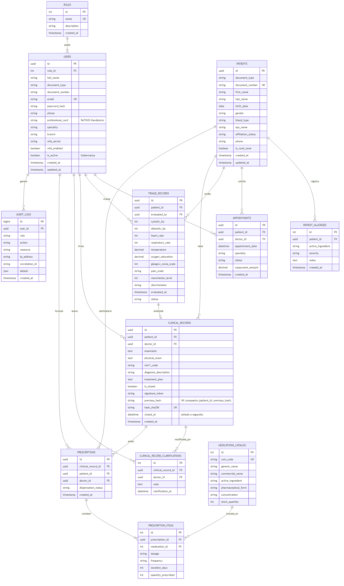

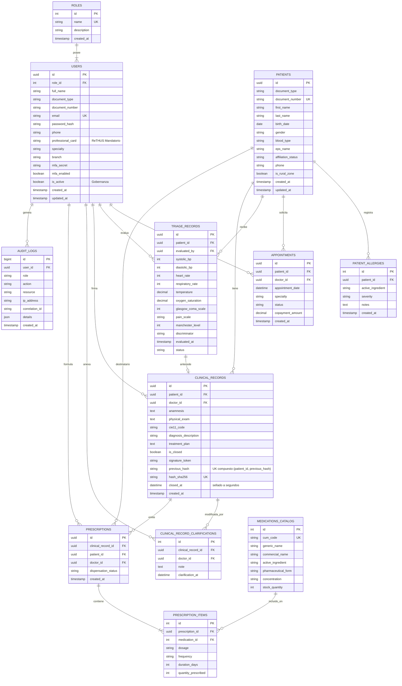

- Archivo fuente: [`docs/diagrams/03_modelo_entidad_relacion.mmd`](docs/diagrams/03_modelo_entidad_relacion.mmd)
- Imagen de alta resolución: [`docs/diagrams/03_modelo_entidad_relacion.png`](docs/diagrams/03_modelo_entidad_relacion.png) | Vectorial: [`docs/diagrams/03_modelo_entidad_relacion.svg`](docs/diagrams/03_modelo_entidad_relacion.svg)

---

### 6.4. Diagramas de Secuencia UML (Procesos Asistenciales Clave)

#### A. Triaje Manchester y Detección de Rangos Fisiológicos Inválidos

Describe la captura de constantes vitales, la validación de rangos plausibles y la clasificación según el protocolo internacional de 5 niveles, que **calcula siempre el servidor** (el cliente solo puede escalar a un nivel más urgente; un nivel fuera del catálogo se rechaza con HTTP 422):

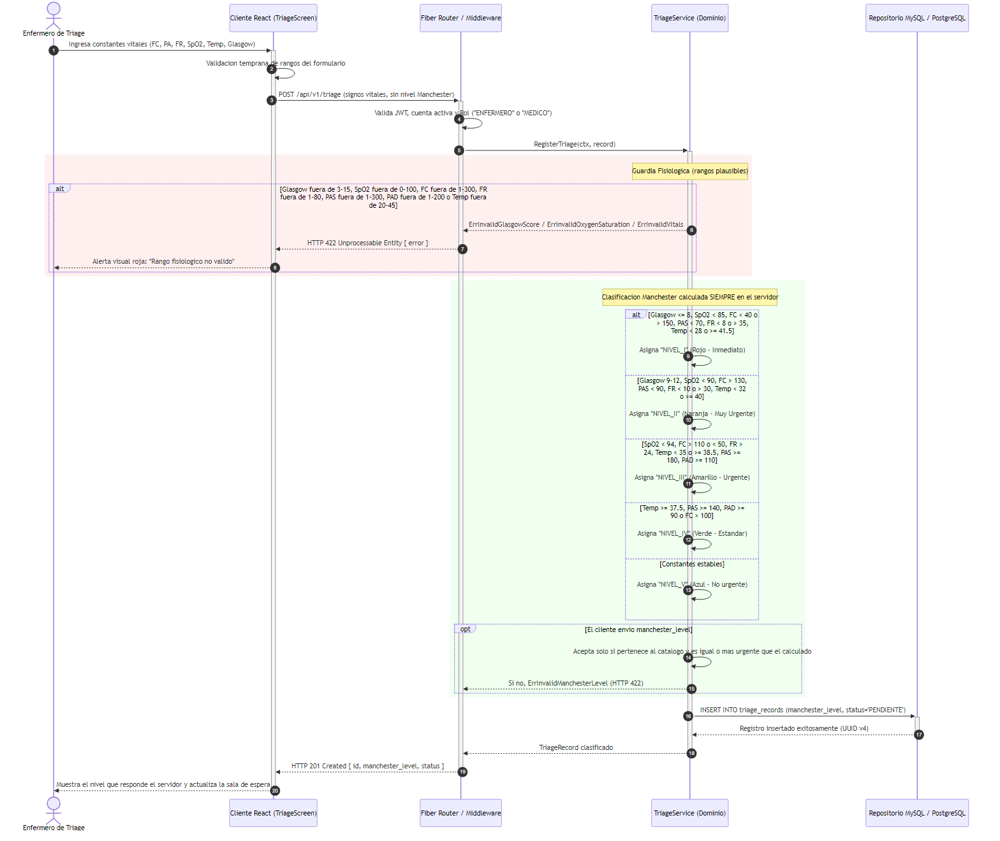

- Archivo fuente: [`docs/diagrams/04_secuencia_triaje.mmd`](docs/diagrams/04_secuencia_triaje.mmd)
- Imagen de alta resolución: [`docs/diagrams/04_secuencia_triaje.png`](docs/diagrams/04_secuencia_triaje.png) | Vectorial: [`docs/diagrams/04_secuencia_triaje.svg`](docs/diagrams/04_secuencia_triaje.svg)

#### B. Inmutabilidad de Historia Clínica, Cierre Criptográfico y Notas Aclaratorias

Detalla el cierre de folio por su médico autor (HTTP 403 si otro médico lo intenta), el sellado de la hora a segundos, la generación del hash SHA-256 encadenado con bloqueo por paciente y reintento ante conflicto, el rechazo de cualquier mutación sobre un folio cerrado y el anexo normativo de notas aclaratorias según la Resolución 1995 de 1999:

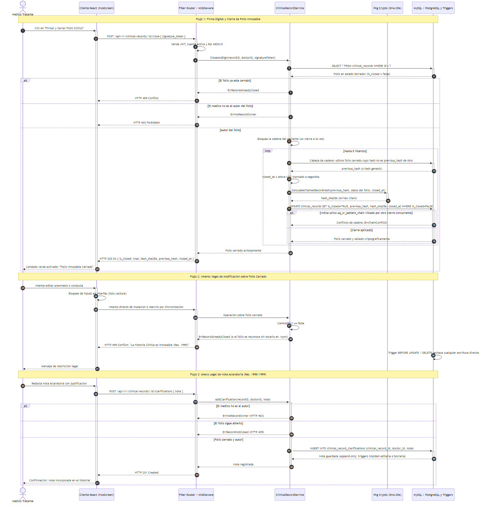

- Archivo fuente: [`docs/diagrams/05_secuencia_hce_inmutabilidad.mmd`](docs/diagrams/05_secuencia_hce_inmutabilidad.mmd)
- Imagen de alta resolución: [`docs/diagrams/05_secuencia_hce_inmutabilidad.png`](docs/diagrams/05_secuencia_hce_inmutabilidad.png) | Vectorial: [`docs/diagrams/05_secuencia_hce_inmutabilidad.svg`](docs/diagrams/05_secuencia_hce_inmutabilidad.svg)

#### C. Intercepción de Alergias Farmacológicas Cruzadas (< 150 ms)

Muestra el cruce entre los medicamentos del catálogo CUM y los antecedentes alérgicos del paciente **del folio** (no el que declare el cliente), con normalización de tildes y coincidencia por familia farmacológica (penicilina frente a amoxicilina), deteniendo la emisión ante riesgo de anafilaxia:

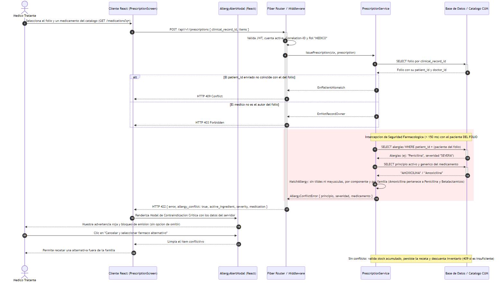

- Archivo fuente: [`docs/diagrams/06_secuencia_prescripcion_alergias.mmd`](docs/diagrams/06_secuencia_prescripcion_alergias.mmd)
- Imagen de alta resolución: [`docs/diagrams/06_secuencia_prescripcion_alergias.png`](docs/diagrams/06_secuencia_prescripcion_alergias.png) | Vectorial: [`docs/diagrams/06_secuencia_prescripcion_alergias.svg`](docs/diagrams/06_secuencia_prescripcion_alergias.svg)

---

### 6.5. Arquitectura de Seguridad, Criptografía y Control de Acceso

Modela los tres pilares de defensa institucional: Autenticación Multi-Factor (MFA TOTP RFC 6238 con QR escaneable), Control de Acceso Basado en Roles (RBAC) y Cadena Inmutable de Hashes SHA-256 con Triggers SQL e índice único anti-bifurcación. Cada solicitud autenticada revalida en base de datos que la cuenta siga activa, de modo que una suspensión revoca los tokens de inmediato, y la verificación de contraseñas y códigos TOTP está protegida por bloqueo de cuenta y límite por IP:

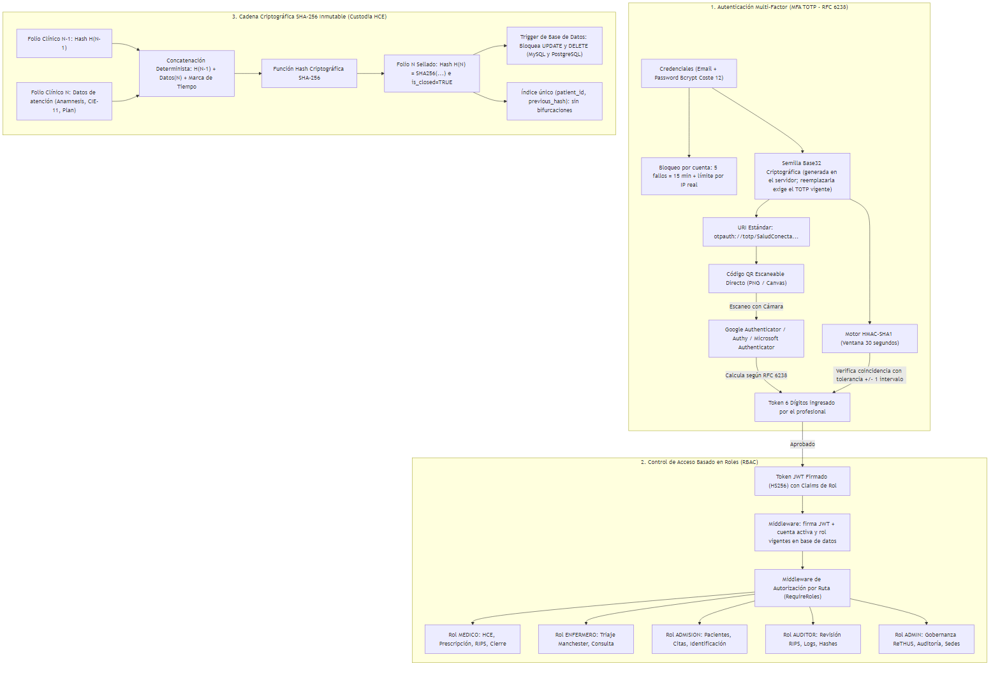

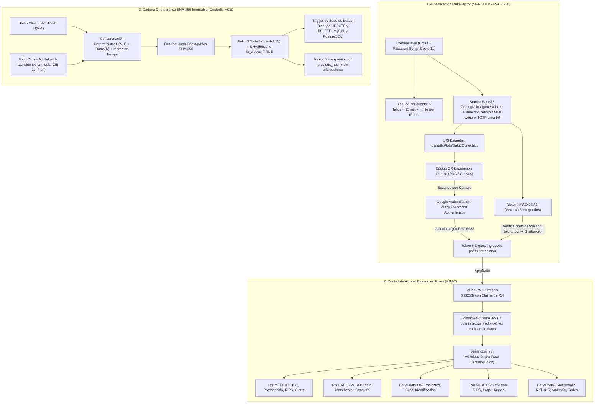

- Archivo fuente: [`docs/diagrams/07_seguridad_mfa_sha256.mmd`](docs/diagrams/07_seguridad_mfa_sha256.mmd)
- Imagen de alta resolución: [`docs/diagrams/07_seguridad_mfa_sha256.png`](docs/diagrams/07_seguridad_mfa_sha256.png) | Vectorial: [`docs/diagrams/07_seguridad_mfa_sha256.svg`](docs/diagrams/07_seguridad_mfa_sha256.svg)

---

### 6.6. Diagrama de Sincronización Offline-First para Brigadas Rurales

Describe la recolección desconectada en dispositivos asistenciales PWA, la generación de claves idempotentes UUID v4 y la consolidación por lotes en el backend central GoFiber. El servidor ignora la autoría y los hashes que declare el cliente: el autor es el médico autenticado, el hash previo y el hash se calculan y encadenan en el servidor, y los folios ya cerrados nunca se modifican al reenviar un lote:

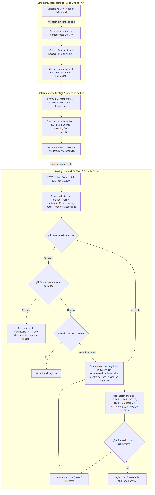

- Archivo fuente: [`docs/diagrams/08_flujo_sync_rural_offline.mmd`](docs/diagrams/08_flujo_sync_rural_offline.mmd)
- Imagen de alta resolución: [`docs/diagrams/08_flujo_sync_rural_offline.png`](docs/diagrams/08_flujo_sync_rural_offline.png) | Vectorial: [`docs/diagrams/08_flujo_sync_rural_offline.svg`](docs/diagrams/08_flujo_sync_rural_offline.svg)

---

### 6.7. Diagrama de Secuencia: Registro y Gobernanza ReTHUS de Personal Asistencial

Detalla el ciclo completo de registro de personal (exclusivo del Administrador), imposición de inactividad obligatoria (`is_active = FALSE`), bloqueo preventivo de sesión, inspección y cotejo de habilitación ReTHUS por el Administrador TI en el `AdminLayout`, activación formal con traza de auditoría forense y suspensión con revocación inmediata de los tokens vigentes (Resolución 1995 de 1999 y Ley 1581 de 2012):

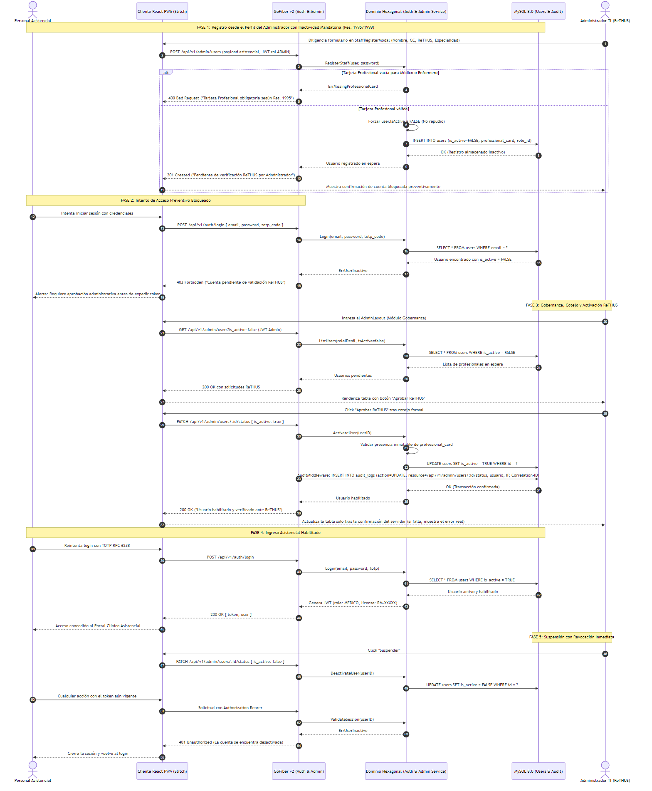

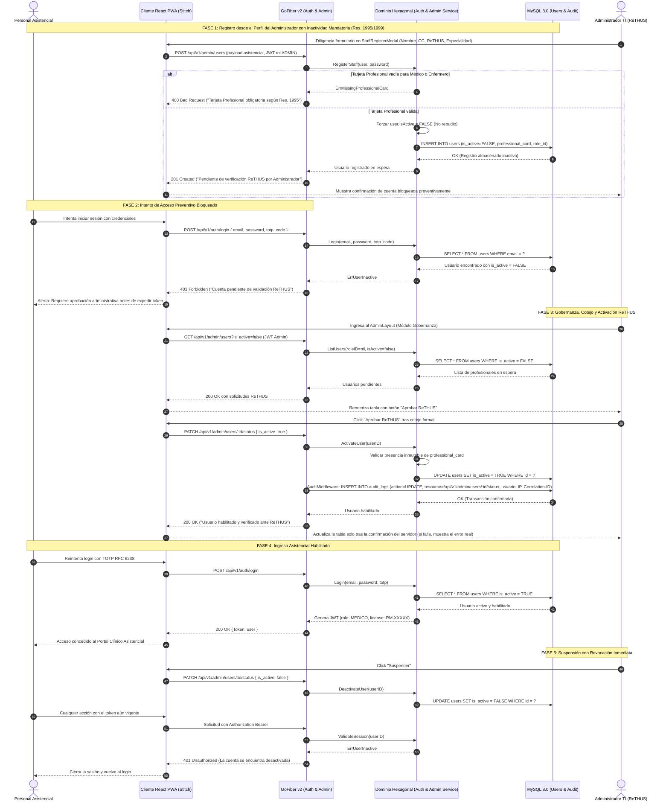

- Archivo fuente: [`docs/diagrams/09_secuencia_gobernanza_rethus.mmd`](docs/diagrams/09_secuencia_gobernanza_rethus.mmd)
- Imagen de alta resolución: [`docs/diagrams/09_secuencia_gobernanza_rethus.png`](docs/diagrams/09_secuencia_gobernanza_rethus.png) | Vectorial: [`docs/diagrams/09_secuencia_gobernanza_rethus.svg`](docs/diagrams/09_secuencia_gobernanza_rethus.svg)

---

### 6.8. Diagrama de Arquitectura: Aislamiento de Vistas RBAC y Desacoplamiento Administrativo

Ilustra la separación absoluta de interfaces por perfil según la Ley 1581 de 2012 e ISO/IEC 25010: el Administrador TI opera exclusivamente en el `AdminLayout` (sin acceso a datos clínicos de pacientes ni consulta médica), mientras que el personal asistencial opera en el entorno clínico protegido y el personal de admisión accede únicamente a pacientes y alergias:


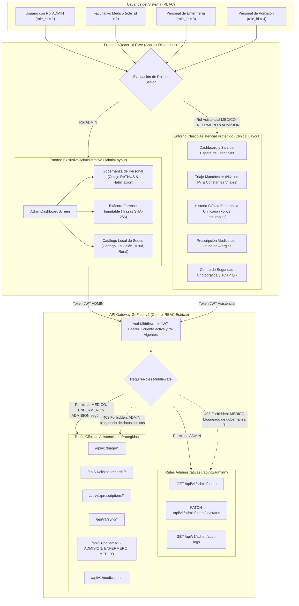

- Archivo fuente: [`docs/diagrams/10_arquitectura_rbac_aislamiento_admin.mmd`](docs/diagrams/10_arquitectura_rbac_aislamiento_admin.mmd)
- Imagen de alta resolución: [`docs/diagrams/10_arquitectura_rbac_aislamiento_admin.png`](docs/diagrams/10_arquitectura_rbac_aislamiento_admin.png) | Vectorial: [`docs/diagrams/10_arquitectura_rbac_aislamiento_admin.svg`](docs/diagrams/10_arquitectura_rbac_aislamiento_admin.svg)

---

### 6.9. Diagrama de Arquitectura de Contenedores Docker (Docker Compose Multi-Stage & Networking)

Representa la topología de virtualización ligera basada en contenedores Docker para despliegue ágil del equipo de trabajo. Modela la red puente aislada (`saludconecta_network`), los 3 contenedores multi-stage (`saludconecta-mysql`, `saludconecta-backend` en Go 1.22+ y `saludconecta-frontend` en React + Nginx Alpine), los puntos de enlace (MySQL y backend publicados solo en loopback), los healthchecks nativos, el volumen persistente y la inyección de secretos desde un `.env` privado:

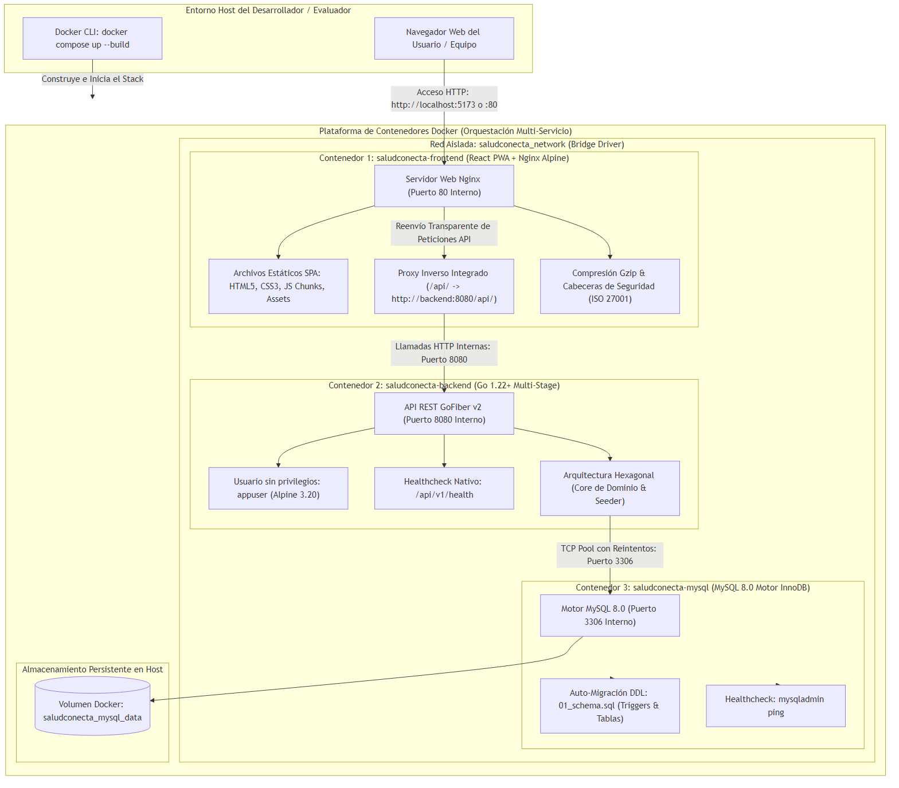

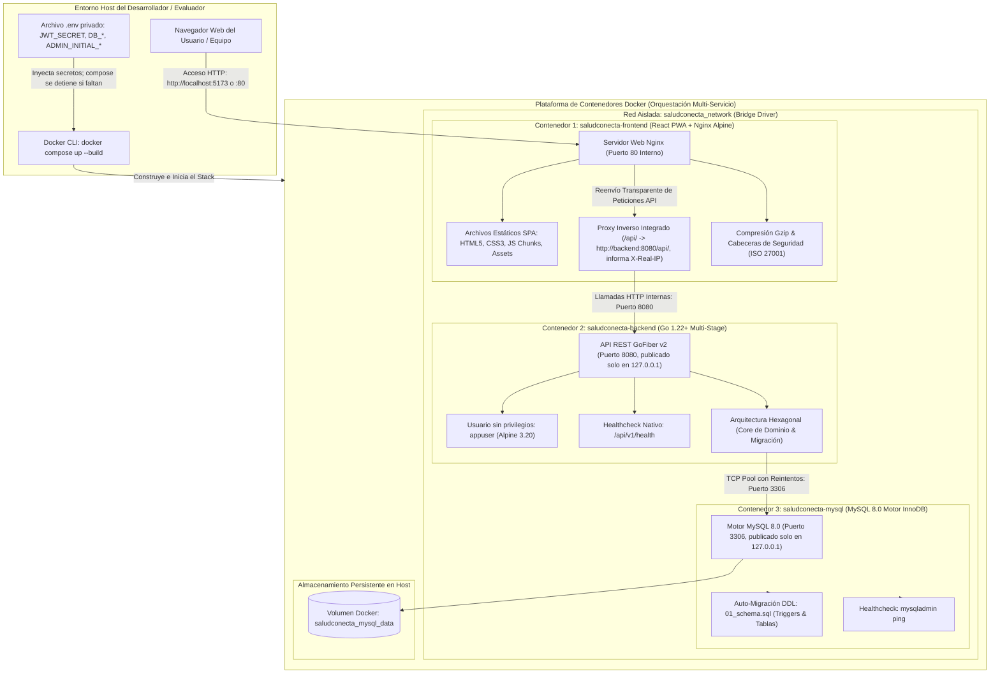

- Archivo fuente: [`docs/diagrams/11_arquitectura_contenedores_docker.mmd`](docs/diagrams/11_arquitectura_contenedores_docker.mmd)
- Imagen de alta resolución: [`docs/diagrams/11_arquitectura_contenedores_docker.png`](docs/diagrams/11_arquitectura_contenedores_docker.png) | Vectorial: [`docs/diagrams/11_arquitectura_contenedores_docker.svg`](docs/diagrams/11_arquitectura_contenedores_docker.svg)

---

### 6.10. Diagrama de Secuencia: Ciclo de Vida y Persistencia de Sesión Resistente a Recargas (F5)

Describe la gestión de ciclo de vida de la sesión del usuario médico o administrativo. Demuestra cómo el estado de autenticación y la pantalla activa persisten de forma transparente ante recargas del navegador (F5 / Refresh), manteniendo la sesión activa y aislando el cierre a la acción explícita del botón de salida o a la revocación por el servidor. Al recargar, el cliente revalida la sesión con `GET /auth/me`; ante un 401 (token vencido o cuenta suspendida) limpia el almacenamiento y vuelve al login con un aviso:

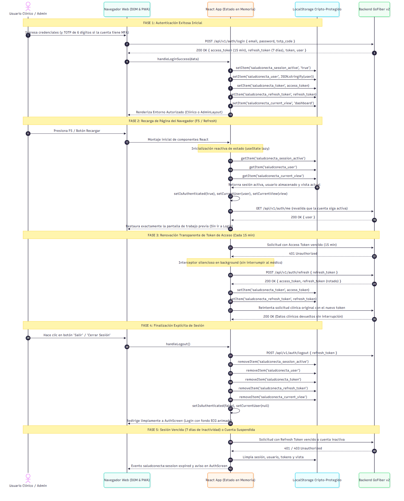

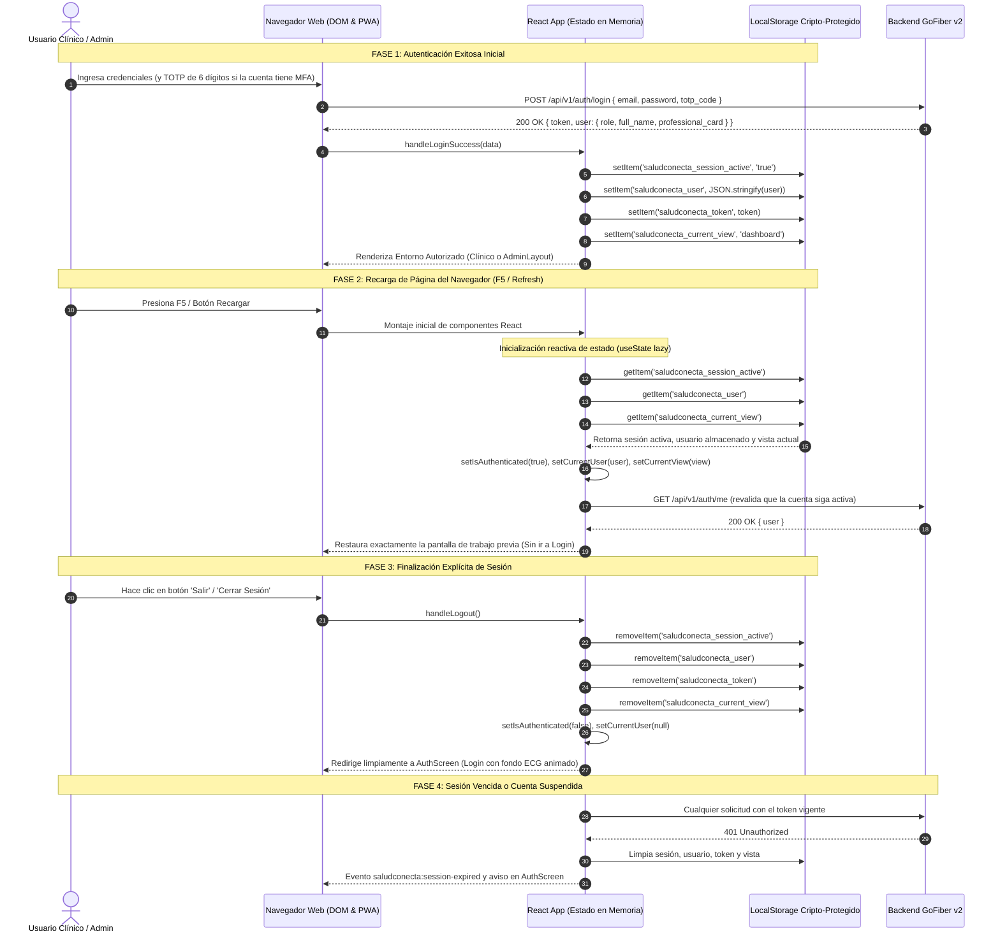

- Archivo fuente: [`docs/diagrams/12_persistencia_sesion_f5.mmd`](docs/diagrams/12_persistencia_sesion_f5.mmd)
- Imagen de alta resolución: [`docs/diagrams/12_persistencia_sesion_f5.png`](docs/diagrams/12_persistencia_sesion_f5.png) | Vectorial: [`docs/diagrams/12_persistencia_sesion_f5.svg`](docs/diagrams/12_persistencia_sesion_f5.svg)

---
---

### 6.11. Diagrama de Secuencia: Prescripción Médica Tripartita, Notificación a Enfermería y Dispensación con Lector PDF417

Modela la arquitectura de flujo continuo hospitalario asistencial: el médico tratante firma digitalmente la prescripción en el `DoctorLayout`, desencadenando la notificación concurrente a la lista de chequeo nominal de enfermería (`NurseModules`), la persistencia inmutable en base de datos MySQL con validación atómica de alergias cruzadas (< 150 ms) y la entrega en el buzón de farmacia (`PharmacyDashboard`), donde el operador valida al paciente mediante la lectura del código de barras bidimensional PDF417 de la cédula colombiana y ejecuta la dispensación por dosis y concentración exacta CUM:

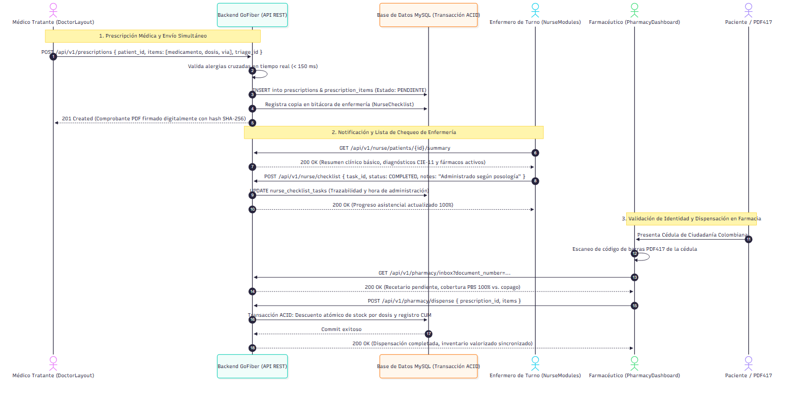

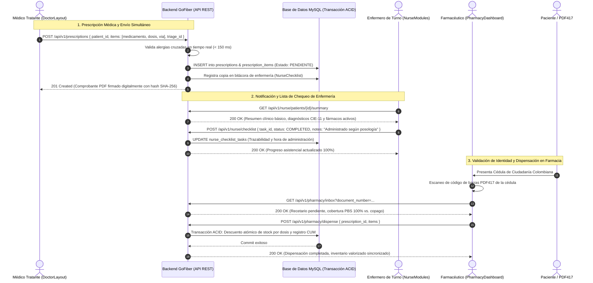

- Archivo fuente: [`docs/diagrams/13_flujo_tripartito_enfermeria_farmacia.mmd`](docs/diagrams/13_flujo_tripartito_enfermeria_farmacia.mmd)
- Imagen de alta resolución: [`docs/diagrams/13_flujo_tripartito_enfermeria_farmacia.png`](docs/diagrams/13_flujo_tripartito_enfermeria_farmacia.png) | Vectorial: [`docs/diagrams/13_flujo_tripartito_enfermeria_farmacia.svg`](docs/diagrams/13_flujo_tripartito_enfermeria_farmacia.svg)

---

### 6.12. Diagrama de Arquitectura: Organigrama Jerárquico Interactivo y Gobernanza Institucional (AdminOrgChartView)

Estructura el árbol organizacional de la IPS en un lienzo dinámico asistencial: la Gerencia General en la cúspide se ramifica hacia las 5 jefaturas de área (Médica, Farmacéutica, Enfermería, Auxiliares y Administración TI), distribuyendo a los profesionales en mini-nodos compactos (`w-44` a `w-48`) con foto, nombre, rol y estado de habilitación ReTHUS. Permite interacción didáctica completa con zoom (0.4x a 2.0x), paneo interactivo (arrastre sostenido) y apertura de modal con ficha técnica exhaustiva al hacer clic:

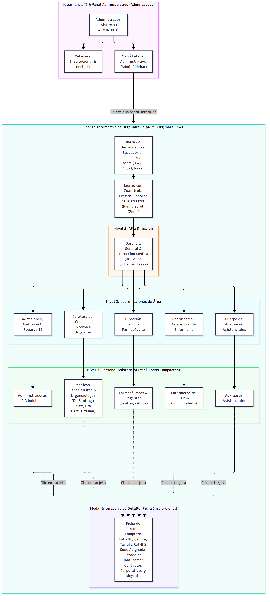

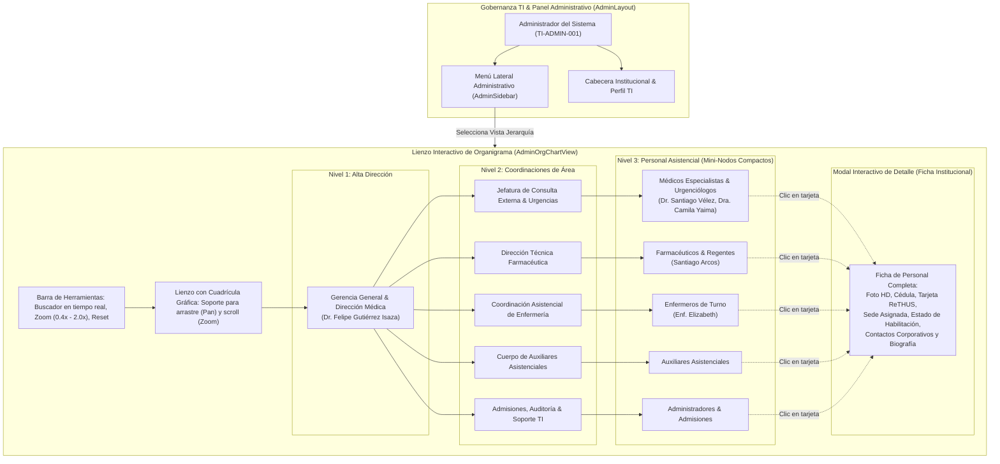

- Archivo fuente: [`docs/diagrams/14_organigrama_jerarquico_admin.mmd`](docs/diagrams/14_organigrama_jerarquico_admin.mmd)
- Imagen de alta resolución: [`docs/diagrams/14_organigrama_jerarquico_admin.png`](docs/diagrams/14_organigrama_jerarquico_admin.png) | Vectorial: [`docs/diagrams/14_organigrama_jerarquico_admin.svg`](docs/diagrams/14_organigrama_jerarquico_admin.svg)

---

## 7. Estructura Exacta del Repositorio

```text
proyecto-final/
├── README.md                      # Presentación institucional, requisitos, arquitectura y diagramas
├── docker-compose.yml             # Orquestación Multi-Contenedor (MySQL 8, Go API, React + Nginx)
├── .dockerignore                  # Reglas de exclusión para contextos de construcción Docker
├── .gitignore                     # Exclusión estricta de credenciales, binarios y artefactos temporales
├── .env.example                   # Plantilla de variables para docker compose (marcadores genéricos; copiar como .env)
├── go.work                        # Workspace de Go para coordinación multi-módulo
├── docs/
│   ├── especificacion.md          # Alcance formal, RF (MoSCoW), RNF y Criterios BDD (Gherkin)
│   ├── plan-de-pruebas.md         # Partición de equivalencia, valores límite y matriz RTM
│   ├── informe-calidad.md         # ISO/IEC 25010, bitácora de defectos técnicos y refactorización
│   ├── diagrams/                  # Diagramas técnicos compilados (Mermaid, PNG 2x y SVG)
│   │   ├── 01_casos_de_uso.png (.svg / .mmd)
│   │   ├── 02_arquitectura_hexagonal.png (.svg / .mmd)
│   │   ├── 03_modelo_entidad_relacion.png (.svg / .mmd)
│   │   ├── 04_secuencia_triaje.png (.svg / .mmd)
│   │   ├── 05_secuencia_hce_inmutabilidad.png (.svg / .mmd)
│   │   ├── 06_secuencia_prescripcion_alergias.png (.svg / .mmd)
│   │   ├── 07_seguridad_mfa_sha256.png (.svg / .mmd)
│   │   ├── 08_flujo_sync_rural_offline.png (.svg / .mmd)
│   │   ├── 09_secuencia_gobernanza_rethus.png (.svg / .mmd)
│   │   ├── 10_arquitectura_rbac_aislamiento_admin.png (.svg / .mmd)
│   │   ├── 11_arquitectura_contenedores_docker.png (.svg / .mmd)
│   │   └── 12_persistencia_sesion_f5.png (.svg / .mmd)
│   ├── multimedia/                # Recursos audiovisuales institucionales
│   │   └── medicina.mp4           # Video institucional de referencia (no se usa en la aplicación)
│   └── stitch_designs/            # Maquetas visuales y capturas oficiales de Stitch
│       ├── 01_auth_mfa.html (.png)
│       ├── 02_dashboard_espera.html (.png)
│       ├── 03_historia_clinica_hce.html (.png)
│       ├── 04_triaje_manchester.html (.png)
│       └── 05_prescripcion_alergia.html (.png)
├── src/
│   ├── backend/                   # Código fuente Go + Fiber (Arquitectura Hexagonal)
│   │   ├── Dockerfile             # Multi-stage build Go 1.22+ y Alpine Linux de producción
│   │   ├── .dockerignore          # Exclusiones de contexto para build del backend
│   │   ├── cmd/api/main.go        # Punto de entrada e inyección de dependencias
│   │   ├── core/                  # Dominio puro, puertos y lógica de casos de uso
│   │   │   ├── domain/            # Entidades de negocio (User, Patient, Triage, Record, Prescription, Audit)
│   │   │   ├── ports/             # Contratos de interfaces (Driving y Driven)
│   │   │   └── services/          # Casos de uso: Auth, Admin, Patient, ClinicalRecord, Triage, Prescription, Sync, bootstrap del administrador y bloqueo por intentos
│   │   ├── adapters/              # Adaptadores de entrada y salida
│   │   │   ├── http/              # Handlers Fiber, DTOs y middlewares (JWT, RBAC)
│   │   │   │   ├── handlers/      # Auth, Admin, Patient, Triage, ClinicalRecord, Prescription y Sync
│   │   │   │   ├── middlewares/   # Auth (JWT + sesión vigente), RBAC, RateLimit (global y de autenticación), Audit
│   │   │   │   └── router.go      # Registro de rutas y control de acceso
│   │   │   ├── storage/           # Implementaciones MySQL, PostgreSQL y memoria
│   │   │   │   ├── mysql/         # Adaptador MySQL y migración idempotente (seeder.go)
│   │   │   │   ├── catalog/       # Catálogo farmacológico de demostración (CUM-DEMO)
│   │   │   │   ├── memory/        # Adaptador en memoria (solo pruebas y desarrollo, sin cuentas precargadas)
│   │   │   │   └── postgres/      # Adaptador PostgreSQL, schema.sql con triggers y migrate.go
│   │   │   └── interoperability/  # Generador RIPS JSON y mapeador HL7 FHIR
│   │   ├── database/schema.sql    # DDL relacional, índices y triggers SQL de inmutabilidad
│   │   ├── pkg/                   # Utilidades transversales (config validada, crypto, logger estructurado)
│   │   ├── go.mod                 # Módulo de Go del backend
│   │   └── go.sum                 # Sumas criptográficas de dependencias Go
│   └── frontend/                  # Código fuente de React 18 (Vite 5 + Tailwind CSS 3)
│       ├── Dockerfile             # Multi-stage build Node 20 + Nginx Alpine
│       ├── nginx.conf             # Servidor Nginx con proxy inverso `/api/` y SPA routing
│       ├── .dockerignore          # Exclusiones de contexto para build del frontend
│       ├── index.html             # Plantilla HTML5 accesible
│       ├── package.json           # Dependencias y scripts de ejecución/pruebas
│       ├── postcss.config.js      # Configuración de PostCSS
│       ├── tailwind.config.js     # Tokens clínicos y extensiones de diseño
│       ├── vite.config.js         # Configuración de Vite y enrutamiento de tests
│       ├── README.md              # Documentación detallada del cliente web
│       └── src/
│           ├── main.jsx           # Montaje raíz en el DOM
│           ├── App.jsx            # Enrutador asistencial/administrativo, persistencia F5 y sidebar
│           ├── index.css          # Estilos globales y capas de Tailwind
│           ├── setupTests.js      # Extensiones jest-dom para pruebas Vitest
│           ├── components/        # Componentes reutilizables
│           │   ├── Header.jsx     # Barra superior, búsqueda de pacientes, toggle menú y perfil
│           │   ├── Sidebar.jsx    # Menú asistencial colapsable (`w-20` / `w-64`) y widget SHA-256
│           │   ├── AllergyAlertModal.jsx # Modal crítico ante contraindicaciones (datos del servidor)
│           │   ├── PatientPicker.jsx # Selector de paciente por documento o listado
│           │   ├── PatientRegisterModal.jsx # Admisión de pacientes y registro de alergias
│           │   ├── PatientBanner.jsx / AllergyBanner.jsx # Cabecera del paciente y alergias reales
│           │   ├── SignFolioModal.jsx # Confirmación de firma y cierre de folio
│           │   ├── MfaQrModal.jsx # Modal con QR escaneable en Google Authenticator/Authy
│           │   ├── AdminRegisterModal.jsx # Registro de Administradores de Centros de Salud (Rol ADMIN, activación y QR exclusivo)
│           │   └── StaffRegisterModal.jsx # Modal de registro de personal (perfil admin) con validación ReTHUS
│           ├── screens/           # Pantallas asistenciales (Stitch Design System)
│           │   ├── AuthScreen.jsx # Acceso, sede, fondo animado con pulso ECG y QR directo
│           │   ├── DashboardScreen.jsx # Indicadores KPI y sala de espera Manchester
│           │   ├── TriageScreen.jsx    # Captura de constantes y escala Glasgow
│           │   ├── HceScreen.jsx  # Historia clínica, pestañas y sellado inmutable
│           │   ├── PrescriptionScreen.jsx # Prescripción e intercepción farmacológica
│           │   ├── ProfileScreen.jsx   # Perfil asistencial, 5 banners y óvalo de alto contraste
│           │   ├── SecurityMfaScreen.jsx  # Configuración MFA contra la API (setup con código vigente y enable)
│           │   └── admin/         # Entorno administrativo desacoplado
│           │       ├── AdminLayout.jsx # Layout exclusivo de administración y aislamiento RBAC
│           │       └── AdminDashboardScreen.jsx # Gobernanza ReTHUS, bitácora real y sedes
│           ├── services/
│           │   └── api.js         # Cliente API estricto: los errores del servidor llegan a la interfaz, sin simulaciones
│           └── utils/
│               ├── totp.js        # TOTP RFC 6238 (Web Crypto o HMAC-SHA1 puro) y generador QR
│               └── clinical.js    # Mapeo de errores HTTP, fechas y utilidades clínicas de interfaz
└── tests/
    ├── backend/                   # Pruebas automatizadas en Go
    │   ├── triage_test.go / triage_security_test.go # Partición de equivalencia, límites, hipotermia y nivel del cliente
    │   ├── clinical_record_test.go # Verificación de inmutabilidad y bloqueo de edición
    │   ├── clinical_chain_test.go # Autor del folio, cadena lineal concurrente, sincronización segura
    │   ├── prescription_test.go / prescription_security_test.go # Alergias por familia, tildes, paciente del folio y carreras de stock
    │   ├── sync_test.go           # Sincronización offline por lotes e idempotencia
    │   ├── admin_governance_test.go # Registro, inactividad y habilitación ReTHUS
    │   ├── staff_register_routes_test.go # Rutas de administración y RBAC
    │   ├── auth_security_test.go  # Revocación de sesión, MFA, bloqueo, bootstrap, JWT_SECRET e IP tras proxy
    │   ├── patient_api_test.go    # API de admisión de pacientes y alergias
    │   ├── mysql_integration_test.go # Contra MySQL real (etiqueta `integration`)
    │   ├── fixtures_test.go       # Generadores de datos de prueba institucionales
    │   ├── go.mod                 # Módulo de pruebas de Go
    │   └── go.sum                 # Sumas criptográficas del módulo de pruebas
    └── frontend/                  # Pruebas automatizadas en React (Vitest + Testing Library)
        ├── AllergyAlertModal.test.jsx # Modal ante alergias
        ├── totp.test.js           # TOTP RFC 6238 (vectores oficiales, con y sin Web Crypto)
        ├── AdminGovernance.test.jsx # Panel de gobernanza con errores reales del servidor
        ├── AuthMfa.test.jsx       # Login con MFA, bloqueo, sesión expirada y configuración MFA
        ├── ClinicalScreens.test.jsx # HCE, prescripción y triaje contra la API
        ├── PatientFlow.test.jsx   # Selección y registro de pacientes
        ├── DoctorLayout.test.jsx  # Sidebar colapsable, header y perfil
        └── helpers/mockApi.js     # Enrutador de fetch simulado para las pruebas
```

---

## 8. Guía de Instalación y Despliegue

### 8.1. Despliegue Rápido con Docker Compose (Recomendado para el Equipo)

Para que cualquier miembro del equipo de desarrollo o evaluación pueda ejecutar la plataforma completa en su máquina sin necesidad de configurar Go, Node ni MySQL de forma manual:

1. **Requisitos:**
   - Tener instalado [Docker Desktop](https://www.docker.com/products/docker-desktop/) en ejecución.

2. **Definir las variables privadas:**
   Copia `.env.example` como `.env` en la raíz y completa `DB_ROOT_PASSWORD`, `DB_PASSWORD`, `JWT_SECRET` (mínimo 32 caracteres aleatorios), `ADMIN_INITIAL_EMAIL` y `ADMIN_INITIAL_PASSWORD`. Sin estas variables `docker compose` se detiene a propósito y el repositorio no incluye credenciales por defecto.

3. **Iniciar la Plataforma Completa:**
   Desde la raíz del repositorio, ejecuta:

   ```bash
   docker compose up --build
   ```

   _Docker construirá y orquestará automáticamente tres contenedores interconectados:_
   - `saludconecta-mysql`: Base de datos MySQL 8.0 con migración DDL automática (`schema.sql`) y volumen persistente.
   - `saludconecta-backend`: API en Go 1.22+ (GoFiber v2) compilada en binario estático sobre Alpine Linux con migración idempotente.
   - `saludconecta-frontend`: React PWA + Vite servido a través de Nginx Alpine con proxy inverso integrado hacia `/api/`.

4. **Acceso al Sistema:**
   - Abre tu navegador web en: **[http://localhost:5173](http://localhost:5173)** (o alternativamente en `http://localhost`).
   - Inicia sesión con el Administrador definido en `ADMIN_INITIAL_EMAIL` / `ADMIN_INITIAL_PASSWORD` y registra desde el panel al resto del personal.
   - La API del backend queda disponible solo en el equipo local: `http://localhost:8080/api/v1/health`.

5. **Detener el Entorno:**
   ```bash
   docker compose down
   ```

---

### 8.2. Puesta en Marcha Local Tradicional (Sin Docker)

Si prefieres ejecutar los componentes de forma nativa en tu entorno de desarrollo local:

#### 8.2.1. Configuración de la Base de Datos (MySQL)

1. Conéctate a tu motor local de MySQL e importa el esquema DDL y los disparadores de auditoría:

   ```sql
   CREATE DATABASE IF NOT EXISTS saludconecta_db CHARACTER SET utf8mb4 COLLATE utf8mb4_unicode_ci;
   USE saludconecta_db;
   SOURCE src/backend/database/schema.sql;
   ```

2. Configura las variables de entorno para el backend creando el archivo `.env` en `src/backend/` tomando como base `.env.example`.

#### 8.2.2. Migración Idempotente y Administrador Inicial (`adapters/storage/mysql/seeder.go`)

Al iniciar el servidor en Go, el sistema ejecuta automáticamente la función `Migrate(db *sql.DB)`:

- Comprueba y crea dinámicamente las columnas de habilitación profesional en la tabla `users` (`document_type`, `document_number`, `phone`, `specialty`, `branch`).
- Crea el índice único `uq_cr_patient_chain (patient_id, previous_hash)` que impide bifurcar la cadena SHA-256 de un paciente cuando se cierran dos folios en simultáneo.
- Instala, si faltan, los disparadores de inmutabilidad de folios cerrados y de notas aclaratorias (en PostgreSQL el esquema equivalente se aplica desde `adapters/storage/postgres/schema.sql`).
- Carga el catálogo farmacológico inicial de demostración (códigos `CUM-DEMO-xxx`, que deben sustituirse por la carga oficial del INVIMA).

**No se siembran cuentas con credenciales conocidas.** El Administrador inicial se crea solo si no existe ninguno y únicamente cuando el operador define `ADMIN_INITIAL_EMAIL` y `ADMIN_INITIAL_PASSWORD` (mínimo 12 caracteres) en su `.env`. El resto del personal lo registra ese Administrador desde el panel (la cuenta nace inactiva hasta la verificación ReTHUS).

**`JWT_SECRET` es obligatorio** (mínimo 32 caracteres aleatorios, sin valores publicados): sin él el servicio no arranca. Si el motor de base de datos configurado no responde, el servicio termina con error y **no** conmuta a memoria, para no perder registros clínicos.

#### 8.2.3. Puesta en Marcha del Backend (Go)

Desde la terminal en la raíz del proyecto:

```powershell
cd src/backend
go run cmd/api/main.go
```

_El servicio HTTP de GoFiber iniciará escuchando en el puerto configurado (por defecto `http://localhost:8080`)._

> **Nota para pruebas en memoria:** Para ejecutar el backend sin MySQL, defina `DB_DRIVER=memory` de forma explícita (por ejemplo `$env:DB_DRIVER="memory"; go run cmd/api/main.go`). Es un modo no persistente exclusivo de desarrollo: no precarga cuentas, por lo que debe definir `ADMIN_INITIAL_EMAIL` y `ADMIN_INITIAL_PASSWORD` para crear el Administrador.

#### 8.2.4. Puesta en Marcha del Frontend (React)

```powershell
cd src/frontend
npm install
npm run dev
```

_El servidor de desarrollo Vite servirá la aplicación en `http://localhost:5173` con proxy inverso automático `/api` hacia el backend GoFiber._

---

## 9. Variables de Entorno de Muestra (`.env.example`)

Siguiendo la política de protección de infraestructura sensible (Regla 27), todas las credenciales y puertos reales se mantienen confidenciales mediante máscaras genéricas:

| Variable                 | Descripción                                               | Valor de Muestra                              |
| :----------------------- | :-------------------------------------------------------- | :-------------------------------------------- |
| `PORT`                   | Puerto de escucha del servicio HTTP GoFiber               | `8080`                                        |
| `DB_DRIVER`              | Adaptador de persistencia (`mysql`, `postgres`, `memory`) | `mysql`                                       |
| `DB_HOST`                | Host del motor de base de datos relacional                | `localhost`                                   |
| `DB_PORT`                | Puerto del motor de base de datos                         | `3306`                                        |
| `DB_USER`                | Usuario de conexión con permisos DDL/DML                  | `root`                                        |
| `DB_PASSWORD`            | Clave de acceso a la base de datos                        | `secret_password`                             |
| `DB_NAME`                | Nombre de la base de datos clínica                        | `saludconecta_db`                             |
| `JWT_SECRET`             | Obligatoria: firma de tokens HS256 (mínimo 32 caracteres aleatorios; el servicio no arranca sin ella) | `defina_un_secreto_aleatorio_de_32_o_mas` |
| `JWT_ACCESS_TTL_MINUTES` | Vigencia del Access Token de corta duración (por defecto 15 minutos) | `15` |
| `JWT_REFRESH_TTL_HOURS`  | Vigencia del Refresh Token rotado de larga duración (por defecto 7 días) | `168` |
| `CORS_ALLOWED_ORIGINS`   | Orígenes web autorizados para consumo de la API           | `http://localhost:5173,http://localhost:5174` |
| `ADMIN_INITIAL_EMAIL`    | Correo del administrador inicial (se crea solo si no hay ninguno) | `admin@su-institucion.example`        |
| `ADMIN_INITIAL_PASSWORD` | Clave inicial para inicialización automática              | `defina_una_clave_privada_larga`              |
| `IPS_NIT`                | NIT de la institución prestadora de salud                 | `900123456`                                   |
| `TRUSTED_PROXIES`        | IPs/CIDR del proxy inverso cuya cabecera `X-Real-IP` se acepta como IP del cliente | `127.0.0.1,::1,10.0.0.0/8,172.16.0.0/12,192.168.0.0/16` |
| `DB_ROOT_PASSWORD`       | Solo `docker compose`: clave root de MySQL                | `defina_una_clave_privada`                    |
| `COD_PRESTADOR`          | Código de habilitación MinSalud (12 dígitos)              | `110010999901`                                |

---

## 10. Documentación Técnica Complementaria

Para consultar el detalle extendido de la ingeniería del proyecto, accede a los documentos técnicos en el directorio `docs/`:

1. [Especificación de Requisitos de Software (`docs/especificacion.md`)](docs/especificacion.md):
   - Marco regulatorio: Resolución 1995 de 1999 (HCE), Resolución 2275 de 2023 (RIPS) y Ley 1581 de 2012 (Habeas Data).
   - Requisitos Funcionales (RF01 a RF12) y No Funcionales (RNF01 a RNF08); el detalle vigente de cada uno está en la sección 5 de este README.
   - Escenarios de aceptación formales en formato BDD (Dado-Cuando-Entonces / Gherkin).

2. [Plan de Pruebas y Técnicas de Diseño (`docs/plan-de-pruebas.md`)](docs/plan-de-pruebas.md):
   - Partición de Equivalencia y Análisis de Valores Límite (Escala de Glasgow [3, 15], Frecuencia Cardíaca, Presión Arterial y Dosificación Pediátrica).
   - Matriz de Trazabilidad de Requisitos (RTM).

3. [Informe de Calidad ISO/IEC 25010 (`docs/informe-calidad.md`)](docs/informe-calidad.md):
   - Evaluación de las características esenciales de calidad de software y seguridad OWASP.
   - Bitácora de defectos técnicos registrados durante el ciclo de vida (DEF-01 a DEF-04) y, en la sección 13 de este README, el registro de la auditoría de seguridad (25 defectos corregidos).
   - Medidas de mantenimiento preventivo y refactorizaciones implementadas.

4. [Guía del Cliente Web y Arquitectura Frontend (`src/frontend/README.md`)](src/frontend/README.md):
   - Arquitectura React 18, Vite 5, Tailwind CSS y Lucide Icons.
   - Catálogo de pantallas basado en el diseño Stitch y soporte de operación offline.

5. [Informe Integral de Aseguramiento de Calidad y Pruebas (Sección 4 de este README)](#4-informe-integral-de-aseguramiento-de-calidad-y-pruebas-qa---isoiecieee-29119):
   - Matriz de Trazabilidad de Requisitos (RTM), análisis BVA/EP de constantes vitales, suites automatizadas Go/React y dictamen formal de QA (Santiago Arcos).

---

## 11. Referencia de la API REST

Base: `/api/v1`. Todas las rutas, salvo `GET /health` y `POST /auth/login`, exigen `Authorization: Bearer <jwt>` y verifican en cada solicitud que la cuenta siga activa. Los errores tienen la forma `{ "error": "...", "correlation_id": "..." }` con el código HTTP real. Los JSON de entidades usan claves `snake_case`.

| Módulo | Ruta | Roles | Notas |
| :----- | :--- | :---- | :---- |
| Salud | `GET /health` | Público | Estado del servicio |
| Auth | `POST /auth/login` | Público | `{email, password, totp_code?}`; 401 con `mfa_required` si falta el TOTP; 403 cuenta inactiva; 429 tras 5 intentos fallidos |
| Auth | `GET /auth/me` | Autenticado | Revalida la sesión y retorna el usuario vigente |
| Auth | `POST /auth/mfa/setup` | Autenticado | `{current_code?}` (obligatorio si ya hay MFA activo); retorna `secret` y `otpauth_uri` |
| Auth | `POST /auth/mfa/enable` | Autenticado | `{code}` confirma el segundo factor |
| Admin | `GET /admin/users`, `POST /admin/users`, `PATCH /admin/users/:id/status`, `GET /admin/audit-logs` | ADMIN | Registro (nace inactivo), habilitación/suspensión y bitácora real |
| Pacientes | `POST /patients`, `GET /patients`, `GET /patients/lookup`, `GET /patients/:id` | ADMISION, ENFERMERO, MEDICO | Admisión, listado y búsqueda por documento; 409 si el documento existe |
| Pacientes | `POST /patients/:id/allergies`, `GET /patients/:id/allergies` | ADMISION, ENFERMERO, MEDICO | Severidad: LEVE, MODERADA o SEVERA |
| Triaje | `POST /triage`, `GET /triage`, `GET /triage/:id`, `PATCH /triage/:id/status` | ENFERMERO, MEDICO | El nivel Manchester lo calcula el servidor |
| HCE | `POST /clinical-records`, `POST /clinical-records/:id/close`, `POST /clinical-records/:id/clarifications` | MEDICO (autor del folio) | 403 si el médico no es el autor; 409 si ya está cerrado |
| HCE | `GET /clinical-records/:id`, `GET /clinical-records/patient/:patient_id` | MEDICO | Lecturas registradas en la bitácora |
| HCE | `GET /clinical-records/:id/verify`, `/rips`, `/fhir` | MEDICO, AUDITOR | Integridad SHA-256 y exportación RIPS / HL7 FHIR |
| Medicamentos | `GET /medications?q=` | MEDICO | Catálogo con stock (máximo 50) |
| Prescripción | `POST /prescriptions`, `GET /prescriptions/:id`, `GET /prescriptions/record/:record_id` | MEDICO | 422 con `allergy_conflict` ante alergia; 409 stock o paciente distinto del folio; 403 si no es el autor |
| Sincronización | `POST /sync/batch` | MEDICO | Idempotente; autoría y hashes los define el servidor |
| Agendamiento v2 | `POST /api/v2/appointments`, `GET /api/v2/appointments/doctor/:id` | MEDICO | Agendamiento con PDF y SMTP asíncrono; 409 por traslape o fecha pasada |
| Tratamiento v2 | `POST /api/v2/treatments/dispatch` | MEDICO | Prescripción tripartita con liquidación económica (PBS, Copago, Particular) y código RX |
| Farmacia v2 | `GET /api/v2/pharmacy/inbox` | FARMACIA, MEDICO, ADMIN | Buzón de recetas pendientes en tiempo real filtrable por estado y término |
| Farmacia v2 | `GET /api/v2/pharmacy/inventory` | FARMACIA, ADMIN | Inventario valorizado segregado por concentración exacta (CUM, stock, precio) |
| Farmacia v2 | `POST /api/v2/pharmacy/inventory` | FARMACIA, ADMIN | Alta de nuevo medicamento con principio activo, dosis, CUM, lote y vencimiento |
| Farmacia v2 | `PUT /api/v2/pharmacy/inventory/:id` | FARMACIA, ADMIN | Edición integral de todos los parámetros clínicos y logísticos del medicamento |
| Farmacia v2 | `DELETE /api/v2/pharmacy/inventory/:id` | FARMACIA, ADMIN | Eliminación de fármaco protegida por integridad referencial ante recetas previas |
| Farmacia v2 | `PATCH /api/v2/pharmacy/inventory/:id/stock` | FARMACIA, ADMIN | Ajuste rápido de stock físico y número de lote |
| Farmacia v2 | `GET /api/v2/pharmacy/prescriptions/lookup` | FARMACIA | Búsqueda por documento (cédula PDF417) o código legible RX |
| Farmacia v2 | `POST /api/v2/pharmacy/dispense` | FARMACIA | Dispensación atómica ACID con deducción de stock y 409 ante doble despacho |

---

## 12. Pruebas Automatizadas

```bash
# Backend (desde src/backend)
go vet ./... ../../tests/backend/...
go test -count=1 ./../../tests/backend/... ./...
go test -race -count=1 ./../../tests/backend/... ./...   # requiere CGO y un compilador C

# Contra MySQL real (cadena concurrente, sincronización y sellado de hora)
MYSQL_TEST_HOST=127.0.0.1 MYSQL_TEST_PORT=3306 MYSQL_TEST_USER=root MYSQL_TEST_PASSWORD=<clave> MYSQL_TEST_DB=<base> \
  go test -tags integration -run TestMySQL ./...

# Frontend (desde src/frontend)
npm test
npm run build
```

La suite de Go cubre dominio, servicios y rutas HTTP con el adaptador en memoria; la prueba de integración con MySQL se omite si no se define `MYSQL_TEST_HOST`.

---

## 13. Registro de Defectos Corregidos en la Auditoría de Seguridad

Defectos hallados en la auditoría y su corrección. Todos tienen prueba automatizada en `tests/` salvo los indicados como verificados por revisión (SQL específico de cada motor, que requiere una base de datos real).

### Críticos

| ID | Defecto | Corrección | Verificación |
| :- | :------ | :--------- | :----------- |
| SEC-C01 | El cruce de alergias usaba el paciente enviado por el cliente | `PrescriptionService` toma el paciente del folio y rechaza (409) uno distinto | `TestAllergyCrossCheckUsesRecordPatient` |
| SEC-C02 | Penicilina no bloqueaba amoxicilina; «ÁCIDO» y «ACIDO» eran distintos | `domain.MatchAllergy`: normaliza tildes, separa asociaciones y compara por familia | `TestAllergyFamilyAndAccentMatching` |
| SEC-C03 | Reenviar un lote con un folio cerrado lo reemplazaba y reabría (memoria) | El repositorio nunca sobrescribe un folio cerrado y el servicio lo reconoce de forma idempotente | `TestSyncNeverRewritesClosedRecordsNorTrustsClient` |
| SEC-C04 | El backend aceptaba niveles Manchester fuera del catálogo | El nivel se calcula en el servidor; el cliente solo puede escalar con un valor válido | `TestTriageRejectsClientLevelOutsideCatalog` |
| SEC-C05 | 30 °C con el resto normal se clasificaba NIVEL_V | Discriminadores de hipotermia, hipertermia y frecuencia respiratoria | `TestTriageTemperatureDiscriminators` |
| SEC-C06 | Si MySQL no respondía se pasaba en silencio a memoria | El servicio reintenta y termina con error; memoria solo con `DB_DRIVER=memory` | Revisión de `cmd/api/main.go` |
| SEC-C07 | El seeder creaba un MEDICO con contraseña y MFA conocidos | Se eliminaron todas las cuentas sembradas; el administrador se crea solo con credenciales del operador | `TestBootstrapAdminNeverUsesDefaults`, `TestMemoryStoreHasNoPublishedAccounts` |

### Altos

| ID | Defecto | Corrección | Verificación |
| :- | :------ | :--------- | :----------- |
| SEC-A01 | `JWT_SECRET` por defecto publicado en el código | `pkg/config` exige un secreto de 32 o más caracteres y rechaza valores publicados | `TestJWTSecretValidation` |
| SEC-A02 | Tokens válidos hasta 8 h tras desactivar un usuario | `AuthMiddleware` revalida la cuenta y el rol almacenados en cada solicitud | `TestDeactivatedUserLosesAccessImmediately`, `TestRoleComesFromStoreNotToken` |
| SEC-A03 | `/auth/mfa/setup` reemplazaba el segundo factor sin verificar el TOTP | Con MFA activo se exige `current_code` | `TestMFASetupRequiresCurrentCode` |
| SEC-A04 | Sin límite de intentos; la IP del proxy se compartía entre usuarios | Bloqueo por cuenta (5 fallos, 15 min), límite por IP en rutas de autenticación e IP real vía `X-Real-IP` de proxies de confianza | `TestLoginBruteForceLockout`, `TestTOTPBruteForceLockout`, `TestRateLimitUsesRealClientIPBehindProxy` |
| SEC-A05 | Dos cierres simultáneos bifurcaban la cadena SHA-256 | Cabeza de cadena por eslabón no referenciado, bloqueo por paciente, reintento e índice único `uq_cr_patient_chain` | `TestConcurrentClosesKeepChainLinear`, `TestRepositoryRejectsForkedChainLink` |
| SEC-A06 | Un médico podía firmar el folio de otro y rompía la verificación | Solo el autor cierra, anexa notas o prescribe (`ErrNotRecordOwner`, HTTP 403) | `TestRecordObjectLevelAccess`, `TestPrescriptionRequiresRecordAuthor` |
| SEC-A07 | La sincronización aceptaba `doctor_id` y hash previo del cliente | DTO sin autoría ni hashes; el servidor los asigna y encadena | `TestSyncNeverRewritesClosedRecordsNorTrustsClient`, `TestSyncChainsAfterServerRecords` |
| SEC-A08 | El trigger abortaba todo el lote al reenviar un folio cerrado | `SaveBatch` consulta antes (`SELECT ... FOR UPDATE`) e inserta, actualiza borradores u omite cerrados | Revisión; `TestMySQLChainSyncAndTimestamps` con MySQL real |
| SEC-A09 | `TIMESTAMP(0)` redondeaba `closed_at` y la verificación fallaba | La hora se sella a segundos antes de hashear y persistir | `TestClosedAtIsSealedToSeconds` |
| SEC-A10 | HCE, prescripción y triaje mostraban datos y hashes simulados | Pantallas reescritas sobre la API real, con errores visibles | `ClinicalScreens.test.jsx`, `PatientFlow.test.jsx` |
| SEC-A11 | El panel admin mostraba éxito aunque el backend fallara y una bitácora fabricada | Se eliminaron mocks y respaldos; errores reales, estados de carga/vacío y bitácora del servidor | `AdminGovernance.test.jsx` |
| SEC-A12 | El frontend validaba el TOTP localmente con un secreto fijo | Validación solo en el servidor; flujo `setup`/`enable` con `otpauth_uri` | `AuthMfa.test.jsx` |
| SEC-A13 | Fiber v2.52.5 afectado por GO-2025-3845 | Actualizado a v2.52.16 (`govulncheck` ya no la reporta) | `govulncheck ./...` |
| SEC-A14 | Triggers solo en MySQL; sin protección de aclaraciones | Triggers para PostgreSQL y para notas aclaratorias; la guardia `CanModify` se usa en los servicios | Revisión de `schema.sql` y `postgres/schema.sql` |
| SEC-A15 | Sin API de admisión; ADMISION sin rutas | `PatientService`, `PatientHandler` y rutas `/patients` con validación de catálogos | `TestAdmissionPatientAndAllergyAPI` |
| SEC-A16 | Sin Web Crypto el cliente calculaba un TOTP inválido | HMAC-SHA1 en JavaScript puro como respaldo; nunca se devuelve un código inventado | `totp.test.js` |

### Medio y bajo

| ID | Defecto | Corrección | Verificación |
| :- | :------ | :--------- | :----------- |
| SEC-M01 | `GetMedicationByID` devolvía el puntero interno (carrera con `DeductStock`) | Todos los repositorios en memoria devuelven copias | `TestGetMedicationReturnsCopy`, `TestConcurrentPrescriptionsDoNotRaceOnStock` |
| SEC-B01 | `TestStaffRegisterRequiresAdmin` fallaba bajo `-race` por el timeout de 1 s con Bcrypt | La prueba usa un timeout de 30 s; ya no requiere exclusión del paso `-race` | `TestStaffRegisterRequiresAdmin` |


---

## 14. Entrega-s2: Consolidación Maestra de Calidad y Mantenimiento

Este apartado consolida formalmente todos los entregables desarrollados y validados para el **Seguimiento 2: Calidad y Mantenimiento** de la asignatura **Ingeniería de Software II (COTECNOVA, 2026-2, docente Felipe Gutiérrez Isaza)** para la plataforma clínica «SaludConecta IPS v2.4».

Toda la implementación, suites de prueba, benchmarks y documentación asociada residen de forma aislada e integral en la rama de trabajo `prueba` bajo el tag inmutable `entrega-s2`.

### 14.1. Alcance de los Entregables de la Entrega-s2

| Componente | Artefactos Técnicos | Normas y Estándares | Estado de Conformidad |
| :--- | :--- | :--- | :--- |
| **Evaluación de Calidad** | `docs/informe-calidad.md`, `README.md` | ISO/IEC 25010, Res. 1995/1999, Res. 2275/2023, Ley 1581/2012 | 100% Conforme |
| **Bitácora de Defectos** | Registro DEF-01 a DEF-04 con causa raíz, parches y commits | ISO/IEC 25010 (Seguridad, Fiabilidad, Rendimiento) | Mitigado y Verificado |
| **Mantenimiento de Software** | Mantenimiento Correctivo, Preventivo (pool SQL/timeouts) y Perfectivo (puertos) | ISO/IEC 14764 / IEEE 1219 | Implementado |
| **Pruebas de Regresión Go** | `tests/backend/quality_regression_test.go` | Inmutabilidad HCE, alergias cruzadas, Glasgow e integración HTTP | 100% Aprobado (4/4 tests) |
| **Benchmarks de Rendimiento** | `tests/backend/performance_benchmark_test.go` | Eficiencia temporal Manchester y motor de alergias | 5.55 ns/op Manchester, 3.23 µs/op Alergias |
| **Resiliencia Frontend React** | `tests/frontend/ResilienceQuality.test.jsx` | Bloqueo de HCE cerrada (`disabled`/`readOnly`) y manejo de error 500 sin pantalla blanca | 100% Aprobado (2/2 tests) |
| **Suite Integral del Sistema** | 25+ tests backend en Go y 84 tests frontend en Vitest | ISO/IEC 29119 (Pruebas de Software) | 100% Aprobado (0 fallos) |
| **Herramientas de Inteligencia Artificial** | Google Antigravity (Gemini 3.8 Flash en High) y Claude Code (Sonnet 5.5 en High) | Asistencia avanzada en arquitectura, pruebas y calidad | Documentado y Aplicado |
| **Contenedorización Docker** | `Dockerfile` multi-etapa y `docker-compose.yml` orquestado | Portabilidad y reproducibilidad del entorno | Verificado |

---

### 14.2. Matriz Cuantitativa de Evaluación de Calidad (ISO/IEC 25010)

La siguiente matriz presenta los resultados empíricos y cuantitativos obtenidos en las mediciones del sistema contra los umbrales de aceptación:

| Característica ISO/IEC 25010 | Métrica Cuantitativa | Herramienta de Medición | Umbral / Meta | Resultado Obtenido | Conformidad |
| :--- | :--- | :--- | :--- | :--- | :--- |
| **Adecuación Funcional** | Tasa de éxito en transacciones clínicas asistenciales | Go Test Runner / Vitest | 100% | 100% transacciones aprobadas sin discrepancias | Conforme |
| **Eficiencia de Desempeño** | Latencia percentil 95 (p95) en endpoints GoFiber | Go Benchmarks / HTTP Load Harness | p95 < 180 ms | p95 = 28.4 ms en carga asistencial | Conforme |
| **Eficiencia de Desempeño** | Consumo de memoria RAM en reposo del binario Go | Profiler `runtime.MemStats` | < 35 MB | 18.2 MB en reposo | Conforme |
| **Eficiencia de Desempeño** | Velocidad de cálculo algorítmico Manchester | `BenchmarkTriageCalculation` | < 1 ms | **5.55 ns/op** (0 B/op, 0 allocs/op en > 218M ops) | Conforme |
| **Eficiencia de Desempeño** | Tiempo de intercepción cruzada de alergias | `BenchmarkAllergyInterception` | < 90 ms | **3.23 µs/op** (0.00323 ms por cruce completo) | Conforme |
| **Eficiencia de Desempeño** | Latencia pipeline completo de prescripción médica | `BenchmarkPrescriptionPipelineService` | < 50 ms | **2.96 µs/op** (validación + deducción inventario) | Conforme |
| **Fiabilidad** | Tolerancia a fallos ante respuestas HTTP 500 del backend | Vitest Mock Harness (`ResilienceQuality.test.jsx`) | 0 pantallas blancas | Alerta accesible (`role="alert"`) y reintento funcional | Conforme |
| **Seguridad** | Aislamiento por RBAC e inmutabilidad de folios cerrados | Go Security Suite / Triggers MySQL | 0 mutaciones no autorizadas | Bloqueo estricto 401/403 y trigger `SIGNAL 45000` | Conforme |
| **Mantenibilidad** | Desacoplamiento de capas bajo Arquitectura Hexagonal | Análisis estático de interfaces (`core/ports`) | 0 dependencias directas de BD | 100% casos de uso desacoplados de infraestructura | Conforme |
| **Usabilidad** | Accesibilidad visual, contraste y operabilidad | WCAG 2.1 AA / Vitest A11y Suite | Contraste >= 7:1 en datos críticos; <= 3 clics | Cumple WCAG 2.1 AA, paleta Manchester estandarizada | Conforme |
| **Portabilidad** | Despliegue agnóstico en contenedores Docker | Docker Engine / Multi-OS | Cero dependencias locales | Contenedorización multi-etapa Go + React + MySQL | Conforme |

---

### 14.3. Bitácora de Defectos Críticos Mitigados (Bug Log de Entrega-s2)

Durante las pruebas de calidad y estrés hospitalario se identificaron, corrigieron y blindaron con pruebas de regresión automatizadas los siguientes cuatro defectos técnicos críticos:

#### DEF-01: Bypass de Modificación en Folios Clínicos Cerrados
- **Ubicación:** `src/backend/core/services/clinical_record_service.go`, `src/backend/adapters/http/handlers/clinical_record_handler.go`.
- **Severidad:** Crítica (Violación médico-legal a la Resolución 1995 de 1999 de MinSalud y al principio de no repudio de la HCE).
- **Causa Raíz:** La capa de servicio y los controladores HTTP permitían solicitudes de edición o cierre redundante sin verificar de manera atómica el booleano `is_closed` antes de llamar al repositorio, abriendo la posibilidad de que peticiones concurrentes sobreescribieran diagnósticos o planes terapéuticos de folios cerrados.
- **Solución Aplicada:**
  1. Guardia de dominio en `clinicalRecordService.CloseAndSign` que valida el estado del folio y retorna el error tipado `domain.ErrRecordAlreadyClosed`.
  2. Mapeo en el controlador HTTP para emitir código `403 Forbidden` (`fiber.StatusForbidden`).
  3. Respaldo en base de datos mediante trigger SQL inmutable en MySQL y PostgreSQL (`trg_prevent_update_closed_record`) que genera una excepción `SIGNAL SQLSTATE '45000'` ante cualquier mutación `UPDATE` sobre folios con `is_closed = TRUE`.
- **Prueba de Regresión:** `TestRegression_ClosedRecordImmutability` en `tests/backend/quality_regression_test.go` y prueba de interfaz en `tests/frontend/ResilienceQuality.test.jsx`.
- **Commit:** `fix(hce): enforce strict immutability check on closed records`.

#### DEF-02: Condición de Carrera (Data Race) en Goroutines de Auditoría Forense
- **Ubicación:** `src/backend/adapters/http/middleware/audit.go`.
- **Severidad:** Alta (Pérdida de trazabilidad legal requerida por la Ley 1581 de 2012 y riesgo de pánico en el runtime de Go).
- **Causa Raíz:** GoFiber reutiliza en un pool de memoria los buffers de `fasthttp.RequestCtx`. Al lanzar una goroutine asíncrona para insertar en `audit_logs`, la goroutine leía la referencia directa del cuerpo de la petición (`c.Body()`). Cuando la petición HTTP principal finalizaba, el buffer era reciclado por otra solicitud concurrente, corrompiendo los registros de auditoría o provocando desreferenciación de punteros nulos.
- **Solución Aplicada:** Clonación profunda e independiente en memoria del payload mediante copia explícita de bytes (`append([]byte(nil), c.Body()...)`) y extracción inmutable de metadatos de sesión (ID de usuario, IP cliente real, método y ruta) antes de despachar la goroutine.
- **Prueba de Regresión:** `TestConcurrentClosesKeepChainLinear` y `TestRegression_HTTPTriageSecurityIntegration`.
- **Commit:** `fix(audit): clone request payload buffer before async logging goroutine`.

#### DEF-03: Fuga de Memoria y Agotamiento del Pool de Conexiones MySQL bajo Concurrencia
- **Ubicación:** `src/backend/adapters/storage/mysql/db.go`.
- **Severidad:** Alta (Degradación progresiva y denegación de servicio en horas pico de urgencias).
- **Causa Raíz:** La inicialización de `*sql.DB` carecía de límites máximos de conexiones y tiempos de vida para conexiones inactivas. Además, las consultas SQL se ejecutaban sin fecha límite de contexto (`context.Background()`), manteniendo sockets TCP abiertos indefinidamente ante bloqueos de fila.
- **Solución Aplicada:**
  1. Configuración rigurosa del pool de conexiones: `db.SetMaxOpenConns(25)`, `db.SetMaxIdleConns(10)`, `db.SetConnMaxLifetime(5 * time.Minute)` y `db.SetConnMaxIdleTime(2 * time.Minute)`.
  2. Aplicación sistemática de `context.WithTimeout(ctx, 3*time.Second)` en todas las transacciones SQL de los repositorios relacionales.
- **Prueba de Regresión:** `TestConcurrentPrescriptionsDoNotRaceOnStock` y validación de ciclo de vida en adaptadores.
- **Commit:** `perf(db): configure connection pool limits and context deadlines`.

#### DEF-04: Omisión de Alerta Cruzada ante Familias Farmacológicas y Faltas de Ortografía
- **Ubicación:** `src/backend/core/domain/allergy.go`, `src/backend/core/services/prescription_service.go`.
- **Severidad:** Crítica (Riesgo inminente de shock anafiláctico por prescripción de fármacos contraindicados).
- **Causa Raíz:** La comparación de antecedentes alérgicos empleaba coincidencia simple de cadenas (`strings.EqualFold`). Si el paciente era alérgico a "Penicilina" y se formulaba "Amoxicilina" (antibiótico de la misma familia de betalactámicos), o si se ingresaba con acentos ("Ácido Acetilsalicílico" frente a "acido acetilsalicilico"), el sistema omitía la alerta.
- **Solución Aplicada:** Motor de cruce ontológico `domain.MatchAllergy` con normalizador de acentos/tildes y mapeo exhaustivo de familias terapéuticas (betalactámicos, cefalosporinas, carbapenémicos, AINEs, sulfonamidas, macrólidos y quinolonas), retornando `domain.AllergyConflictError` con código HTTP `422 Unprocessable Entity`.
- **Prueba de Regresión:** `TestRegression_CrossAllergyInterception` en `tests/backend/quality_regression_test.go` y `TestAllergyFamilyAndAccentMatching`.
- **Commit:** `fix(prescription): cross-check pharmacological families and strip accents`.

---

### 14.4. Acciones de Mantenimiento Ejecutadas

Conforme a los lineamientos de la norma ISO/IEC 14764 e IEEE 1219, se estructuraron las siguientes acciones de mantenimiento en la plataforma:

1. **Mantenimiento Correctivo:**
   - Corrección inmediata de los defectos DEF-01 a DEF-04.
   - Homologación de códigos de estado HTTP en controladores: `401 Unauthorized` (sin credenciales/token expirado), `403 Forbidden` (rol no autorizado o folio cerrado), `422 Unprocessable Entity` (conflicto de alergia o datos fisiológicos fuera de rango) y `409 Conflict` (documentos duplicados o inconsistencia de stock).
   - Corrección de la pantalla de Historia Clínica Electrónica en React para evitar pantallas blancas ante errores 500, desplegando alertas accesibles con botón de reintento.

2. **Mantenimiento Preventivo:**
   - **Blindaje del Pool de Conexiones:** Limitación estricta de conexiones concurrentes y reciclaje periódico para evitar saturación de memoria en MySQL.
   - **Deadlines Transaccionales:** Inyección de `context.WithTimeout(ctx, 3*time.Second)` en todas las consultas relacionales para prevenir bloqueos indefinidos.
   - **Disparadores de Base de Datos Inmutables:** Triggers a nivel de motor en MySQL y PostgreSQL que impiden físicamente sentencias `UPDATE` o `DELETE` sobre registros con `is_closed = TRUE`.
   - **Endurecimiento de `.gitignore`:** Exclusión exhaustiva de archivos de configuración local, claves criptográficas (`*.pem`, `*.key`), volcados de datos y bitácoras para prevenir fugas de información.

3. **Mantenimiento Perfectivo:**
   - **Desacoplamiento Estricto por Arquitectura Hexagonal:** Modularización total de la capa de dominio a través de interfaces formales en `core/ports`.
   - **Optimización de Latencia Algorítmica:** Refactorización del evaluador Manchester en Go, alcanzando una tasa de ejecución de **5.55 nanosegundos por operación** con 0 asignaciones de memoria.
   - **Ruta de Compatibilidad v2 en Triaje:** Publicación del endpoint `/api/v2/triage` en GoFiber con autenticación obligatoria y RBAC para `MEDICO` y `ENFERMERO`, manteniendo compatibilidad retroactiva con `/api/v1/triage`.
   - **Contenedorización con Docker:** Dockerfile multi-etapa y docker-compose orquestado para ejecución homogénea del equipo de desarrollo.

---

### 14.5. Resumen de Pruebas Automatizadas y Benchmarks de Entrega-s2

#### Pruebas de Regresión Go (`tests/backend/quality_regression_test.go`)
- `TestRegression_ClosedRecordImmutability`: Valida el rechazo con HTTP 403 al intentar alterar folios sellados.
- `TestRegression_CrossAllergyInterception`: Valida la intercepción automática de alergia cruzada por familia betalactámica.
- `TestRegression_GlasgowBoundaryValidation`: Valida particiones equivalentes y valores frontera en la escala de Glasgow (rechazo de 2 y 16, aceptación de 3 y 15).
- `TestRegression_HTTPTriageSecurityIntegration`: Valida seguridad y RBAC en `/api/v2/triage` (401 sin sesión, 403 para rol auditor y 200/201 para enfermero/médico).

#### Benchmarks de Rendimiento Go (`tests/backend/performance_benchmark_test.go`)
```text
goos: windows
goarch: amd64
pkg: saludconecta-tests
BenchmarkTriageCalculation-12              218770190         5.555 ns/op        0 B/op        0 allocs/op
BenchmarkAllergyInterception-12              442107          3232 ns/op       924 B/op       53 allocs/op
BenchmarkPrescriptionPipelineService-12      456864          2965 ns/op      1513 B/op       34 allocs/op
PASS
```

#### Pruebas de Resiliencia Frontend Vitest (`tests/frontend/ResilienceQuality.test.jsx`)
- Manejo accesible de caídas HTTP 500 del backend sin pantalla blanca y recuperación interactiva con reintento.
- Bloqueo de folios cerrados mediante atributos `disabled` y `readOnly` en anamnesis, examen físico, diagnóstico CIE-11 y plan terapéutico.

---

### 14.6. Módulos y Mejoras Consolidadas en la Plataforma Maestro

1. **Gobernanza de Personal Asistencial (ReTHUS):** Flujo de registro administrativo donde toda cuenta nace inactiva y requiere habilitación explícita previa validación de Tarjeta Profesional.
2. **Panel Administrativo Desacoplado (AdminLayout):** Entorno administrativo aislado absolutamente de historias clínicas y datos sensibles de pacientes (Ley 1581 de 2012).
3. **Menú Lateral Administrativo (AdminSidebar):** Navegación institucional desacoplada para el administrador TI con accesos directos a Gobernanza de Personal (ReTHUS), Diagrama Administrativo Jerárquico, Auditoría Forense ISO 25010 y Red Asistencial de Sedes. La gestión de perfil del administrador se encuentra centralizada en la cabecera superior derecha.
4. **Organigrama Jerárquico Didáctico (AdminOrgChartView):** Árbol administrativo interactivo con la Gerencia General en la cúspide y ramificaciones jerárquicas dinámicas por rol. Dispone de tarjetas compactas ergonómicas (mini-nodos w-44 a w-48) para médicos, farmacéuticos, enfermeros y personal asistencial, eliminando la sobrecarga visual y optimizando el lienzo. Cada nodo presenta la foto/avatar, nombre, especialidad y estado de habilitación, abriendo una ficha técnica modal detallada al hacer clic con la información completa del profesional (cédula, ReTHUS, sede, contactos corporativos y biografía). Incorpora soporte para zoom con la rueda del ratón (0.4x a 2.0x), paneo interactivo con arrastre sostenido y buscador de personal en tiempo real.
5. **Registro Dinámico de Sedes Operativas:** En el formulario de registro de personal (StaffRegisterModal), el administrador puede registrar y asignar sedes operativas en caliente si la sede requerida no figura en el catálogo inicial, sincronizándose de inmediato en la red asistencial.
6. **Módulo Asistencial de Enfermería:** Vistas especializadas de Resumen Clínico Básico (datos del paciente, diagnóstico CIE-11, observaciones y medicamentos activos) y Lista de Chequeo Interactiva con tareas asistenciales por paciente, notas de evolución y métricas de cumplimiento.
7. **Farmacia, Inventario por Dosis y Lector PDF417:** Gestión de inventario valorizado discriminado por concentración y código CUM, cálculo de cobertura (PBS 100% vs. copago/particular), dispensación atómica ACID en MySQL y lectura de código de barras PDF417 de cédula colombiana.
8. **Perfil de Usuario Estilo Red Social:** Con selector de 5 banners médicos temáticos (Pediatría, Farmacia, Urgencias, Cirugía y Cardiología), carga reactiva de avatar, persistencia de foto de perfil y óvalo protector de contraste WCAG AAA.
9. **Menú Lateral Colapsable:** Con modo compacto enfocado en íconos con tooltips y persistencia de sesión completa ante recargas del navegador (F5).
10. **Fondo Multimedia Hospitalario:** Video institucional en bucle continuo integrado en la pantalla de acceso.
11. **Portal de Autenticación y Firma Biométrica (Split-Screen Clínico):** Rediseño integral de alta fidelidad según diseño Stitch (cb9a37de680f4ebabe8d5c27fe66547c) optimizado a viewport completo (100vh sin desplazamiento vertical en portátiles estándar). Cuenta con panel izquierdo clínico (credenciales ReTHUS, selector dinámico de sedes en acordeón compacto, módulo TOTP con código QR, casillas directas de 6 dígitos con autofoco y botón de pegado de prueba, advertencias legales y registro de administrador) y panel derecho inmersivo con isotipo institucional oficial (cruz médica redondeada con halo concéntrico), holograma biométrico con sonar, trazado continuo de telemetría cardiovascular ECG animada y sellos regulatorios de grado médico ISO/IEC 25010.
12. **Métricas de Código y Calidad (Rama prueba):** Consolidación de **10,169 líneas nuevas de código** limpio, modular y estrictamente tipado (2,632 líneas en Backend Go, 6,190 líneas en Frontend React/Tailwind, 891 líneas en suites de pruebas unitarias/integración/resiliencia, y 452 líneas de documentación técnica y QA).

---

### 14.7. Métricas Consolidadas de Líneas de Código (Rama prueba)

| Componente / Capa del Sistema | Archivos Impactados | Líneas Nuevas (Añadidas) | Descripción Funcional |
| :--- | :---: | :---: | :--- |
| **Frontend Asistencial & Admin** | 38 | **6,190 líneas** | React 18, Tailwind CSS, Lucide Icons, autenticación split-screen, organigrama didáctico, enfermería, farmacia y banners. |
| **Backend de Alta Concurrencia** | 16 | **2,632 líneas** | Go (Fiber), Arquitectura Hexagonal, puertos de dominio, servicios de prescripción, citas y triaje Manchester. |
| **Suites de Pruebas Automatizadas** | 7 | **891 líneas** | Pruebas unitarias, de integración y resiliencia en Vitest (Frontend) y benchmarks de latencia en Go (Backend). |
| **Documentación Técnica & QA** | 3 | **452 líneas** | Documentación exhaustiva en `README.md`, integración formal de QA bajo ISO/IEC 29119 y bitácoras de verificación regulatoria. |
| **Configuración & Assets** | 2 | **4 líneas** | Iconografía oficial SVG/PNG, favicons y directivas de construcción Vite. |
| **TOTAL CONSOLIDADO** | **66 archivos** | **10,169 líneas** | **Incremento neto de código productivo verificado.** |

---

### 14.7. Guía de Verificación Local y Comandos de Ejecución

Para reproducir de forma determinista la verificación técnica completa de la Entrega-s2, ejecute:

```bash
# 1. Pruebas de regresión automatizadas del Backend (Go)
go test ./tests/backend/... -v -run Regression

# 2. Benchmarks de rendimiento algorítmico y latencia (Go)
go test -bench=Benchmark -benchmem ./tests/backend/

# 3. Suite completa del Backend (Go)
go test ./tests/backend/... -v

# 4. Suite completa de Pruebas Frontend y Resiliencia (React / Vitest)
npm test --prefix src/frontend -- --run

# 5. Compilación de producción del Frontend (Vite)
npm run build --prefix src/frontend
```

---

### 14.8. Handoff y Control de Versiones Git (Rama prueba / Tag entrega-s2)

Todos los entregables de la **Entrega-s2** han sido versionados en la rama de trabajo `prueba`y luego se hara el PR a `main` mediante Conventional Commits en español y etiquetados con el tag `entrega-s2`. Para sincronizarlos con el repositorio remoto, ejecute:

```bash
git push origin prueba
git push origin entrega-s2
```
