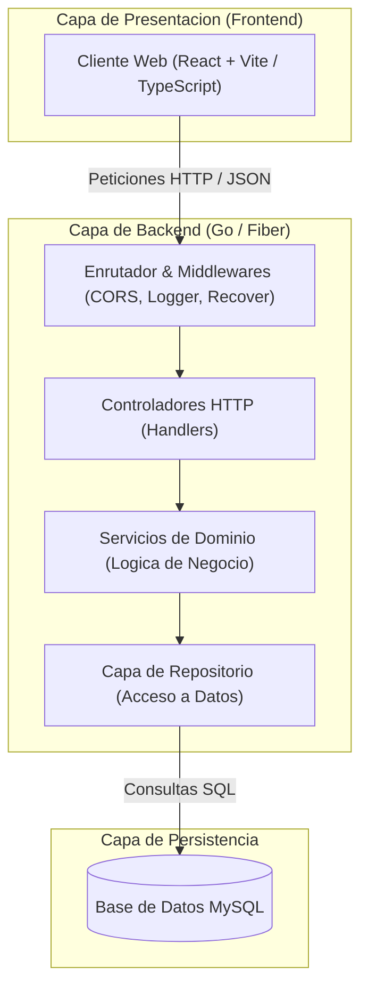

# Proyecto Felipe

Sistema web modular con arquitectura desacoplada, compuesto por un backend desarrollado en Go, un frontend en React y una base de datos relacional MySQL.

---

## 1. Stack Tecnologico

- **Backend:** Go (con Fiber como framework HTTP de alto rendimiento / soporte para `net/http` estandar).
- **Frontend:** React (SPA moderna construida con Vite y TypeScript).
- **Base de Datos:** MySQL 8.0+ (driver nativo `go-sql-driver/mysql` o ORM GORM / sqlc).
- **Arquitectura:** Diseno por capas limpias (Presentacion, Control/Handlers, Dominio/Servicios, Persistencia/Repositorios).

---

## 2. Prerrequisitos de Entorno

Asegurate de contar con las siguientes herramientas instaladas en tu sistema:

- **Go:** Version 1.22 o superior ([golang.org](https://golang.org/dl/))
- **Node.js:** Version 18.0 o superior con `npm` ([nodejs.org](https://nodejs.org/))
- **MySQL Server:** Version 8.0 o superior ([mysql.com](https://www.mysql.com/)) o contenedor Docker
- **Git:** Version 2.30 o superior ([git-scm.com](https://git-scm.com/))

---

## 3. Estructura del Proyecto

El repositorio esta organizado siguiendo una separacion estricta de responsabilidades:

```text
Proyecto_felipe/
├── backend/                  # Codigo fuente de la API REST en Go
│   ├── cmd/
│   │   └── api/
│   │       └── main.go       # Punto de entrada de la aplicacion
│   ├── internal/
│   │   ├── config/           # Carga de variables de entorno y configuracion
│   │   ├── database/         # Conexion y migraciones a MySQL
│   │   ├── domain/           # Entidades y contratos de interfaz (modelos)
│   │   ├── handler/          # Controladores HTTP (Fiber / net/http)
│   │   ├── repository/       # Implementacion de persistencia SQL (MySQL)
│   │   └── service/          # Reglas de negocio y casos de uso
│   ├── go.mod                # Dependencias de modulos Go
│   └── go.sum
├── frontend/                 # Aplicacion cliente en React
│   ├── src/
│   │   ├── assets/           # Recursos estaticos y vectores SVG
│   │   ├── components/       # Componentes visuales reutilizables
│   │   ├── hooks/            # Hooks personalizados para logica de estado
│   │   ├── pages/            # Vistas principales de navegacion
│   │   ├── services/         # Clientes HTTP y llamadas a la API
│   │   ├── types/            # Definiciones e interfaces TypeScript
│   │   ├── App.tsx           # Componente raiz y rutas
│   │   └── main.tsx          # Punto de montaje React
│   ├── package.json          # Dependencias y scripts de Node.js
│   ├── tsconfig.json         # Configuracion estricta de TypeScript
│   └── vite.config.ts        # Configuracion del empaquetador Vite
├── docs/                     # Diagramas de arquitectura y documentacion tecnica
│   ├── architecture.mmd      # Fuente del diagrama en Mermaid
│   ├── architecture.png      # Diagrama compilado en alta resolucion
│   └── architecture.svg      # Diagrama vectorial escalable
├── .env.example              # Plantilla base de variables de entorno
└── README.md                 # Documentacion tecnica del proyecto
```

---

## 4. Arquitectura del Sistema

La comunicacion entre capas se realiza a traves de interfaces de dominio, garantizando bajo acoplamiento e independencia del motor HTTP y de la base de datos:



> Nota: Los diagramas renderizados estan disponibles en formato de imagen en [docs/architecture.png](file:///c:/Users/santi/Desktop/Proyecto_felipe/docs/architecture.png) y [docs/architecture.svg](file:///c:/Users/santi/Desktop/Proyecto_felipe/docs/architecture.svg).

---

## 5. Variables de Entorno

Copia el archivo `.env.example` en la raiz o en el directorio correspondiente antes de iniciar la aplicacion:

```powershell
Copy-Item .env.example .env
```

| Variable | Descripcion | Valor por Defecto |
| :--- | :--- | :--- |
| `PORT` | Puerto de escucha del servidor Go | `8080` |
| `APP_ENV` | Entorno de ejecucion (`development` / `production`) | `development` |
| `APP_NAME` | Nombre identificador de la aplicacion | `ProyectoFelipe` |
| `DB_HOST` | Host o direccion del servidor MySQL | `127.0.0.1` |
| `DB_PORT` | Puerto de conexion MySQL | `3306` |
| `DB_USER` | Usuario con privilegios en la base de datos | `root` |
| `DB_PASSWORD` | Contrasena del usuario de base de datos | `secret` |
| `DB_NAME` | Nombre de la base de datos relacional | `proyecto_felipe_db` |
| `CORS_ALLOWED_ORIGINS` | Origenes permitidos para solicitudes cross-origin | `http://localhost:5173` |
| `VITE_API_BASE_URL` | URL base de la API consumida por el frontend React | `http://localhost:8080/api/v1` |

---

## 6. Instalacion y Puesta en Marcha

### 6.1. Configuracion de la Base de Datos (MySQL)

Crea la base de datos en tu servidor local de MySQL:

```sql
CREATE DATABASE proyecto_felipe_db CHARACTER SET utf8mb4 COLLATE utf8mb4_unicode_ci;
```

### 6.2. Backend (Go)

1. Ingresa al directorio del backend:
   ```powershell
   cd backend
   ```
2. Descarga las dependencias:
   ```powershell
   go mod download
   ```
3. Ejecuta el servidor en modo desarrollo:
   ```powershell
   go run cmd/api/main.go
   ```
   El servidor estara disponible en `http://localhost:8080`.

### 6.3. Frontend (React)

1. Ingresa al directorio del frontend:
   ```powershell
   cd frontend
   ```
2. Instala las dependencias del proyecto:
   ```powershell
   npm install
   ```
3. Inicia el servidor de desarrollo local:
   ```powershell
   npm run dev
   ```
   La aplicacion web estara disponible en `http://localhost:5173`.

---

## 7. Contratos de API Principales

Todos los endpoints responden en formato JSON y siguen los codigos de estado HTTP estandar:

| Metodo | Endpoint | Descripcion | Codigo Exito | Codigo Error |
| :--- | :--- | :--- | :--- | :--- |
| `GET` | `/api/v1/health` | Verificacion de estado del servicio y conexion a BD | `200 OK` | `503 Service Unavailable` |
| `GET` | `/api/v1/recursos` | Listado paginado de registros | `200 OK` | `500 Internal Server Error` |
| `GET` | `/api/v1/recursos/:id` | Consulta detallada de un registro especifico | `200 OK` | `404 Not Found` |
| `POST` | `/api/v1/recursos` | Creacion de un nuevo recurso | `201 Created` | `400 Bad Request` |
| `PUT` | `/api/v1/recursos/:id` | Actualizacion total de un recurso existente | `200 OK` | `400 / 404` |
| `DELETE` | `/api/v1/recursos/:id` | Eliminacion logica o fisica de un registro | `204 No Content` | `404 Not Found` |

---

## 8. Calidad y Verificacion

Antes de confirmar cambios o abrir revisiones de codigo, ejecuta las suites de validacion:

- **Backend (Go):**
  ```powershell
  go test -v -race ./...
  go vet ./...
  ```
- **Frontend (React):**
  ```powershell
  npm run lint
  npm run build
  ```

---

## 9. Convencion de Commits

Los mensajes de confirmacion en Git deben seguir la especificacion de Conventional Commits en idioma espanol, en minusculas y sin emojis:

- `feat: agregar controlador para gestion de usuarios`
- `fix: corregir conexion del pool a mysql en arranque`
- `refactor: desacoplar capa de servicio del router http`
- `docs: actualizar contratos de api en el readme`
- `chore: configurar variables de entorno en docker-compose`
