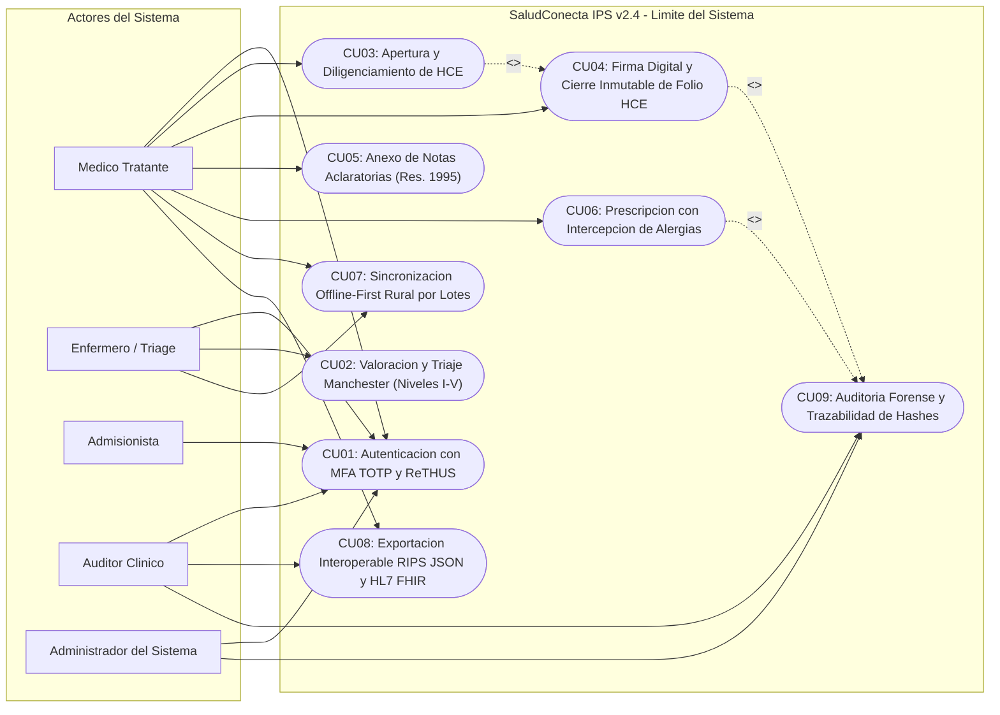
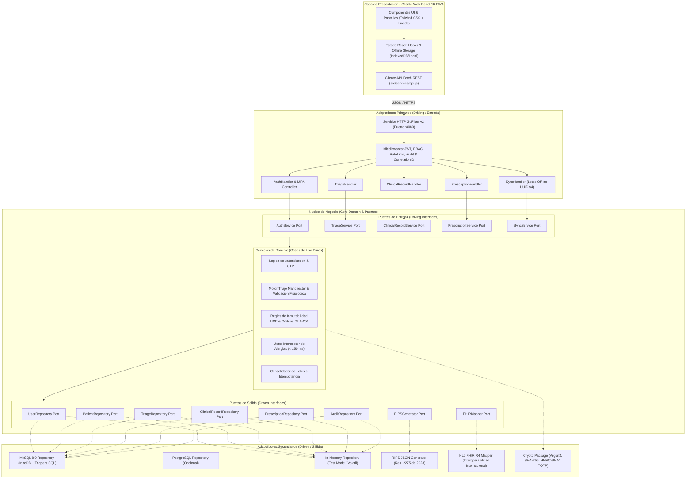
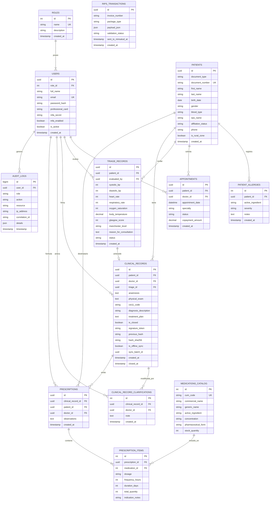
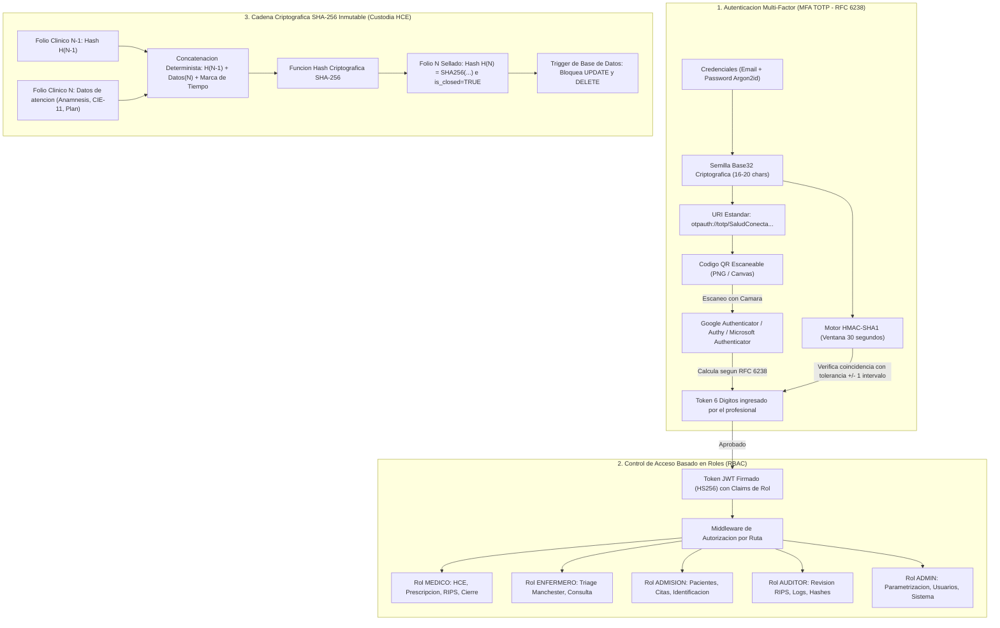
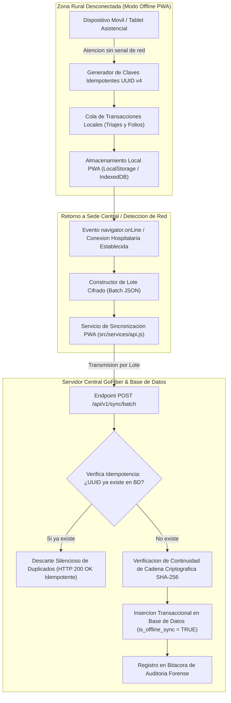

# Corporacion de Estudios Tecnologicos del Norte del Valle (COTECNOVA)

## Ingenieria de Sistemas - Ingenieria de Software II

### Periodo Academico: 2026-2 | Docente: Felipe Gutierrez Isaza

### Proyecto Final: Sistema Clinico Hospitalario «SaludConecta IPS v2.4»

---

## 1. Descripcion del Proyecto y Arquitectura Tecnica

«SaludConecta IPS v2.4» es una plataforma de software hospitalario de mision critica disenada para gestionar procesos clinicos asistenciales bajo altos estandares de fiabilidad, seguridad y rendimiento: admision hospitalaria, triaje estructurado bajo el protocolo internacional de Manchester, Historia Clinica Electronica (HCE) con sellado criptografico inmutable (Resolucion 1995 de 1999 de MinSalud), prescripcion medica con intercepcion de alergias farmacologicas en tiempo real (< 150 ms ante Betalactamicos) e interoperabilidad normativa mediante RIPS JSON (Resolucion 2275 de 2023) y HL7 FHIR Release 4.

### Stack Tecnologico

- **Backend:** Go 1.22+ estructurado bajo **Arquitectura Hexagonal Estricta (Puertos y Adaptadores)** utilizando el framework web de alto desempeno **GoFiber (v2)**.
- **Frontend:** React 18 (Vite 5, Tailwind CSS 3, Lucide Icons, arquitectura modular de componentes accesibles y soporte PWA para atencion offline en brigadas rurales). Disenado bajo el sistema de diseno asistencial oficial de Stitch (Proyecto ID: `3409750822053339349`).
- **Persistencia de Datos:** MySQL 8.0+ relacional con motor InnoDB, integridad referencial estricta, triggers de inmutabilidad y compatibilidad para adaptadores PostgreSQL y almacenamiento volatil en memoria.
- **Estandar de Calidad:** Evaluado, asegurado y documentado bajo el estandar internacional **ISO/IEC 25010** y lineamientos de seguridad **OWASP ASVS Nivel 2**.

---

## 2. Integrantes y Asignacion de Roles del Equipo

| Nombre del Integrante                                  | Rol Asignado                           | Responsabilidades Principales                                                                                                  |
| :----------------------------------------------------- | :------------------------------------- | :----------------------------------------------------------------------------------------------------------------------------- |
| **Santiago Velez**                                     | Lider Tecnico / Arquitecto de Software | Diseno de arquitectura hexagonal, definicion de puertos y adaptadores, coordinacion tecnica del stack Go/Fiber y persistencia. |
| **Santiago Arcos**                                     | Responsable de Pruebas (QA / Testing)  | Diseno de casos de prueba aplicando particion de equivalencia y valores limite, automatizacion de suites en Go y React.        |
| **Juan Jose Sanchez**                                  | Responsable de Calidad (ISO/IEC 25010) | Evaluacion de caracteristicas de calidad ISO 25010, bitacora de defectos (DEF-01 a DEF-04) y verificacion de seguridad.        |
| **Santiago Velez, Santiago Arcos y Juan Jose Sanchez** | Responsables de Documentacion          | Elaboracion de especificaciones formales de requisitos, marco normativo (Res. 1995 / 2275), criterios BDD y manuales tecnicos. |

---

## 3. Gestion del Proyecto en Trello

El flujo de trabajo, la priorizacion de requisitos y el ciclo de vida del desarrollo se gestionaron mediante el tablero oficial de Trello:

- [Tablero de Trello del Equipo](https://trello.com/b/HUUP8uyu/proyecto-de-felipe)

### Organizacion de las Listas Operativas:

1. **Por hacer (Backlog):** Requisitos funcionales (RF01 a RF06) priorizados mediante tecnica MoSCoW, diseno de modelos de dominio y contratos de interfaces.
2. **En curso (In Progress):** Modulos y adaptadores en desarrollo activo (handlers HTTP, repositorios MySQL/Postgres y componentes de interfaz de usuario).
3. **En revision (In Review / Code Review):** Inspeccion de codigo estricta, analisis estatico con `go vet` y verificacion de desacoplamiento de capas segun la Arquitectura Hexagonal.
4. **Hecho (Done):** Incrementos de software con pruebas automatizadas aprobadas (100% pass), sin defectos criticos abiertos y con trazabilidad documental completa.

---

## 4. Requisitos del Sistema

### 4.1. Requisitos Funcionales (Priorizacion MoSCoW)

| Codigo   | Nombre del Requisito                    | Descripcion Detallada                                                                                                                                                                                                                                                                                       | Prioridad MoSCoW |
| :------- | :-------------------------------------- | :---------------------------------------------------------------------------------------------------------------------------------------------------------------------------------------------------------------------------------------------------------------------------------------------------------- | :--------------- |
| **RF01** | Autenticacion, MFA y Roles RBAC         | Control de acceso basado en roles asistenciales (MEDICO, ENFERMERO, ADMISION, AUDITOR, ADMIN) con tokens JWT (HS256) y autenticacion multifactor obligatoria mediante algoritmo TOTP (RFC 6238) con generador y validador de codigo QR escaneable en Google Authenticator, Authy y Microsoft Authenticator. | **Must Have**    |
| **RF02** | Triaje Manchester y Guardia Fisiologica | Valoracion en urgencias con semaforizacion automatica en 5 niveles (Nivel I Rojo a Nivel V Azul) segun constantes vitales e intercepcion preventiva de rangos fisiologicos incompatibles (Escala de Glasgow < 3 o > 15, Frecuencia Cardiaca <= 0 o > 300 lpm, etc.).                                        | **Must Have**    |
| **RF03** | HCE e Inmutabilidad Absoluta            | Registro de atencion clinica con bloqueo de modificacion post-cierre. Una vez firmado electronicamente el folio, cualquier peticion de mutacion es rechazada con HTTP 403 Forbidden y protegida por triggers a nivel de base de datos (Resolucion 1995 de 1999).                                            | **Must Have**    |
| **RF04** | Cadena Criptografica SHA-256            | Calculo determinista de hash SHA-256 encadenado que incorpora el hash del folio previo del paciente, asegurando custodia legal, no repudio y trazabilidad inalterable ante auditorias forenses.                                                                                                             | **Must Have**    |
| **RF05** | Intercepcion Farmacologica de Alergias  | Cruce de seguridad en tiempo real entre el principio activo del catalogo CUM recetado y los antecedentes alergicos del paciente. Respuesta en < 150 ms bloqueando prescripciones conflictivas (ej. Betalactamicos / Penicilinas).                                                                           | **Must Have**    |
| **RF06** | Sincronizacion Offline-First Rural      | Consolidacion por lotes idempotentes con identificadores UUID v4 de folios y triajes capturados en brigadas rurales desconectadas, garantizando validacion de firmas y continuidad de la cadena criptografica.                                                                                              | **Should Have**  |

### 4.2. Requisitos No Funcionales (RNF)

| Codigo    | Criterio de Calidad                            | Descripcion y Metrica de Aceptacion                                                                                                                                                                                                      |
| :-------- | :--------------------------------------------- | :--------------------------------------------------------------------------------------------------------------------------------------------------------------------------------------------------------------------------------------- |
| **RNF01** | Latencia de Respuesta (Eficiencia)             | El percentil 95 (p95) de la latencia en operaciones de lectura y emision de prescripciones debe ser inferior a 400 ms bajo concurrencia asistencial estandar.                                                                            |
| **RNF02** | Trazabilidad y Auditoria Forense               | Cada peticion debe portar y propagar un encabezado `X-Correlation-ID` unico (UUID v4). Las operaciones de mutacion quedan persistidas en bitacora inalterable con IP, marca de tiempo UTC y actor institucional (ISO/IEC 27001).         |
| **RNF03** | Seguridad en Aplicaciones (OWASP ASVS Nivel 2) | Proteccion contra inyeccion SQL mediante sentencias preparadas, hashing de contrasenas mediante Argon2id/Bcrypt (coste 12), expiracion de tokens JWT, limitacion de tasa de peticiones (Rate Limiting) y sanitizacion de cabeceras CORS. |
| **RNF04** | Inmutabilidad Criptografica de Datos           | Toda modificacion fisica a folios cerrados debe ser prevenida tanto en la capa de aplicacion como en el motor de base de datos relacional mediante disparadores `BEFORE UPDATE` y `BEFORE DELETE`.                                       |
| **RNF05** | Resiliencia y Disponibilidad en Zonas Rurales  | Operacion asistencial autonoma en ausencia de conexion a internet mediante almacenamiento local PWA y resolucion determinista de duplicados al sincronizar con la sede central.                                                          |

---

## 5. Arquitectura del Sistema y Diagramas UML

Los diagramas tecnicos del sistema han sido modelados en sintaxis Mermaid y pre-compilados en alta resolucion (`.png` a escala 2x con fondo solido blanco y `.svg` vectoriales) en el directorio `docs/diagrams/`:

### 5.1. Diagrama de Casos de Uso del Sistema (UML)

Representa los limites del sistema «SaludConecta IPS v2.4», los actores humanos involucrados y los 9 casos de uso esenciales:




- Archivo fuente: [`docs/diagrams/01_casos_de_uso.mmd`](docs/diagrams/01_casos_de_uso.mmd)
- Imagen de alta resolucion: [`docs/diagrams/01_casos_de_uso.png`](docs/diagrams/01_casos_de_uso.png) | Vectorial: [`docs/diagrams/01_casos_de_uso.svg`](docs/diagrams/01_casos_de_uso.svg)

---

### 5.2. Diagrama de Arquitectura Hexagonal y Flujo Integral (Go + React)

Ilustra la separacion estricta entre la capa de presentacion web (React 18 PWA), los adaptadores primarios HTTP (GoFiber), los puertos de entrada, los servicios puros de dominio (casos de uso clinicos), los puertos de salida y los adaptadores secundarios (MySQL, PostgreSQL, Memoria, RIPS y FHIR):




- Archivo fuente: [`docs/diagrams/02_arquitectura_hexagonal.mmd`](docs/diagrams/02_arquitectura_hexagonal.mmd)
- Imagen de alta resolucion: [`docs/diagrams/02_arquitectura_hexagonal.png`](docs/diagrams/02_arquitectura_hexagonal.png) | Vectorial: [`docs/diagrams/02_arquitectura_hexagonal.svg`](docs/diagrams/02_arquitectura_hexagonal.svg)

---

### 5.3. Diagrama de Base de Datos y Modelo Entidad-Relacion (ERD)

Estructura relacional de 13 tablas implementada en MySQL 8.0 (motor InnoDB) con llaves primarias, foraneas, restricciones de integridad referencial y disparadores de inmutabilidad:




- Archivo fuente: [`docs/diagrams/03_modelo_entidad_relacion.mmd`](docs/diagrams/03_modelo_entidad_relacion.mmd)
- Imagen de alta resolucion: [`docs/diagrams/03_modelo_entidad_relacion.png`](docs/diagrams/03_modelo_entidad_relacion.png) | Vectorial: [`docs/diagrams/03_modelo_entidad_relacion.svg`](docs/diagrams/03_modelo_entidad_relacion.svg)

---

### 5.4. Diagramas de Secuencia UML (Procesos Asistenciales Clave)

#### A. Triaje Manchester y Deteccion de Rangos Fisiologicos Invalidos

Describe la captura de constantes vitales, el analisis de valores limite y la clasificacion automatica segun el protocolo internacional de 5 niveles:


- Archivo fuente: [`docs/diagrams/04_secuencia_triaje.mmd`](docs/diagrams/04_secuencia_triaje.mmd)
- Imagen de alta resolucion: [`docs/diagrams/04_secuencia_triaje.png`](docs/diagrams/04_secuencia_triaje.png) | Vectorial: [`docs/diagrams/04_secuencia_triaje.svg`](docs/diagrams/04_secuencia_triaje.svg)

#### B. Inmutabilidad de Historia Clinica, Cierre Criptografico y Notas Aclaratorias

Detalla el cierre de folio, la generacion del hash SHA-256 encadenado, el rechazo con HTTP 403 Forbidden ante intentos ilegales de mutacion y el anexo normativo de notas aclaratorias segun la Resolucion 1995 de 1999:


- Archivo fuente: [`docs/diagrams/05_secuencia_hce_inmutabilidad.mmd`](docs/diagrams/05_secuencia_hce_inmutabilidad.mmd)
- Imagen de alta resolucion: [`docs/diagrams/05_secuencia_hce_inmutabilidad.png`](docs/diagrams/05_secuencia_hce_inmutabilidad.png) | Vectorial: [`docs/diagrams/05_secuencia_hce_inmutabilidad.svg`](docs/diagrams/05_secuencia_hce_inmutabilidad.svg)

#### C. Intercepcion de Alergias Farmacologicas Cruzadas (< 150 ms)

Muestra el cruce entre medicamentos formulados del catalogo CUM y los antecedentes alergicos del paciente, deteniendo la emision ante riesgo de anafilaxia por Betalactamicos:


- Archivo fuente: [`docs/diagrams/06_secuencia_prescripcion_alergias.mmd`](docs/diagrams/06_secuencia_prescripcion_alergias.mmd)
- Imagen de alta resolucion: [`docs/diagrams/06_secuencia_prescripcion_alergias.png`](docs/diagrams/06_secuencia_prescripcion_alergias.png) | Vectorial: [`docs/diagrams/06_secuencia_prescripcion_alergias.svg`](docs/diagrams/06_secuencia_prescripcion_alergias.svg)

---

### 5.5. Arquitectura de Seguridad, Criptografia y Control de Acceso

Modela los tres pilares de defensa institucional: Autenticacion Multi-Factor (MFA TOTP RFC 6238 con QR escaneable), Control de Acceso Basado en Roles (RBAC) y Cadena Inmutable de Hashes SHA-256 con Triggers SQL:




- Archivo fuente: [`docs/diagrams/07_seguridad_mfa_sha256.mmd`](docs/diagrams/07_seguridad_mfa_sha256.mmd)
- Imagen de alta resolucion: [`docs/diagrams/07_seguridad_mfa_sha256.png`](docs/diagrams/07_seguridad_mfa_sha256.png) | Vectorial: [`docs/diagrams/07_seguridad_mfa_sha256.svg`](docs/diagrams/07_seguridad_mfa_sha256.svg)

---

### 5.6. Diagrama de Sincronizacion Offline-First para Brigadas Rurales

Describe la recoleccion desconectada en dispositivos asistenciales PWA, la generacion de claves idempotentes UUID v4 y la consolidacion por lotes en el backend central GoFiber:




- Archivo fuente: [`docs/diagrams/08_flujo_sync_rural_offline.mmd`](docs/diagrams/08_flujo_sync_rural_offline.mmd)
- Imagen de alta resolucion: [`docs/diagrams/08_flujo_sync_rural_offline.png`](docs/diagrams/08_flujo_sync_rural_offline.png) | Vectorial: [`docs/diagrams/08_flujo_sync_rural_offline.svg`](docs/diagrams/08_flujo_sync_rural_offline.svg)

---

## 6. Estructura Exacta del Repositorio

```text
proyecto-final/
├── README.md                      # Presentacion institucional, requisitos, arquitectura y diagramas
├── .gitignore                     # Exclusion estricta de credenciales, binarios y artefactos temporales
├── .env.example                   # Variables de entorno plantilla con valores genericos seguros
├── go.work                        # Workspace de Go para coordinacion multi-modulo
├── docs/
│   ├── especificacion.md          # Alcance formal, RF (MoSCoW), RNF y Criterios BDD (Gherkin)
│   ├── plan-de-pruebas.md         # Particion de equivalencia, valores limite y matriz RTM
│   ├── informe-calidad.md         # ISO/IEC 25010, bitacora de defectos tecnicos y refactorizacion
│   ├── diagrams/                  # Diagramas tecnicos compilados (Mermaid, PNG 2x y SVG)
│   │   ├── 01_casos_de_uso.png (.svg / .mmd)
│   │   ├── 02_arquitectura_hexagonal.png (.svg / .mmd)
│   │   ├── 03_modelo_entidad_relacion.png (.svg / .mmd)
│   │   ├── 04_secuencia_triaje.png (.svg / .mmd)
│   │   ├── 05_secuencia_hce_inmutabilidad.png (.svg / .mmd)
│   │   ├── 06_secuencia_prescripcion_alergias.png (.svg / .mmd)
│   │   ├── 07_seguridad_mfa_sha256.png (.svg / .mmd)
│   │   └── 08_flujo_sync_rural_offline.png (.svg / .mmd)
│   └── stitch_designs/            # Maquetas visuales y capturas oficiales de Stitch
│       ├── 01_auth_mfa.html (.png)
│       ├── 02_dashboard_espera.html (.png)
│       ├── 03_historia_clinica_hce.html (.png)
│       ├── 04_triaje_manchester.html (.png)
│       └── 05_prescripcion_alergia.html (.png)
├── src/
│   ├── backend/                   # Codigo fuente Go + Fiber (Arquitectura Hexagonal)
│   │   ├── cmd/api/main.go        # Punto de entrada e inyeccion de dependencias
│   │   ├── core/                  # Dominio puro, puertos y logica de casos de uso
│   │   │   ├── domain/            # Entidades de negocio (Patient, Triage, Record, Prescription)
│   │   │   ├── ports/             # Contratos de interfaces (Driving y Driven)
│   │   │   └── services/          # Logica de aplicacion, guardia fisiologica e inmutabilidad
│   │   ├── adapters/              # Adaptadores de entrada y salida
│   │   │   ├── http/              # Handlers Fiber, DTOs y middlewares (JWT, RBAC)
│   │   │   ├── storage/           # Implementaciones MySQL, PostgreSQL y memoria
│   │   │   └── interoperability/  # Generador RIPS JSON y mapeador HL7 FHIR
│   │   ├── database/schema.sql    # DDL relacional, indices y triggers SQL de inmutabilidad
│   │   ├── pkg/                   # Utilidades transversales (crypto, logger estructurado)
│   │   ├── go.mod                 # Modulo de Go del backend
│   │   └── go.sum                 # Sumas criptograficas de dependencias Go
│   └── frontend/                  # Codigo fuente de React 18 (Vite 5 + Tailwind CSS 3)
│       ├── index.html             # Plantilla HTML5 accesible
│       ├── package.json           # Dependencias y scripts de ejecucion/pruebas
│       ├── postcss.config.js      # Configuracion de PostCSS
│       ├── tailwind.config.js     # Tokens clinicos y extensiones de diseno
│       ├── vite.config.js         # Configuracion de Vite y enrutamiento de tests
│       ├── README.md              # Documentacion detallada del cliente web
│       └── src/
│           ├── main.jsx           # Montaje raiz en el DOM
│           ├── App.jsx            # Enrutador asistencial y estado de sesion
│           ├── index.css          # Estilos globales y capas de Tailwind
│           ├── setupTests.js      # Extensiones jest-dom para pruebas Vitest
│           ├── components/        # Componentes reutilizables
│           │   ├── Header.jsx     # Barra superior, busqueda de pacientes y modo offline
│           │   ├── Sidebar.jsx    # Navegacion modular y widget SHA-256
│           │   ├── AllergyAlertModal.jsx # Modal critico ante contraindicaciones
│           │   └── MfaQrModal.jsx # Modal con QR escaneable en Google Authenticator/Authy
│           ├── screens/           # Pantallas asistenciales (Stitch Design System)
│           │   ├── AuthScreen.jsx # Acceso, sede, password ReTHUS y QR escaneable directo
│           │   ├── DashboardScreen.jsx # Indicadores KPI y sala de espera Manchester
│           │   ├── TriageScreen.jsx    # Captura de constantes y escala Glasgow
│           │   ├── HceScreen.jsx  # Historia clinica, pestañas y sellado inmutable
│           │   ├── PrescriptionScreen.jsx # Prescripcion e intercepcion farmacologica
│           │   └── SecurityMfaScreen.jsx  # Panel activo de seguridad MFA y auditoria
│           ├── services/
│           │   └── api.js         # Cliente API con soporte offline y fallback
│           └── utils/
│               └── totp.js        # Motor criptografico TOTP RFC 6238 y generador QR
└── tests/
    ├── backend/                   # Pruebas automatizadas en Go (Triage, HCE, Alergias, Sync)
    │   ├── triage_test.go         # Particion de equivalencia y valores limite Manchester
    │   ├── clinical_record_test.go# Verificacion de inmutabilidad y bloqueo de edicion
    │   ├── prescription_test.go   # Intercepcion de alergias farmacologicas (< 150 ms)
    │   ├── sync_test.go           # Sincronizacion offline por lotes e idempotencia
    │   ├── fixtures_test.go       # Generadores de datos de prueba
    │   ├── go.mod                 # Modulo de pruebas de Go
    │   └── go.sum                 # Sumas criptograficas del modulo de pruebas
    └── frontend/                  # Pruebas automatizadas en React (Vitest + Testing Library)
        ├── AllergyAlertModal.test.jsx # Verificacion de componente modal ante alergias
        └── totp.test.js           # Verificacion de algoritmo TOTP RFC 6238 y vector oficial
```

---

## 7. Guia de Instalacion y Ejecucion Local

### 7.1. Configuracion de la Base de Datos (MySQL)

1. Conectate a tu motor local de MySQL e importa el esquema DDL y los disparadores de auditoria:

   ```sql
   CREATE DATABASE IF NOT EXISTS saludconecta_db CHARACTER SET utf8mb4 COLLATE utf8mb4_unicode_ci;
   USE saludconecta_db;
   SOURCE src/backend/database/schema.sql;
   ```

2. Configura las variables de entorno para el backend creando el archivo `.env` en la raiz o en `src/backend/` tomando como base `.env.example`.

### 7.2. Puesta en Marcha del Backend (Go)

Desde la terminal en la raiz del proyecto:

```powershell
cd src/backend
go run cmd/api/main.go
```

_El servicio HTTP de GoFiber iniciara escuchando en el puerto configurado (por defecto `http://localhost:8080`)._

> **Nota para pruebas en memoria:** Si deseas ejecutar el backend sin depender de MySQL o PostgreSQL activo, define la variable de entorno antes de ejecutar: `$env:DB_DRIVER="memory"; go run cmd/api/main.go`.

### 7.3. Puesta en Marcha del Frontend (React)

```powershell
cd src/frontend
npm install
npm run dev
```

_El servidor de desarrollo Vite servira la aplicacion web asistencial en `http://localhost:5173` o `http://localhost:5174` con proxy inverso automatico `/api` hacia el backend._

---

## 8. Instrucciones para Ejecutar las Pruebas Automatizadas

### 8.1. Pruebas Automatizadas del Backend (Go)

Las pruebas automatizadas de caja blanca y de integracion logica se ejecutan con la herramienta nativa de Go:

1. **Desde la raiz del proyecto (utilizando el workspace de pruebas):**

   ```powershell
   go test ./tests/backend/... -v
   ```

2. **O ingresando directamente al modulo de pruebas de backend:**

   ```powershell
   cd tests/backend
   go test -v ./...
   ```

3. **Para ejecutar las pruebas internas de los servicios del backend:**
   ```powershell
   cd src/backend
   go test -v ./...
   ```

### 8.2. Pruebas Automatizadas del Frontend (React)

```powershell
cd src/frontend
npm test
```

_Ejecuta la suite con Vitest, validando el modal de intercepcion de alergias y el algoritmo criptografico TOTP RFC 6238 contra el vector oficial internacional._

---

## 9. Variables de Entorno de Muestra (`.env.example`)

Siguiendo la politica de proteccion de infraestructura sensible (Regla 27), todas las credenciales y puertos reales se mantienen confidenciales mediante mascaras genericas:

| Variable               | Descripcion                                               | Valor de Muestra                              |
| :--------------------- | :-------------------------------------------------------- | :-------------------------------------------- |
| `PORT`                 | Puerto de escucha del servicio HTTP GoFiber               | `8080`                                        |
| `DB_DRIVER`            | Adaptador de persistencia (`mysql`, `postgres`, `memory`) | `mysql`                                       |
| `DB_HOST`              | Host del motor de base de datos relacional                | `localhost`                                   |
| `DB_PORT`              | Puerto del motor de base de datos                         | `3306`                                        |
| `DB_USER`              | Usuario de conexion con permisos DDL/DML                  | `root`                                        |
| `DB_PASSWORD`          | Clave de acceso a la base de datos                        | `secret_password`                             |
| `DB_NAME`              | Nombre de la base de datos clinica                        | `saludconecta_db`                             |
| `JWT_SECRET`           | Semilla secreta para la firma de tokens HS256             | `super_secret_seed_key`                       |
| `CORS_ALLOWED_ORIGINS` | Origenes web autorizados para consumo de la API           | `http://localhost:5173,http://localhost:5174` |
| `IPS_NIT`              | NIT de la institucion prestadora de salud                 | `900123456`                                   |
| `COD_PRESTADOR`        | Codigo de habilitacion MinSalud (12 digitos)              | `110010999901`                                |

---

## 10. Documentacion Tecnica Complementaria

Para consultar el detalle extendido de la ingenieria del proyecto, accede a los documentos tecnicos en el directorio `docs/`:

1. [Especificacion de Requisitos de Software (`docs/especificacion.md`)](docs/especificacion.md):
   - Marco regulatorio: Resolucion 1995 de 1999 (HCE) y Resolucion 2275 de 2023 (RIPS).
   - Requisitos Funcionales (RF01 a RF06) y No Funcionales (RNF01 a RNF05).
   - Escenarios de aceptacion formales en formato BDD (Dado-Cuando-Entonces / Gherkin).

2. [Plan de Pruebas y Tecnicas de Diseno (`docs/plan-de-pruebas.md`)](docs/plan-de-pruebas.md):
   - Particion de Equivalencia y Analisis de Valores Limite (Escala de Glasgow [3, 15], Frecuencia Cardiaca, Presion Arterial y Dosificacion Pediatrica).
   - Matriz de Trazabilidad de Requisitos (RTM).

3. [Informe de Calidad ISO/IEC 25010 (`docs/informe-calidad.md`)](docs/informe-calidad.md):
   - Evaluacion de las 6 caracteristicas esenciales de calidad de software.
   - Bitacora de defectos tecnicos registrados durante el ciclo de vida (DEF-01 a DEF-04).
   - Medidas de mantenimiento preventivo y refactorizaciones implementadas.

4. [Guia del Cliente Web y Arquitectura Frontend (`src/frontend/README.md`)](src/frontend/README.md):
   - Arquitectura React 18, Vite 5, Tailwind CSS y Lucide Icons.
   - Catalogo de pantallas basado en el diseno Stitch y soporte de operacion offline.
