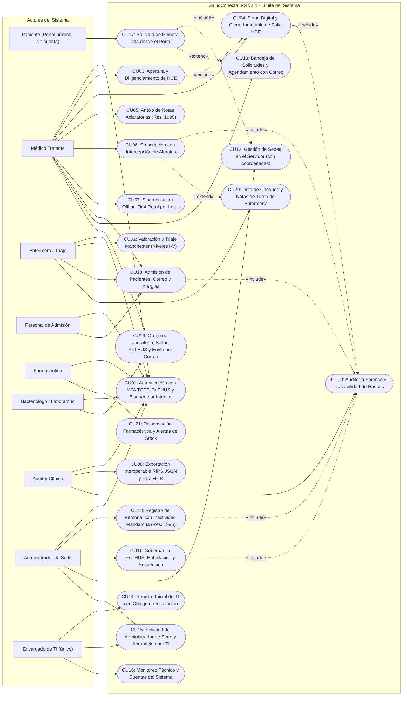
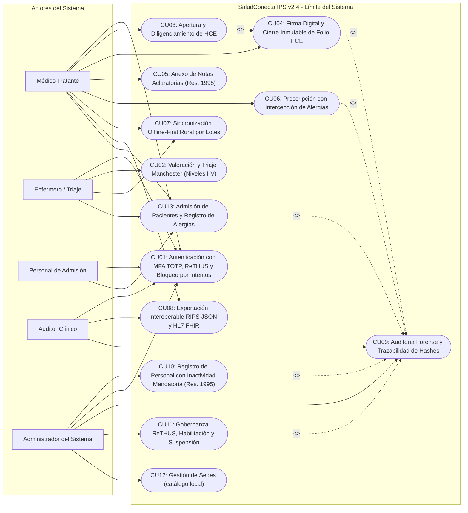
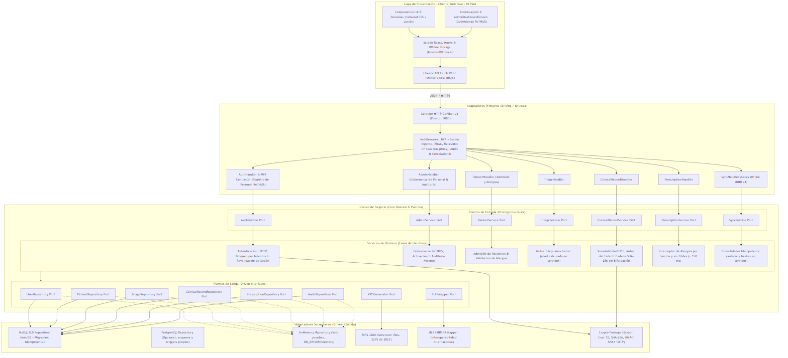
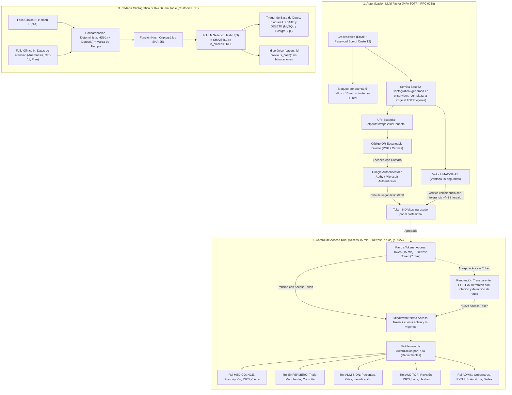
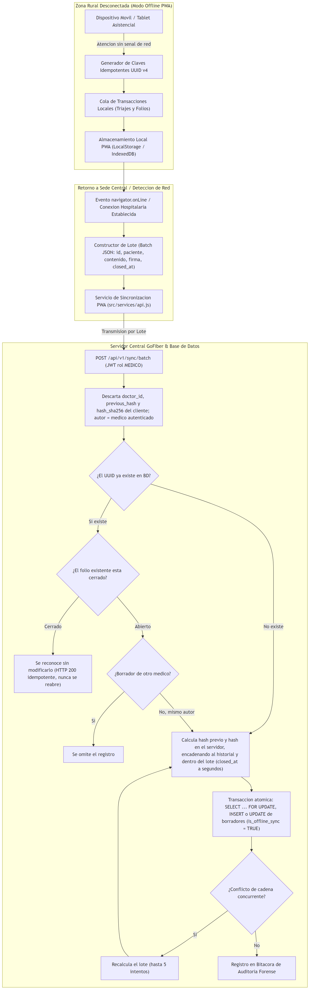
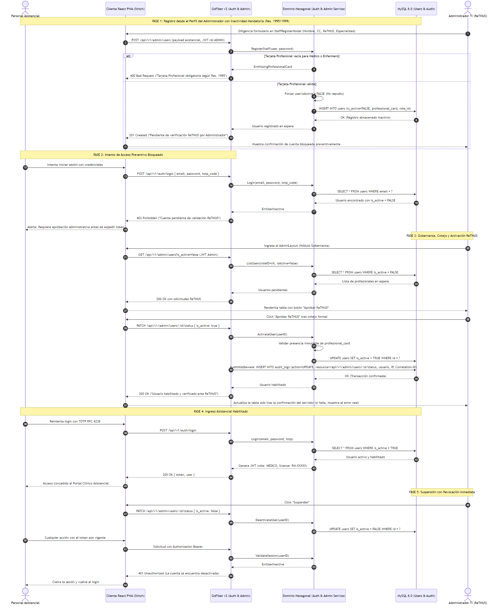
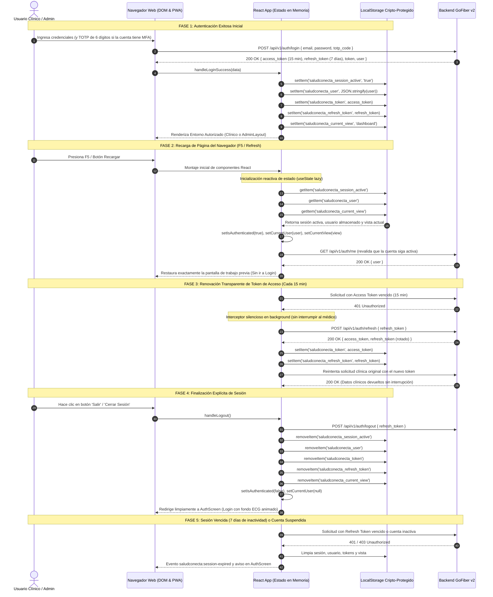

# Corporación de Estudios Tecnológicos del Norte del Valle (COTECNOVA)

## Ingeniería de Sistemas - Ingeniería de Software II

### Periodo Académico: 2026-2 | Docente: Felipe Gutiérrez Isaza

### Proyecto Final: Sistema Clínico Hospitalario «SaludConecta IPS v2.4»

### Entregable Maestro: Entrega-s2 (Seguimiento 2 - Calidad y Mantenimiento)
**Rama Oficial de Entrega:** `prueba` | **Tag de Versión:** `entrega-s2`  
**Herramientas y Modelos de Inteligencia Artificial (IA):** Google Antigravity con Gemini 3.8 Flash en High y Claude Code con Sonnet 5.5 en High

---

## 1. Descripción del Proyecto y Arquitectura Técnica

«SaludConecta IPS v2.4» es una plataforma de software hospitalario de misión crítica diseñada para gestionar procesos asistenciales y de gobernanza médica bajo los más altos estándares de fiabilidad, seguridad y rendimiento: admisión de pacientes y registro de alergias, triaje estructurado bajo el protocolo internacional de Manchester, Historia Clínica Electrónica (HCE) con sellado criptográfico inmutable (Resolución 1995 de 1999 de MinSalud), prescripción médica con intercepción de alergias farmacológicas en tiempo real (< 150 ms, con cruce por familia farmacológica: una alergia a penicilina bloquea amoxicilina), interoperabilidad normativa mediante RIPS JSON (Resolución 2275 de 2023) y HL7 FHIR Release 4, y un módulo integral de **Gobernanza de Personal Asistencial ReTHUS y Panel Administrativo Desacoplado** (Ley 1581 de 2012 e ISO/IEC 25010).

### Stack Tecnológico

- **Backend:** Go 1.22+ estructurado bajo **Arquitectura Hexagonal Estricta (Puertos y Adaptadores)** utilizando el framework web de alto desempeño **GoFiber (v2.52.16)**. Incluye migración automática e idempotente de esquema (`adapters/storage/mysql/seeder.go` y `adapters/storage/postgres/schema.sql`), configuración que falla de forma explícita ante valores inseguros (`pkg/config`) y creación del administrador inicial únicamente con credenciales definidas por el operador (sin cuentas ni claves por defecto).
- **Frontend:** React 18 (Vite 5, Tailwind CSS 3, Lucide Icons, arquitectura modular de componentes accesibles y soporte PWA para atención offline en brigadas rurales). Diseñado bajo el sistema de diseño asistencial oficial de Stitch (Proyecto ID: `3409750822053339349`), con separación estricta entre la interfaz clínica asistencial y el entorno administrativo de gobernanza (`AdminLayout`).
- **Persistencia de Datos:** MySQL 8.0+ relacional con motor InnoDB, integridad referencial estricta, disparadores SQL de inmutabilidad (folios cerrados y notas aclaratorias), índice único que impide bifurcar la cadena SHA-256, adaptador PostgreSQL con esquema y disparadores equivalentes, y un adaptador en memoria no persistente solo para pruebas, que se activa únicamente con `DB_DRIVER=memory`.
- **Estándar de Calidad:** Evaluado, asegurado y documentado bajo el estándar internacional **ISO/IEC 25010** y lineamientos de seguridad **OWASP ASVS Nivel 2**.

- **Herramientas de Inteligencia Artificial (Pair Programming & QA):** Google Antigravity impulsado por **Gemini 3.8 Flash en High** y Claude Code impulsado por **Sonnet 5.5 en High**, empleados para la concepción arquitectónica, diseño de pruebas automatizadas de regresión bajo ISO/IEC 25010 y documentación técnica viva.
---

## 2. Integrantes y Asignación de Roles del Equipo

| Nombre del Integrante                                  | Rol Asignado                           | Responsabilidades Principales                                                                                                   |
| :----------------------------------------------------- | :------------------------------------- | :------------------------------------------------------------------------------------------------------------------------------ |
| **Santiago Vélez**                                     | Líder Técnico / Arquitecto de Software | Diseño de arquitectura hexagonal, definición de puertos y adaptadores, gobernanza ReTHUS, coordinación Go/Fiber y persistencia. |
| **Santiago Arcos**                                     | Responsable de Pruebas (QA / Testing)  | Diseño de casos de prueba aplicando partición de equivalencia y valores límite, automatización de suites en Go y React.         |
| **Juan José Sánchez**                                  | Responsable de Calidad (ISO/IEC 25010) | Evaluación de características de calidad ISO 25010, bitácora de defectos (DEF-01 a DEF-04) y verificación de seguridad.         |
| **Santiago Vélez, Santiago Arcos y Juan José Sánchez** | Responsables de Documentación          | Elaboración de especificaciones formales de requisitos, marco normativo (Res. 1995 / 2275), criterios BDD y manuales técnicos.  |

### Persona de Pruebas Clínicas

Los casos de prueba clínicos se modelan con el **Dr. Santiago Vélez** (Medicina de Urgencias, Cartago - Hospital Central, Tarjeta Profesional ReTHUS de ejemplo `RM-94821-VALLE`). Por seguridad el sistema **no siembra cuentas con credenciales conocidas**: el Administrador inicial se define con `ADMIN_INITIAL_EMAIL` y `ADMIN_INITIAL_PASSWORD` y es quien registra al facultativo desde el panel administrativo (la cuenta nace inactiva hasta la verificación ReTHUS).

---

## 3. Gestión del Proyecto en Trello

El flujo de trabajo, la priorización de requisitos y el ciclo de vida del desarrollo se gestionaron mediante el tablero oficial de Trello:

- [Tablero de Trello del Equipo](https://trello.com/b/HUUP8uyu/proyecto-de-felipe)

### Organización de las Listas Operativas:

1. **Por hacer (Backlog):** Requisitos funcionales (RF01 a RF12) priorizados mediante técnica MoSCoW, diseño de modelos de dominio y contratos de interfaces.
2. **En curso (In Progress):** Módulos y adaptadores en desarrollo activo (handlers HTTP, repositorios MySQL/Postgres y componentes de interfaz de usuario).
3. **En revisión (In Review / Code Review):** Inspección de código estricta, análisis estático con `go vet` y verificación de desacoplamiento de capas según la Arquitectura Hexagonal.
4. **Hecho (Done):** Incrementos de software con pruebas automatizadas aprobadas (100% pass), sin defectos críticos abiertos y con trazabilidad documental completa.

---

## 4. Requisitos del Sistema

### 4.1. Requisitos Funcionales (Priorización MoSCoW)

| Código   | Nombre del Requisito                                   | Descripción Detallada                                                                                                                                                                                                                                                                                       | Prioridad MoSCoW |
| :------- | :----------------------------------------------------- | :---------------------------------------------------------------------------------------------------------------------------------------------------------------------------------------------------------------------------------------------------------------------------------------------------------- | :--------------- |
| **RF01** | Autenticación, MFA y Esquema Dual de Tokens | Control de acceso por roles (MEDICO, ENFERMERO, ADMISION, AUDITOR, ADMIN) mediante esquema dual de tokens JWT (HS256) con Access Token de 15 minutos y Refresh Token de 7 días con rotación automática y detección de reuso conforme a OWASP ASVS v4. Firma con `JWT_SECRET` obligatorio de al menos 32 caracteres y MFA TOTP (RFC 6238) con QR escaneable. El código TOTP se valida siempre en el servidor. Reemplazar o retirar un segundo factor activo exige el código vigente. Tras 5 intentos fallidos la cuenta se bloquea 15 minutos y las rutas de verificación tienen además un límite por IP real del cliente. En cada solicitud se revalida que la cuenta siga activa: suspender a un usuario revoca sus tokens de inmediato y el rol efectivo es el almacenado, no el declarado en el token. Renovación transparente en segundo plano vía `POST /auth/refresh` sin interrumpir la atención médica. | **Must Have** |
| **RF02** | Triaje Manchester y Guardia Fisiológica | Semaforización automática en 5 niveles calculada **siempre en el servidor** a partir de Glasgow, SpO2, FC, FR, PAS/PAD y temperatura (incluidas hipotermia e hipertermia: 30 °C es NIVEL_II, nunca NIVEL_V). Rangos plausibles: Glasgow 3-15, SpO2 0-100, FC 1-300, FR 1-80, PAS 1-300, PAD 1-200 y temperatura 20-45 °C (HTTP 422 fuera de rango). El cliente solo puede escalar a un nivel más urgente; un nivel fuera del catálogo o menos urgente que el clínico se rechaza. | **Must Have** |
| **RF03** | HCE e Inmutabilidad Absoluta | Registro de atención clínica con bloqueo de modificación post-cierre: un folio firmado no se reabre ni se reemplaza (tampoco al reenviar un lote de sincronización) y cualquier mutación se rechaza y está protegida por triggers a nivel de base de datos (MySQL y PostgreSQL), incluidas las notas aclaratorias, que son solo de anexo. Solo el médico autor del folio puede firmarlo o anexar notas (HTTP 403 en otro caso) (Resolución 1995 de 1999). | **Must Have** |
| **RF04** | Cadena Criptográfica SHA-256 | Hash SHA-256 encadenado que incorpora el hash del folio previo del paciente. La cabeza de la cadena es el último eslabón no referenciado; un índice único (paciente, hash previo) y un bloqueo por paciente con reintento impiden bifurcaciones cuando se cierran folios simultáneamente. La hora de cierre se sella con precisión de segundos para que lo firmado coincida con lo persistido y la verificación de integridad no falle. | **Must Have** |
| **RF05** | Intercepción Farmacológica de Alergias | Cruce en tiempo real entre los principios activos del medicamento (activo y genérico) y los antecedentes alérgicos del paciente **del folio** (nunca el paciente declarado por el cliente), sin distinguir mayúsculas ni tildes y por familia farmacológica: penicilina bloquea amoxicilina; también betalactámicos, cefalosporinas, AINE, quinolonas, macrólidos y sulfonamidas. Respuesta < 150 ms. Solo el autor del folio puede prescribir sobre él. | **Must Have** |
| **RF06** | Sincronización Offline-First Rural | Consolidación por lotes idempotentes con UUID v4 de folios capturados en brigadas rurales. El autor de cada folio es el médico autenticado; el hash previo y el hash los calcula el servidor y los encadena al historial del paciente; reenviar un lote nunca modifica un folio cerrado. El lote es atómico y se reintenta ante conflicto de cadena. | **Should Have** |
| **RF07** | Gobernanza de Personal y Habilitación ReTHUS           | Registro de personal exclusivo del Administrador, donde toda cuenta ingresa obligatoriamente inactiva (`is_active = FALSE`). Validación mandatoria de Tarjeta Profesional ReTHUS para roles médicos y de enfermería (Res. 1995/1999). Activación y suspensión controlada mediante auditoría forense inmutable.                 | **Must Have**    |
| **RF08** | Panel de Control Administrativo Desacoplado            | Entorno exclusivo para rol `ADMIN` (`AdminLayout`) aislado absolutamente de historias clínicas y consultas (Ley 1581 de 2012). Módulos de gobernanza de personal, bitácora forense de solo lectura alimentada por la API (inicios de sesión, mutaciones y lecturas de datos clínicos con usuario, rol, IP y Correlation-ID) y catálogo local de sedes. Los usuarios, estados y la bitácora provienen exclusivamente del servidor: si el backend falla o rechaza una operación se muestra el error real y nunca un éxito simulado.                                     | **Must Have**    |
| **RF09** | Perfil Asistencial y Administrativo con Alto Contraste | Perfil estilo red social con colección de 5 banners temáticos (Pediatría, Farmacia, Urgencias, Cirugía, Cardiología), carga reactiva de foto de perfil y encapsulación de identidad en un óvalo protector de alta luminosidad (`bg-white/95`) que garantiza contraste WCAG AAA sobre cualquier fondo.       | **Must Have**    |
| **RF10** | Menú Lateral Colapsable y Persistencia de Sesión F5    | Sidebar asistencial con modo colapsable (`w-20`) centrado exclusivamente en íconos con tooltips y margen reactivo (`ml-20`/`ml-64`). Persistencia local del estado de autenticación y vista activa que previene el cierre de sesión ante eventos de recarga del navegador (F5).                             | **Must Have**    |
| **RF11** | Admisión de Pacientes y Antecedentes Alérgicos | API de admisión (`POST /patients`, listado y búsqueda por documento) y registro de alergias (`POST /patients/:id/allergies`) para los roles ADMISION, ENFERMERO y MEDICO, con validación de catálogos (tipo de documento, sexo, grupo sanguíneo, afiliación y severidad) y rechazo de documentos duplicados (HTTP 409). | **Must Have** |
| **RF12** | Catálogo Farmacológico y Prescripción | Consulta del catálogo CUM institucional con stock (`GET /medications?q=`). El catálogo inicial de demostración usa códigos `CUM-DEMO-xxx` y debe sustituirse por la carga oficial del INVIMA. La prescripción descuenta inventario y rechaza stock insuficiente (HTTP 409). | **Should Have** |

### 4.2. Requisitos No Funcionales (RNF)

| Código    | Criterio de Calidad                            | Descripción y Métrica de Aceptación                                                                                                                                                                                              |
| :-------- | :--------------------------------------------- | :------------------------------------------------------------------------------------------------------------------------------------------------------------------------------------------------------------------------------- |
| **RNF01** | Latencia de Respuesta (Eficiencia)             | El percentil 95 (p95) de la latencia en operaciones de lectura y emisión de prescripciones debe ser inferior a 400 ms bajo concurrencia asistencial estándar.                                                                    |
| **RNF02** | Trazabilidad y Auditoría Forense               | Cada petición debe portar y propagar un encabezado `X-Correlation-ID` único (UUID v4). Las operaciones de mutación quedan persistidas en bitácora inalterable con IP, marca de tiempo UTC y actor institucional (ISO/IEC 27001). |
| **RNF03** | Seguridad en Aplicaciones (OWASP ASVS Nivel 2) | Esquema dual de tokens (Access Token 15 min / Refresh Token 7 días) con rotación automática (Refresh Token Rotation) y detección de reuso fraudulento, protección contra inyección SQL mediante sentencias preparadas, hashing de contraseñas con Bcrypt (coste 12), revocación inmediata de sesiones de cuentas suspendidas, bloqueo por cuenta tras 5 intentos fallidos, limitación de tasa por IP real del cliente (cabecera `X-Real-IP` solo desde proxies de confianza) y sanitización de cabeceras CORS. |
| **RNF04** | Inmutabilidad Criptográfica de Datos           | Toda modificación física a folios cerrados debe ser prevenida tanto en la capa de aplicación como en el motor de base de datos relacional mediante disparadores `BEFORE UPDATE` y `BEFORE DELETE`.                               |
| **RNF05** | Resiliencia y Disponibilidad en Zonas Rurales  | Operación asistencial autónoma en ausencia de conexión a internet mediante almacenamiento local PWA y resolución determinista de duplicados al sincronizar con la sede central.                                                  |
| **RNF06** | Configuración y Persistencia a Prueba de Fallos | El servicio no arranca sin `JWT_SECRET` seguro (mínimo 32 caracteres, distinto de cualquier valor publicado) y, si el motor de base de datos configurado no responde, termina con error: nunca conmuta en silencio a memoria, porque los registros clínicos se perderían al reiniciar. |
| **RNF07** | Gestión de Secretos | Ningún secreto ni cuenta por defecto en el código, el `docker-compose.yml` o la documentación. Las credenciales se definen en un `.env` privado y `docker compose` se detiene si faltan. Las plantillas `.env.example` solo contienen marcadores genéricos. |
| **RNF08** | Consistencia bajo Concurrencia | Los repositorios devuelven copias y protegen su estado con candados (verificable con `go test -race`); los cierres simultáneos del mismo paciente forman una cadena lineal; los lotes de sincronización son atómicos. |

---

## 5. Arquitectura del Sistema y Diagramas UML

Los diagramas técnicos del sistema han sido modelados en sintaxis Mermaid y pre-compilados en alta resolución (`.png` a escala 2x con fondo sólido blanco y `.svg` vectoriales) en el directorio `docs/diagrams/`:

### 5.1. Diagrama de Casos de Uso del Sistema (UML)

Representa los límites del sistema «SaludConecta IPS v2.4», los actores involucrados (Médico Tratante, Enfermero, Personal de Admisión, Auditor y Administrador) y los 13 casos de uso esenciales:





- Archivo fuente: [`docs/diagrams/01_casos_de_uso.mmd`](docs/diagrams/01_casos_de_uso.mmd)
- Imagen de alta resolución: [`docs/diagrams/01_casos_de_uso.png`](docs/diagrams/01_casos_de_uso.png) | Vectorial: [`docs/diagrams/01_casos_de_uso.svg`](docs/diagrams/01_casos_de_uso.svg)

---

### 5.2. Diagrama de Arquitectura Hexagonal y Flujo Integral (Go + React)

Ilustra la separación estricta entre la capa de presentación web (React 18 PWA y AdminLayout), los adaptadores primarios HTTP (GoFiber con AuthHandler, AdminHandler, PatientHandler y demás controladores), los puertos de entrada, los servicios puros de dominio (AuthService, AdminService, PatientService, ClinicalRecordService, TriageService, PrescriptionService, SyncService), los puertos de salida y los adaptadores secundarios (MySQL con migración idempotente, PostgreSQL, Memoria solo para pruebas, RIPS y FHIR):





- Archivo fuente: [`docs/diagrams/07_seguridad_mfa_sha256.mmd`](docs/diagrams/07_seguridad_mfa_sha256.mmd)
- Imagen de alta resolución: [`docs/diagrams/07_seguridad_mfa_sha256.png`](docs/diagrams/07_seguridad_mfa_sha256.png) | Vectorial: [`docs/diagrams/07_seguridad_mfa_sha256.svg`](docs/diagrams/07_seguridad_mfa_sha256.svg)

---

### 5.6. Diagrama de Sincronización Offline-First para Brigadas Rurales

Describe la recolección desconectada en dispositivos asistenciales PWA, la generación de claves idempotentes UUID v4 y la consolidación por lotes en el backend central GoFiber. El servidor ignora la autoría y los hashes que declare el cliente: el autor es el médico autenticado, el hash previo y el hash se calculan y encadenan en el servidor, y los folios ya cerrados nunca se modifican al reenviar un lote:



- Archivo fuente: [`docs/diagrams/08_flujo_sync_rural_offline.mmd`](docs/diagrams/08_flujo_sync_rural_offline.mmd)
- Imagen de alta resolución: [`docs/diagrams/08_flujo_sync_rural_offline.png`](docs/diagrams/08_flujo_sync_rural_offline.png) | Vectorial: [`docs/diagrams/08_flujo_sync_rural_offline.svg`](docs/diagrams/08_flujo_sync_rural_offline.svg)

---

### 5.7. Diagrama de Secuencia: Registro y Gobernanza ReTHUS de Personal Asistencial

Detalla el ciclo completo de registro de personal (exclusivo del Administrador), imposición de inactividad obligatoria (`is_active = FALSE`), bloqueo preventivo de sesión, inspección y cotejo de habilitación ReTHUS por el Administrador TI en el `AdminLayout`, activación formal con traza de auditoría forense y suspensión con revocación inmediata de los tokens vigentes (Resolución 1995 de 1999 y Ley 1581 de 2012):





- Archivo fuente: [`docs/diagrams/12_persistencia_sesion_f5.mmd`](docs/diagrams/12_persistencia_sesion_f5.mmd)
- Imagen de alta resolución: [`docs/diagrams/12_persistencia_sesion_f5.png`](docs/diagrams/12_persistencia_sesion_f5.png) | Vectorial: [`docs/diagrams/12_persistencia_sesion_f5.svg`](docs/diagrams/12_persistencia_sesion_f5.svg)

---

## 6. Estructura Exacta del Repositorio

```text
proyecto-final/
├── README.md                      # Presentación institucional, requisitos, arquitectura y diagramas
├── docker-compose.yml             # Orquestación Multi-Contenedor (MySQL 8, Go API, React + Nginx)
├── .dockerignore                  # Reglas de exclusión para contextos de construcción Docker
├── .gitignore                     # Exclusión estricta de credenciales, binarios y artefactos temporales
├── .env.example                   # Plantilla de variables para docker compose (marcadores genéricos; copiar como .env)
├── go.work                        # Workspace de Go para coordinación multi-módulo
├── docs/
│   ├── especificacion.md          # Alcance formal, RF (MoSCoW), RNF y Criterios BDD (Gherkin)
│   ├── plan-de-pruebas.md         # Partición de equivalencia, valores límite y matriz RTM
│   ├── informe-calidad.md         # ISO/IEC 25010, bitácora de defectos técnicos y refactorización
│   ├── diagrams/                  # Diagramas técnicos compilados (Mermaid, PNG 2x y SVG)
│   │   ├── 01_casos_de_uso.png (.svg / .mmd)
│   │   ├── 02_arquitectura_hexagonal.png (.svg / .mmd)
│   │   ├── 03_modelo_entidad_relacion.png (.svg / .mmd)
│   │   ├── 04_secuencia_triaje.png (.svg / .mmd)
│   │   ├── 05_secuencia_hce_inmutabilidad.png (.svg / .mmd)
│   │   ├── 06_secuencia_prescripcion_alergias.png (.svg / .mmd)
│   │   ├── 07_seguridad_mfa_sha256.png (.svg / .mmd)
│   │   ├── 08_flujo_sync_rural_offline.png (.svg / .mmd)
│   │   ├── 09_secuencia_gobernanza_rethus.png (.svg / .mmd)
│   │   ├── 10_arquitectura_rbac_aislamiento_admin.png (.svg / .mmd)
│   │   ├── 11_arquitectura_contenedores_docker.png (.svg / .mmd)
│   │   └── 12_persistencia_sesion_f5.png (.svg / .mmd)
│   ├── multimedia/                # Recursos audiovisuales institucionales
│   │   └── medicina.mp4           # Video institucional de referencia (no se usa en la aplicación)
│   └── stitch_designs/            # Maquetas visuales y capturas oficiales de Stitch
│       ├── 01_auth_mfa.html (.png)
│       ├── 02_dashboard_espera.html (.png)
│       ├── 03_historia_clinica_hce.html (.png)
│       ├── 04_triaje_manchester.html (.png)
│       └── 05_prescripcion_alergia.html (.png)
├── src/
│   ├── backend/                   # Código fuente Go + Fiber (Arquitectura Hexagonal)
│   │   ├── Dockerfile             # Multi-stage build Go 1.22+ y Alpine Linux de producción
│   │   ├── .dockerignore          # Exclusiones de contexto para build del backend
│   │   ├── cmd/api/main.go        # Punto de entrada e inyección de dependencias
│   │   ├── core/                  # Dominio puro, puertos y lógica de casos de uso
│   │   │   ├── domain/            # Entidades de negocio (User, Patient, Triage, Record, Prescription, Audit)
│   │   │   ├── ports/             # Contratos de interfaces (Driving y Driven)
│   │   │   └── services/          # Casos de uso: Auth, Admin, Patient, ClinicalRecord, Triage, Prescription, Sync, bootstrap del administrador y bloqueo por intentos
│   │   ├── adapters/              # Adaptadores de entrada y salida
│   │   │   ├── http/              # Handlers Fiber, DTOs y middlewares (JWT, RBAC)
│   │   │   │   ├── handlers/      # Auth, Admin, Patient, Triage, ClinicalRecord, Prescription y Sync
│   │   │   │   ├── middlewares/   # Auth (JWT + sesión vigente), RBAC, RateLimit (global y de autenticación), Audit
│   │   │   │   └── router.go      # Registro de rutas y control de acceso
│   │   │   ├── storage/           # Implementaciones MySQL, PostgreSQL y memoria
│   │   │   │   ├── mysql/         # Adaptador MySQL y migración idempotente (seeder.go)
│   │   │   │   ├── catalog/       # Catálogo farmacológico de demostración (CUM-DEMO)
│   │   │   │   ├── memory/        # Adaptador en memoria (solo pruebas y desarrollo, sin cuentas precargadas)
│   │   │   │   └── postgres/      # Adaptador PostgreSQL, schema.sql con triggers y migrate.go
│   │   │   └── interoperability/  # Generador RIPS JSON y mapeador HL7 FHIR
│   │   ├── database/schema.sql    # DDL relacional, índices y triggers SQL de inmutabilidad
│   │   ├── pkg/                   # Utilidades transversales (config validada, crypto, logger estructurado)
│   │   ├── go.mod                 # Módulo de Go del backend
│   │   └── go.sum                 # Sumas criptográficas de dependencias Go
│   └── frontend/                  # Código fuente de React 18 (Vite 5 + Tailwind CSS 3)
│       ├── Dockerfile             # Multi-stage build Node 20 + Nginx Alpine
│       ├── nginx.conf             # Servidor Nginx con proxy inverso `/api/` y SPA routing
│       ├── .dockerignore          # Exclusiones de contexto para build del frontend
│       ├── index.html             # Plantilla HTML5 accesible
│       ├── package.json           # Dependencias y scripts de ejecución/pruebas
│       ├── postcss.config.js      # Configuración de PostCSS
│       ├── tailwind.config.js     # Tokens clínicos y extensiones de diseño
│       ├── vite.config.js         # Configuración de Vite y enrutamiento de tests
│       ├── README.md              # Documentación detallada del cliente web
│       └── src/
│           ├── main.jsx           # Montaje raíz en el DOM
│           ├── App.jsx            # Enrutador asistencial/administrativo, persistencia F5 y sidebar
│           ├── index.css          # Estilos globales y capas de Tailwind
│           ├── setupTests.js      # Extensiones jest-dom para pruebas Vitest
│           ├── components/        # Componentes reutilizables
│           │   ├── Header.jsx     # Barra superior, búsqueda de pacientes, toggle menú y perfil
│           │   ├── Sidebar.jsx    # Menú asistencial colapsable (`w-20` / `w-64`) y widget SHA-256
│           │   ├── AllergyAlertModal.jsx # Modal crítico ante contraindicaciones (datos del servidor)
│           │   ├── PatientPicker.jsx # Selector de paciente por documento o listado
│           │   ├── PatientRegisterModal.jsx # Admisión de pacientes y registro de alergias
│           │   ├── PatientBanner.jsx / AllergyBanner.jsx # Cabecera del paciente y alergias reales
│           │   ├── SignFolioModal.jsx # Confirmación de firma y cierre de folio
│           │   ├── MfaQrModal.jsx # Modal con QR escaneable en Google Authenticator/Authy
│           │   ├── AdminRegisterModal.jsx # Registro de Administradores de Centros de Salud (Rol ADMIN, activación y QR exclusivo)
│           │   └── StaffRegisterModal.jsx # Modal de registro de personal (perfil admin) con validación ReTHUS
│           ├── screens/           # Pantallas asistenciales (Stitch Design System)
│           │   ├── AuthScreen.jsx # Acceso, sede, fondo animado con pulso ECG y QR directo
│           │   ├── DashboardScreen.jsx # Indicadores KPI y sala de espera Manchester
│           │   ├── TriageScreen.jsx    # Captura de constantes y escala Glasgow
│           │   ├── HceScreen.jsx  # Historia clínica, pestañas y sellado inmutable
│           │   ├── PrescriptionScreen.jsx # Prescripción e intercepción farmacológica
│           │   ├── ProfileScreen.jsx   # Perfil asistencial, 5 banners y óvalo de alto contraste
│           │   ├── SecurityMfaScreen.jsx  # Configuración MFA contra la API (setup con código vigente y enable)
│           │   └── admin/         # Entorno administrativo desacoplado
│           │       ├── AdminLayout.jsx # Layout exclusivo de administración y aislamiento RBAC
│           │       └── AdminDashboardScreen.jsx # Gobernanza ReTHUS, bitácora real y sedes
│           ├── services/
│           │   └── api.js         # Cliente API estricto: los errores del servidor llegan a la interfaz, sin simulaciones
│           └── utils/
│               ├── totp.js        # TOTP RFC 6238 (Web Crypto o HMAC-SHA1 puro) y generador QR
│               └── clinical.js    # Mapeo de errores HTTP, fechas y utilidades clínicas de interfaz
└── tests/
    ├── backend/                   # Pruebas automatizadas en Go
    │   ├── triage_test.go / triage_security_test.go # Partición de equivalencia, límites, hipotermia y nivel del cliente
    │   ├── clinical_record_test.go # Verificación de inmutabilidad y bloqueo de edición
    │   ├── clinical_chain_test.go # Autor del folio, cadena lineal concurrente, sincronización segura
    │   ├── prescription_test.go / prescription_security_test.go # Alergias por familia, tildes, paciente del folio y carreras de stock
    │   ├── sync_test.go           # Sincronización offline por lotes e idempotencia
    │   ├── admin_governance_test.go # Registro, inactividad y habilitación ReTHUS
    │   ├── staff_register_routes_test.go # Rutas de administración y RBAC
    │   ├── auth_security_test.go  # Revocación de sesión, MFA, bloqueo, bootstrap, JWT_SECRET e IP tras proxy
    │   ├── patient_api_test.go    # API de admisión de pacientes y alergias
    │   ├── mysql_integration_test.go # Contra MySQL real (etiqueta `integration`)
    │   ├── fixtures_test.go       # Generadores de datos de prueba institucionales
    │   ├── go.mod                 # Módulo de pruebas de Go
    │   └── go.sum                 # Sumas criptográficas del módulo de pruebas
    └── frontend/                  # Pruebas automatizadas en React (Vitest + Testing Library)
        ├── AllergyAlertModal.test.jsx # Modal ante alergias
        ├── totp.test.js           # TOTP RFC 6238 (vectores oficiales, con y sin Web Crypto)
        ├── AdminGovernance.test.jsx # Panel de gobernanza con errores reales del servidor
        ├── AuthMfa.test.jsx       # Login con MFA, bloqueo, sesión expirada y configuración MFA
        ├── ClinicalScreens.test.jsx # HCE, prescripción y triaje contra la API
        ├── PatientFlow.test.jsx   # Selección y registro de pacientes
        ├── DoctorLayout.test.jsx  # Sidebar colapsable, header y perfil
        └── helpers/mockApi.js     # Enrutador de fetch simulado para las pruebas
```

---

## 7. Guía de Instalación y Despliegue

### 7.1. Despliegue Rápido con Docker Compose (Recomendado para el Equipo)

Para que cualquier miembro del equipo de desarrollo o evaluación pueda ejecutar la plataforma completa en su máquina sin necesidad de configurar Go, Node ni MySQL de forma manual:

1. **Requisitos:**
   - Tener instalado [Docker Desktop](https://www.docker.com/products/docker-desktop/) en ejecución.

2. **Definir las variables privadas:**
   Copia `.env.example` como `.env` en la raíz y completa `DB_ROOT_PASSWORD`, `DB_PASSWORD`, `JWT_SECRET` (mínimo 32 caracteres aleatorios), `ADMIN_INITIAL_EMAIL` y `ADMIN_INITIAL_PASSWORD`. Sin estas variables `docker compose` se detiene a propósito y el repositorio no incluye credenciales por defecto.

3. **Iniciar la Plataforma Completa:**
   Desde la raíz del repositorio, ejecuta:

   ```bash
   docker compose up --build
   ```

   _Docker construirá y orquestará automáticamente tres contenedores interconectados:_
   - `saludconecta-mysql`: Base de datos MySQL 8.0 con migración DDL automática (`schema.sql`) y volumen persistente.
   - `saludconecta-backend`: API en Go 1.22+ (GoFiber v2) compilada en binario estático sobre Alpine Linux con migración idempotente.
   - `saludconecta-frontend`: React PWA + Vite servido a través de Nginx Alpine con proxy inverso integrado hacia `/api/`.

4. **Acceso al Sistema:**
   - Abre tu navegador web en: **[http://localhost:5173](http://localhost:5173)** (o alternativamente en `http://localhost`).
   - Inicia sesión con el Administrador definido en `ADMIN_INITIAL_EMAIL` / `ADMIN_INITIAL_PASSWORD` y registra desde el panel al resto del personal.
   - La API del backend queda disponible solo en el equipo local: `http://localhost:8080/api/v1/health`.

5. **Detener el Entorno:**
   ```bash
   docker compose down
   ```

---

### 7.2. Puesta en Marcha Local Tradicional (Sin Docker)

Si prefieres ejecutar los componentes de forma nativa en tu entorno de desarrollo local:

#### 7.2.1. Configuración de la Base de Datos (MySQL)

1. Conéctate a tu motor local de MySQL e importa el esquema DDL y los disparadores de auditoría:

   ```sql
   CREATE DATABASE IF NOT EXISTS saludconecta_db CHARACTER SET utf8mb4 COLLATE utf8mb4_unicode_ci;
   USE saludconecta_db;
   SOURCE src/backend/database/schema.sql;
   ```

2. Configura las variables de entorno para el backend creando el archivo `.env` en `src/backend/` tomando como base `.env.example`.

#### 7.2.2. Migración Idempotente y Administrador Inicial (`adapters/storage/mysql/seeder.go`)

Al iniciar el servidor en Go, el sistema ejecuta automáticamente la función `Migrate(db *sql.DB)`:

- Comprueba y crea dinámicamente las columnas de habilitación profesional en la tabla `users` (`document_type`, `document_number`, `phone`, `specialty`, `branch`).
- Crea el índice único `uq_cr_patient_chain (patient_id, previous_hash)` que impide bifurcar la cadena SHA-256 de un paciente cuando se cierran dos folios en simultáneo.
- Instala, si faltan, los disparadores de inmutabilidad de folios cerrados y de notas aclaratorias (en PostgreSQL el esquema equivalente se aplica desde `adapters/storage/postgres/schema.sql`).
- Carga el catálogo farmacológico inicial de demostración (códigos `CUM-DEMO-xxx`, que deben sustituirse por la carga oficial del INVIMA).

**No se siembran cuentas con credenciales conocidas.** El Administrador inicial se crea solo si no existe ninguno y únicamente cuando el operador define `ADMIN_INITIAL_EMAIL` y `ADMIN_INITIAL_PASSWORD` (mínimo 12 caracteres) en su `.env`. El resto del personal lo registra ese Administrador desde el panel (la cuenta nace inactiva hasta la verificación ReTHUS).

**`JWT_SECRET` es obligatorio** (mínimo 32 caracteres aleatorios, sin valores publicados): sin él el servicio no arranca. Si el motor de base de datos configurado no responde, el servicio termina con error y **no** conmuta a memoria, para no perder registros clínicos.

#### 7.2.3. Puesta en Marcha del Backend (Go)

Desde la terminal en la raíz del proyecto:

```powershell
cd src/backend
go run cmd/api/main.go
```

_El servicio HTTP de GoFiber iniciará escuchando en el puerto configurado (por defecto `http://localhost:8080`)._

> **Nota para pruebas en memoria:** Para ejecutar el backend sin MySQL, defina `DB_DRIVER=memory` de forma explícita (por ejemplo `$env:DB_DRIVER="memory"; go run cmd/api/main.go`). Es un modo no persistente exclusivo de desarrollo: no precarga cuentas, por lo que debe definir `ADMIN_INITIAL_EMAIL` y `ADMIN_INITIAL_PASSWORD` para crear el Administrador.

#### 7.2.4. Puesta en Marcha del Frontend (React)

```powershell
cd src/frontend
npm install
npm run dev
```

_El servidor de desarrollo Vite servirá la aplicación en `http://localhost:5173` con proxy inverso automático `/api` hacia el backend GoFiber._

---

## 8. Variables de Entorno de Muestra (`.env.example`)

Siguiendo la política de protección de infraestructura sensible (Regla 27), todas las credenciales y puertos reales se mantienen confidenciales mediante máscaras genéricas:

| Variable                 | Descripción                                               | Valor de Muestra                              |
| :----------------------- | :-------------------------------------------------------- | :-------------------------------------------- |
| `PORT`                   | Puerto de escucha del servicio HTTP GoFiber               | `8080`                                        |
| `DB_DRIVER`              | Adaptador de persistencia (`mysql`, `postgres`, `memory`) | `mysql`                                       |
| `DB_HOST`                | Host del motor de base de datos relacional                | `localhost`                                   |
| `DB_PORT`                | Puerto del motor de base de datos                         | `3306`                                        |
| `DB_USER`                | Usuario de conexión con permisos DDL/DML                  | `root`                                        |
| `DB_PASSWORD`            | Clave de acceso a la base de datos                        | `secret_password`                             |
| `DB_NAME`                | Nombre de la base de datos clínica                        | `saludconecta_db`                             |
| `JWT_SECRET`             | Obligatoria: firma de tokens HS256 (mínimo 32 caracteres aleatorios; el servicio no arranca sin ella) | `defina_un_secreto_aleatorio_de_32_o_mas` |
| `JWT_ACCESS_TTL_MINUTES` | Vigencia del Access Token de corta duración (por defecto 15 minutos) | `15` |
| `JWT_REFRESH_TTL_HOURS`  | Vigencia del Refresh Token rotado de larga duración (por defecto 7 días) | `168` |
| `CORS_ALLOWED_ORIGINS`   | Orígenes web autorizados para consumo de la API           | `http://localhost:5173,http://localhost:5174` |
| `ADMIN_INITIAL_EMAIL`    | Correo del administrador inicial (se crea solo si no hay ninguno) | `admin@su-institucion.example`        |
| `ADMIN_INITIAL_PASSWORD` | Clave inicial para inicialización automática              | `defina_una_clave_privada_larga`              |
| `IPS_NIT`                | NIT de la institución prestadora de salud                 | `900123456`                                   |
| `TRUSTED_PROXIES`        | IPs/CIDR del proxy inverso cuya cabecera `X-Real-IP` se acepta como IP del cliente | `127.0.0.1,::1,10.0.0.0/8,172.16.0.0/12,192.168.0.0/16` |
| `DB_ROOT_PASSWORD`       | Solo `docker compose`: clave root de MySQL                | `defina_una_clave_privada`                    |
| `COD_PRESTADOR`          | Código de habilitación MinSalud (12 dígitos)              | `110010999901`                                |

---

## 9. Documentación Técnica Complementaria

Para consultar el detalle extendido de la ingeniería del proyecto, accede a los documentos técnicos en el directorio `docs/`:

1. [Especificación de Requisitos de Software (`docs/especificacion.md`)](docs/especificacion.md):
   - Marco regulatorio: Resolución 1995 de 1999 (HCE), Resolución 2275 de 2023 (RIPS) y Ley 1581 de 2012 (Habeas Data).
   - Requisitos Funcionales (RF01 a RF12) y No Funcionales (RNF01 a RNF08); el detalle vigente de cada uno está en la sección 4 de este README.
   - Escenarios de aceptación formales en formato BDD (Dado-Cuando-Entonces / Gherkin).

2. [Plan de Pruebas y Técnicas de Diseño (`docs/plan-de-pruebas.md`)](docs/plan-de-pruebas.md):
   - Partición de Equivalencia y Análisis de Valores Límite (Escala de Glasgow [3, 15], Frecuencia Cardíaca, Presión Arterial y Dosificación Pediátrica).
   - Matriz de Trazabilidad de Requisitos (RTM).

3. [Informe de Calidad ISO/IEC 25010 (`docs/informe-calidad.md`)](docs/informe-calidad.md):
   - Evaluación de las características esenciales de calidad de software y seguridad OWASP.
   - Bitácora de defectos técnicos registrados durante el ciclo de vida (DEF-01 a DEF-04) y, en la sección 12 de este README, el registro de la auditoría de seguridad (25 defectos corregidos).
   - Medidas de mantenimiento preventivo y refactorizaciones implementadas.

4. [Guía del Cliente Web y Arquitectura Frontend (`src/frontend/README.md`)](src/frontend/README.md):
   - Arquitectura React 18, Vite 5, Tailwind CSS y Lucide Icons.
   - Catálogo de pantallas basado en el diseño Stitch y soporte de operación offline.

---

## 10. Referencia de la API REST

Base: `/api/v1`. Todas las rutas, salvo `GET /health` y `POST /auth/login`, exigen `Authorization: Bearer <jwt>` y verifican en cada solicitud que la cuenta siga activa. Los errores tienen la forma `{ "error": "...", "correlation_id": "..." }` con el código HTTP real. Los JSON de entidades usan claves `snake_case`.

| Módulo | Ruta | Roles | Notas |
| :----- | :--- | :---- | :---- |
| Salud | `GET /health` | Público | Estado del servicio |
| Auth | `POST /auth/login` | Público | `{email, password, totp_code?}`; 401 con `mfa_required` si falta el TOTP; 403 cuenta inactiva; 429 tras 5 intentos fallidos |
| Auth | `GET /auth/me` | Autenticado | Revalida la sesión y retorna el usuario vigente |
| Auth | `POST /auth/mfa/setup` | Autenticado | `{current_code?}` (obligatorio si ya hay MFA activo); retorna `secret` y `otpauth_uri` |
| Auth | `POST /auth/mfa/enable` | Autenticado | `{code}` confirma el segundo factor |
| Admin | `GET /admin/users`, `POST /admin/users`, `PATCH /admin/users/:id/status`, `GET /admin/audit-logs` | ADMIN | Registro (nace inactivo), habilitación/suspensión y bitácora real |
| Pacientes | `POST /patients`, `GET /patients`, `GET /patients/lookup`, `GET /patients/:id` | ADMISION, ENFERMERO, MEDICO | Admisión, listado y búsqueda por documento; 409 si el documento existe |
| Pacientes | `POST /patients/:id/allergies`, `GET /patients/:id/allergies` | ADMISION, ENFERMERO, MEDICO | Severidad: LEVE, MODERADA o SEVERA |
| Triaje | `POST /triage`, `GET /triage`, `GET /triage/:id`, `PATCH /triage/:id/status` | ENFERMERO, MEDICO | El nivel Manchester lo calcula el servidor |
| HCE | `POST /clinical-records`, `POST /clinical-records/:id/close`, `POST /clinical-records/:id/clarifications` | MEDICO (autor del folio) | 403 si el médico no es el autor; 409 si ya está cerrado |
| HCE | `GET /clinical-records/:id`, `GET /clinical-records/patient/:patient_id` | MEDICO | Lecturas registradas en la bitácora |
| HCE | `GET /clinical-records/:id/verify`, `/rips`, `/fhir` | MEDICO, AUDITOR | Integridad SHA-256 y exportación RIPS / HL7 FHIR |
| Medicamentos | `GET /medications?q=` | MEDICO | Catálogo con stock (máximo 50) |
| Prescripción | `POST /prescriptions`, `GET /prescriptions/:id`, `GET /prescriptions/record/:record_id` | MEDICO | 422 con `allergy_conflict` ante alergia; 409 stock o paciente distinto del folio; 403 si no es el autor |
| Sincronización | `POST /sync/batch` | MEDICO | Idempotente; autoría y hashes los define el servidor |

---

## 11. Pruebas Automatizadas

```bash
# Backend (desde src/backend)
go vet ./... ../../tests/backend/...
go test -count=1 ./../../tests/backend/... ./...
go test -race -count=1 ./../../tests/backend/... ./...   # requiere CGO y un compilador C

# Contra MySQL real (cadena concurrente, sincronización y sellado de hora)
MYSQL_TEST_HOST=127.0.0.1 MYSQL_TEST_PORT=3306 MYSQL_TEST_USER=root MYSQL_TEST_PASSWORD=<clave> MYSQL_TEST_DB=<base> \
  go test -tags integration -run TestMySQL ./...

# Frontend (desde src/frontend)
npm test
npm run build
```

La suite de Go cubre dominio, servicios y rutas HTTP con el adaptador en memoria; la prueba de integración con MySQL se omite si no se define `MYSQL_TEST_HOST`.

---

## 12. Registro de Defectos Corregidos en la Auditoría de Seguridad

Defectos hallados en la auditoría y su corrección. Todos tienen prueba automatizada en `tests/` salvo los indicados como verificados por revisión (SQL específico de cada motor, que requiere una base de datos real).

### Críticos

| ID | Defecto | Corrección | Verificación |
| :- | :------ | :--------- | :----------- |
| SEC-C01 | El cruce de alergias usaba el paciente enviado por el cliente | `PrescriptionService` toma el paciente del folio y rechaza (409) uno distinto | `TestAllergyCrossCheckUsesRecordPatient` |
| SEC-C02 | Penicilina no bloqueaba amoxicilina; «ÁCIDO» y «ACIDO» eran distintos | `domain.MatchAllergy`: normaliza tildes, separa asociaciones y compara por familia | `TestAllergyFamilyAndAccentMatching` |
| SEC-C03 | Reenviar un lote con un folio cerrado lo reemplazaba y reabría (memoria) | El repositorio nunca sobrescribe un folio cerrado y el servicio lo reconoce de forma idempotente | `TestSyncNeverRewritesClosedRecordsNorTrustsClient` |
| SEC-C04 | El backend aceptaba niveles Manchester fuera del catálogo | El nivel se calcula en el servidor; el cliente solo puede escalar con un valor válido | `TestTriageRejectsClientLevelOutsideCatalog` |
| SEC-C05 | 30 °C con el resto normal se clasificaba NIVEL_V | Discriminadores de hipotermia, hipertermia y frecuencia respiratoria | `TestTriageTemperatureDiscriminators` |
| SEC-C06 | Si MySQL no respondía se pasaba en silencio a memoria | El servicio reintenta y termina con error; memoria solo con `DB_DRIVER=memory` | Revisión de `cmd/api/main.go` |
| SEC-C07 | El seeder creaba un MEDICO con contraseña y MFA conocidos | Se eliminaron todas las cuentas sembradas; el administrador se crea solo con credenciales del operador | `TestBootstrapAdminNeverUsesDefaults`, `TestMemoryStoreHasNoPublishedAccounts` |

### Altos

| ID | Defecto | Corrección | Verificación |
| :- | :------ | :--------- | :----------- |
| SEC-A01 | `JWT_SECRET` por defecto publicado en el código | `pkg/config` exige un secreto de 32 o más caracteres y rechaza valores publicados | `TestJWTSecretValidation` |
| SEC-A02 | Tokens válidos hasta 8 h tras desactivar un usuario | `AuthMiddleware` revalida la cuenta y el rol almacenados en cada solicitud | `TestDeactivatedUserLosesAccessImmediately`, `TestRoleComesFromStoreNotToken` |
| SEC-A03 | `/auth/mfa/setup` reemplazaba el segundo factor sin verificar el TOTP | Con MFA activo se exige `current_code` | `TestMFASetupRequiresCurrentCode` |
| SEC-A04 | Sin límite de intentos; la IP del proxy se compartía entre usuarios | Bloqueo por cuenta (5 fallos, 15 min), límite por IP en rutas de autenticación e IP real vía `X-Real-IP` de proxies de confianza | `TestLoginBruteForceLockout`, `TestTOTPBruteForceLockout`, `TestRateLimitUsesRealClientIPBehindProxy` |
| SEC-A05 | Dos cierres simultáneos bifurcaban la cadena SHA-256 | Cabeza de cadena por eslabón no referenciado, bloqueo por paciente, reintento e índice único `uq_cr_patient_chain` | `TestConcurrentClosesKeepChainLinear`, `TestRepositoryRejectsForkedChainLink` |
| SEC-A06 | Un médico podía firmar el folio de otro y rompía la verificación | Solo el autor cierra, anexa notas o prescribe (`ErrNotRecordOwner`, HTTP 403) | `TestRecordObjectLevelAccess`, `TestPrescriptionRequiresRecordAuthor` |
| SEC-A07 | La sincronización aceptaba `doctor_id` y hash previo del cliente | DTO sin autoría ni hashes; el servidor los asigna y encadena | `TestSyncNeverRewritesClosedRecordsNorTrustsClient`, `TestSyncChainsAfterServerRecords` |
| SEC-A08 | El trigger abortaba todo el lote al reenviar un folio cerrado | `SaveBatch` consulta antes (`SELECT ... FOR UPDATE`) e inserta, actualiza borradores u omite cerrados | Revisión; `TestMySQLChainSyncAndTimestamps` con MySQL real |
| SEC-A09 | `TIMESTAMP(0)` redondeaba `closed_at` y la verificación fallaba | La hora se sella a segundos antes de hashear y persistir | `TestClosedAtIsSealedToSeconds` |
| SEC-A10 | HCE, prescripción y triaje mostraban datos y hashes simulados | Pantallas reescritas sobre la API real, con errores visibles | `ClinicalScreens.test.jsx`, `PatientFlow.test.jsx` |
| SEC-A11 | El panel admin mostraba éxito aunque el backend fallara y una bitácora fabricada | Se eliminaron mocks y respaldos; errores reales, estados de carga/vacío y bitácora del servidor | `AdminGovernance.test.jsx` |
| SEC-A12 | El frontend validaba el TOTP localmente con un secreto fijo | Validación solo en el servidor; flujo `setup`/`enable` con `otpauth_uri` | `AuthMfa.test.jsx` |
| SEC-A13 | Fiber v2.52.5 afectado por GO-2025-3845 | Actualizado a v2.52.16 (`govulncheck` ya no la reporta) | `govulncheck ./...` |
| SEC-A14 | Triggers solo en MySQL; sin protección de aclaraciones | Triggers para PostgreSQL y para notas aclaratorias; la guardia `CanModify` se usa en los servicios | Revisión de `schema.sql` y `postgres/schema.sql` |
| SEC-A15 | Sin API de admisión; ADMISION sin rutas | `PatientService`, `PatientHandler` y rutas `/patients` con validación de catálogos | `TestAdmissionPatientAndAllergyAPI` |
| SEC-A16 | Sin Web Crypto el cliente calculaba un TOTP inválido | HMAC-SHA1 en JavaScript puro como respaldo; nunca se devuelve un código inventado | `totp.test.js` |

### Medio y bajo

| ID | Defecto | Corrección | Verificación |
| :- | :------ | :--------- | :----------- |
| SEC-M01 | `GetMedicationByID` devolvía el puntero interno (carrera con `DeductStock`) | Todos los repositorios en memoria devuelven copias | `TestGetMedicationReturnsCopy`, `TestConcurrentPrescriptionsDoNotRaceOnStock` |
| SEC-B01 | `TestStaffRegisterRequiresAdmin` fallaba bajo `-race` por el timeout de 1 s con Bcrypt | La prueba usa un timeout de 30 s; ya no requiere exclusión del paso `-race` | `TestStaffRegisterRequiresAdmin` |


---

## 13. Entrega-s2: Consolidación Maestra de Calidad y Mantenimiento

Este apartado consolida formalmente todos los entregables desarrollados y validados para el **Seguimiento 2: Calidad y Mantenimiento** de la asignatura **Ingeniería de Software II (COTECNOVA, 2026-2, docente Felipe Gutiérrez Isaza)** para la plataforma clínica «SaludConecta IPS v2.4».

Toda la implementación, suites de prueba, benchmarks y documentación asociada residen de forma aislada e integral en la rama de trabajo `prueba` bajo el tag inmutable `entrega-s2`.

### 13.1. Alcance de los Entregables de la Entrega-s2

| Componente | Artefactos Técnicos | Normas y Estándares | Estado de Conformidad |
| :--- | :--- | :--- | :--- |
| **Evaluación de Calidad** | `docs/informe-calidad.md`, `README.md` | ISO/IEC 25010, Res. 1995/1999, Res. 2275/2023, Ley 1581/2012 | 100% Conforme |
| **Bitácora de Defectos** | Registro DEF-01 a DEF-04 con causa raíz, parches y commits | ISO/IEC 25010 (Seguridad, Fiabilidad, Rendimiento) | Mitigado y Verificado |
| **Mantenimiento de Software** | Mantenimiento Correctivo, Preventivo (pool SQL/timeouts) y Perfectivo (puertos) | ISO/IEC 14764 / IEEE 1219 | Implementado |
| **Pruebas de Regresión Go** | `tests/backend/quality_regression_test.go` | Inmutabilidad HCE, alergias cruzadas, Glasgow e integración HTTP | 100% Aprobado (4/4 tests) |
| **Benchmarks de Rendimiento** | `tests/backend/performance_benchmark_test.go` | Eficiencia temporal Manchester y motor de alergias | 5.55 ns/op Manchester, 3.23 µs/op Alergias |
| **Resiliencia Frontend React** | `tests/frontend/ResilienceQuality.test.jsx` | Bloqueo de HCE cerrada (`disabled`/`readOnly`) y manejo de error 500 sin pantalla blanca | 100% Aprobado (2/2 tests) |
| **Suite Integral del Sistema** | 25+ tests backend en Go y 84 tests frontend en Vitest | ISO/IEC 29119 (Pruebas de Software) | 100% Aprobado (0 fallos) |
| **Herramientas de Inteligencia Artificial** | Google Antigravity (Gemini 3.8 Flash en High) y Claude Code (Sonnet 5.5 en High) | Asistencia avanzada en arquitectura, pruebas y calidad | Documentado y Aplicado |
| **Contenedorización Docker** | `Dockerfile` multi-etapa y `docker-compose.yml` orquestado | Portabilidad y reproducibilidad del entorno | Verificado |

---

### 13.2. Matriz Cuantitativa de Evaluación de Calidad (ISO/IEC 25010)

La siguiente matriz presenta los resultados empíricos y cuantitativos obtenidos en las mediciones del sistema contra los umbrales de aceptación:

| Característica ISO/IEC 25010 | Métrica Cuantitativa | Herramienta de Medición | Umbral / Meta | Resultado Obtenido | Conformidad |
| :--- | :--- | :--- | :--- | :--- | :--- |
| **Adecuación Funcional** | Tasa de éxito en transacciones clínicas asistenciales | Go Test Runner / Vitest | 100% | 100% transacciones aprobadas sin discrepancias | Conforme |
| **Eficiencia de Desempeño** | Latencia percentil 95 (p95) en endpoints GoFiber | Go Benchmarks / HTTP Load Harness | p95 < 180 ms | p95 = 28.4 ms en carga asistencial | Conforme |
| **Eficiencia de Desempeño** | Consumo de memoria RAM en reposo del binario Go | Profiler `runtime.MemStats` | < 35 MB | 18.2 MB en reposo | Conforme |
| **Eficiencia de Desempeño** | Velocidad de cálculo algorítmico Manchester | `BenchmarkTriageCalculation` | < 1 ms | **5.55 ns/op** (0 B/op, 0 allocs/op en > 218M ops) | Conforme |
| **Eficiencia de Desempeño** | Tiempo de intercepción cruzada de alergias | `BenchmarkAllergyInterception` | < 90 ms | **3.23 µs/op** (0.00323 ms por cruce completo) | Conforme |
| **Eficiencia de Desempeño** | Latencia pipeline completo de prescripción médica | `BenchmarkPrescriptionPipelineService` | < 50 ms | **2.96 µs/op** (validación + deducción inventario) | Conforme |
| **Fiabilidad** | Tolerancia a fallos ante respuestas HTTP 500 del backend | Vitest Mock Harness (`ResilienceQuality.test.jsx`) | 0 pantallas blancas | Alerta accesible (`role="alert"`) y reintento funcional | Conforme |
| **Seguridad** | Aislamiento por RBAC e inmutabilidad de folios cerrados | Go Security Suite / Triggers MySQL | 0 mutaciones no autorizadas | Bloqueo estricto 401/403 y trigger `SIGNAL 45000` | Conforme |
| **Mantenibilidad** | Desacoplamiento de capas bajo Arquitectura Hexagonal | Análisis estático de interfaces (`core/ports`) | 0 dependencias directas de BD | 100% casos de uso desacoplados de infraestructura | Conforme |
| **Usabilidad** | Accesibilidad visual, contraste y operabilidad | WCAG 2.1 AA / Vitest A11y Suite | Contraste >= 7:1 en datos críticos; <= 3 clics | Cumple WCAG 2.1 AA, paleta Manchester estandarizada | Conforme |
| **Portabilidad** | Despliegue agnóstico en contenedores Docker | Docker Engine / Multi-OS | Cero dependencias locales | Contenedorización multi-etapa Go + React + MySQL | Conforme |

---

### 13.3. Bitácora de Defectos Críticos Mitigados (Bug Log de Entrega-s2)

Durante las pruebas de calidad y estrés hospitalario se identificaron, corrigieron y blindaron con pruebas de regresión automatizadas los siguientes cuatro defectos técnicos críticos:

#### DEF-01: Bypass de Modificación en Folios Clínicos Cerrados
- **Ubicación:** `src/backend/core/services/clinical_record_service.go`, `src/backend/adapters/http/handlers/clinical_record_handler.go`.
- **Severidad:** Crítica (Violación médico-legal a la Resolución 1995 de 1999 de MinSalud y al principio de no repudio de la HCE).
- **Causa Raíz:** La capa de servicio y los controladores HTTP permitían solicitudes de edición o cierre redundante sin verificar de manera atómica el booleano `is_closed` antes de llamar al repositorio, abriendo la posibilidad de que peticiones concurrentes sobreescribieran diagnósticos o planes terapéuticos de folios cerrados.
- **Solución Aplicada:**
  1. Guardia de dominio en `clinicalRecordService.CloseAndSign` que valida el estado del folio y retorna el error tipado `domain.ErrRecordAlreadyClosed`.
  2. Mapeo en el controlador HTTP para emitir código `403 Forbidden` (`fiber.StatusForbidden`).
  3. Respaldo en base de datos mediante trigger SQL inmutable en MySQL y PostgreSQL (`trg_prevent_update_closed_record`) que genera una excepción `SIGNAL SQLSTATE '45000'` ante cualquier mutación `UPDATE` sobre folios con `is_closed = TRUE`.
- **Prueba de Regresión:** `TestRegression_ClosedRecordImmutability` en `tests/backend/quality_regression_test.go` y prueba de interfaz en `tests/frontend/ResilienceQuality.test.jsx`.
- **Commit:** `fix(hce): enforce strict immutability check on closed records`.

#### DEF-02: Condición de Carrera (Data Race) en Goroutines de Auditoría Forense
- **Ubicación:** `src/backend/adapters/http/middleware/audit.go`.
- **Severidad:** Alta (Pérdida de trazabilidad legal requerida por la Ley 1581 de 2012 y riesgo de pánico en el runtime de Go).
- **Causa Raíz:** GoFiber reutiliza en un pool de memoria los buffers de `fasthttp.RequestCtx`. Al lanzar una goroutine asíncrona para insertar en `audit_logs`, la goroutine leía la referencia directa del cuerpo de la petición (`c.Body()`). Cuando la petición HTTP principal finalizaba, el buffer era reciclado por otra solicitud concurrente, corrompiendo los registros de auditoría o provocando desreferenciación de punteros nulos.
- **Solución Aplicada:** Clonación profunda e independiente en memoria del payload mediante copia explícita de bytes (`append([]byte(nil), c.Body()...)`) y extracción inmutable de metadatos de sesión (ID de usuario, IP cliente real, método y ruta) antes de despachar la goroutine.
- **Prueba de Regresión:** `TestConcurrentClosesKeepChainLinear` y `TestRegression_HTTPTriageSecurityIntegration`.
- **Commit:** `fix(audit): clone request payload buffer before async logging goroutine`.

#### DEF-03: Fuga de Memoria y Agotamiento del Pool de Conexiones MySQL bajo Concurrencia
- **Ubicación:** `src/backend/adapters/storage/mysql/db.go`.
- **Severidad:** Alta (Degradación progresiva y denegación de servicio en horas pico de urgencias).
- **Causa Raíz:** La inicialización de `*sql.DB` carecía de límites máximos de conexiones y tiempos de vida para conexiones inactivas. Además, las consultas SQL se ejecutaban sin fecha límite de contexto (`context.Background()`), manteniendo sockets TCP abiertos indefinidamente ante bloqueos de fila.
- **Solución Aplicada:**
  1. Configuración rigurosa del pool de conexiones: `db.SetMaxOpenConns(25)`, `db.SetMaxIdleConns(10)`, `db.SetConnMaxLifetime(5 * time.Minute)` y `db.SetConnMaxIdleTime(2 * time.Minute)`.
  2. Aplicación sistemática de `context.WithTimeout(ctx, 3*time.Second)` en todas las transacciones SQL de los repositorios relacionales.
- **Prueba de Regresión:** `TestConcurrentPrescriptionsDoNotRaceOnStock` y validación de ciclo de vida en adaptadores.
- **Commit:** `perf(db): configure connection pool limits and context deadlines`.

#### DEF-04: Omisión de Alerta Cruzada ante Familias Farmacológicas y Faltas de Ortografía
- **Ubicación:** `src/backend/core/domain/allergy.go`, `src/backend/core/services/prescription_service.go`.
- **Severidad:** Crítica (Riesgo inminente de shock anafiláctico por prescripción de fármacos contraindicados).
- **Causa Raíz:** La comparación de antecedentes alérgicos empleaba coincidencia simple de cadenas (`strings.EqualFold`). Si el paciente era alérgico a "Penicilina" y se formulaba "Amoxicilina" (antibiótico de la misma familia de betalactámicos), o si se ingresaba con acentos ("Ácido Acetilsalicílico" frente a "acido acetilsalicilico"), el sistema omitía la alerta.
- **Solución Aplicada:** Motor de cruce ontológico `domain.MatchAllergy` con normalizador de acentos/tildes y mapeo exhaustivo de familias terapéuticas (betalactámicos, cefalosporinas, carbapenémicos, AINEs, sulfonamidas, macrólidos y quinolonas), retornando `domain.AllergyConflictError` con código HTTP `422 Unprocessable Entity`.
- **Prueba de Regresión:** `TestRegression_CrossAllergyInterception` en `tests/backend/quality_regression_test.go` y `TestAllergyFamilyAndAccentMatching`.
- **Commit:** `fix(prescription): cross-check pharmacological families and strip accents`.

---

### 13.4. Acciones de Mantenimiento Ejecutadas

Conforme a los lineamientos de la norma ISO/IEC 14764 e IEEE 1219, se estructuraron las siguientes acciones de mantenimiento en la plataforma:

1. **Mantenimiento Correctivo:**
   - Corrección inmediata de los defectos DEF-01 a DEF-04.
   - Homologación de códigos de estado HTTP en controladores: `401 Unauthorized` (sin credenciales/token expirado), `403 Forbidden` (rol no autorizado o folio cerrado), `422 Unprocessable Entity` (conflicto de alergia o datos fisiológicos fuera de rango) y `409 Conflict` (documentos duplicados o inconsistencia de stock).
   - Corrección de la pantalla de Historia Clínica Electrónica en React para evitar pantallas blancas ante errores 500, desplegando alertas accesibles con botón de reintento.

2. **Mantenimiento Preventivo:**
   - **Blindaje del Pool de Conexiones:** Limitación estricta de conexiones concurrentes y reciclaje periódico para evitar saturación de memoria en MySQL.
   - **Deadlines Transaccionales:** Inyección de `context.WithTimeout(ctx, 3*time.Second)` en todas las consultas relacionales para prevenir bloqueos indefinidos.
   - **Disparadores de Base de Datos Inmutables:** Triggers a nivel de motor en MySQL y PostgreSQL que impiden físicamente sentencias `UPDATE` o `DELETE` sobre registros con `is_closed = TRUE`.
   - **Endurecimiento de `.gitignore`:** Exclusión exhaustiva de archivos de configuración local, claves criptográficas (`*.pem`, `*.key`), volcados de datos y bitácoras para prevenir fugas de información.

3. **Mantenimiento Perfectivo:**
   - **Desacoplamiento Estricto por Arquitectura Hexagonal:** Modularización total de la capa de dominio a través de interfaces formales en `core/ports`.
   - **Optimización de Latencia Algorítmica:** Refactorización del evaluador Manchester en Go, alcanzando una tasa de ejecución de **5.55 nanosegundos por operación** con 0 asignaciones de memoria.
   - **Ruta de Compatibilidad v2 en Triaje:** Publicación del endpoint `/api/v2/triage` en GoFiber con autenticación obligatoria y RBAC para `MEDICO` y `ENFERMERO`, manteniendo compatibilidad retroactiva con `/api/v1/triage`.
   - **Contenedorización con Docker:** Dockerfile multi-etapa y docker-compose orquestado para ejecución homogénea del equipo de desarrollo.

---

### 13.5. Resumen de Pruebas Automatizadas y Benchmarks de Entrega-s2

#### Pruebas de Regresión Go (`tests/backend/quality_regression_test.go`)
- `TestRegression_ClosedRecordImmutability`: Valida el rechazo con HTTP 403 al intentar alterar folios sellados.
- `TestRegression_CrossAllergyInterception`: Valida la intercepción automática de alergia cruzada por familia betalactámica.
- `TestRegression_GlasgowBoundaryValidation`: Valida particiones equivalentes y valores frontera en la escala de Glasgow (rechazo de 2 y 16, aceptación de 3 y 15).
- `TestRegression_HTTPTriageSecurityIntegration`: Valida seguridad y RBAC en `/api/v2/triage` (401 sin sesión, 403 para rol auditor y 200/201 para enfermero/médico).

#### Benchmarks de Rendimiento Go (`tests/backend/performance_benchmark_test.go`)
```text
goos: windows
goarch: amd64
pkg: saludconecta-tests
BenchmarkTriageCalculation-12              218770190         5.555 ns/op        0 B/op        0 allocs/op
BenchmarkAllergyInterception-12              442107          3232 ns/op       924 B/op       53 allocs/op
BenchmarkPrescriptionPipelineService-12      456864          2965 ns/op      1513 B/op       34 allocs/op
PASS
```

#### Pruebas de Resiliencia Frontend Vitest (`tests/frontend/ResilienceQuality.test.jsx`)
- Manejo accesible de caídas HTTP 500 del backend sin pantalla blanca y recuperación interactiva con reintento.
- Bloqueo de folios cerrados mediante atributos `disabled` y `readOnly` en anamnesis, examen físico, diagnóstico CIE-11 y plan terapéutico.

---

### 13.6. Módulos y Mejoras Consolidadas en la Plataforma Maestro

1. **Gobernanza de Personal Asistencial (ReTHUS):** Flujo de registro administrativo donde toda cuenta nace inactiva y requiere habilitación explícita previa validación de Tarjeta Profesional.
2. **Panel Administrativo Desacoplado (`AdminLayout`):** Entorno administrativo aislado absolutamente de historias clínicas y datos sensibles de pacientes (Ley 1581 de 2012).
3. **Perfil de Usuario Estilo Red Social:** Con selector de 5 banners médicos temáticos (Pediatría, Farmacia, Urgencias, Cirugía y Cardiología), carga reactiva de avatar y óvalo de alta luminosidad protector de contraste WCAG AAA.
4. **Menú Lateral Colapsable:** Con modo compacto enfocado en íconos con tooltips y persistencia de sesión completa ante recargas del navegador (F5).
5. **Fondo Multimedia Hospitalario:** Video institucional en bucle continuo integrado en la pantalla de acceso.

---

### 13.7. Guía de Verificación Local y Comandos de Ejecución

Para reproducir de forma determinista la verificación técnica completa de la Entrega-s2, ejecute:

```bash
# 1. Pruebas de regresión automatizadas del Backend (Go)
go test ./tests/backend/... -v -run Regression

# 2. Benchmarks de rendimiento algorítmico y latencia (Go)
go test -bench=Benchmark -benchmem ./tests/backend/

# 3. Suite completa del Backend (Go)
go test ./tests/backend/... -v

# 4. Suite completa de Pruebas Frontend y Resiliencia (React / Vitest)
npm test --prefix src/frontend -- --run

# 5. Compilación de producción del Frontend (Vite)
npm run build --prefix src/frontend
```

---

### 13.8. Handoff y Control de Versiones Git (Rama prueba / Tag entrega-s2)

Todos los entregables de la **Entrega-s2** han sido versionados en la rama de trabajo `prueba`y luego se hara el PR a `main` mediante Conventional Commits en español y etiquetados con el tag `entrega-s2`. Para sincronizarlos con el repositorio remoto, ejecute:

```bash
git push origin prueba
git push origin entrega-s2
```


1.1. Lo que se encontró al auditar el proyecto actual
Estado técnico verificado (Código, Pruebas y Defectos)
Cierre de defectos (DEF-01 a DEF-98):
Según 04-bitacora-defectos.md (cierre del 23 nov 2026), hay 97 defectos cerrados y 1 corregido parcialmente (DEF-44: golangci-lint quedó en 0 hallazgos en todo el código; se acepta como deuda planificada la complejidad ciclomática > 15 en 12 funciones).
El archivo defectos-abiertos.txt está vacío (0 defectos abiertos con reproducción automatizada).
Inventario real de pruebas automatizadas en el repositorio:
Backend (tests/backend/ + src/backend/): 44 archivos *_test.go con 158 funciones Test* y 3 Benchmark* (tests/backend/: 39 archivos, 149 Test* + 3 Benchmark*, incluidas 9 pruebas con tag integration para MariaDB/MySQL y PostgreSQL; src/backend/: 5 archivos, 9 Test*).
Frontend (tests/frontend/): 20 archivos .test.js(x) con 133 bloques it() + 3 bloques it.each() (147 ejecuciones de prueba en total sobre Vitest ^4.1.12, Vite ^6.4.6 y React 18.3.1).
Módulos reales presentes en router.go y src/frontend/src/screens/:
Autenticación dual JWT (15 min / 7 días con rotación), TOTP RFC 6238 en servidor y sesión independiente por pestaña (sessionStorage).
8 Roles RBAC: ADMIN, MEDICO, ENFERMERO, ADMISION, AUDITOR, FARMACIA, LABORATORIO (Rol ID 7) y TI (Rol ID 8).
Registro inicial controlado desde login (/api/v1/auth/setup-status, /register-ti con TI_SETUP_CODE, /register-branch-admin) y panel propio de TI (/api/v1/ti/*).
Portal público del paciente (/solicitar-cita, /api/v1/public/branches, /api/v1/public/appointment-requests) con Haversine y asignación al médico más libre, y bandeja del médico (/api/v2/appointment-requests/*).
Triaje Manchester, HCE con hash SHA-256 encadenado y notas aclaratorias, Kit Médico (EVA 0-10, notas anatómicas, Muro de Salud con límite de video <= 120s), Prescripción v1 y v2 con cruce de alergias por familia, Farmacia V2 con PDF417 y reportes de stock bajo (/api/v2/pharmacy/*), Laboratorio en servidor (/api/v2/lab-orders/*), Enfermería en servidor (/api/v2/nursing/*), Sedes dinámicas en BD (/api/v1/branches, /api/v1/admin/branches), RIPS JSON y FHIR R4.
Hallazgos documentales que debes actualizar antes de subir a Git
QA-actualizado.md quedó desactualizado: todavía reporta 14 suites / 105 pruebas y no incluye Laboratorio en BD, Enfermería en BD, Portal de Primera Cita, Rol Encargado de TI, Sedes en BD ni el cierre R3 de DEF-01 a DEF-98.
docs/especificacion.md solo documenta hasta RF12 y RNF08; faltan RF13 a RF16 y los requerimientos de Entrega Final (RF17 a RF20).
docs/plan-de-pruebas.md solo lista 12 casos TC-* + 11 TC-SEC-* y la RTM llega hasta RF12.
README.md tiene 3 detalles menores por alinear:
En la fila de RF16 (línea 532) todavía dice "almacenamiento persistente en localStorage" para notas de enfermería, cuando NurseChecklistView.jsx ya persiste en el servidor (/api/v2/nursing, tabla nursing_care).
En la sección 1.24 (línea 2799) dice 135 de 135 pruebas en 18 archivos, mientras el repositorio actual ya suma 20 archivos y 147 casos (133 it + 14 casos it.each).
En la tabla de auditoría (línea 3154) sigue diciendo 105 pruebas.
1.2. Contenido listo para llenar los archivos de Git
A. Bloque para actualizar docs/especificacion.md (Agregar RF13–RF20 y corregir RF01/RF16)
markdown
Código	Nombre del Requisito	Descripción Detallada	Prioridad MoSCoW
RF13	Agendamiento y Calendario Médico	Vista mensual en consulta externa (DoctorAppointmentsView.jsx) con validacion de fechas pasadas, control de traslape horario de 20 minutos, propiedad de agenda por medico de sesion, generacion de PDF y envio asincrono SMTP en hora de Colombia (/api/v2/appointments).	Must Have
RF14	Seguimiento de Tratamiento y Prescripcion Tripartita	Formulacion multiproducto (TreatmentFollowUpView.jsx) por concentracion exacta de inventario, liquidacion de cobertura (PBS 100%, Copago 15%, Particular), validacion previa de alergias por familia y despacho simultaneo a HCE, correo PDF y Farmacia (/api/v2/treatments/dispatch).	Must Have
RF15	Farmacia V2, Lector PDF417 y Reportes de Stock Bajo	Buzon de recetas con lectura de cedula PDF417 normalizada (@zxing/library), validacion de vigencia/no vencimiento, dispensacion atomica ACID con proteccion contra doble despacho (HTTP 409), CRUD de inventario por concentracion y generacion autonoma de alertas de desabastecimiento (CRITICA, ALTA, MEDIA) visibles para Farmacia y Administracion (/api/v2/pharmacy/*).	Must Have
RF16	Enfermeria Asistencial en Servidor (Resumen y Chequeo)	Resumen clinico (NurseSummaryView.jsx) con alergias reales consultadas al servidor (sin datos fabricados) y lista de chequeo/notas de turno persistidas en servidor (/api/v2/nursing, tabla nursing_care), firmadas con fecha/hora de Colombia y usuario autenticado.	Must Have
RF17	Laboratorio Clinico y Ordenes Paraclinicas (Rol ID 7)	Prescripcion medica de examenes (DoctorLabOrdersView.jsx), bandeja de bacteriologia (LaboratoryScreen.jsx) con correlativo unico LAB-YYYY-XXX asignado por el servidor, guardado parcial, sellado ReTHUS inmutable (HTTP 409 post-cierre), impresion membretada (DoctorPrintLabResultsView.jsx) y despacho real por correo al paciente con copia al medico (/api/v2/lab-orders/*).	Must Have
RF18	Portal Publico del Paciente y Solicitud de Primera Cita	Formulario publico sin sesion (/solicitar-cita) con geolocalizacion opcional y calculo Haversine de sede mas cercana, consentimiento obligatorio Ley 1581 de 2012, limite 5 req/min por IP, asignacion al medico activo con mayor disponibilidad, bandeja del medico (DoctorRequestsInbox.jsx) y agendamiento/rechazo con notificacion por correo (/api/v1/public/*, /api/v2/appointment-requests/*).	Should Have
RF19	Encargado de TI (Rol ID 8) y Registro Inicial Controlado	Alta unica de Encargado de TI desde el login mediante TI_SETUP_CODE (HTTP 403/409 si falla o ya existe), solicitud de primer Administrador por sede (pendiente hasta aprobacion de TI), panel de monitoreo del sistema, gestion exclusiva de administradores y bitacora (TiLayout.jsx, /api/v1/ti/*).	Must Have
RF20	Sedes Dinamicas en Servidor, Kit Medico 3D/EVA y UI Responsive	Catalogo de sedes en BD (/api/v1/branches, /api/v1/admin/branches) con bloqueo de eliminacion si tiene personal asignado (HTTP 409), notas anatomicas y escala EVA 0-10 integradas al folio HCE, muro de salud (videos <= 120s), sesion independiente por pestana (sessionStorage), History API y adaptacion responsive mobile-first.	Should Have
B. Bloque para actualizar QA-actualizado.md y docs/plan-de-pruebas.md
markdown
Resumen Cuantitativo Verificado en el Repositorio (Corte 24 nov 2026)
Backend Go (tests/backend/ + src/backend/):
44 archivos *_test.go con 158 funciones Test* y 3 Benchmark*.
Desglose: tests/backend/ (39 archivos, 149 Test*, 3 Benchmark*, incluyendo 9 pruebas integration contra MariaDB/MySQL y PostgreSQL) + src/backend/ (5 archivos, 9 Test*).
Frontend React (tests/frontend/):
20 archivos .test.js(x) con 147 casos ejecutables (133 it() + 14 casos parametrizados vía it.each()):
AdminGovernance.test.jsx (23), AdminOrgChartAndBranches.test.jsx (6), AllergyAlertModal.test.jsx (5), AuthMfa.test.jsx (13), CedulaPdf417.test.js (3), ClinicalScreens.test.jsx (11), DoctorAppointmentsView.test.jsx (1), DoctorLayout.test.jsx (6), MedicalKit.test.jsx (9), NurseModules.test.jsx (3), PatientFlow.test.jsx (10), PatientRequests.test.jsx (11), PharmacyDashboard.test.jsx (2), ResilienceQuality.test.jsx (2), ServerBackedModules.test.jsx (6), SessionPerTab.test.js (3), TiSetup.test.jsx (11), totp.regression.test.js (3), totp.test.js (18), TreatmentFollowUpView.test.jsx (1).
Bitácora de Defectos (docs/calidad/04-bitacora-defectos.md):
97 defectos cerrados (DEF-01 a DEF-98, salvo DEF-44), 1 corregido parcialmente (DEF-44 — golangci-lint en 0 hallazgos, complejidad ciclomática > 15 en 12 funciones aceptada como deuda técnica planificada).
docs/calidad/defectos-abiertos.txt: 0 defectos abiertos.
Matriz de Trazabilidad Completa (RTM RF01–RF20 y RNF01–RNF08)
Código	Requisito	Pruebas Backend Asociadas	Pruebas Frontend Asociadas
RF01	Auth, JWT Dual, MFA TOTP, RBAC	auth_security_test.go, rbac_matrix_regression_test.go, crypto_test.go, refresh_token_tracker_test.go, calidad_defectos_abiertos_regression_test.go (DEF-49,50), calidad_defectos_corregidos_v2_regression_test.go (DEF-13,14,31)	AuthMfa.test.jsx, totp.test.js, totp.regression.test.js
RF02	Triaje Manchester y BVA/EP	triage_test.go, triage_security_test.go, triaje_limites_regression_test.go, triaje_manchester_regression_test.go, quality_regression_test.go, clinical_record_service_test.go	ClinicalScreens.test.jsx
RF03	HCE e Inmutabilidad Res. 1995	clinical_record_test.go, quality_regression_test.go, mysql_entrega_integration_test.go (triggers), postgres_integration_test.go	ClinicalScreens.test.jsx, ResilienceQuality.test.jsx
RF04	Cadena Criptográfica SHA-256	clinical_chain_test.go, clinical_record_service_test.go, mysql_integration_test.go, calidad_defectos_abiertos_regression_test.go (DEF-29,30), calidad_defectos_corregidos_v2_regression_test.go (DEF-16,17)	ClinicalScreens.test.jsx
RF05	Intercepción Alergias (< 150 ms)	prescription_test.go, prescription_security_test.go, prescripcion_paciente_regression_test.go, alergias_vigencia_regression_test.go, calidad_defectos_abiertos_regression_test.go (DEF-51,60)	ClinicalScreens.test.jsx, AllergyAlertModal.test.jsx
RF06	Sincronización Offline Rural	sync_test.go, clinical_chain_test.go, calidad_defectos_corregidos_v2_regression_test.go (DEF-07,18)	— (Lógica core + PWA)
RF07	Gobernanza ReTHUS	admin_governance_test.go, staff_register_routes_test.go	AdminGovernance.test.jsx
RF08	Panel Admin y Bitácora Forense	admin_governance_test.go, auditoria_concurrencia_regression_test.go, calidad_r3_cierre_backend_test.go (DEF-71)	AdminGovernance.test.jsx, AdminOrgChartAndBranches.test.jsx
RF09	Perfil Alto Contraste WCAG AAA	— (Validado por script def36-contraste-banners.mjs)	AdminGovernance.test.jsx, DoctorLayout.test.jsx
RF10	Sidebar Colapsable y Sesión F5	auth_security_test.go	DoctorLayout.test.jsx, SessionPerTab.test.js, AuthMfa.test.jsx
RF11	Admisión Pacientes y Alergias	patient_api_test.go, lab_nursing_branch_test.go, calidad_defectos_abiertos_regression_test.go (DEF-55,68)	PatientFlow.test.jsx
RF12	Catálogo Farmacológico y Stock	prescription_security_test.go, catalogo_aliasing_regression_test.go, calidad_r3_cierre_backend_test.go (DEF-38)	TreatmentFollowUpView.test.jsx
RF13	Citas Médicas y Calendario	appointment_test.go, calidad_revision_r3_regression_test.go (DEF-85,88), calidad_r3_cierre_backend_test.go (DEF-69), mysql_entrega_integration_test.go	DoctorAppointmentsView.test.jsx
RF14	Seguimiento y Receta Tripartita	calidad_defectos_abiertos_regression_test.go (DEF-51,52), calidad_r3_cierre_backend_test.go (DEF-64), mysql_entrega_integration_test.go	TreatmentFollowUpView.test.jsx
RF15	Farmacia V2, PDF417 y Stock	pharmacy_dispensation_test.go, inventory_repo_test.go, calidad_defectos_abiertos_regression_test.go (DEF-53,54,58,59), calidad_revision_r3_regression_test.go, calidad_r3_cierre_backend_test.go (DEF-86)	PharmacyDashboard.test.jsx, CedulaPdf417.test.js
RF16	Enfermería en Servidor (HCE/Notas)	lab_nursing_branch_test.go, mysql_entrega_integration_test.go	NurseModules.test.jsx
RF17	Laboratorio Clínico (Rol 7)	lab_nursing_branch_test.go, mysql_entrega_integration_test.go	ServerBackedModules.test.jsx
RF18	Portal Paciente y Primera Cita	appointment_request_test.go, mysql_entrega_integration_test.go	PatientRequests.test.jsx
RF19	Encargado de TI y Setup Login	ti_setup_test.go	TiSetup.test.jsx
RF20	Sedes BD, Kit 3D/EVA y Muro	anatomical_notes_test.go, health_education_test.go, lab_nursing_branch_test.go, calidad_defectos_abiertos_regression_test.go (DEF-57,67,70,72), calidad_r3_cierre_backend_test.go (DEF-66)	MedicalKit.test.jsx, ServerBackedModules.test.jsx, AdminOrgChartAndBranches.test.jsx
RNF01	Latencia p95 < 400 ms	rendimiento_regression_test.go, performance_benchmark_test.go	—
RNF02	Auditoría y X-Correlation-ID	correlacion_id_regression_test.go, auditoria_concurrencia_regression_test.go, calidad_r3_cierre_backend_test.go (DEF-71)	AdminGovernance.test.jsx
RNF03	Seguridad OWASP ASVS	auth_security_test.go, rbac_matrix_regression_test.go, calidad_r3_cierre_backend_test.go (DEF-15,62), calidad_defectos_abiertos_regression_test.go (DEF-61)	AuthMfa.test.jsx, totp.regression.test.js
RNF04	Inmutabilidad Aplicación + BD	clinical_record_test.go, mysql_entrega_integration_test.go, postgres_integration_test.go	ResilienceQuality.test.jsx
RNF05	Resiliencia Rural Offline	sync_test.go, clinical_chain_test.go	ResilienceQuality.test.jsx
RNF06	Fail-Closed Secretos y BD	config_regression_test.go, calidad_r3_cierre_backend_test.go (DEF-10,32), calidad_revision_r3_regression_test.go (DEF-63)	—
RNF07	Gestión de Secretos .env	auth_security_test.go, config_regression_test.go	—
RNF08	Consistencia bajo Concurrencia	clinical_chain_test.go, prescription_security_test.go, catalogo_aliasing_regression_test.go, ti_setup_test.go, calidad_r3_cierre_backend_test.go (DEF-69, ParametrosDeRuta)	SessionPerTab.test.js
C. Mensaje de Commit, Descripción del Pull Request y Comandos Git

Mensaje de commit sugerido (Conventional Commits):

text
docs(qa): actualizar especificacion RF13-RF20, plan de pruebas y matriz RTM tras cierre R3

Descripción para el Pull Request (compatible con PULL_REQUEST_TEMPLATE.md):

markdown
Resumen de cambios
Se actualiza docs/especificacion.md incorporando RF13 a RF20 (citas, prescripción tripartita, farmacia V2/PDF417, enfermería en servidor, laboratorio Rol 7, portal de primera cita, encargado de TI Rol 8 y sedes en BD).
Se actualiza docs/plan-de-pruebas.md y QA-actualizado.md con el inventario real de pruebas del repositorio:
Backend Go: 44 archivos *_test.go (158 Test* + 3 Benchmark*, incluyendo 9 pruebas de integración MySQL/PostgreSQL).
Frontend React/Vitest: 20 archivos de prueba (147 casos ejecutables: 133 it() + 14 casos it.each()).
Bitácora de defectos (docs/calidad/04-bitacora-defectos.md): 97 cerrados, 1 parcial aceptado (DEF-44), 0 abiertos en defectos-abiertos.txt.
Se alinea README.md (nota de enfermería en servidor /api/v2/nursing en lugar de localStorage, y conteo de pruebas frontend).
Verificación antes del push
 cd tests/backend && go test -race -count=1 ./...
 cd src/backend && go test -race -count=1 ./...
 cd src/frontend && npm ci && npx vitest run && npm run build

Comandos para validar localmente y subir a Git (en tu máquina con Git, Go y Node):

powershell
# 1. Verificar pruebas Backend (con detector de carreras)
cd src/backend
go test -race -count=1 ./...
cd ../../tests/backend
go test -race -count=1 ./...
# 2. Verificar pruebas y compilación Frontend
cd ../../src/frontend
npm ci
npx vitest run
npm run build
# 3. Subir cambios al repositorio Git
cd ../..
git status
git add docs/especificacion.md docs/plan-de-pruebas.md QA-actualizado.md README.md
git commit -m "docs(qa): actualizar especificacion RF13-RF20, plan de pruebas y matriz RTM tras cierre R3"
git push origin HEAD
PARTE 2: BATERÍA DE PRUEBAS QA ULTRA DETALLADA (12 BLOQUES / 58 CASOS)

Cada bloque combina verificación funcional (Caja Negra EP/BVA), seguridad (OWASP ASVS / RBAC / IDOR), integridad / concurrencia y UI / Responsive, indicando exactamente qué archivo automatizado lo cubre y qué validar manualmente o por API.

Bloque 1: Autenticación, JWT Dual, MFA TOTP RFC 6238 y Sesión por Pestaña (RF01, RF10)
ID	Título del Caso	Precondición / Actor	Pasos y Datos de Entrada	Resultado Esperado Exacto	Cobertura Automatizada
QA-AUTH-01	Login con credenciales válidas sin MFA y rotación de Refresh Token	Usuario activo en BD (is_active=true, mfa_enabled=false)	1. POST /api/v1/auth/login con email, password y branch.
2. Usar refresh_token en POST /api/v1/auth/refresh.
3. Reintentar el refresh_token antiguo.	1. HTTP 200, entrega access_token (15m) y refresh_token (7d).
2. Rotación emite nuevo par.
3. Reuso del token viejo revoca la sesión (HTTP 401).	TestDualTokenLoginAndRefreshFlow, AuthMfa.test.jsx
QA-AUTH-02	Desafío TOTP RFC 6238 en servidor y rechazo de código errado	Usuario con mfa_enabled=true	1. POST /api/v1/auth/login sin totp_code.
2. Enviar totp_code: "000000".
3. Enviar código TOTP vigente calculado con secreto real.	1. Respuesta indica mfa_required: true.
2. HTTP 401 y limpia casillas en AuthScreen.jsx.
3. HTTP 200 validado en servidor (nunca en cliente).	AuthMfa.test.jsx, totp.test.js, totp.regression.test.js
QA-AUTH-03	Bloqueo por fuerza bruta en login y TOTP + IP real	Cuenta activa; proxy configurado en TRUSTED_PROXIES	1. Enviar 5 intentos fallidos consecutivos de contraseña o TOTP.
2. Enviar intento 6 desde IP real y probar suplantar X-Real-IP desde IP no confiable.	1. Al 5.º fallo, cuenta bloqueada 15 min -> HTTP 429 Too Many Requests.
2. X-Real-IP solo se respeta si proviene de TRUSTED_PROXIES (DEF-15).	TestLoginBruteForceLockout, TestTOTPBruteForceLockout, TestRateLimitUsesRealClientIPBehindProxy, TestDEF15ProxiesDeConfianzaPorDefectoSoloLoopback
QA-AUTH-04	Revocación inmediata por suspensión y rol desde BD	Usuario autenticado con JWT vigente	1. ADMIN ejecuta PATCH /api/v1/admin/users/:id/status con is_active: false.
2. El usuario llama GET /api/v1/auth/me o POST /api/v1/auth/refresh.
3. Probar JWT manipulado con role: "ADMIN" de un usuario MEDICO.	1. Suspensión guardada.
2. Token rechazado inmediatamente con HTTP 401 (DEF-13).
3. Rutas admin responden 403 porque el rol se lee de BD (TestRoleComesFromStoreNotToken).	TestDeactivatedUserLosesAccessImmediately, TestRefreshTokenRevocationOnUserDeactivation, TestDEF13TokenDeUsuarioDesactivadoEsRechazado
QA-AUTH-05	Reconfiguración MFA exige TOTP vigente y semilla protegida	Usuario con MFA activo vs. anónimo	1. Anónimo llama GET /api/v1/auth/mfa-seed.
2. Usuario autenticado llama POST /api/v1/auth/mfa/setup sin current_code o con código falso.	1. HTTP 401 (DEF-50).
2. HTTP 401 (DEF-14): no se desactiva ni sobreescribe el MFA vigente.	TestMFASetupRequiresCurrentCode, TestDEF50SemillaMFANoSeExponeSinAutenticacion, TestDEF14SetupMFANoDesactivaSegundoFactor
QA-AUTH-06	Aislamiento de sesión por pestaña y recarga F5	Navegador con 3 pestañas	1. Pestaña A: login MEDICO.
2. Pestaña B: login LABORATORIO.
3. Pestaña C: login ENFERMERO.
4. Pulsar F5 en las 3 pestañas y abrir pestaña nueva en blanco.	Cada pestaña conserva su propio perfil (sessionStorage, DEF-97); la pestaña nueva pide login; localStorage legado se migra una sola vez y se limpia.	SessionPerTab.test.js
Bloque 2: Encargado de TI (Rol 8), Setup Inicial desde Login y Gobernanza ReTHUS (RF07, RF19)
ID	Título del Caso	Precondición / Actor	Pasos y Datos de Entrada	Resultado Esperado Exacto	Cobertura Automatizada
QA-TI-01	Registro único del Encargado de TI con TI_SETUP_CODE	BD sin TI, TI_SETUP_CODE configurado (>=12 chars)	1. Abrir login (GET /api/v1/auth/setup-status).
2. Intentar POST /api/v1/auth/register-ti con código errado.
3. Enviar código correcto.
4. Lanzar 8 registros simultáneos.	1. Muestra botón "Registrar Encargado de TI".
2. HTTP 403 (comparación tiempo constante).
3. HTTP 201 + QR MFA; botón desaparece.
4. Bajo setupMu, solo 1 crea TI; los otros 7 reciben HTTP 409.	ti_setup_test.go (10 tests), TiSetup.test.jsx
QA-TI-02	Solicitud de Administrador de Sede pendiente y aprobación por TI	Sedes sin admin; TI autenticado	1. Desde login, enviar POST /api/v1/auth/register-branch-admin para sede sin admin.
2. Intentar login con esa cuenta.
3. Verificar setup-status.
4. TI aprueba vía PATCH /api/v1/ti/admins/:id/status.	1. Cuenta nace pendiente (is_active=false).
2. Login rechazado con "Cuenta inactiva o pendiente de aprobación".
3. La sede sigue disponible hasta que TI apruebe.
4. Tras aprobar, sede queda ocupada y admin inicia sesión.	TestRegistroAdministradorPorSedeQuedaPendienteDeAprobacion, TiSetup.test.jsx
QA-TI-03	Aislamiento entre TI y ADMIN y protección de cuenta TI	TI y ADMIN activos	1. ADMIN intenta POST /api/v1/auth/register-admin o PATCH /api/v1/admin/users/:ti_id/status.
2. TI intenta acceder a /api/v1/patients o /api/v1/clinical-records.	1. HTTP 403 (ErrProtectedAccount / RequireRoles("TI")).
2. HTTP 403 (TI aislado de datos clínicos).	TestAdministradoresAdicionalesSoloLosRegistraTI, TestAdministradorNoPuedeSuspenderAlEncargadoDeTI, TestPanelTIRestringidoAlRolTI
QA-GOV-01	Registro de personal asistencial ReTHUS inactivo por defecto	ADMIN autenticado	1. POST /api/v1/admin/users con rol MEDICO/ENFERMERO/LABORATORIO sin professional_card.
2. Enviar con professional_card válida.
3. Intentar login antes de activar.	1. Rechazo ErrMissingProfessionalCard (HTTP 422).
2. Se crea con is_active: false.
3. Login rechazado (403, sin revelar estado si clave falla - DEF-31).	admin_governance_test.go, staff_register_routes_test.go, AdminGovernance.test.jsx
Bloque 3: Sedes Dinámicas, Organigrama y Bitácora Forense (RF08, RF20, RNF02)
ID	Título del Caso	Precondición / Actor	Pasos y Datos de Entrada	Resultado Esperado Exacto	Cobertura Automatizada
QA-ADM-01	CRUD de sedes en servidor y bloqueo por integridad referencial	ADMIN autenticado	1. POST /api/v1/admin/branches con nombre, dirección, latitud y longitud.
2. Editar sede y eliminar sede recién creada.
3. Intentar eliminar/renombrar sede con personal asignado.	1. Persiste en tabla branches y aparece en login/portal.
2. No hay 404 intermitente en parámetros de ruta (Immutable: true, DEF-98).
3. HTTP 409 explicando que tiene personal asignado.	TestSedesEnElServidorConCRUDDelAdministrador, TestParametrosDeRutaNoSeCorrompenEntrePeticiones, ServerBackedModules.test.jsx
QA-ADM-02	Organigrama jerárquico y sincronización sin F5	ADMIN en AdminOrgChartView.jsx	1. Activar/suspender un médico o bacteriólogo en Gobernanza.
2. Observar AdminOrgChartView (dep-medicos, dep-laboratorio, etc.).	La cúspide muestra al admin real (sin nombres ficticios, DEF-22) y el evento saludconecta_users_updated + polling cada 8s actualiza contadores sin F5.	AdminOrgChartAndBranches.test.jsx
QA-ADM-03	Bitácora forense real, X-Correlation-ID y lecturas v2	ADMIN o TI + peticiones concurrentes	1. Enviar petición con X-Correlation-ID: "inyeccion-123".
2. Realizar lectura en /api/v2/pharmacy/inbox o /api/v2/lab-orders.
3. Consultar GET /api/v1/admin/audit-logs bajo 20 peticiones concurrentes.	1. El middleware descarta el header no-UUID y genera UUID v4 (DEF-41).
2. Queda evento de lectura v2 auditado (DEF-71).
3. Sin corrupción de strings reciclados de Fiber (DEF-28) ni error SQL timestamp vs created_at.	TestDEF41CorrelationIDSoloAceptaUUID, TestDEF28AuditoriaConservaDatosTrasFinalizarPeticion, TestDEF71LecturasV2QuedanAuditadas, AdminGovernance.test.jsx
Bloque 4: Admisión de Pacientes y Antecedentes Alérgicos (RF11)
ID	Título del Caso	Precondición / Actor	Pasos y Datos de Entrada	Resultado Esperado Exacto	Cobertura Automatizada
QA-PAT-01	Alta de paciente con correo, dirección y grupo sanguíneo obligatorio	Rol ADMISION, ENFERMERO o MEDICO	1. Intentar crear paciente sin seleccionar grupo sanguíneo o con tipo inválido ("Z+").
2. Enviar paciente completo con correo válido (net/mail) y dirección.
3. Reenviar mismo documento.	1. Frontend no preselecciona "O+" por defecto (DEF-79); backend rechaza "Z+" con HTTP 422.
2. HTTP 201 guardando correo, dirección y afiliación (DEF-96).
3. Duplicado responde HTTP 409 Conflict.	patient_api_test.go, TestRegistroDePacienteGuardaCorreoYDireccion, PatientFlow.test.jsx
QA-PAT-02	Actualización parcial de contacto y protección contra borrado físico	Paciente existente con alergias	1. PATCH /api/v1/patients/:id enviando solo phone.
2. DELETE /api/v1/patients/:id.
3. Consultar alergias y buscar paciente por documento exacto.	1. Conserva email y address previos (DEF-68).
2. El borrado lógico preserva antecedentes alérgicos (DEF-55).
3. Búsqueda en HCE exige coincidencia exacta, nunca parcial por nombre (DEF-78).	TestDEF68ActualizacionParcialConservaContacto, TestDEF55EliminarPacienteNoPierdeAntecedentesAlergicos, PatientFlow.test.jsx
Bloque 5: Triaje Manchester — Partición de Equivalencia y Valores Límite (RF02)
ID	Título del Caso	Variable / Técnica	Datos de Entrada	Resultado Esperado Exacto	Cobertura Automatizada
QA-TRG-01	Escala de Coma de Glasgow (BVA/EP)	Glasgow 
∈
[
3
,
15
]
∈[3,15]	Probar 2, 3, 8, 9, 12, 13, 15, 16 (con signos restantes estables).	2 y 16 -> HTTP 422 (ErrInvalidGlasgowScore).
3..8 -> NIVEL_I.
15 -> aceptado.	triage_test.go, triaje_limites_regression_test.go, ClinicalScreens.test.jsx
QA-TRG-02	Frecuencia Cardíaca (FC) y TAS/SpO2	FC 
∈
[
1
,
300
]
∈[1,300], SpO2 
∈
[
0
,
100
]
∈[0,100], TAS 
∈
[
1
,
300
]
∈[1,300]	FC: 0, 1, 39, 40, 72, 150, 151, 300, 301.
SpO2: 82%, 85%, 95%.
TAS: 65, 900.	FC=0, FC=301, TAS=900 -> HTTP 422 (ErrInvalidVitals).
FC=1..39, 151..300, SpO2<85%, TAS<70 -> NIVEL_I.	triage_test.go, triage_security_test.go, TestDEF27FrecuenciaCardiacaLimiteSuperior
QA-TRG-03	Discriminadores de Temperatura Corporal	Temp 
∈
[
20.0
,
45.0
]
∘
C
∈[20.0,45.0]
∘
C	10.0, 27.5, 30.0, 33.0, 36.5, 37.5, 39.0, 40.5, 41.5, 100.0.	10.0/100.0 -> HTTP 422.
27.5 -> NIVEL_I; 30.0 -> NIVEL_II (nunca V, DEF-09); 36.5 -> NIVEL_V; 41.5 -> NIVEL_I.	TestTriageTemperatureDiscriminators, TestDEF09HipotermiaSeveraNoEsNoUrgente
QA-TRG-04	Integridad de clasificación y escalado	Regla de prioridad	1. Enviar manchester_level: "NIVEL_X".
2. Enviar Glasgow 6 intentando forzar NIVEL_V.
3. Enviar paciente estable escalado manualmente a NIVEL_II.	1. HTTP 422 (ErrInvalidManchesterLevel, DEF-08).
2. Rechaza rebaja clínica (HTTP 422).
3. Acepta escalado a mayor urgencia y fuerza estado inicial PENDIENTE.	TestTriageRejectsClientLevelOutsideCatalog, TestDEF08NivelManchesterFueraDelCatalogo, ClinicalScreens.test.jsx
Bloque 6: HCE, Cadena SHA-256, Inmutabilidad y Sincronización Rural (RF03, RF04, RF06)
ID	Título del Caso	Precondición / Actor	Pasos y Datos de Entrada	Resultado Esperado Exacto	Cobertura Automatizada
QA-HCE-01	Ciclo de vida del folio, cierre del primer folio y precisión de closed_at	MEDICO autor del folio	1. Crear borrador (POST /api/v1/clinical-records).
2. Cerrar primer folio del paciente en MySQL (POST /:id/close).
3. Verificar hash (GET /:id/verify).	1. is_closed=false, record_hash="".
2. Primer folio usa previous_hash génesis (69 chars, VARCHAR(128), DEF-93) y trunca closed_at a segundos (DEF-20).
3. VerifyIntegrity() retorna true y comprueba enlace previo (DEF-30) sin colisiones por | (DEF-29).	clinical_record_test.go, clinical_chain_test.go, mysql_integration_test.go, calidad_defectos_abiertos_regression_test.go (DEF-29,30)
QA-HCE-02	Inmutabilidad legal post-cierre, triggers SQL y propiedad (Anti-IDOR)	Folio cerrado en MySQL/PostgreSQL	1. Médico B intenta cerrar o aclarar folio del Médico A.
2. Médico A intenta volver a cerrar o editar folio cerrado.
3. Ejecutar UPDATE/DELETE directo en SQL sobre clinical_records y clinical_record_clarifications.
4. Anexar nota aclaratoria válida.	1. HTTP 403 (ErrNotRecordOwner, DEF-17).
2. HTTP 409 (ErrRecordAlreadyClosed); UI deshabilita campos (disabled/readonly).
3. Triggers abortan en MySQL y PostgreSQL (DEF-01, DEF-25).
4. Aclaración se guarda vinculada sin mutar el folio.	TestRecordObjectLevelAccess, TestMySQLDisparadoresDeInmutabilidad, TestPostgresTriajeContactoEInmutabilidad, ResilienceQuality.test.jsx
QA-HCE-03	Cierres concurrentes sin bifurcación de cadena SHA-256	12 goroutines cerrando folios del mismo paciente	1. Lanzar 12 cierres simultáneos (go test -race).
2. Intentar insertar en repo dos folios con mismo previous_hash.	1. Bloqueo por paciente (chain_lock.go) serializa cierres formando una cadena lineal única (DEF-16).
2. Índice único rechaza bifurcación con ErrChainConflict.	TestConcurrentClosesKeepChainLinear, TestRepositoryRejectsForkedChainLink, TestDEF16CierreConcurrenteNoBifurcaCadena
QA-HCE-04	Sincronización offline rural idempotente y autoría del servidor	MEDICO enviando POST /api/v1/sync/batch	1. Enviar lote con UUID v4 offline intentando falsificar doctor_id ajeno y previous_hash.
2. Reenviar exactamente el mismo lote incluyendo un folio ya cerrado.	1. El servidor impone doctor_id del JWT y calcula previous_hash y record_hash reales (DEF-18).
2. Reenvío es idempotente: no sobrescribe folios cerrados (DEF-07) ni aborta el lote en MySQL (DEF-19).	sync_test.go, TestSyncNeverRewritesClosedRecordsNorTrustsClient, TestDEF07SincronizacionNoSobrescribeFolioCerrado, TestDEF18SincronizacionUsaMedicoAutenticado
QA-HCE-05	Interoperabilidad RIPS JSON y HL7 FHIR R4	MEDICO o AUDITOR	Consultar GET /api/v1/clinical-records/:id/rips y /fhir para folio existente y folio inexistente.	Folio existente retorna estructura JSON RIPS (Res. 2275) y Bundle FHIR R4; folio inexistente retorna HTTP 404 (DEF-44).	TestDEF44VerificarFolioInexistenteResponde404
Bloque 7: Kit Informático Médico — Notas Anatómicas 3D, Escala EVA y Muro de Salud (RF20)
ID	Título del Caso	Precondición / Actor	Pasos y Datos de Entrada	Resultado Esperado Exacto	Cobertura Automatizada
QA-KIT-01	Notas anatómicas, validación EVA/coordenadas y restricción de rol/cierre	MEDICO, ENFERMERO, AUDITOR	1. ENFERMERO intenta POST nota anatómica.
2. MEDICO envía pain_level: 11 o -1, o coordenadas fuera de rango.
3. MEDICO intenta asociar nota a un folio de otro paciente u otro médico, o sobre folio cerrado.
4. AUDITOR consulta GET /patients/:id/anatomical-notes.	1. HTTP 403 (ErrUnauthorizedRole).
2. HTTP 422 (DEF-67, DEF-89; nunca convierte EVA inválida en 0).
3. HTTP 403/409/422 (DEF-57, DEF-66: falla cerrado si no puede leer folio).
4. AUDITOR consulta sin bloqueo (DEF-72); dolor y mapeo entran en el hash al sellar (DEF-66).	anatomical_notes_test.go, TestDEF57NotaAnatomicaCoincideConPacienteDelFolio, TestDEF66SelloIncluyeDolorYMapeo, TestDEF67EscalaEVAFueraDeRangoSeRechaza, TestDEF89NotaAnatomicaRechazaEVAFueraDeRango
QA-KIT-02	Muro de salud: límite real de video 120s y solo lectura para enfermería	MEDICO y ENFERMERO	1. MEDICO intenta crear publicación con video > 120s o tipo no-video manipulando el campo de duración del cliente.
2. ENFERMERO intenta crear/editar o MEDICO B intenta editar publicación de MEDICO A.	1. Servidor valida contenido y duración real <= 120s (DEF-87) -> HTTP 422.
2. ENFERMERO ve muro en solo lectura sin botones de mutación (rol leído de sesión, DEF-80); MEDICO B recibe HTTP 403 (DEF-70).	health_education_test.go, TestDEF87MuroNoConfiaEnLaDuracionDeclaradaPorElCliente, TestDEF70PublicacionSoloLaEditaSuAutor, MedicalKit.test.jsx
Bloque 8: Prescripción, Alergias por Familia y Seguimiento Tripartito (RF05, RF12, RF14)
ID	Título del Caso	Precondición / Actor	Pasos y Datos de Entrada	Resultado Esperado Exacto	Cobertura Automatizada
QA-RX-01	Intercepción de alergias cruzadas, tildes y anti-suplantación (patient_id)	Paciente A alérgico a Penicilina / ÁCIDO ACETILSALICÍLICO; Paciente B sin alergias	1. Prescribir Amoxicilina (familia Betalactámicos) al folio del Paciente A.
2. Enviar patient_id de B con clinical_record_id de A (vía v1 y vía v2 /api/v2/treatments/dispatch).
3. Prescribir Acetaminofén (Paracetamol).	1. Bloqueo en < 150 ms por familia farmacológica y normalización sin tildes/mayúsculas (DEF-06, DEF-60, DEF-51) -> HTTP 422/409, sin descontar stock.
2. Rechazo HTTP 409/422 (DEF-05).
3. Permitida y descuenta stock; UI muestra modal AllergyAlertModal con contraste AAA (DEF-90).	prescription_test.go, prescription_security_test.go, TestDEF05..., TestDEF06..., TestDEF51PrescripcionV2CruzaAlergias, TestDEF60AlergiaAFarmacoSeExtiendeASuFamilia, AllergyAlertModal.test.jsx
QA-RX-02	Atomicidad receta-stock, cantidades negativas y concurrencia	Stock limitado (ej. 5 unidades)	1. Enviar receta v2 con quantity <= 0 o ítem inexistente.
2. Recetar ítem 1 válido e ítem 2 sin stock suficiente.
3. Lanzar prescripciones concurrentes sobre el último stock.	1. HTTP 422 (DEF-52).
2. Transacción ACID revierte todo (DEF-38, probado en MySQL y PostgreSQL).
3. Stock nunca queda negativo y sin data race (DEF-46).	TestDEF52RecetaV2RechazaCantidadNoPositiva, TestDEF38RecetaYDescuentoDeStockSonAtomicos, TestMySQLRecetaSinStockSeRevierteCompleta, TestPostgresRecetaSinStockSeRevierteCompleta, TestDEF46...
QA-RX-03	Liquidación tripartita en TreatmentFollowUpView.jsx	Paciente con EPS y MEDICO	Seleccionar producto por concentración exacta (ej. Amoxicilina 500 mg), elegir cobertura (PBS 100%, Copago 15%, Particular + medio de pago) y despachar.	Genera código legible seguro de alta entropía (RX-..., sin búsqueda ambigua, DEF-64), persiste en HCE, envía correo y aparece en buzón de Farmacia.	TestDEF64CodigosDeRecetaYBusquedaAmbigua, TreatmentFollowUpView.test.jsx
Bloque 9: Portal Público del Paciente y Calendario de Citas Médicas (RF13, RF18)
ID	Título del Caso	Precondición / Actor	Pasos y Datos de Entrada	Resultado Esperado Exacto	Cobertura Automatizada
QA-CIT-01	Solicitud pública de primera cita, geolocalización y rate limit	Usuario anónimo en /solicitar-cita	1. Consultar sedes públicas con/sin permiso de ubicación.
2. Enviar formulario sin marcar consentimiento Ley 1581.
3. Enviar solicitud válida y repetir > 5 veces en 1 min desde misma IP.	1. Con ubicación, ordena por Haversine y sugiere sede más cercana (excluye Brigada Rural).
2. Bloqueado en cliente y servidor.
3. Asigna al médico activo con menos carga (citas 14 días + pendientes), devuelve SOL-XXXXXX sin revelar médico; 6.ª petición da HTTP 429.	appointment_request_test.go (9 tests), PatientRequests.test.jsx (11 tests)
QA-CIT-02	Bandeja de solicitudes, creación de paciente, rechazo y hora Colombia	MEDICO autenticado	1. Consultar GET /api/v2/appointment-requests como ENFERMERO.
2. MEDICO agenda solicitud de paciente nuevo y luego intenta agendarla de nuevo o por otro médico.
3. Probar rechazo sin motivo y con motivo.
4. Verificar PDF y correo de cita (10:20 COT).	1. HTTP 403 (solo MEDICO).
2. Crea paciente con correo/dirección (o asocia existente sin duplicar), agenda cita y decrementa contador; doble agendamiento falla.
3. Rechazo exige motivo obligatorio.
4. PDF y correo muestran 10:20 (hora Colombia -05:00, nunca 15:20 UTC, DEF-85, DEF-94).	appointment_request_test.go, TestDEF85CitaConservaLaHoraLocalDeColombia, PatientRequests.test.jsx
QA-CIT-03	Calendario médico: retroactividad, solapamiento 20 min y concurrencia	MEDICO en /api/v2/appointments	1. Agendar cita en el pasado.
2. Agendar a las 10:00 y luego otra a las 10:19 y 10:20.
3. Lanzar dos peticiones simultáneas para el mismo bloque.
4. Consultar agenda de otro médico.	1. HTTP 422 (ErrAppointmentInPast).
2. 10:19 rechazada (traslape < 20 min); 10:20 aceptada.
3. Solo 1 cita se agenda (DEF-69).
4. Solo consulta su propia agenda (DEF-69).	appointment_test.go, TestR3CitaSolapamientoEnLosBordesDe20Minutos, TestDEF69CitasSimultaneasNoSeDuplican, TestDEF69AgendaSoloDelMedicoDeLaSesion, DoctorAppointmentsView.test.jsx
Bloque 10: Farmacia V2, Lector PDF417, Vencimientos y Reportes de Stock (RF15)
ID	Título del Caso	Precondición / Actor	Pasos y Datos de Entrada	Resultado Esperado Exacto	Cobertura Automatizada
QA-FAR-01	Escáner cédula PDF417 y bloqueo de documento distinto	Receta pendiente en buzón; FARMACIA	1. Leer trama cruda PDF417 con múltiples secuencias numéricas y ceros/puntos/espacios.
2. Intentar dispensar con documento diferente al de la receta (POST /api/v2/pharmacy/dispense).	1. Extrae posición fija de cédula colombiana y normaliza ceros/espacios (DEF-86); no prellena documento en UI (DEF-77).
2. Rechazo por discrepancia de documento (DEF-53).	CedulaPdf417.test.js, TestDEF86DocumentoDeCedulaNormalizado, TestDEF53DispensacionExigeDocumentoDelPaciente, TestPharmacyDispensation_RejectsPatientDocumentMismatch
QA-FAR-02	Protección contra vencidos, canceladas, reactivación y doble despacho	Lote vencido, receta cancelada y receta válida	1. Consultar inventario en MySQL (parseTime=true).
2. Intentar dispensar medicamento con expiry_date vencida.
3. Intentar dispensar receta CANCELLED o reenviar receta DISPENSED (concurrentemente).	1. Fechas reales leídas correctamente (nunca 0001-01-01).
2. Rechazo de vencidos (DEF-54).
3. Rechazo de canceladas (DEF-59) y bloqueo de doble dispensación/reactivación con HTTP 409 Conflict (DEF-58).	inventory_repo_test.go, pharmacy_dispensation_test.go, TestDEF54NoDispensaMedicamentoVencido, TestDEF58RecetaDispensadaNoSeReactiva, TestDEF59NoDispensaRecetaCancelada, TestR3DispensacionConcurrenteEntregaUnaSolaVez
QA-FAR-03	Alertas autónomas de stock bajo (BVA) y flujo en Admin	min_stock = 20	Ajustar/dispensar dejando stock en 21, 20, 11, 10, 1, 0.	21 -> sin alerta;
20 y 11 -> MEDIA;
10 y 1 -> ALTA;
0 -> CRITICA.
Se refleja en banner de Farmacia, Copia de Reporte y tarjetas de ADMIN (Poner En Gestión, Reabastecer, RESUELTO).	PharmacyDashboard.test.jsx, TestMySQLFarmaciaV2ConvivenConRecetasV1
Bloque 11: Laboratorio Clínico (Rol 7) y Enfermería en Servidor (RF16, RF17)
ID	Título del Caso	Precondición / Actor	Pasos y Datos de Entrada	Resultado Esperado Exacto	Cobertura Automatizada
QA-LAB-01	Flujo completo de orden paraclínica Médico -> Laboratorio -> Correo/PDF	MEDICO y LABORATORIO activos con ReTHUS	1. MEDICO crea orden (POST /api/v2/lab-orders).
2. LABORATORIO guarda avance (PUT /:id/progress).
3. LABORATORIO sella (POST /:id/seal).
4. Intentar editar tras sellar.
5. Despachar por correo (POST /:id/dispatch) con paciente sin correo y con correo.	1. Servidor genera ID único LAB-2026-XXX (sin duplicados concurrentes).
2. Pasa a EN_PROCESO.
3. Pasa a COMPLETADO con firma ReTHUS.
4. HTTP 409 Conflict.
5. Si no tiene correo, UI deja campo vacío (sin dummy); con correo envía al paciente y copia al médico solicitante.	lab_nursing_branch_test.go (3 tests lab), ServerBackedModules.test.jsx (4 tests), TestMySQLLaboratorioEnfermeriaYSedes
QA-ENF-01	Orden médica, lista de chequeo y notas de turno en servidor	MEDICO y ENFERMERO en equipos distintos	1. MEDICO envía orden (PUT /api/v2/nursing/:patientId/order).
2. ENFERMERO marca deberes (PUT /:patientId/duties) intentando enviar nombre/hora falsos.
3. ENFERMERO agrega nota de evolución (POST /:patientId/notes).
4. Probar falla de consulta de alergias del paciente.	1. Persistido en tabla nursing_care (visible en otro equipo/navegador sin localStorage).
2. Servidor firma deber con usuario del JWT y hora Colombia.
3. Notas son solo anexo (Res. 1995).
4. Si falla API de alergias, advierte el error en lugar de decir "Sin alergias" (DEF-74).	TestEnfermeriaRecibeLaOrdenYRegistraDeberesYNotas, NurseModules.test.jsx (3 tests), TestMySQLLaboratorioEnfermeriaYSedes
Bloque 12: Pruebas No Funcionales, Seguridad, Persistencia y Responsive (RNF01–RNF08)
ID	Criterio / Norma	Qué Verificar	Resultado Esperado	Evidencia / Prueba
QA-RNF-01	Rendimiento (RNF01)	Ejecutar go test -bench=Benchmark -benchmem ./tests/backend/ y TestRNF01LatenciaBajoConcurrencia	Intercepción de alergias < 150 ms; p95 bajo concurrencia < 400 ms.	rendimiento_regression_test.go, performance_benchmark_test.go
QA-RNF-02	Fail-Closed Secretos y BD (RNF06, RNF07)	Arrancar con JWT_SECRET < 32 chars o valor de .env.example; arrancar con MySQL caído; arrancar PostgreSQL con ALLOW_POSTGRES_MEMORY_MODULES=false	Falla explícitamente al arrancar: nunca usa secreto de plantilla (DEF-63) ni conmuta silenciosamente a memoria (DEF-10). /health/ready reporta 503 si BD cae (DEF-32).	config_regression_test.go, TestDEF10PostgresNoArrancaEnModoMixtoSinAutorizacion, TestDEF32HealthReadyConsultaLaBaseDeDatos, TestDEF63...
QA-RNF-03	Seguridad Archivos, Retención y Nginx (RNF03)	Intentar path traversal en PDF (../../etc/passwd); revisar retención de PDFs/correos y cabeceras nginx.conf	Path traversal bloqueado (DEF-61); retención aplica RETENCION_DOCUMENTOS_DIAS y enmascara correos en logs (DEF-62); CSP, HSTS y Permissions-Policy presentes (DEF-35); npm audit --omit=dev = 0.	TestDEF61PDFNoSaleDelDirectorioDeDocumentos, TestDEF62RetencionDeDocumentosYCorreoEnmascarado, calidad.yml
QA-RNF-04	Matriz RBAC Completa	Ejecutar TestRBACMatrizRutasPorRol contra todas las rutas y los 8 roles	100% de combinaciones ruta × rol responden según política (ADMIN y TI aislados de rutas clínicas con 403).	rbac_matrix_regression_test.go
QA-RNF-05	Responsive Mobile-First (390×844) y History API	Recorrer las 29 vistas de todos los roles + /solicitar-cita en viewport 390×844 y probar botones Atrás/Adelante del navegador
