# Corporación de Estudios Tecnológicos del Norte del Valle (COTECNOVA)

## Ingeniería de Sistemas - Ingeniería de Software II

### Periodo Académico: 2026-2 | Docente: Felipe Gutiérrez Isaza

### Proyecto Final: Sistema Clínico Hospitalario «SaludConecta IPS v2.4»

---

## 1. Descripción del Proyecto y Arquitectura Técnica

«SaludConecta IPS v2.4» es una plataforma de software hospitalario de misión crítica diseñada para gestionar procesos asistenciales y de gobernanza médica bajo los más altos estándares de fiabilidad, seguridad y rendimiento: admisión hospitalaria, triaje estructurado bajo el protocolo internacional de Manchester, Historia Clínica Electrónica (HCE) con sellado criptográfico inmutable (Resolución 1995 de 1999 de MinSalud), prescripción médica con intercepción de alergias farmacológicas en tiempo real (< 150 ms ante Betalactámicos), interoperabilidad normativa mediante RIPS JSON (Resolución 2275 de 2023) y HL7 FHIR Release 4, y un módulo integral de **Gobernanza de Personal Asistencial ReTHUS y Panel Administrativo Desacoplado** (Ley 1581 de 2012 e ISO/IEC 25010).

### Stack Tecnológico

- **Backend:** Go 1.22+ estructurado bajo **Arquitectura Hexagonal Estricta (Puertos y Adaptadores)** utilizando el framework web de alto desempeño **GoFiber (v2)**. Incluye inicializador automático e idempotente de esquema y cuentas institucionales (`adapters/storage/mysql/seeder.go`).
- **Frontend:** React 18 (Vite 5, Tailwind CSS 3, Lucide Icons, arquitectura modular de componentes accesibles y soporte PWA para atención offline en brigadas rurales). Diseñado bajo el sistema de diseño asistencial oficial de Stitch (Proyecto ID: `3409750822053339349`), con separación estricta entre la interfaz clínica asistencial y el entorno administrativo de gobernanza (`AdminLayout`).
- **Persistencia de Datos:** MySQL 8.0+ relacional con motor InnoDB, integridad referencial estricta, disparadores SQL de inmutabilidad y compatibilidad para adaptadores PostgreSQL y almacenamiento en memoria para pruebas continuas.
- **Estándar de Calidad:** Evaluado, asegurado y documentado bajo el estándar internacional **ISO/IEC 25010** y lineamientos de seguridad **OWASP ASVS Nivel 2**.

---

## 2. Integrantes y Asignación de Roles del Equipo

| Nombre del Integrante                                  | Rol Asignado                           | Responsabilidades Principales                                                                                                  |
| :----------------------------------------------------- | :------------------------------------- | :----------------------------------------------------------------------------------------------------------------------------- |
| **Santiago Vélez**                                     | Líder Técnico / Arquitecto de Software | Diseño de arquitectura hexagonal, definición de puertos y adaptadores, gobernanza ReTHUS, coordinación Go/Fiber y persistencia. |
| **Santiago Arcos**                                     | Responsable de Pruebas (QA / Testing)  | Diseño de casos de prueba aplicando partición de equivalencia y valores límite, automatización de suites en Go y React.        |
| **Juan José Sánchez**                                  | Responsable de Calidad (ISO/IEC 25010) | Evaluación de características de calidad ISO 25010, bitácora de defectos (DEF-01 a DEF-04) y verificación de seguridad.        |
| **Santiago Vélez, Santiago Arcos y Juan José Sánchez** | Responsables de Documentación          | Elaboración de especificaciones formales de requisitos, marco normativo (Res. 1995 / 2275), criterios BDD y manuales técnicos. |

### Persona Oficial de Pruebas Clínicas

El facultativo líder y médico especialista activo en el entorno de pruebas es el **Dr. Santiago Vélez** (`svelez@saludconecta.ips.gov.co`, Tarjeta Profesional ReTHUS `RM-94821-VALLE`, Especialidad: *Medicina de Urgencias*, Sede: *Cartago - Hospital Central*).

---

## 3. Gestión del Proyecto en Trello

El flujo de trabajo, la priorización de requisitos y el ciclo de vida del desarrollo se gestionaron mediante el tablero oficial de Trello:

- [Tablero de Trello del Equipo](https://trello.com/b/HUUP8uyu/proyecto-de-felipe)

### Organización de las Listas Operativas:

1. **Por hacer (Backlog):** Requisitos funcionales (RF01 a RF08) priorizados mediante técnica MoSCoW, diseño de modelos de dominio y contratos de interfaces.
2. **En curso (In Progress):** Módulos y adaptadores en desarrollo activo (handlers HTTP, repositorios MySQL/Postgres y componentes de interfaz de usuario).
3. **En revisión (In Review / Code Review):** Inspección de código estricta, análisis estático con `go vet` y verificación de desacoplamiento de capas según la Arquitectura Hexagonal.
4. **Hecho (Done):** Incrementos de software con pruebas automatizadas aprobadas (100% pass), sin defectos críticos abiertos y con trazabilidad documental completa.

---

## 4. Requisitos del Sistema

### 4.1. Requisitos Funcionales (Priorización MoSCoW)

| Código   | Nombre del Requisito                                | Descripción Detallada                                                                                                                                                                                                                                                                                       | Prioridad MoSCoW |
| :------- | :-------------------------------------------------- | :---------------------------------------------------------------------------------------------------------------------------------------------------------------------------------------------------------------------------------------------------------------------------------------------------------- | :--------------- |
| **RF01** | Autenticación, MFA y Roles RBAC                     | Control de acceso basado en roles asistenciales (MEDICO, ENFERMERO, ADMISION, AUDITOR, ADMIN) con tokens JWT (HS256) y autenticación multifactor obligatoria mediante algoritmo TOTP (RFC 6238) con generador y validador de código QR escaneable en Google Authenticator, Authy y Microsoft Authenticator. | **Must Have**    |
| **RF02** | Triaje Manchester y Guardia Fisiológica             | Valoración en urgencias con semaforización automática en 5 niveles (Nivel I Rojo a Nivel V Azul) según constantes vitales e intercepción preventiva de rangos fisiológicos incompatibles (Escala de Glasgow < 3 o > 15, Frecuencia Cardíaca <= 0 o > 300 lpm, etc.).                                        | **Must Have**    |
| **RF03** | HCE e Inmutabilidad Absoluta                        | Registro de atención clínica con bloqueo de modificación post-cierre. Una vez firmado electrónicamente el folio, cualquier petición de mutación es rechazada con HTTP 403 Forbidden y protegida por triggers a nivel de base de datos (Resolución 1995 de 1999).                                            | **Must Have**    |
| **RF04** | Cadena Criptográfica SHA-256                        | Cálculo determinista de hash SHA-256 encadenado que incorpora el hash del folio previo del paciente, asegurando custodia legal, no repudio y trazabilidad inalterable ante auditorías forenses.                                                                                                             | **Must Have**    |
| **RF05** | Intercepción Farmacológica de Alergias              | Cruce de seguridad en tiempo real entre el principio activo del catálogo CUM recetado y los antecedentes alérgicos del paciente. Respuesta en < 150 ms bloqueando prescripciones conflictivas (ej. Betalactámicos / Penicilinas).                                                                           | **Must Have**    |
| **RF06** | Sincronización Offline-First Rural                  | Consolidación por lotes idempotentes con identificadores UUID v4 de folios y triajes capturados en brigadas rurales desconectadas, garantizando validación de firmas y continuidad de la cadena criptográfica.                                                                                              | **Should Have**  |
| **RF07** | Gobernanza de Personal y Habilitación ReTHUS        | Flujo de autorregistro público donde toda cuenta ingresa obligatoriamente inactiva (`is_active = FALSE`). Validación mandatoria de Tarjeta Profesional ReTHUS para roles médicos y de enfermería (Res. 1995/1999). Activación y suspensión controlada mediante auditoría forense inmutable.                 | **Must Have**    |
| **RF08** | Panel de Control Administrativo Desacoplado         | Entorno exclusivo para rol `ADMIN` (`AdminLayout`) aislado absolutamente de historias clínicas y consultas (Ley 1581 de 2012). Módulos de gobernanza de personal, visor forense de hashes SHA-256, monitoreo de 4 sedes operativas y catálogo farmacológico CUM/INVIMA.                                 | **Must Have**    |
| **RF09** | Perfil Asistencial y Administrativo con Alto Contraste | Perfil estilo red social con colección de 5 banners temáticos (Pediatría, Farmacia, Urgencias, Cirugía, Cardiología), carga reactiva de foto de perfil y encapsulación de identidad en un óvalo protector de alta luminosidad (`bg-white/95`) que garantiza contraste WCAG AAA sobre cualquier fondo. | **Must Have**    |
| **RF10** | Menú Lateral Colapsable y Persistencia de Sesión F5 | Sidebar asistencial con modo colapsable (`w-20`) centrado exclusivamente en íconos con tooltips y margen reactivo (`ml-20`/`ml-64`). Persistencia local del estado de autenticación y vista activa que previene el cierre de sesión ante eventos de recarga del navegador (F5).                   | **Must Have**    |

### 4.2. Requisitos No Funcionales (RNF)

| Código    | Criterio de Calidad                            | Descripción y Métrica de Aceptación                                                                                                                                                                                                      |
| :-------- | :--------------------------------------------- | :--------------------------------------------------------------------------------------------------------------------------------------------------------------------------------------------------------------------------------------- |
| **RNF01** | Latencia de Respuesta (Eficiencia)             | El percentil 95 (p95) de la latencia en operaciones de lectura y emisión de prescripciones debe ser inferior a 400 ms bajo concurrencia asistencial estándar.                                                                            |
| **RNF02** | Trazabilidad y Auditoría Forense               | Cada petición debe portar y propagar un encabezado `X-Correlation-ID` único (UUID v4). Las operaciones de mutación quedan persistidas en bitácora inalterable con IP, marca de tiempo UTC y actor institucional (ISO/IEC 27001).         |
| **RNF03** | Seguridad en Aplicaciones (OWASP ASVS Nivel 2) | Protección contra inyección SQL mediante sentencias preparadas, hashing de contraseñas mediante Bcrypt (coste 12), expiración de tokens JWT, limitación de tasa de peticiones (Rate Limiting) y sanitización de cabeceras CORS.         |
| **RNF04** | Inmutabilidad Criptográfica de Datos           | Toda modificación física a folios cerrados debe ser prevenida tanto en la capa de aplicación como en el motor de base de datos relacional mediante disparadores `BEFORE UPDATE` y `BEFORE DELETE`.                                       |
| **RNF05** | Resiliencia y Disponibilidad en Zonas Rurales  | Operación asistencial autónoma en ausencia de conexión a internet mediante almacenamiento local PWA y resolución determinista de duplicados al sincronizar con la sede central.                                                          |

---

## 5. Arquitectura del Sistema y Diagramas UML

Los diagramas técnicos del sistema han sido modelados en sintaxis Mermaid y pre-compilados en alta resolución (`.png` a escala 2x con fondo sólido blanco y `.svg` vectoriales) en el directorio `docs/diagrams/`:

### 5.1. Diagrama de Casos de Uso del Sistema (UML)

Representa los límites del sistema «SaludConecta IPS v2.4», los actores involucrados (Médico Tratante Dr. Santiago Vélez, Enfermero, Postulante, Auditor y Administrador) y los 12 casos de uso esenciales:

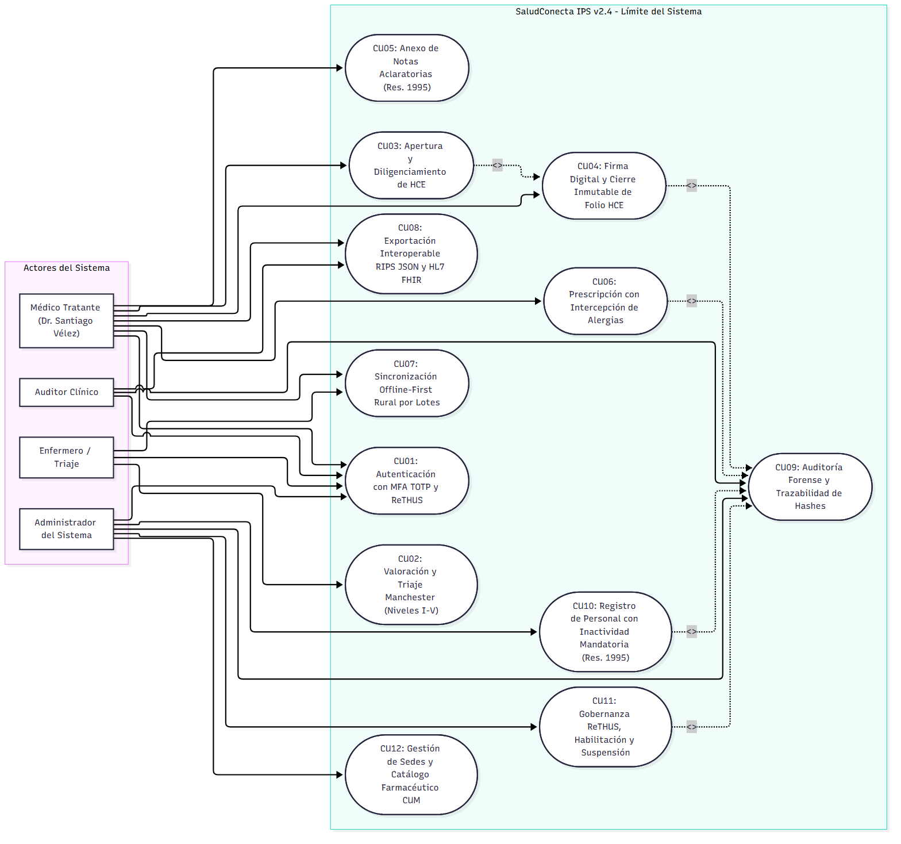

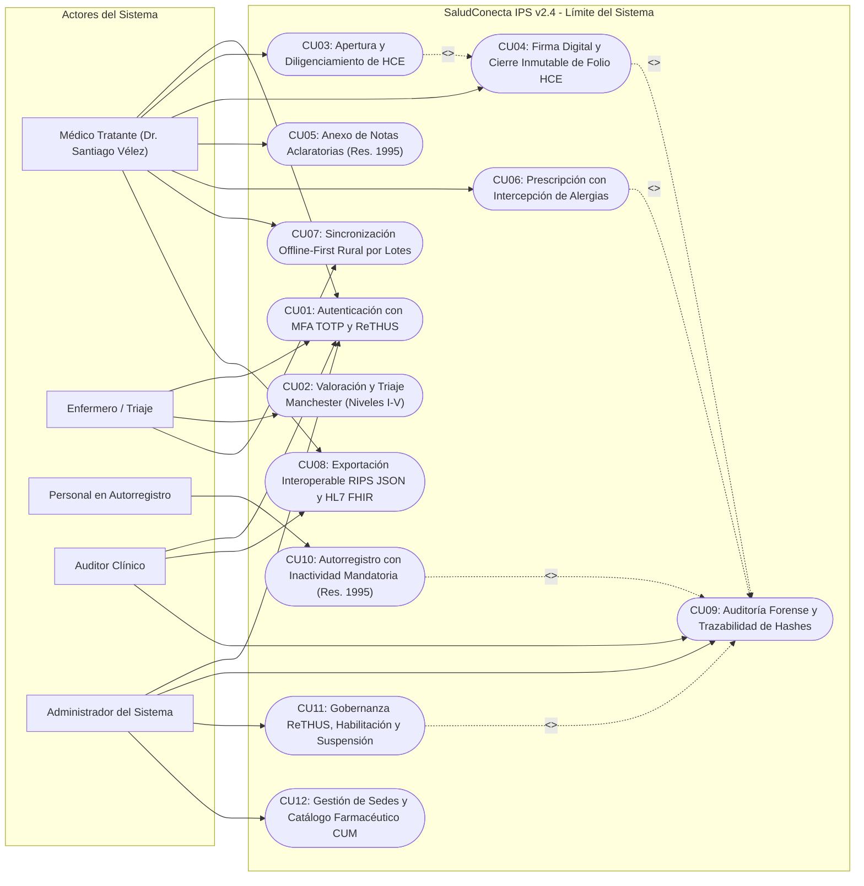

- Archivo fuente: [`docs/diagrams/01_casos_de_uso.mmd`](docs/diagrams/01_casos_de_uso.mmd)
- Imagen de alta resolución: [`docs/diagrams/01_casos_de_uso.png`](docs/diagrams/01_casos_de_uso.png) | Vectorial: [`docs/diagrams/01_casos_de_uso.svg`](docs/diagrams/01_casos_de_uso.svg)

---

### 5.2. Diagrama de Arquitectura Hexagonal y Flujo Integral (Go + React)

Ilustra la separación estricta entre la capa de presentación web (React 18 PWA y AdminLayout), los adaptadores primarios HTTP (GoFiber con AuthHandler y AdminHandler), los puertos de entrada, los servicios puros de dominio (AuthService, AdminService, ClinicalRecordService, TriageService, PrescriptionService), los puertos de salida y los adaptadores secundarios (MySQL con Seeder, PostgreSQL, Memoria, RIPS y FHIR):

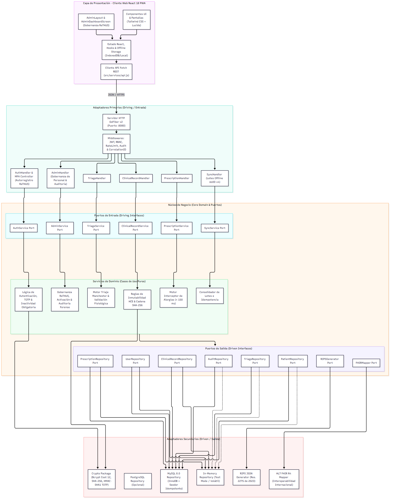

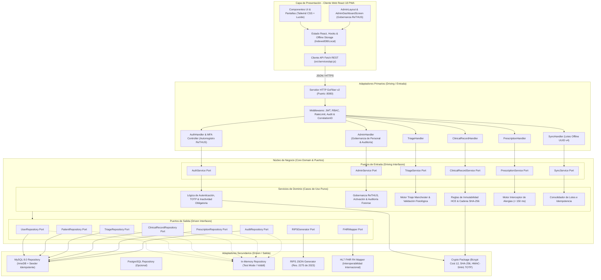

- Archivo fuente: [`docs/diagrams/02_arquitectura_hexagonal.mmd`](docs/diagrams/02_arquitectura_hexagonal.mmd)
- Imagen de alta resolución: [`docs/diagrams/02_arquitectura_hexagonal.png`](docs/diagrams/02_arquitectura_hexagonal.png) | Vectorial: [`docs/diagrams/02_arquitectura_hexagonal.svg`](docs/diagrams/02_arquitectura_hexagonal.svg)

---

### 5.3. Diagrama de Base de Datos y Modelo Entidad-Relación (ERD)

Estructura relacional implementada en MySQL 8.0 (motor InnoDB) con llaves primarias, foráneas, restricciones de integridad referencial, campos de habilitación profesional (`document_type`, `document_number`, `phone`, `specialty`, `branch`, `professional_card`, `is_active`) y disparadores de inmutabilidad:

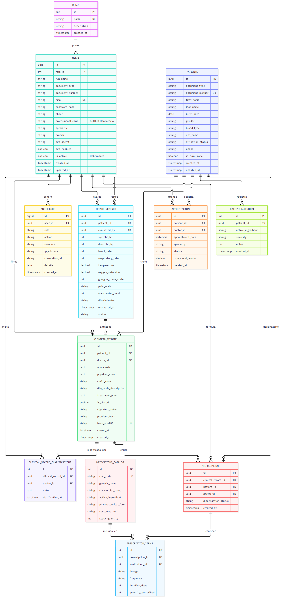

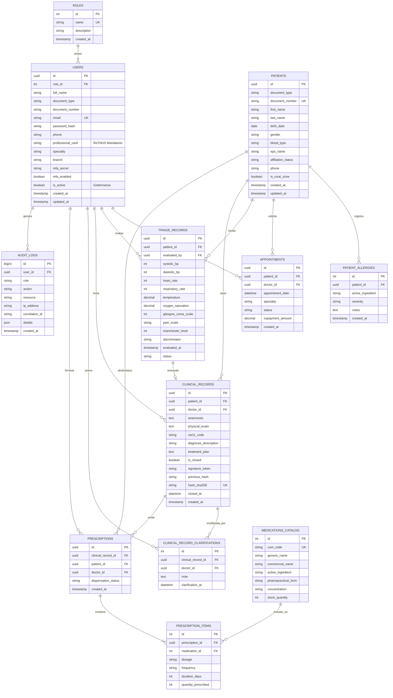

- Archivo fuente: [`docs/diagrams/03_modelo_entidad_relacion.mmd`](docs/diagrams/03_modelo_entidad_relacion.mmd)
- Imagen de alta resolución: [`docs/diagrams/03_modelo_entidad_relacion.png`](docs/diagrams/03_modelo_entidad_relacion.png) | Vectorial: [`docs/diagrams/03_modelo_entidad_relacion.svg`](docs/diagrams/03_modelo_entidad_relacion.svg)

---

### 5.4. Diagramas de Secuencia UML (Procesos Asistenciales Clave)

#### A. Triaje Manchester y Detección de Rangos Fisiológicos Inválidos

Describe la captura de constantes vitales, el análisis de valores límite y la clasificación automática según el protocolo internacional de 5 niveles:

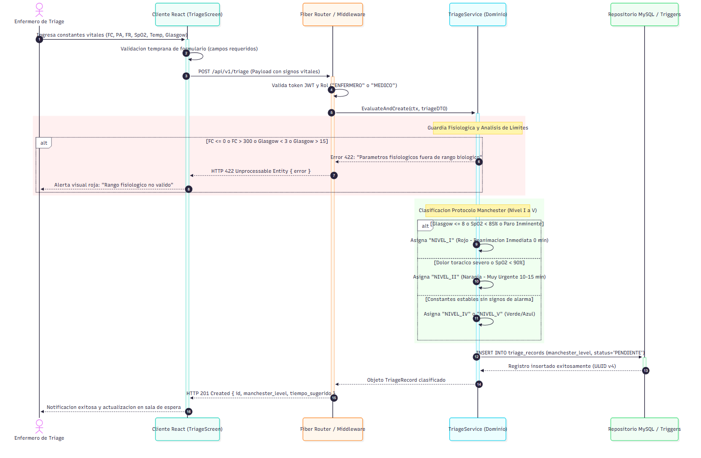

- Archivo fuente: [`docs/diagrams/04_secuencia_triaje.mmd`](docs/diagrams/04_secuencia_triaje.mmd)
- Imagen de alta resolución: [`docs/diagrams/04_secuencia_triaje.png`](docs/diagrams/04_secuencia_triaje.png) | Vectorial: [`docs/diagrams/04_secuencia_triaje.svg`](docs/diagrams/04_secuencia_triaje.svg)

#### B. Inmutabilidad de Historia Clínica, Cierre Criptográfico y Notas Aclaratorias

Detalla el cierre de folio, la generación del hash SHA-256 encadenado, el rechazo con HTTP 403 Forbidden ante intentos ilegales de mutación y el anexo normativo de notas aclaratorias según la Resolución 1995 de 1999:

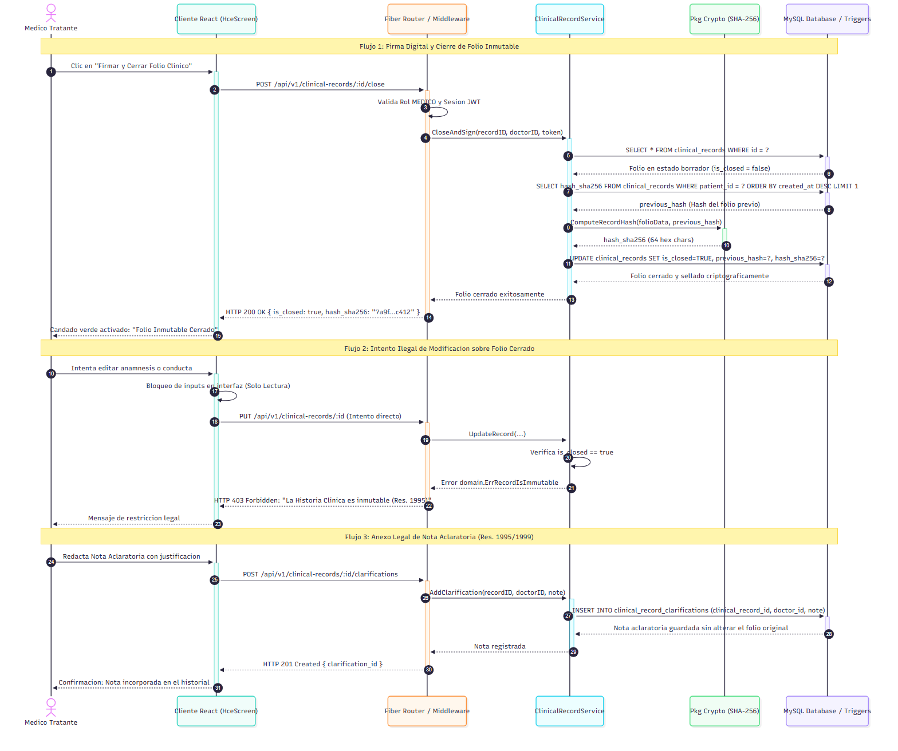

- Archivo fuente: [`docs/diagrams/05_secuencia_hce_inmutabilidad.mmd`](docs/diagrams/05_secuencia_hce_inmutabilidad.mmd)
- Imagen de alta resolución: [`docs/diagrams/05_secuencia_hce_inmutabilidad.png`](docs/diagrams/05_secuencia_hce_inmutabilidad.png) | Vectorial: [`docs/diagrams/05_secuencia_hce_inmutabilidad.svg`](docs/diagrams/05_secuencia_hce_inmutabilidad.svg)

#### C. Intercepción de Alergias Farmacológicas Cruzadas (< 150 ms)

Muestra el cruce entre medicamentos formulados del catálogo CUM y los antecedentes alérgicos del paciente, deteniendo la emisión ante riesgo de anafilaxia por Betalactámicos:

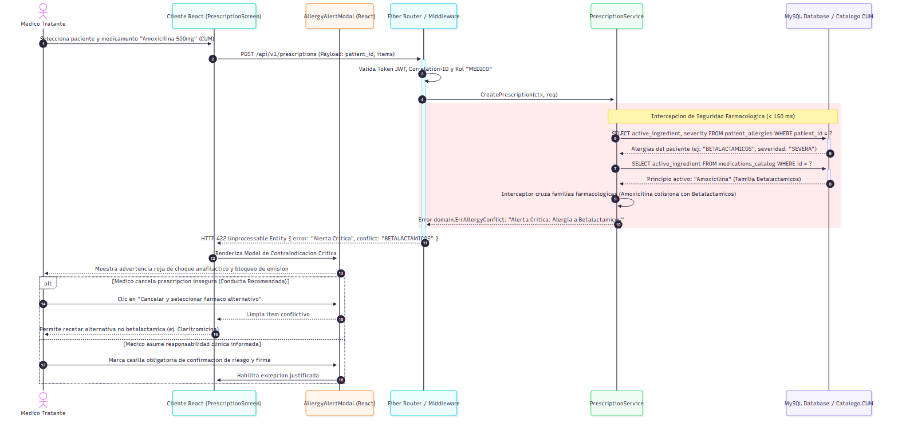

- Archivo fuente: [`docs/diagrams/06_secuencia_prescripcion_alergias.mmd`](docs/diagrams/06_secuencia_prescripcion_alergias.mmd)
- Imagen de alta resolución: [`docs/diagrams/06_secuencia_prescripcion_alergias.png`](docs/diagrams/06_secuencia_prescripcion_alergias.png) | Vectorial: [`docs/diagrams/06_secuencia_prescripcion_alergias.svg`](docs/diagrams/06_secuencia_prescripcion_alergias.svg)

---

### 5.5. Arquitectura de Seguridad, Criptografía y Control de Acceso

Modela los tres pilares de defensa institucional: Autenticación Multi-Factor (MFA TOTP RFC 6238 con QR escaneable), Control de Acceso Basado en Roles (RBAC) y Cadena Inmutable de Hashes SHA-256 con Triggers SQL:

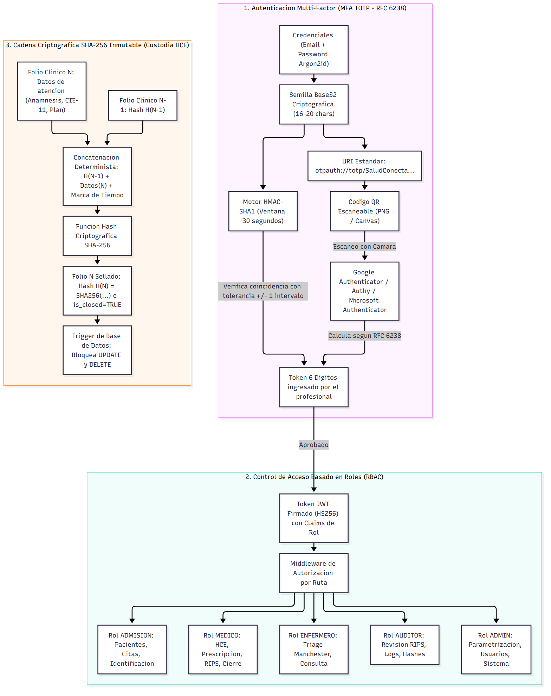

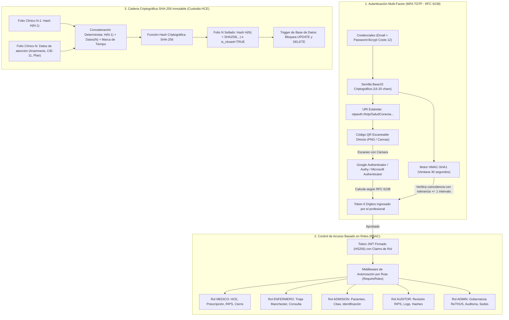

- Archivo fuente: [`docs/diagrams/07_seguridad_mfa_sha256.mmd`](docs/diagrams/07_seguridad_mfa_sha256.mmd)
- Imagen de alta resolución: [`docs/diagrams/07_seguridad_mfa_sha256.png`](docs/diagrams/07_seguridad_mfa_sha256.png) | Vectorial: [`docs/diagrams/07_seguridad_mfa_sha256.svg`](docs/diagrams/07_seguridad_mfa_sha256.svg)

---

### 5.6. Diagrama de Sincronización Offline-First para Brigadas Rurales

Describe la recolección desconectada en dispositivos asistenciales PWA, la generación de claves idempotentes UUID v4 y la consolidación por lotes en el backend central GoFiber:

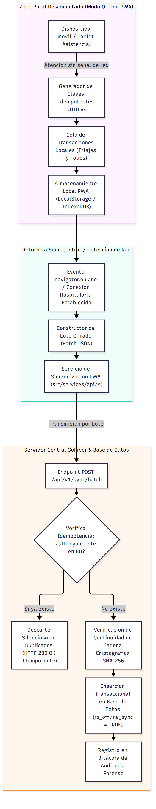

- Archivo fuente: [`docs/diagrams/08_flujo_sync_rural_offline.mmd`](docs/diagrams/08_flujo_sync_rural_offline.mmd)
- Imagen de alta resolución: [`docs/diagrams/08_flujo_sync_rural_offline.png`](docs/diagrams/08_flujo_sync_rural_offline.png) | Vectorial: [`docs/diagrams/08_flujo_sync_rural_offline.svg`](docs/diagrams/08_flujo_sync_rural_offline.svg)

---

### 5.7. Diagrama de Secuencia: Autorregistro y Gobernanza ReTHUS de Personal Asistencial

Detalla el ciclo completo de registro público de personal, imposición de inactividad obligatoria (`is_active = FALSE`), bloqueo preventivo de sesión, inspección y cotejo de habilitación ReTHUS por el Administrador TI en el `AdminLayout`, y activación formal con generación de traza de auditoría forense SHA-256 (Resolución 1995 de 1999 y Ley 1581 de 2012):

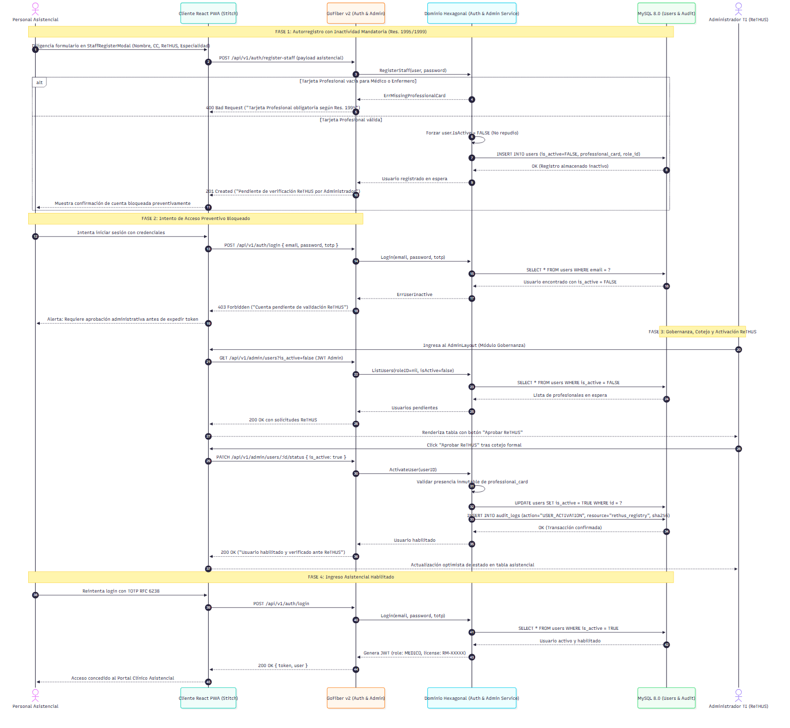

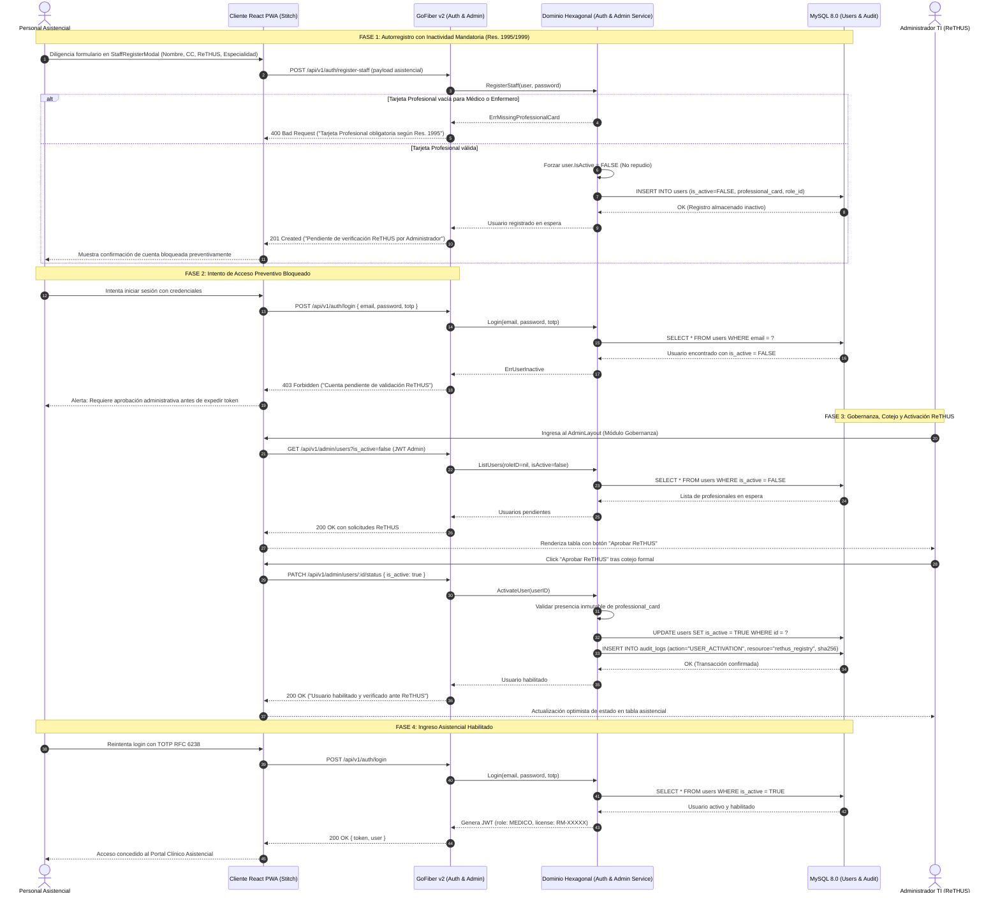

- Archivo fuente: [`docs/diagrams/09_secuencia_gobernanza_rethus.mmd`](docs/diagrams/09_secuencia_gobernanza_rethus.mmd)
- Imagen de alta resolución: [`docs/diagrams/09_secuencia_gobernanza_rethus.png`](docs/diagrams/09_secuencia_gobernanza_rethus.png) | Vectorial: [`docs/diagrams/09_secuencia_gobernanza_rethus.svg`](docs/diagrams/09_secuencia_gobernanza_rethus.svg)

---

### 5.8. Diagrama de Arquitectura: Aislamiento de Vistas RBAC y Desacoplamiento Administrativo

Ilustra la separación absoluta de interfaces por perfil según la Ley 1581 de 2012 e ISO/IEC 25010: el Administrador TI opera exclusivamente en el `AdminLayout` (sin acceso a datos clínicos de pacientes ni consulta médica), mientras que el personal asistencial opera en el entorno clínico protegido:

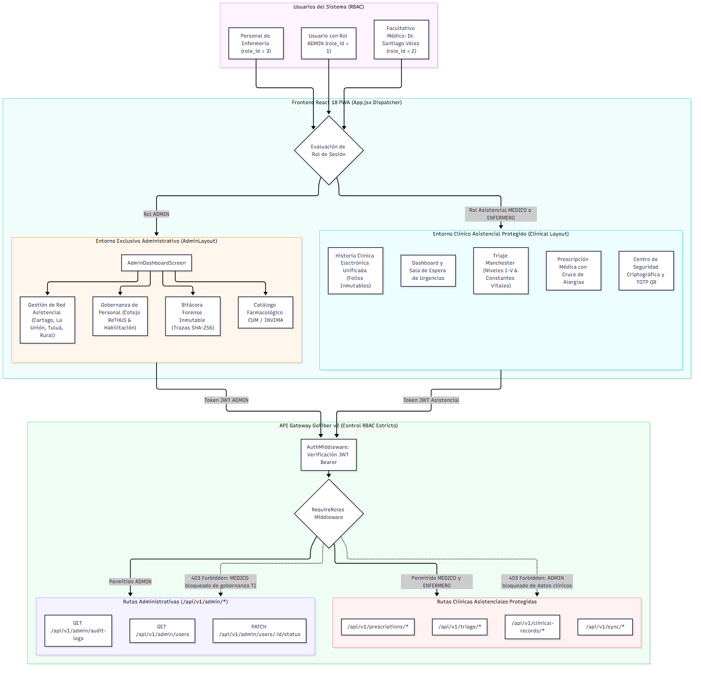

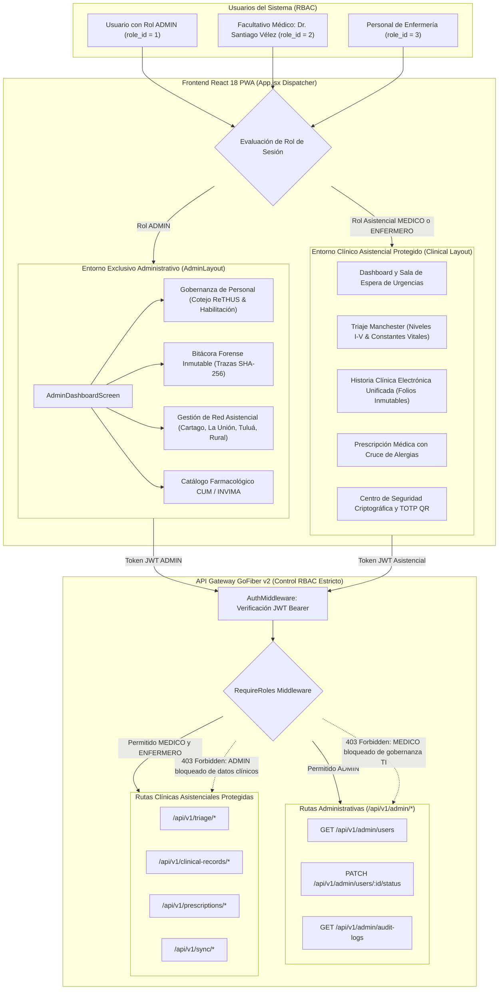

- Archivo fuente: [`docs/diagrams/10_arquitectura_rbac_aislamiento_admin.mmd`](docs/diagrams/10_arquitectura_rbac_aislamiento_admin.mmd)
- Imagen de alta resolución: [`docs/diagrams/10_arquitectura_rbac_aislamiento_admin.png`](docs/diagrams/10_arquitectura_rbac_aislamiento_admin.png) | Vectorial: [`docs/diagrams/10_arquitectura_rbac_aislamiento_admin.svg`](docs/diagrams/10_arquitectura_rbac_aislamiento_admin.svg)

---

### 5.9. Diagrama de Arquitectura de Contenedores Docker (Docker Compose Multi-Stage & Networking)

Representa la topología de virtualización ligera basada en contenedores Docker para despliegue ágil del equipo de trabajo. Modela la red puente aislada (`saludconecta_network`), los 3 contenedores multi-stage (`saludconecta-mysql`, `saludconecta-backend` en Go 1.22+ y `saludconecta-frontend` en React + Nginx Alpine), los puntos de enlace, los healthchecks nativos y el volumen persistente:

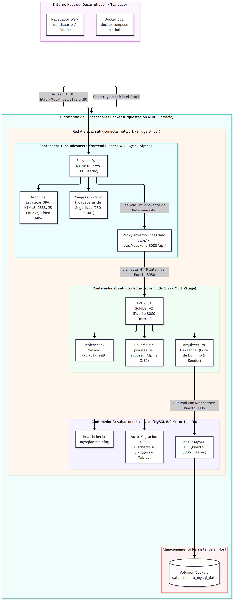

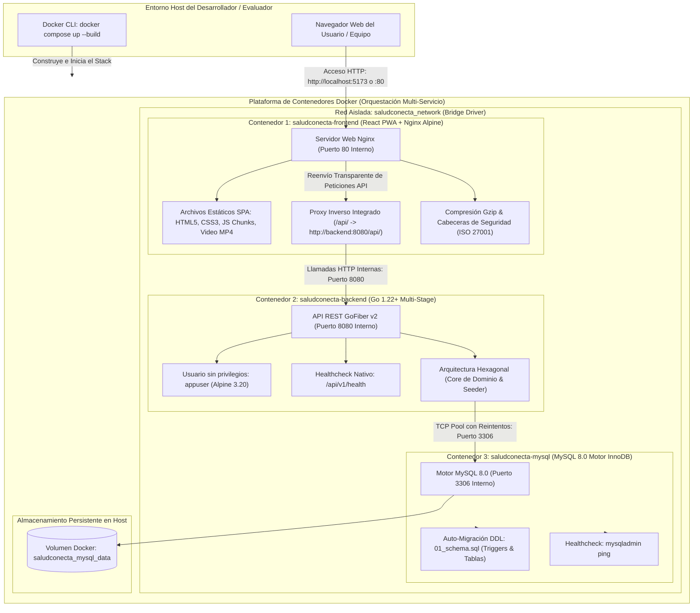

- Archivo fuente: [`docs/diagrams/11_arquitectura_contenedores_docker.mmd`](docs/diagrams/11_arquitectura_contenedores_docker.mmd)
- Imagen de alta resolución: [`docs/diagrams/11_arquitectura_contenedores_docker.png`](docs/diagrams/11_arquitectura_contenedores_docker.png) | Vectorial: [`docs/diagrams/11_arquitectura_contenedores_docker.svg`](docs/diagrams/11_arquitectura_contenedores_docker.svg)

---

### 5.10. Diagrama de Secuencia: Ciclo de Vida y Persistencia de Sesión Resistente a Recargas (F5)

Describe la gestión de ciclo de vida de la sesión del usuario médico o administrativo. Demuestra cómo el estado de autenticación y la pantalla activa persisten de forma transparente ante recargas del navegador (F5 / Refresh), manteniendo la sesión activa y aislando el cierre únicamente a la acción explícita del botón de salida:

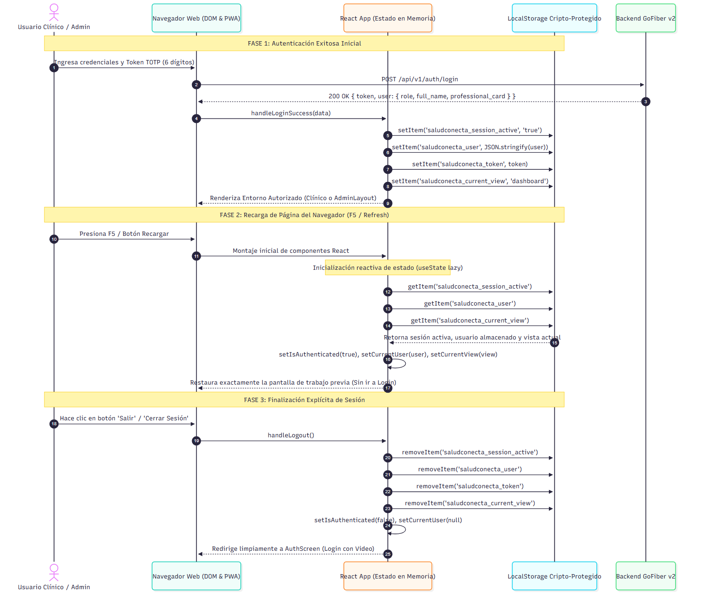

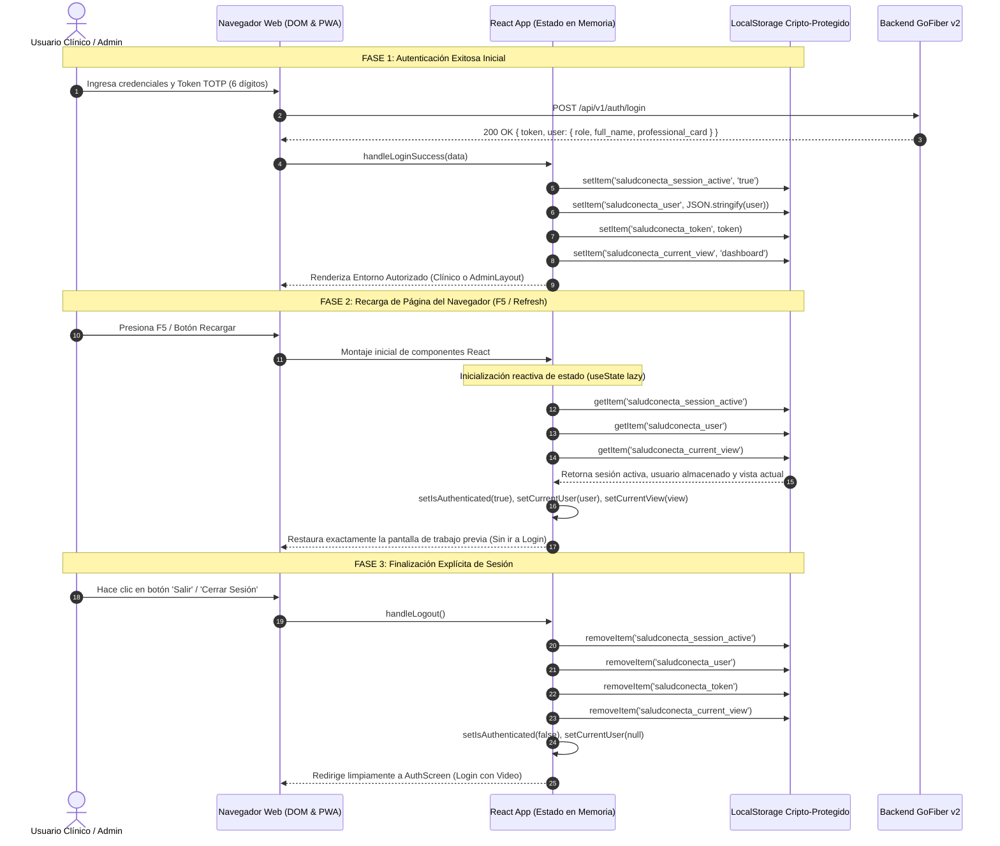

- Archivo fuente: [`docs/diagrams/12_persistencia_sesion_f5.mmd`](docs/diagrams/12_persistencia_sesion_f5.mmd)
- Imagen de alta resolución: [`docs/diagrams/12_persistencia_sesion_f5.png`](docs/diagrams/12_persistencia_sesion_f5.png) | Vectorial: [`docs/diagrams/12_persistencia_sesion_f5.svg`](docs/diagrams/12_persistencia_sesion_f5.svg)

---

## 6. Estructura Exacta del Repositorio

```text
proyecto-final/
├── README.md                      # Presentación institucional, requisitos, arquitectura y diagramas
├── docker-compose.yml             # Orquestación Multi-Contenedor (MySQL 8, Go API, React + Nginx)
├── .dockerignore                  # Reglas de exclusión para contextos de construcción Docker
├── .gitignore                     # Exclusión estricta de credenciales, binarios y artefactos temporales
├── .env.example                   # Variables de entorno plantilla con valores genéricos seguros
├── go.work                        # Workspace de Go para coordinación multi-módulo
├── docs/
│   ├── especificacion.md          # Alcance formal, RF (MoSCoW), RNF y Criterios BDD (Gherkin)
│   ├── plan-de-pruebas.md         # Partición de equivalencia, valores límite y matriz RTM
│   ├── informe-calidad.md         # ISO/IEC 25010, bitácora de defectos técnicos y refactorización
│   ├── diagrams/                  # Diagramas técnicos compilados (Mermaid, PNG 2x y SVG)
│   │   ├── 01_casos_de_uso.png (.svg / .mmd)
│   │   ├── 02_arquitectura_hexagonal.png (.svg / .mmd)
│   │   ├── 03_modelo_entidad_relacion.png (.svg / .mmd)
│   │   ├── 04_secuencia_triaje.png (.svg / .mmd)
│   │   ├── 05_secuencia_hce_inmutabilidad.png (.svg / .mmd)
│   │   ├── 06_secuencia_prescripcion_alergias.png (.svg / .mmd)
│   │   ├── 07_seguridad_mfa_sha256.png (.svg / .mmd)
│   │   ├── 08_flujo_sync_rural_offline.png (.svg / .mmd)
│   │   ├── 09_secuencia_gobernanza_rethus.png (.svg / .mmd)
│   │   ├── 10_arquitectura_rbac_aislamiento_admin.png (.svg / .mmd)
│   │   ├── 11_arquitectura_contenedores_docker.png (.svg / .mmd)
│   │   └── 12_persistencia_sesion_f5.png (.svg / .mmd)
│   ├── multimedia/                # Recursos audiovisuales institucionales
│   │   └── medicina.mp4           # Video institucional de referencia (no se usa en la aplicación)
│   └── stitch_designs/            # Maquetas visuales y capturas oficiales de Stitch
│       ├── 01_auth_mfa.html (.png)
│       ├── 02_dashboard_espera.html (.png)
│       ├── 03_historia_clinica_hce.html (.png)
│       ├── 04_triaje_manchester.html (.png)
│       └── 05_prescripcion_alergia.html (.png)
├── src/
│   ├── backend/                   # Código fuente Go + Fiber (Arquitectura Hexagonal)
│   │   ├── Dockerfile             # Multi-stage build Go 1.22+ y Alpine Linux de producción
│   │   ├── .dockerignore          # Exclusiones de contexto para build del backend
│   │   ├── cmd/api/main.go        # Punto de entrada e inyección de dependencias
│   │   ├── core/                  # Dominio puro, puertos y lógica de casos de uso
│   │   │   ├── domain/            # Entidades de negocio (User, Patient, Triage, Record, Prescription, Audit)
│   │   │   ├── ports/             # Contratos de interfaces (Driving y Driven)
│   │   │   └── services/          # Casos de uso: AuthService, AdminService, ClinicalRecordService, etc.
│   │   ├── adapters/              # Adaptadores de entrada y salida
│   │   │   ├── http/              # Handlers Fiber, DTOs y middlewares (JWT, RBAC)
│   │   │   │   ├── handlers/      # AuthHandler, AdminHandler, TriageHandler, ClinicalRecordHandler, etc.
│   │   │   │   ├── middlewares/   # Auth, RBAC, RateLimit, Audit
│   │   │   │   └── router.go      # Registro de rutas y control de acceso
│   │   │   ├── storage/           # Implementaciones MySQL, PostgreSQL y memoria
│   │   │   │   ├── mysql/         # Adaptador MySQL y Seeder institucional (seeder.go)
│   │   │   │   ├── memory/        # Adaptador en memoria con precarga institucional
│   │   │   │   └── postgres/      # Adaptador PostgreSQL compatible
│   │   │   └── interoperability/  # Generador RIPS JSON y mapeador HL7 FHIR
│   │   ├── database/schema.sql    # DDL relacional, índices y triggers SQL de inmutabilidad
│   │   ├── pkg/                   # Utilidades transversales (crypto, logger estructurado)
│   │   ├── go.mod                 # Módulo de Go del backend
│   │   └── go.sum                 # Sumas criptográficas de dependencias Go
│   └── frontend/                  # Código fuente de React 18 (Vite 5 + Tailwind CSS 3)
│       ├── Dockerfile             # Multi-stage build Node 20 + Nginx Alpine
│       ├── nginx.conf             # Servidor Nginx con proxy inverso `/api/` y SPA routing
│       ├── .dockerignore          # Exclusiones de contexto para build del frontend
│       ├── index.html             # Plantilla HTML5 accesible
│       ├── package.json           # Dependencias y scripts de ejecución/pruebas
│       ├── postcss.config.js      # Configuración de PostCSS
│       ├── tailwind.config.js     # Tokens clínicos y extensiones de diseño
│       ├── vite.config.js         # Configuración de Vite y enrutamiento de tests
│       ├── README.md              # Documentación detallada del cliente web
│       └── src/
│           ├── main.jsx           # Montaje raíz en el DOM
│           ├── App.jsx            # Enrutador asistencial/administrativo, persistencia F5 y sidebar
│           ├── index.css          # Estilos globales y capas de Tailwind
│           ├── setupTests.js      # Extensiones jest-dom para pruebas Vitest
│           ├── components/        # Componentes reutilizables
│           │   ├── Header.jsx     # Barra superior, búsqueda de pacientes, toggle menú y perfil
│           │   ├── Sidebar.jsx    # Menú asistencial colapsable (`w-20` / `w-64`) y widget SHA-256
│           │   ├── AllergyAlertModal.jsx # Modal crítico ante contraindicaciones
│           │   ├── MfaQrModal.jsx # Modal con QR escaneable en Google Authenticator/Authy
│           │   └── StaffRegisterModal.jsx # Modal de autorregistro con validación ReTHUS
│           ├── screens/           # Pantallas asistenciales (Stitch Design System)
│           │   ├── AuthScreen.jsx # Acceso, sede, video de fondo en bucle y QR directo
│           │   ├── DashboardScreen.jsx # Indicadores KPI y sala de espera Manchester
│           │   ├── TriageScreen.jsx    # Captura de constantes y escala Glasgow
│           │   ├── HceScreen.jsx  # Historia clínica, pestañas y sellado inmutable
│           │   ├── PrescriptionScreen.jsx # Prescripción e intercepción farmacológica
│           │   ├── ProfileScreen.jsx   # Perfil asistencial, 5 banners y óvalo de alto contraste
│           │   ├── SecurityMfaScreen.jsx  # Panel activo de seguridad MFA y auditoría
│           │   └── admin/         # Entorno administrativo desacoplado
│           │       ├── AdminLayout.jsx # Layout exclusivo de administración y aislamiento RBAC
│           │       └── AdminDashboardScreen.jsx # Gobernanza ReTHUS, Auditoría, Sedes y CUM
│           ├── services/
│           │   └── api.js         # Cliente API con soporte offline, gobernanza y fallback
│           └── utils/
│               └── totp.js        # Motor criptográfico TOTP RFC 6238 y generador QR
└── tests/
    ├── backend/                   # Pruebas automatizadas en Go (Triage, HCE, Alergias, Sync, Gobernanza)
    │   ├── triage_test.go         # Partición de equivalencia y valores límite Manchester
    │   ├── clinical_record_test.go# Verificación de inmutabilidad y bloqueo de edición
    │   ├── prescription_test.go   # Intercepción de alergias farmacológicas (< 150 ms)
    │   ├── sync_test.go           # Sincronización offline por lotes e idempotencia
    │   ├── admin_governance_test.go # Pruebas de autorregistro, inactividad y habilitación ReTHUS
    │   ├── fixtures_test.go       # Generadores de datos de prueba institucionales
    │   ├── go.mod                 # Módulo de pruebas de Go
    │   └── go.sum                 # Sumas criptográficas del módulo de pruebas
    └── frontend/                  # Pruebas automatizadas en React (Vitest + Testing Library)
        ├── AllergyAlertModal.test.jsx # Verificación de componente modal ante alergias
        ├── totp.test.js           # Verificación de algoritmo TOTP RFC 6238 y vector oficial
        ├── AdminGovernance.test.jsx # Verificación de modal ReTHUS y panel de gobernanza
        └── DoctorLayout.test.jsx  # Verificación de sidebar colapsable, header y perfil
```

---

## 7. Guía de Instalación y Despliegue

### 7.1. Despliegue Rápido con Docker Compose (Recomendado para el Equipo)

Para que cualquier miembro del equipo de desarrollo o evaluación pueda ejecutar la plataforma completa en su máquina sin necesidad de configurar Go, Node ni MySQL de forma manual:

1. **Requisitos:**
   - Tener instalado [Docker Desktop](https://www.docker.com/products/docker-desktop/) en ejecución.

2. **Iniciar la Plataforma Completa:**
   Desde la raíz del repositorio, ejecuta:

   ```bash
   docker compose up --build
   ```

   _Docker construirá y orquestará automáticamente tres contenedores interconectados:_
   - `saludconecta-mysql`: Base de datos MySQL 8.0 con migración DDL automática (`schema.sql`) y volumen persistente.
   - `saludconecta-backend`: API en Go 1.22+ (GoFiber v2) compilada en binario estático sobre Alpine Linux con seeder idempotente.
   - `saludconecta-frontend`: React PWA + Vite servido a través de Nginx Alpine con proxy inverso integrado hacia `/api/`.

3. **Acceso Inmediato al Sistema:**
   - Abre tu navegador web en: **[http://localhost:5173](http://localhost:5173)** (o alternativamente en `http://localhost`).
   - La API del backend estará disponible en `http://localhost:8080/api/v1/health`.

4. **Detener el Entorno:**
   ```bash
   docker compose down
   ```

---

### 7.2. Puesta en Marcha Local Tradicional (Sin Docker)

Si prefieres ejecutar los componentes de forma nativa en tu entorno de desarrollo local:

#### 7.2.1. Configuración de la Base de Datos (MySQL)

1. Conéctate a tu motor local de MySQL e importa el esquema DDL y los disparadores de auditoría:

   ```sql
   CREATE DATABASE IF NOT EXISTS saludconecta_db CHARACTER SET utf8mb4 COLLATE utf8mb4_unicode_ci;
   USE saludconecta_db;
   SOURCE src/backend/database/schema.sql;
   ```

2. Configura las variables de entorno para el backend creando el archivo `.env` en `src/backend/` tomando como base `.env.example`.

#### 7.2.2. Seeder Automático e Idempotente (`adapters/storage/mysql/seeder.go`)

Al iniciar el servidor en Go, el sistema ejecuta automáticamente la función `SeedInitialAdmin(db *sql.DB)`:
- Comprueba y crea dinámicamente las columnas de habilitación profesional en la tabla `users` (`document_type`, `document_number`, `phone`, `specialty`, `branch`).
- Siembra el Administrador inicial (`admin@saludconecta.ips.gov.co`) con contraseña cifrada mediante Bcrypt coste 12 si no existe ningún usuario con `role_id = 1`.
- Siembra al facultativo líder **Dr. Santiago Vélez** (`svelez@saludconecta.ips.gov.co`, `RM-94821-VALLE`, activo con MFA).
- Siembra un registro de prueba de personal pendiente (**Dra. Camila Yaima**, inactiva) para verificación inmediata de la gobernanza ReTHUS.

#### 7.2.3. Puesta en Marcha del Backend (Go)

Desde la terminal en la raíz del proyecto:

```powershell
cd src/backend
go run cmd/api/main.go
```

_El servicio HTTP de GoFiber iniciará escuchando en el puerto configurado (por defecto `http://localhost:8080`)._

> **Nota para pruebas en memoria:** Si deseas ejecutar el backend sin depender de MySQL activo, define la variable de entorno antes de ejecutar: `$env:DB_DRIVER="memory"; go run cmd/api/main.go`. El adaptador en memoria precarga automáticamente las cuentas del Administrador y del Dr. Santiago Vélez.

#### 7.2.4. Puesta en Marcha del Frontend (React)

```powershell
cd src/frontend
npm install
npm run dev
```

_El servidor de desarrollo Vite servirá la aplicación en `http://localhost:5173` con proxy inverso automático `/api` hacia el backend GoFiber._

---


## 8. Variables de Entorno de Muestra (`.env.example`)

Siguiendo la política de protección de infraestructura sensible (Regla 27), todas las credenciales y puertos reales se mantienen confidenciales mediante máscaras genéricas:

| Variable               | Descripción                                               | Valor de Muestra                              |
| :--------------------- | :-------------------------------------------------------- | :-------------------------------------------- |
| `PORT`                 | Puerto de escucha del servicio HTTP GoFiber               | `8080`                                        |
| `DB_DRIVER`            | Adaptador de persistencia (`mysql`, `postgres`, `memory`) | `mysql`                                       |
| `DB_HOST`              | Host del motor de base de datos relacional                | `localhost`                                   |
| `DB_PORT`              | Puerto del motor de base de datos                         | `3306`                                        |
| `DB_USER`              | Usuario de conexión con permisos DDL/DML                  | `root`                                        |
| `DB_PASSWORD`          | Clave de acceso a la base de datos                        | `secret_password`                             |
| `DB_NAME`              | Nombre de la base de datos clínica                        | `saludconecta_db`                             |
| `JWT_SECRET`           | Semilla secreta para la firma de tokens HS256             | `super_secret_seed_key`                       |
| `CORS_ALLOWED_ORIGINS` | Orígenes web autorizados para consumo de la API           | `http://localhost:5173,http://localhost:5174` |
| `ADMIN_INITIAL_EMAIL`  | Correo institucional del administrador inicial            | `admin@saludconecta.ips.gov.co`               |
| `ADMIN_INITIAL_PASSWORD`| Clave inicial para inicialización automática             | `AdminSalud2026*`                             |
| `IPS_NIT`              | NIT de la institución prestadora de salud                 | `900123456`                                   |
| `COD_PRESTADOR`        | Código de habilitación MinSalud (12 dígitos)              | `110010999901`                                |

---

## 9. Documentación Técnica Complementaria

Para consultar el detalle extendido de la ingeniería del proyecto, accede a los documentos técnicos en el directorio `docs/`:

1. [Especificación de Requisitos de Software (`docs/especificacion.md`)](docs/especificacion.md):
   - Marco regulatorio: Resolución 1995 de 1999 (HCE), Resolución 2275 de 2023 (RIPS) y Ley 1581 de 2012 (Habeas Data).
   - Requisitos Funcionales (RF01 a RF08) y No Funcionales (RNF01 a RNF05).
   - Escenarios de aceptación formales en formato BDD (Dado-Cuando-Entonces / Gherkin).

2. [Plan de Pruebas y Técnicas de Diseño (`docs/plan-de-pruebas.md`)](docs/plan-de-pruebas.md):
   - Partición de Equivalencia y Análisis de Valores Límite (Escala de Glasgow [3, 15], Frecuencia Cardíaca, Presión Arterial y Dosificación Pediátrica).
   - Matriz de Trazabilidad de Requisitos (RTM).

3. [Informe de Calidad ISO/IEC 25010 (`docs/informe-calidad.md`)](docs/informe-calidad.md):
   - Evaluación de las características esenciales de calidad de software y seguridad OWASP.
   - Bitácora de defectos técnicos registrados durante el ciclo de vida (DEF-01 a DEF-04).
   - Medidas de mantenimiento preventivo y refactorizaciones implementadas.

4. [Guía del Cliente Web y Arquitectura Frontend (`src/frontend/README.md`)](src/frontend/README.md):
   - Arquitectura React 18, Vite 5, Tailwind CSS y Lucide Icons.
   - Catálogo de pantallas basado en el diseño Stitch y soporte de operación offline.
