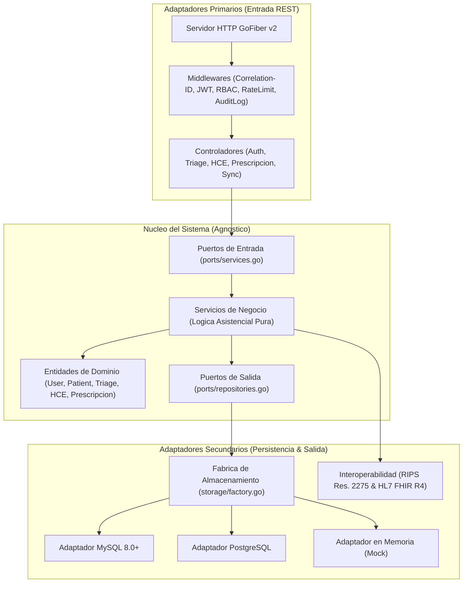

# SaludConecta IPS v2.4

Sistema clinico hospitalario de alta disponibilidad y tolerancia a fallos, disenado bajo una **Arquitectura Hexagonal Estricta (Puertos y Adaptadores / Clean Architecture)** y evaluado bajo el estandar internacional de calidad **ISO/IEC 25010** y la normatividad sanitaria colombiana (Resoluciones MinSalud 1995 de 1999 y 2275 de 2023).

---

## 1. Stack Tecnologico

- **Lenguaje:** Go (Golang) 1.22+
- **Framework Web:** GoFiber (v2) (`github.com/gofiber/fiber/v2`)
- **Motores de Persistencia Soportados (Intercambiables):**
  - **MySQL 8.0+:** Driver oficial `github.com/go-sql-driver/mysql`
  - **PostgreSQL 14+:** Driver `github.com/lib/pq`
  - **In-Memory Mock:** Adaptador volatil thread-safe para pruebas unitarias y operacion en modo desconectado
- **Frontend:** React (SPA con Vite y TypeScript, en directorio `frontend/`)
- **Seguridad Criptografica:** SHA-256 encadenado inmutable, TOTP RFC 6238 nativo, JWT HS256, Bcrypt
- **Interoperabilidad Sanitaria:** Generador RIPS JSON (Res. 2275) y Mapeador HL7 FHIR Release 4

---

## 2. Filosofia de Diseno y Arquitectura Hexagonal

El nucleo de la aplicacion (`internal/core/`) es completamente agnostico a frameworks web, drivers y motores de bases de datos:

- **Regla de Oro:** El dominio (`core/domain`) no contiene etiquetas de bases de datos (`db:`, `gorm:`, `bson:`) ni dependencias de terceros.
- **Inversion de Dependencias (DIP):** Los servicios de negocio consumen contratos de interfaz (Puertos en `core/ports`). La persistencia y el servidor web son adaptadores perifericos reemplazables.
- **Reemplazabilidad de Motor (ISO/IEC 25010):** Conmutar entre MySQL, PostgreSQL o Memoria se realiza unicamente cambiando la variable `DB_DRIVER` en el archivo `.env`, sin modificar una sola linea de la logica de negocio.



---

## 3. Jerarquia del Proyecto

```text
Proyecto_felipe/
├── backend/
│   ├── cmd/
│   │   └── api/
│   │       └── main.go                  # Punto de entrada e inyeccion de dependencias
│   ├── internal/
│   │   ├── core/
│   │   │   ├── domain/                  # Entidades y tipos de dominio puros (sin tags)
│   │   │   │   ├── user.go              # Usuarios, credenciales y roles RBAC
│   │   │   │   ├── patient.go           # Pacientes y catalogo de alergias
│   │   │   │   ├── triage.go            # Signos vitales y clasificacion Manchester
│   │   │   │   ├── clinical_record.go   # Folios HCE e inmutabilidad criptografica
│   │   │   │   ├── prescription.go      # Medicamentos CUM y cruce de contraindicaciones
│   │   │   │   └── audit.go             # Trazas forenses y transacciones RIPS
│   │   │   ├── ports/                   # Contratos de interfaz (Puertos)
│   │   │   │   ├── repositories.go      # Contratos de acceso a datos
│   │   │   │   └── services.go          # Contratos de casos de uso e interoperabilidad
│   │   │   └── services/                # Reglas de negocio asistenciales puras
│   │   │       ├── auth_service.go      # Autenticacion, control de roles y MFA
│   │   │       ├── triage_service.go    # Priorizacion segun constantes vitales
│   │   │       ├── clinical_record_service.go # Sellado criptografico y cadena SHA-256
│   │   │       ├── prescription_service.go    # Validacion de alergias y stock
│   │   │       └── sync_service.go      # Sincronizacion por lotes para zonas rurales
│   │   └── adapters/
│   │       ├── http/                    # Adaptador Primario (Entrada REST Fiber)
│   │       │   ├── server.go            # Configuracion y apagado elegante
│   │       │   ├── router.go            # Definicion de endpoints y politicas RBAC
│   │       │   ├── middlewares/         # Correlation-ID, JWT, RBAC, RateLimit, Audit
│   │       │   └── handlers/            # Parseo de peticiones y llamada a servicios
│   │       ├── storage/                 # Adaptadores Secundarios de Persistencia
│   │       │   ├── factory.go           # Resolutor dinamico de motor de base de datos
│   │       │   ├── mysql/               # Implementacion nativa MySQL 8.0+
│   │       │   ├── postgres/            # Implementacion nativa PostgreSQL
│   │       │   └── memory/              # Implementacion thread-safe en RAM
│   │       └── interoperability/        # Adaptador Normativo Nacional
│   │           ├── rips_generator.go    # Generador JSON segun Res. 2275 de 2023
│   │           └── fhir_mapper.go       # Transformador a HL7 FHIR Release 4
│   ├── pkg/
│   │   ├── crypto/                      # SHA-256 encadenado, JWT y TOTP RFC 6238
│   │   └── logger/                      # Logger estructurado JSON con Correlation-ID
│   ├── database/
│   │   └── schema.sql                   # DDL relacional, indices y triggers de seguridad
│   ├── .env.example                     # Plantilla de variables de entorno del backend
│   ├── go.mod                           # Modulo Go principal
│   └── go.sum
├── frontend/                            # Aplicacion cliente SPA (React + TypeScript)
│   └── README.md
├── docs/                                # Diagramas arquitectonicos compilados
│   ├── architecture.mmd
│   ├── architecture.png
│   └── architecture.svg
├── .env.example                         # Plantilla transversal de variables de entorno
└── README.md                            # Documentacion global del sistema
```

---

## 4. Modulos Funcionales Asistenciales

### 4.1. Triaje Manchester
Clasificacion de pacientes de urgencias segun discriminadores vitales de alerta temprana (Escala Glasgow, SaO2, Presion Arterial Sistolica/Diastolica, Frecuencia Cardiaca y Temperatura):
- **Nivel I (Rojo):** Resucitacion / Inmediato
- **Nivel II (Naranja):** Muy urgente (10-15 minutos)
- **Nivel III (Amarillo):** Urgente (hasta 60 minutos)
- **Nivel IV (Verde):** Estandar / Menos urgente (hasta 120 minutos)
- **Nivel V (Azul):** No urgente (hasta 240 minutos)

### 4.2. Historia Clinica Electronica (HCE) e Inmutabilidad (Res. 1995)
- **Cadena Criptografica:** Cada folio cerrado calcula un hash SHA-256 encadenado que incorpora el hash del folio previo del paciente, garantizando trazabilidad y no repudio.
- **Sellado a Nivel de Motor:** El script DDL [schema.sql](file:///c:/Users/santi/Desktop/Proyecto_felipe/backend/database/schema.sql) implementa triggers (`trg_prevent_update_closed_record` y `trg_prevent_delete_clinical_record`) que bloquean modificaciones o borrado fisico sobre folios cerrados.
- **Notas Aclaratorias:** Mecanismo legal exclusivo para anexar precisiones a registros cerrados sin alterar el contenido original.

### 4.3. Prescripcion Farmacologica y Cruce de Alergias
Validacion en tiempo real que cruza el principio activo del catalogo CUM del medicamento prescrito contra el registro de hipersensibilidades conocidas del paciente. En caso de conflicto, la API rechaza la emision con codigo HTTP `422 Unprocessable Entity` y el detalle de la severidad alergica.

### 4.4. Sincronizacion Offline Rural
Mecanismo para brigadas medicas en zonas sin conectividad. Procesa lotes (`batch_id`) de folios registrados en dispositivos de campo, manteniendo la validez del sellado criptografico.

### 4.5. Interoperabilidad Normativa
- **RIPS JSON:** Generacion de la estructura obligatoria segun la Resolucion 2275 de 2023 de MinSalud (datos del obligado, usuario, consultas, codigos CUPS y diagnosticos CIE-11).
- **HL7 FHIR R4:** Mapeo de atenciones medicas a un recurso contenedor `Bundle` de tipo `document` con recursos integrados `Patient`, `Encounter`, `Condition` y `MedicationRequest`.

---

## 5. Matriz de Endpoints de la API REST (`/api/v1`)

| Metodo | Endpoint | Roles Permitidos | Descripcion |
| :--- | :--- | :--- | :--- |
| `GET` | `/health` | Publico | Verificacion de estado operativo y estandar ISO |
| `POST` | `/auth/login` | Publico | Inicio de sesion (retorna JWT y valida TOTP si aplica) |
| `POST` | `/auth/register` | Publico / Admin | Registro de profesionales y personal administrativo |
| `POST` | `/auth/mfa/setup` | Autenticado | Generacion de semilla secreta TOTP en Base32 |
| `POST` | `/auth/mfa/enable` | Autenticado | Activacion definitiva de autenticacion multifactor |
| `POST` | `/triage` | ENFERMERO, MEDICO, ADMIN | Registro y clasificacion Manchester de paciente |
| `GET` | `/triage` | Autenticado | Consulta de cola de urgencias ordenada por severidad |
| `GET` | `/triage/:id` | Autenticado | Consulta de signos vitales de un triaje especifico |
| `PATCH`| `/triage/:id/status` | ENFERMERO, MEDICO, ADMIN | Cambio de estado de atencion (`PENDIENTE`, `EN_ATENCION`, `FINALIZADO`) |
| `POST` | `/clinical-records` | MEDICO, ADMIN | Apertura de borrador de historia clinica |
| `POST` | `/clinical-records/:id/close` | MEDICO, ADMIN | Firma digital y sellado criptografico inmutable |
| `POST` | `/clinical-records/:id/clarifications` | MEDICO, ADMIN | Registro de nota aclaratoria legal sobre folio cerrado |
| `GET` | `/clinical-records/:id` | Autenticado | Consulta completa de folio con sus notas aclaratorias |
| `GET` | `/clinical-records/patient/:patient_id` | Autenticado | Historial cronologico de folios de un paciente |
| `GET` | `/clinical-records/:id/verify` | Autenticado | Verificacion matematica de integridad de la cadena SHA-256 |
| `GET` | `/clinical-records/:id/rips` | MEDICO, AUDITOR, ADMIN | Exportacion del folio a JSON normativo MinSalud (Res. 2275) |
| `GET` | `/clinical-records/:id/fhir` | MEDICO, AUDITOR, ADMIN | Exportacion a HL7 FHIR Release 4 Bundle |
| `POST` | `/prescriptions` | MEDICO, ADMIN | Emision de receta con cruce obligatorio de alergias |
| `GET` | `/prescriptions/:id` | Autenticado | Detalle de prescripcion medica y posologia |
| `GET` | `/prescriptions/record/:record_id` | Autenticado | Prescripcion vinculada a un folio clinico especifico |
| `POST` | `/sync/batch` | MEDICO, ADMIN | Sincronizacion de lote clinico capturado en campo sin conexion |

---

## 6. Variables de Entorno

Configuracion transversal disponible en `.env.example`:

| Variable | Descripcion | Opciones / Ejemplo |
| :--- | :--- | :--- |
| `PORT` | Puerto de escucha HTTP | `8080` |
| `DB_DRIVER` | Motor de base de datos a instanciar | `mysql`, `postgres`, `memory` |
| `DB_HOST` | Host del servidor de base de datos | `127.0.0.1` |
| `DB_PORT` | Puerto del motor de base de datos | `3306` (MySQL) / `5432` (PostgreSQL) |
| `DB_USER` | Usuario con privilegios de lectura/escritura | `root` / `postgres` |
| `DB_PASSWORD` | Contrasena de conexion | *(vacia en dev o configurada)* |
| `DB_NAME` | Nombre de la base de datos | `saludconecta_db` |
| `JWT_SECRET` | Clave secreta para firma HMAC de tokens de sesion | Cadena de alta entropia |
| `CORS_ALLOWED_ORIGINS` | Origenes habilitados para navegadores web | `http://localhost:5173,http://localhost:3000` |
| `IPS_NIT` | Identificacion tributaria de la IPS para RIPS | `900123456` |
| `COD_PRESTADOR` | Codigo de habilitacion REPS ante el Ministerio | `110010999901` |
| `VITE_API_BASE_URL` | Endpoint consumido por la SPA cliente | `http://localhost:8080/api/v1` |

---

## 7. Puesta en Marcha

### 7.1. Opcion A: Ejecucion Inmediata en Memoria (Zero-Database Setup)
Ideal para pruebas de endpoints y verificacion rapida sin necesidad de un motor de base de datos activo:

```powershell
cd backend
$env:DB_DRIVER="memory"
go run cmd/api/main.go
```

### 7.2. Opcion B: Ejecucion con MySQL 8.0+
1. Crear la base de datos e importar la estructura relacional DDL (sin datos quemados):
   ```sql
   CREATE DATABASE saludconecta_db CHARACTER SET utf8mb4 COLLATE utf8mb4_unicode_ci;
   USE saludconecta_db;
   SOURCE backend/database/schema.sql;
   ```
2. Configurar variables en `backend/.env`:
   ```env
   DB_DRIVER=mysql
   DB_HOST=127.0.0.1
   DB_PORT=3306
   DB_USER=root
   DB_PASSWORD=
   DB_NAME=saludconecta_db
   ```
3. Iniciar el servidor:
   ```powershell
   cd backend
   go run cmd/api/main.go
   ```

### 7.3. Opcion C: Ejecucion con PostgreSQL
1. Configurar variables en `backend/.env`:
   ```env
   DB_DRIVER=postgres
   DB_HOST=127.0.0.1
   DB_PORT=5432
   DB_USER=postgres
   DB_PASSWORD=tu_password
   DB_NAME=saludconecta_db
   ```
2. Iniciar el servidor:
   ```powershell
   cd backend
   go run cmd/api/main.go
   ```

---

## 8. Verificacion de Calidad y Pruebas Unitarias

Para ejecutar el banco de pruebas de integridad criptografica, calculo de discriminadores de triaje y seguridad:

```powershell
cd backend
go test -v ./...
go vet ./...
```
